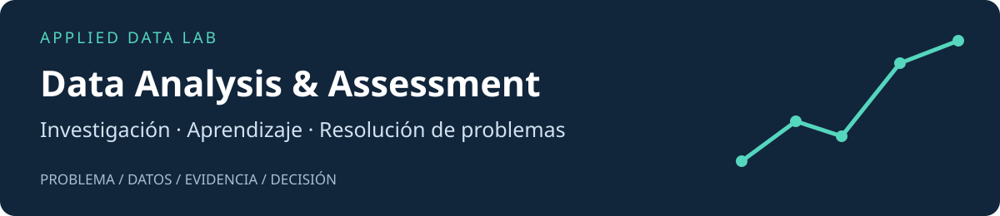
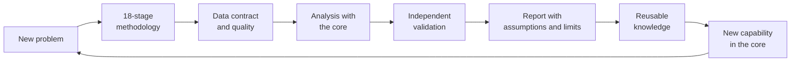

# Applied Data Analysis and Assessment Lab



[](https://github.com/vladimiracunadev-create/applied-data-analysis-and-assessment-lab/actions/workflows/ci.yml)


A professional, domain-agnostic and evolving laboratory for **solving data problems,
running applied research, experimenting and preparing for technical assessments** in
any sector.

Guiding principle: **solve today's problems and turn the resulting knowledge into
reusable capabilities for tomorrow's.**

🇪🇸 [Versión en español](README.md) — the primary documentation is in Spanish; this
page is a complete overview in English.

---

## Navigation

| | |
| --- | --- |
| **Start** | [Quick start](#quick-start) · [Architecture](docs/arquitectura.md) · [Manual (ES)](docs/manual.md) |
| **Learn** | [Learning programme](docs/programa.md) · [Professional profiles](docs/perfiles.md) · [SQL/Pandas/Excel/R equivalences](docs/equivalencias.md) |
| **Solve** | [Case catalogue](docs/catalogo-casos.md) · [18-stage methodology](docs/metodologia.md) · [Research method](docs/research-method.md) |
| **Assess** | [Four-hour simulations](simulations/) · [Transport case](cases/transport/README.md) · [Verified public sources](docs/dtpm-antecedentes.md) |
| **Reference** | [Knowledge base](docs/conocimiento.md) · [Data dictionary](docs/diccionario.md) · [Agent contracts](docs/agentes.md) |
| **Governance** | [Roadmap](docs/roadmap.md) · [Changelog](CHANGELOG.md) · [Contributing](CONTRIBUTING.md) · [Security](SECURITY.md) |

---

## What this is



Three parts that never blend into each other:

- **A domain-agnostic core** (`lab/`, 17 modules): data contracts, indicators, dates,
  statistical inference, a SQL bridge, auditable Excel workbooks, reports, the
  methodology and the knowledge base. It knows nothing about any industry.
- **Independent case studies** (`cases/`) that solve real sector problems and never
  import from one another.
- **An assessment lab** (`assessments/`) that generates reproducible, rubric-scored
  simulations for preparing for any technical selection process.

Every solved problem leaves a record in the knowledge base, and when something new is
needed, the core grows together with its automated test.

---

## Quick start

```powershell
uv sync
```

```powershell
uv run python scripts/generate_data.py
```

```powershell
uv run python -m pytest
```

Then try:

```powershell
uv run python solutions/reference.py 1
```

```powershell
uv run python scripts/build_excel_solutions.py
```

```powershell
uv run python -m lab.knowledge "zero denominator"
```

---

## Why the cross-validation matters

`solutions/reference.py` (pandas) and `solutions/sql_reference.py` (SQL over the same
CSVs loaded as **text**, doing its own casting, joining and aggregation) solve the same
problem without sharing a single line of code. The test suite confronts them indicator
by indicator with a 10⁻⁹ tolerance.

That confrontation **found a real defect**: durations computed with SQLite's
`julianday` differed in the seventh decimal place, which flipped the
`duration ≤ target` comparison exactly on ties and moved on-time performance by several
percentage points, while the mean agreed to the eighth decimal. With a single
implementation the number would have looked perfectly plausible. Written up in
[`knowledge/julianday-precision.md`](knowledge/julianday-precision.md).

This is the laboratory's stance in one example: a result is not validated because it
runs, but because a second, independent implementation agrees with it.

---

## The core

| Module | Purpose |
| --- | --- |
`lab.method` | The 18-stage methodology as an auditable object: a stage cannot be completed without evidence
`lab.contracts` | Data contracts: types, domains, keys, and a severity for every finding
`lab.core` | Reading, quality profiling and audited joins with cardinality checks
`lab.dates` | Dates, durations and time bands, reporting what could not be parsed
`lab.metrics` | Safe ratios, percentiles with a declared method, weighted rate vs. simple average
`lab.stats` | Confidence intervals, Welch, Pearson and chi-square **without SciPy**, validated against published tables
`lab.sqlbridge` | Running real SQL over DataFrames for independent validation
`lab.excel` | Workbooks with live formulas, units, and inputs / calculations / results kept apart
`lab.viz` | Charts that require a title, unit, period, source and an honest scale
`lab.report` | Reports that refuse to export while a mandatory section is missing
`lab.catalog` | The real state of each case: 26 required metadata fields
`lab.knowledge` | Knowledge base with TF-IDF search — no models, no network
`lab.learning` | Validator for the teaching standard: 17 sections per lesson
`lab.assessment` | Assessment engine: blueprints, reproducible generation, rubrics
`lab.agents` | 20 contracts for specialised capabilities, plus a harness that verifies them
`lab.profiles` | 11 professional profiles with their real coverage measured
`lab.console` | UTF-8 output that stays readable on Windows consoles

---

## Cases and assessments

| Case | Industry | Difficulty | Time | Competencies |
| --- | --- | --- | --- | --- |
| [`transport`](cases/transport/README.md) | Transport | advanced | 240 min | 12 |
| [`retail`](cases/retail/README.md) | Retail | intermediate | 90 min | 6 |
| [`education`](cases/education/README.md) | Education | introductory | 90 min | 6 |

The [full catalogue](docs/catalogo-casos.md) is generated from metadata and flags
incomplete cases rather than hiding them.

Generate a fresh, reproducible simulation:

```powershell
uv run python scripts/build_assessment.py --blueprint gestor-datos-transporte --seed 1
```

> Simulations are the laboratory's own **training material**. They are not official
> tests from any institution and do not reproduce real selection instruments. Each
> process sets its own rules about AI assistants; this repository does not authorise
> their use during an assessment.

---

## Learning programme

**8 published lessons** across 6 blocks. Every lesson carries the 17 required
sections: objectives, prerequisites, plain and formal definitions, fundamentals,
formulas with variables and units, progressive examples, professional applications,
commented code, exercises, worked solutions, common mistakes, validation criteria,
assessment questions, verifiable references and a glossary.

```powershell
uv run python -m lab.learning
```

The validator keeps the standard alive: a lesson missing one section fails the suite.

---

## Quality and validation

```powershell
uv run python -m pytest
```

Beyond the calculations, the suite protects: cross-technology validation (pandas vs.
SQL), statistics checked against published values, median and P90 checked against a
pure-Python implementation, Excel workbook structure, the 17-section teaching
standard, the 26 metadata fields per case, the agent harness, and repository coherence
(single version, live relative links, a core free of domain dependencies, generated
docs in sync, no secrets).

### What the suite does **not** cover

The tests verify that Excel formulas exist, are formulas, and reference the right
ranges; they do **not** evaluate their numeric result, because that requires Excel or
LibreOffice, which are not available in CI. Each workbook's `30_control` sheet performs
that check when opened, and numeric agreement between implementations is covered by the
pandas ↔ SQL validation, which does run. This distinction is stated in
[`docs/roadmap.md`](docs/roadmap.md).

After changing code, regenerate the derived documentation:

```powershell
uv run python scripts/build_docs.py
```

---

## Technology stack

**Minimal environment** (seven packages): Python, pandas, NumPy, openpyxl, XlsxWriter,
Matplotlib, JupyterLab and pytest. Nothing else is required.

**Integrated with no new dependencies:** SQL through the standard library's `sqlite3`,
and statistical inference implemented in `lab.stats`.

**Optional, detected at runtime:** DuckDB.

**On the roadmap, not implemented:** Polars, R/RStudio, Power BI, Tableau, Metabase,
GeoPandas, QGIS, Arrow/Parquet, SciPy, Statsmodels, scikit-learn, Docker, n8n, vector
stores and semantic search. The [roadmap](docs/roadmap.md) strictly separates what
exists from what is planned, and lists every measured gap.

---

## Data and privacy

All data here is **synthetic and generated from a fixed seed**; it describes no real
system. Public sources that were actually opened and read are cited with their
consultation date in [`docs/dtpm-antecedentes.md`](docs/dtpm-antecedentes.md), with
verified facts separated from pending ones.

Do not publish personal data, credentials or third-party material. Read
[`SECURITY.md`](SECURITY.md) before adding any dataset.

---

## Licence

[MIT](LICENSE). Code and documentation are reusable; any third-party data a future case
incorporates keeps its own licence, declared in the corresponding `case.json`.
