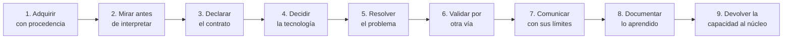

# Applied Data Analysis and Assessment Lab


[](https://github.com/vladimiracunadev-create/applied-data-analysis-and-assessment-lab/actions/workflows/ci.yml)


---

## El problema que resuelve

Te entregan datos que no generaste y una pregunta que hay que contestar bien.

Entonces descubres que el encabezado del Excel no está en la primera fila, que la
columna «código» se repite, que la hora `25:10:00` no la acepta ninguna librería, que
el cruce te cambió el total sin avisar, y que el indicador que te piden tiene siete
reglas de exclusión escondidas en una nota al pie.

**Este repositorio es el método para hacer ese trabajo bien, probado contra datos
públicos reales.** No es un curso ni una colección de ejercicios: es un recorrido de
nueve etapas, un núcleo de código reutilizable y nueve casos resueltos que documentan
qué tecnología se usó, por qué, y qué trampa tenía cada dato.

### Si vienes a aprender a hacerlo: los cuadernos de trabajo

Un caso tiene dos documentos y sirven para cosas distintas:

| Documento | Qué es | Cuándo sirve |
| --- | --- | --- |
| **`CUADERNO.md`** | el problema resuelto **paso a paso**: el código de Pandas, **la salida que devuelve de verdad**, la fórmula de Excel equivalente, y la trampa de cada paso | cuando quieres **aprender a producir** el resultado |
| `README.md` | qué se encontró, con las cifras y lo que no se puede concluir | cuando quieres **auditar** el resultado |

El cuaderno se lee de arriba abajo y no hay que abrir nada más. Y no se escribe a mano:
se **genera ejecutando el caso**, de modo que el código que aparece es el que corrió y la
salida es la que devolvió. Si el código deja de funcionar, el cuaderno no se genera.

| Cuaderno | Pasos | Qué se practica en Excel |
| --- | --- | --- |
| [P01 · Consolidar cinco Excel heterogéneos](cases/bip_lugares_carga/CUADERNO.md) | 12 | `CONTAR.SI` para medir si una columna es clave, `CONTAR.SI` con `"?*"` para la cobertura de un campo, `FRECUENCIA` para el histograma, haversine en una celda, y Power Query para anexar los cinco archivos |

El Excel de cada paso va **dibujado como hoja**: la barra de fórmulas con su celda, las
letras de columna, la columna donde va la fórmula resaltada, y el resultado en su sitio.
Una fórmula en prosa no dice dónde va ni sobre qué rango opera.

Y cada cuaderno trae sus descargables al lado:

| Archivo | Qué es |
| --- | --- |
| [`cuaderno/pasos.py`](cases/bip_lugares_carga/cuaderno/pasos.py) | los pasos seguidos. Se corre y **muestra las doce salidas** |
| [`cuaderno/practica.xlsx`](cases/bip_lugares_carga/cuaderno/practica.xlsx) | las fórmulas como texto y **el resultado que deben dar**, para corregirse solo |
| [`cuaderno/svg/`](cases/bip_lugares_carga/cuaderno/svg) | las nueve figuras: siete hojas de Excel y dos gráficos |

El libro de práctica **no trae los datos**: los archivos del portal son NoComercial y el
repositorio no los redistribuye. Se pega el consolidado que uno obtuvo, que además es
parte del ejercicio.

Los otros quince cuadernos están **pendientes**: nueve corresponden a problemas ya
resueltos y necesitan solo el cuaderno; seis —P07, P12 a P16— no están resueltos, de modo
que ahí el cuaderno y el análisis son el mismo trabajo. El estado real de cada uno está en
el [mapa de problemas](docs/problemas-de-la-instancia.md).

```powershell
python scripts/build_cuadernos.py          # regenera los cuadernos declarados
```

---

### Por dónde entrar

| Si necesitas… | Empieza por |
| --- | --- |
| **Prepararte para una evaluación técnica** de datos con Excel y Pandas | [Cuaderno de P01](cases/bip_lugares_carga/CUADERNO.md), y el [mapa de problemas](docs/problemas-de-la-instancia.md) para el resto |
| **Resolver un problema de datos** de tu trabajo | [El recorrido de nueve etapas](docs/instancias.md) |
| **Aprender** con material que explica el por qué | [Programa de aprendizaje](docs/programa.md) — 8 clases con 17 secciones cada una |
| **Reproducir un indicador oficial** | [Indicadores oficiales del transporte](docs/indicadores-oficiales-transporte.md) |
| **Agregar tu propio caso** en otro dominio | [Cómo agregar una instancia](docs/instancias.md) |

---

## Lo que ya está resuelto, y qué encontró cada caso

Nueve casos: seis con **datos públicos reales** y tres con datos sintéticos de semilla
fija. Lo que importa no es el tema de cada uno, es la clase de problema que enseña a
detectar.

| Caso | Datos | La pregunta | Lo que encontró |
| --- | --- | --- | --- |
| [`bip_lugares_carga`](cases/bip_lugares_carga/README.md) | **reales**, licencia verificada | ¿Cuántos lugares de carga hay, y qué identifica a cada uno? | El encabezado en **5 filas distintas**; **ninguna columna identifica una fila**, ni `fuente + codigo`; y la validación cruzada de coordenadas destapó **3 errores de hasta 10,3 km** |
| [`calendario_medicion`](cases/calendario_medicion/README.md) | **reales**, metodología oficial | ¿Qué días entran en la medición de un indicador oficial? | De 261 días laborales quedan **78 medibles**, y **4 de las 8 reglas oficiales no cambian el denominador** |
| [`gtfs_red_movilidad`](cases/gtfs_red_movilidad/README.md) | **reales**, 1,1 M de filas | ¿Cuántas expediciones salen por hora? | El **77,5 %** de la tabla de horarios **no contiene horas**, y el conteo ingenuo se equivoca en **−87,65 %** |
| [`cobertura_de_carga`](cases/cobertura_de_carga/README.md) | **reales**, dos fuentes sin clave común | ¿A qué distancia está el lugar de carga más cercano de cada parada? | **59,29 %** de las paradas lo tiene a 300 m en línea recta y **46,02 %** con un rodeo de 1,3: las decisiones del método mueven la respuesta **entre 39 % y 81 %** |
| [`carga_nocturna`](cases/carga_nocturna/README.md) | **reales**, espacio y tiempo a la vez | ¿Donde hay buses de madrugada, hay dónde cargar? | **Ninguno** de los 1 927 locales declara abrir de madrugada, y para el **52,6 %** de las paradas nocturnas la pregunta **no se puede contestar**: la respuesta es el intervalo 0 %–52,6 % |
| [`correspondencia_metro`](cases/correspondencia_metro/README.md) | **reales**, dos inventarios de lo mismo | ¿Qué estaciones de Metro tienen bus cerca? | Las 126 lo tienen, pero **11 estaciones están hasta 13 km mal ubicadas** en el otro archivo y **la validación interna de P01 no vio ninguna** |
| [`transport`](cases/transport/README.md) | sintéticos | Indicadores operacionales con exclusiones declaradas | La validación Pandas ↔ SQL destapó que `julianday` **invierte la puntualidad en los empates** |
| [`retail`](cases/retail/README.md) | sintéticos | Ventas netas y margen descontando devoluciones | El signo de la devolución tiene que ser una **columna explícita**, no una resta escondida |
| [`education`](cases/education/README.md) | sintéticos | Asistencia por establecimiento | La tasa ponderada y el promedio de porcentajes **no son lo mismo** |

Los nueve hallazgos salieron de ejecutar el código, no de la intuición. Cada uno está
documentado con su magnitud, su causa y su corrección en la
[base de conocimiento](docs/conocimiento.md), que tiene 42 registros.

---

## Inicio rápido

```powershell
uv sync
```

```powershell
uv run python scripts/generate_data.py
```

```powershell
uv run python -m pytest
```

Tres comandos y 702 pruebas en verde. Después, el caso que mejor muestra de qué va
esto:

```powershell
uv run python -m cases.calendario_medicion.solution
```

Y para ver las fuentes públicas declaradas, con su licencia y su estado:

```powershell
uv run python scripts/fetch_data.py --listar
```

---

## El recorrido

Nueve etapas, cada una con lo que evita. El detalle está en
[`docs/instancias.md`](docs/instancias.md).



La etapa 6 es la que más defectos encontró. La 9 es la que hace crecer el repositorio:
cuando un problema exige algo nuevo, ese algo sube al núcleo con su prueba y la
próxima instancia lo encuentra hecho.

**El mismo recorrido sirve para cualquier dominio.** Los casos de hoy son de transporte
porque los datos públicos verificables que se encontraron son de transporte. Las
instancias candidatas de banca, astronomía, clientes, salud, energía y logística están
declaradas en [`docs/instancias.md`](docs/instancias.md) como **trabajo pendiente**, no
como capacidad existente.

---

## El núcleo

21 módulos en `lab/`, ninguno con reglas de negocio de ningún dominio.

| Módulo | Para qué sirve |
| --- | --- |
`lab.sources` | Traer datos públicos con procedencia verificable: URL, fecha, SHA-256, licencia, y el enlace resuelto desde la página índice
`lab.contracts` | Contratos de datos: tipos, dominios, claves y severidad. **Informa; no borra filas**
`lab.excel` | Lee planillas cuyo encabezado no está en la primera fila, y escribe libros con fórmulas vivas
`lab.textual` | Normaliza texto distinguiendo la clave para agrupar de la etiqueta para mostrar
`lab.calendars` | Calendarios por reglas con su fuente, auditoría de exclusión exclusiva, y cálculo de Pascua
`lab.dates` | Fechas, duraciones y horarios de día de servicio que exceden las 24 h
`lab.metrics` | Razones seguras, percentiles con método declarado, tasa ponderada frente a promedio simple
`lab.stats` | Intervalos de confianza, Welch, Pearson y chi-cuadrado **sin SciPy**, validados contra tablas publicadas
`lab.geo` | Distancias sobre la esfera, conversión de UTM y punto más cercano, sin dependencias
`lab.sqlbridge` | Ejecutar SQL real sobre DataFrames para validar de forma independiente
`lab.viz` | Gráficos que exigen título, unidad, período, fuente y escala honesta
`lab.report` | Informes que se niegan a exportarse sin sus secciones obligatorias
`lab.method` | La metodología de 18 etapas como objeto auditable
`lab.catalog` | El estado real de cada caso: 26 campos de metadatos exigidos
`lab.knowledge` | Base de conocimiento con búsqueda TF-IDF, sin modelos ni red
`lab.learning` | Validador del estándar pedagógico: 17 secciones por clase
`lab.assessment` | Motor de evaluaciones: configuración, generación reproducible y rúbricas
`lab.agents` | 20 contratos de capacidades especializadas y un arnés que los verifica
`lab.profiles` | 11 perfiles profesionales con su cobertura real medida
`lab.core` | Lectura, perfilado y cruce auditado con control de cardinalidad
`lab.console` | Salida UTF-8 legible también en consolas de Windows

Dos ejemplos de lo que el núcleo hace cumplir siempre:

```python
from lab.metrics import compare_rates, safe_ratio

safe_ratio(1, 0)                    # nan, no una excepción ni un cero silencioso
compare_rates([1, 90], [2, 100])    # ponderada 89,2 % · simple 70,0 % · 19,2 pp de brecha
```

---

## Prepararse para una evaluación técnica

Hay un motor de evaluaciones con banco de ítems y rúbricas, y tres simulaciones de
cuatro horas sobre datos sintéticos.

```powershell
uv run python scripts/build_assessment.py --blueprint gestor-datos-transporte --seed 1
```

```powershell
uv run python scripts/build_excel_solutions.py
```

El segundo comando genera los libros de Excel **resueltos con fórmulas vivas**:
`BUSCARX`, `SUMAR.SI.CONJUNTO`, la duración por el factor 1440, y una hoja de control
que compara Excel contra Python al abrirla. Un valor pegado no demuestra nada; una
fórmula que se puede abrir, sí.

> Las simulaciones son material de entrenamiento propio. **No son pruebas oficiales de
> ninguna institución** ni reproducen instrumentos reales de selección, y cada enunciado
> generado lo declara. Cada proceso fija sus propias reglas sobre el uso de asistentes
> de IA; este repositorio no autoriza su uso durante una evaluación.

---

## Qué comprueban las pruebas, y qué no

702 pruebas en 33 archivos. Además de los cálculos:

- **Validación cruzada entre tecnologías**: Pandas contra SQL, indicador por indicador,
  con tolerancia 10⁻⁹.
- **Estadística contra valores publicados**: la t de Student, la chi-cuadrado, el
  intervalo de Wilson y el Domingo de Pascua se comparan con tablas y artículos, no
  consigo mismos.
- **Mediana y P90 contra una implementación en Python puro**, sin NumPy ni pandas.
- **Estructura de los libros de Excel**: que las fórmulas sean fórmulas y apunten al
  rango correcto.
- **Coherencia del repositorio**: versión única, enlaces relativos vivos, núcleo sin
  dependencias de dominio, documentación derivada al día, ausencia de secretos.

### Lo que **no** cubren

- **El resultado numérico de las fórmulas de Excel.** Evaluarlas exige Excel o
  LibreOffice, que no están en integración continua. Lo hace la hoja `30_control` de
  cada libro al abrirla, y el acuerdo numérico queda cubierto por la vía Pandas ↔ SQL.
- **Mediana y P90 en SQL.** SQLite no tiene percentil con interpolación lineal, de modo
  que se validan contra la implementación en Python puro.

Las brechas están **medidas** en [`docs/roadmap.md`](docs/roadmap.md), y una prueba
falla si alguna deja de estar declarada.

Tras cambiar código, regenerar la documentación derivada:

```powershell
uv run python scripts/build_docs.py
```

Seis documentos se generan desde el código, así que no pueden desincronizarse.

---

## Datos, licencias y privacidad

| Origen | Licencia | ¿Se versiona? |
| --- | --- | --- |
| Datos sintéticos del laboratorio | propios, semilla fija | sí |
| Lugares de carga bip! (Subsecretaría de Transporte) | **CC BY-NC 2.0, verificada** | no: solo procedencia y resultados |
| GTFS de la Red Metropolitana (DTPM) | **no verificada** | no: solo procedencia y resultados |
| Listado de feriados | tercero, **no oficial**, licencia no verificada | sí, validado y con su fuente declarada |

El catálogo distingue las fuentes con licencia comprobada de las que no, y una prueba
exige que esa distinción siga existiendo. Lo que no se verificó, se dice.

No publiques datos personales, credenciales ni material de terceros. Lee
[`SECURITY.md`](SECURITY.md) antes de incorporar cualquier dataset.

---

## Navegación completa

| | |
| --- | --- |
| **Empezar** | [Índice de la documentación](docs/README.md) · [Mapa de problemas](docs/problemas-de-la-instancia.md) · [El recorrido](docs/instancias.md) · [Arquitectura](docs/arquitectura.md) · [Manual](docs/manual.md) |
| **Aprender** | [Programa](docs/programa.md) · [Perfiles profesionales](docs/perfiles.md) · [Equivalencias SQL/Pandas/Excel/R](docs/equivalencias.md) |
| **Resolver** | [Catálogo de casos](docs/catalogo-casos.md) · [Metodología de 18 etapas](docs/metodologia.md) · [Método de investigación](docs/research-method.md) |
| **Consultar** | [Base de conocimiento](docs/conocimiento.md) · [Indicadores oficiales](docs/indicadores-oficiales-transporte.md) · [Diccionario de datos](docs/diccionario.md) · [Contratos de agentes](docs/agentes.md) |
| **Gobernanza** | [Hoja de ruta](docs/roadmap.md) · [Cambios](CHANGELOG.md) · [Contribuir](CONTRIBUTING.md) · [Seguridad](SECURITY.md) · [Estándar visual](docs/visual-standard.md) · [Prompt maestro](PROMPT_MAESTRO.md) |

---

## Licencia

[MIT](LICENSE) para el código y la documentación. Los datos de terceros conservan su
propia licencia, declarada en el `case.json` de cada caso.
