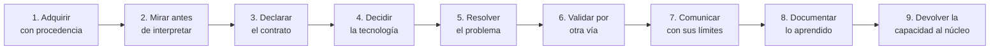

# Applied Data Analysis and Assessment Lab

**Datos reales, problemas reales, resueltos paso a paso.** Cada caso trae el código de
Python con su salida real, la fórmula de Excel dibujada en su hoja, las trampas de
hacerlo de la forma obvia y lo que los datos **no** permiten concluir. Los diez
cuadernos reales incluyen además tres soluciones comparables: Pandas + Matplotlib,
Polars + Matplotlib y R con `readr`/`dplyr` + ggplot2. Las pruebas confrontan sus
resultados numéricos, no sólo que los scripts terminen.

<br clear="left">


[](https://github.com/vladimiracunadev-create/applied-data-analysis-and-assessment-lab/actions/workflows/ci.yml)


[](https://colab.research.google.com/github/vladimiracunadev-create/applied-data-analysis-and-assessment-lab/blob/main/cases/bip_lugares_carga/cuaderno/colab.ipynb)

---

## El problema que resuelve

Te entregan datos que no generaste y una pregunta que hay que contestar bien.

Entonces descubres que el encabezado del Excel no está en la primera fila, que la
columna «código» se repite, que la hora `25:10:00` no la acepta ninguna librería, que
el cruce te cambió el total sin avisar, y que el indicador que te piden tiene siete
reglas de exclusión escondidas en una nota al pie.

**Este repositorio es el método para hacer ese trabajo bien, probado contra datos
públicos reales.** No es un curso ni una colección de ejercicios: es un recorrido de
nueve etapas, un núcleo de código reutilizable y quince casos resueltos que documentan
qué tecnología se usó, por qué, y qué trampa tenía cada dato.

### Si vienes a aprender a hacerlo: los cuadernos de trabajo

> **[Ruta de los doce cuadernos y dieciocho problemas](docs/cuadernos.md)** — en
> orden P01/P02/P04 → P03/P10 → P05/P09 → P06 → P07 → P08 → P11 →
> P12/P13 → P14/P15 → P16 → P17 → P18.
>
> **[Descargar todos los casos](dist/todos-los-casos.zip)** — quince casos, doce
> cuadernos, resultados, datos sintéticos e implementaciones en Pandas, Polars, R,
> SQL y Excel, con manifiesto SHA-256.

Un caso tiene dos documentos y sirven para cosas distintas:

| Documento | Qué es | Cuándo sirve |
| --- | --- | --- |
| **`CUADERNO.md`** | el problema resuelto **paso a paso**: Pandas con salida real, Excel equivalente, laboratorio comparable en Pandas/Polars/R y gráficos estadísticos | cuando quieres **aprender a producir y contrastar** el resultado |
| `README.md` | qué se encontró, con las cifras y lo que no se puede concluir | cuando quieres **auditar** el resultado |

El cuaderno se lee de arriba abajo y no hay que abrir nada más. La navegación sigue una
ruta lineal entre los doce casos, sin saltos como P01 → P08. Y no se escribe a mano:
se **genera ejecutando el caso**, de modo que el código que aparece es el que corrió y la
salida es la que devolvió. Si el código deja de funcionar, el cuaderno no se genera.

| Cuaderno | Pasos | Qué se practica en Excel |
| --- | --- | --- |
| [P01/P02/P04 · Consolidar, validar claves y normalizar](cases/bip_lugares_carga/CUADERNO.md) | 16 | `CONTAR.SI` para medir si una columna es clave, `CONTAR.SI` con `"?*"` para la cobertura de un campo, `FRECUENCIA` para el histograma, haversine en una celda, y Power Query para anexar los cinco archivos |
| [P03/P10 · Conciliar Metro y buses](cases/correspondencia_metro/CUADERNO.md) | 9 | nombres normalizados, distancias, conteos distintos y sensibilidad a la fuente |
| [P05/P09 · Horarios y cobertura nocturna](cases/carga_nocturna/CUADERNO.md) | 9 | estructurar texto libre, conservar desconocidos y calcular un intervalo |
| [P06 · Expediciones por hora](cases/gtfs_red_movilidad/CUADERNO.md) | 10 | ventanas de frecuencia, fin exclusivo, horas mayores de 24 y tabla dinámica |
| [P07 · Cuándo dejar Pandas](cases/rendimiento_gtfs/CUADERNO.md) | 8 | benchmark comparable, memoria, tiempo y validación exacta |
| [P08 · Cobertura espacial](cases/cobertura_de_carga/CUADERNO.md) | 9 | percentiles, umbrales, sensibilidad y cruce sin clave |
| [P11 · Calendario oficial](cases/calendario_medicion/CUADERNO.md) | 8 | reglas booleanas, solapamientos, escenarios y denominador final |
| [P12/P13 · Frecuencia programada](cases/frecuencia_programada/CUADERNO.md) | 8 | alcance calculable, percentiles y ponderaciones |
| [P14/P15 · Evolución GTFS](cases/evolucion_gtfs/CUADERNO.md) | 8 | comparación de versiones, altas, bajas y serie homogénea |
| [P16 · Informe para decisión](cases/informe_decision_carga/CUADERNO.md) | 8 | lista corta, regla de prioridad y clasificación de afirmaciones |
| [P17 · Gobernanza de datos DTPM](cases/gobernanza_datos_dtpm/CUADERNO.md) | 8 | identidad del catálogo, banderas de brecha, pesos y prioridad auditable |
| [P18 · ETL histórico GTFS](cases/etl_gtfs_automatizado/CUADERNO.md) | 8 | contrato de esquema, controles, particiones y estado real de formatos |

El Excel de cada paso va **dibujado como hoja**: la barra de fórmulas con su celda, las
letras de columna, la columna donde va la fórmula resaltada, y el resultado en su sitio.
Una fórmula en prosa no dice dónde va ni sobre qué rango opera.

Y cada cuaderno trae sus descargables al lado:

| Archivo | Qué es |
| --- | --- |
| [`cuaderno/pasos.py`](cases/bip_lugares_carga/cuaderno/pasos.py) | los pasos seguidos. Se corre y **muestra las dieciséis salidas** |
| [`cuaderno/solucion_pandas.py`](cases/bip_lugares_carga/cuaderno/solucion_pandas.py) | referencia comparable con **Pandas + Matplotlib**, además de los pasos completos |
| [`cuaderno/solucion_polars.py`](cases/bip_lugares_carga/cuaderno/solucion_polars.py) | contraste ejecutable con **Polars + Matplotlib**; lee el resultado versionado y genera el gráfico del caso |
| [`cuaderno/solucion.R`](cases/bip_lugares_carga/cuaderno/solucion.R) · [`solucion.Rmd`](cases/bip_lugares_carga/cuaderno/solucion.Rmd) | contraste con **R + dplyr/readr + ggplot2** y distribución para RStudio/Posit Cloud |
| [`cuaderno/practica.xlsx`](cases/bip_lugares_carga/cuaderno/practica.xlsx) | las fórmulas como texto y **el resultado que deben dar**, para corregirse solo |
| [`cuaderno/svg/`](cases/bip_lugares_carga/cuaderno/svg) | las nueve figuras: siete hojas de Excel y dos gráficos |

El libro de práctica **no trae los datos**: los archivos del portal son NoComercial y el
repositorio no los redistribuye. Se pega el consolidado que uno obtuvo, que además es
parte del ejercicio.

Los **dieciocho problemas están cubiertos** por doce cuadernos distintos: seis problemas
se integran en el cuaderno de otro porque comparten datos y método. El índice enlaza cada
problema con su resolución y el [mapa de problemas](docs/problemas-de-la-instancia.md)
declara qué se puede y qué no se puede concluir.

Cada uno de esos doce cuadernos contiene al menos una visualización estadística visible,
con título, unidad, período y fuente. Pandas, Polars y R exportan el mismo contrato; las
pruebas comparan sus valores con tolerancia 10⁻⁹ y exigen gráficos no vacíos. La
[guía portable](docs/ejecucion-portable.md), la
[matriz de validación](docs/matriz-validacion-cuadernos.md) y el
[informe de auditoría](docs/informe-auditoria-cuadernos.md) indican qué se ejecutó y qué
compatibilidad sólo está documentada.
El [índice de fuentes](docs/fuentes-cuadernos.md) centraliza origen, formato, licencia,
descarga, huella y alternativa reproducible de cada caso.

```powershell
python scripts/build_cuadernos.py          # regenera los cuadernos declarados
python scripts/build_all_cases.py          # regenera la descarga general
```

---

### Por dónde entrar

| Si necesitas… | Empieza por |
| --- | --- |
| **Prepararte para una evaluación técnica** de datos con Excel, Pandas, Polars o R | [Índice de los 18 problemas resueltos](docs/cuadernos.md) |
| **Resolver un problema de datos** de tu trabajo | [El recorrido de nueve etapas](docs/instancias.md) |
| **Aprender** con material que explica el por qué | [Programa de aprendizaje](docs/programa.md) — 8 clases con 17 secciones cada una |
| **Reproducir un indicador oficial** | [Indicadores oficiales del transporte](docs/indicadores-oficiales-transporte.md) |
| **Agregar tu propio caso** en otro dominio | [Cómo agregar una instancia](docs/instancias.md) |

---

## Lo que ya está resuelto, y qué encontró cada caso

Quince casos: doce con **datos públicos reales, metadatos documentales o resultados reproducibles** y tres con datos sintéticos de semilla
fija. Lo que importa no es el tema de cada uno, es la clase de problema que enseña a
detectar.

| Caso | Cuaderno | Datos | Pregunta y hallazgo principal |
| --- | --- | --- | --- |
| [`bip_lugares_carga`](cases/bip_lugares_carga/README.md) | [P01/P02/P04](cases/bip_lugares_carga/CUADERNO.md) | reales, licencia verificada | Cinco encabezados distintos; ninguna columna identifica una fila; tres errores de coordenada de hasta 10,3 km |
| [`correspondencia_metro`](cases/correspondencia_metro/README.md) | [P03/P10](cases/correspondencia_metro/CUADERNO.md) | reales, dos inventarios | Las 126 estaciones tienen bus cerca, pero 11 coordenadas discrepan más de 500 m entre fuentes |
| [`carga_nocturna`](cases/carga_nocturna/README.md) | [P05/P09](cases/carga_nocturna/CUADERNO.md) | reales, espacio y tiempo | La cobertura verificable es 0 % y 52,6 % queda indeterminado por horarios ausentes |
| [`gtfs_red_movilidad`](cases/gtfs_red_movilidad/README.md) | [P06](cases/gtfs_red_movilidad/CUADERNO.md) | reales, 1,1 M de filas | El 77,5 % de los horarios son desplazamientos relativos; el conteo ingenuo se equivoca −87,65 % |
| [`rendimiento_gtfs`](cases/rendimiento_gtfs/README.md) | [P07](cases/rendimiento_gtfs/CUADERNO.md) | reales, benchmark | Pandas completo, bloques, DuckDB y Polars coinciden; bloques reduce cerca de 81 % la memoria visible |
| [`cobertura_de_carga`](cases/cobertura_de_carga/README.md) | [P08](cases/cobertura_de_carga/CUADERNO.md) | reales, cruce sin clave | 59,29 % de cobertura en línea recta y 46,02 % con rodeo 1,3 |
| [`calendario_medicion`](cases/calendario_medicion/README.md) | [P11](cases/calendario_medicion/CUADERNO.md) | reales, metodología oficial | De 261 días laborales quedan 78 medibles; cuatro reglas no cambian el denominador de 2026 |
| [`frecuencia_programada`](cases/frecuencia_programada/README.md) | [P12/P13](cases/frecuencia_programada/CUADERNO.md) | reales, GTFS + definición oficial | 142 366 salidas programadas; el ICF observado no es calculable sin GPS |
| [`evolucion_gtfs`](cases/evolucion_gtfs/README.md) | [P14/P15](cases/evolucion_gtfs/CUADERNO.md) | reales, tres publicaciones | 68 533 → 68 011 → 64 011 salidas laborales entre 2024 y 2026 |
| [`informe_decision_carga`](cases/informe_decision_carga/README.md) | [P16](cases/informe_decision_carga/CUADERNO.md) | resultados reproducibles | Prioriza zonas para factibilidad sin presentar baja cobertura como demanda demostrada |
| [`gobernanza_datos_dtpm`](cases/gobernanza_datos_dtpm/README.md) | [P17](cases/gobernanza_datos_dtpm/CUADERNO.md) | catálogo pedagógico trazable | Mide cinco brechas sin inventar responsables, licencias, periodicidad o retención |
| [`etl_gtfs_automatizado`](cases/etl_gtfs_automatizado/README.md) | [P18](cases/etl_gtfs_automatizado/CUADERNO.md) | inventario reproducible P14/P15 | Valida tres cortes, crea particiones y no declara Parquet ejecutado sin motor |
| [`transport`](cases/transport/README.md) | — | sintéticos | Pandas, Polars, R y SQL coinciden; la comparación detectó que `julianday` invierte puntualidad en empates |
| [`retail`](cases/retail/README.md) | — | sintéticos | El signo de devolución debe ser una columna explícita |
| [`education`](cases/education/README.md) | — | sintéticos | La tasa ponderada y el promedio de porcentajes no son lo mismo |

Los quince hallazgos salieron de ejecutar el código, no de la intuición. Cada uno está
documentado con su magnitud, su causa y su corrección en la
[base de conocimiento](docs/conocimiento.md), que tiene 43 registros.

---

## Inicio rápido

```powershell
uv sync
```

```powershell
uv run python scripts/generate_data.py
```

```powershell
uv run python -m pytest
```

El entorno mínimo sigue siendo Python/Pandas. Polars es un extra; la referencia
canónica de R usa la biblioteca base y los gráficos de los cuadernos usan ggplot2:

```powershell
uv sync --extra polars
uv run --extra polars python solutions/polars_reference.py transport 1
Rscript solutions/r_reference.R transport 1 reference_outputs/r/transport
```

Tres comandos y 761 pruebas en verde. Después, el caso que mejor muestra de qué va
esto:

```powershell
uv run python -m cases.calendario_medicion.solution
```

Y para ver las fuentes públicas declaradas, con su licencia y su estado:

```powershell
uv run python scripts/fetch_data.py --listar
```

---

## El mismo caso en cinco tecnologías

Los casos sintéticos `transport`, `retail` y `education` parten de los mismos CSV y
aplican las mismas reglas con implementaciones que no comparten transformaciones:

| Tecnología | Implementación | Cómo se verifica |
| --- | --- | --- |
| Pandas | [`solutions/reference.py`](solutions/reference.py) y las soluciones de cada caso | referencia contractual |
| Polars | [`solutions/polars_reference.py`](solutions/polars_reference.py) | extra opcional `polars`, expresiones columnares |
| R base | [`solutions/r_reference.R`](solutions/r_reference.R) | runtime R sin paquetes, ejecutado en CI |
| SQL | [`solutions/sql_reference.py`](solutions/sql_reference.py) | SQLite con tipado y agregación independientes |
| Excel | [`solutions/EXCEL.md`](solutions/EXCEL.md) y libros resueltos | fórmulas vivas y hoja de control |

`tests/test_multiengine.py` confronta transporte, retail y educación con tolerancia
10⁻⁹. La guía de [equivalencias](docs/equivalencias.md) muestra dónde una traducción
deja de ser equivalente por nulos, tipos, percentiles o semántica del cruce.

---

## El recorrido

Nueve etapas, cada una con lo que evita. El detalle está en
[`docs/instancias.md`](docs/instancias.md).



La etapa 6 es la que más defectos encontró. La 9 es la que hace crecer el repositorio:
cuando un problema exige algo nuevo, ese algo sube al núcleo con su prueba y la
próxima instancia lo encuentra hecho.

**El mismo recorrido sirve para cualquier dominio.** Los casos de hoy son de transporte
porque los datos públicos verificables que se encontraron son de transporte. Las
instancias candidatas de banca, astronomía, clientes, salud, energía y logística están
declaradas en [`docs/instancias.md`](docs/instancias.md) como **trabajo pendiente**, no
como capacidad existente.

---

## El núcleo

26 módulos en `lab/`, ninguno con reglas de negocio de ningún dominio.

| Módulo | Para qué sirve |
| --- | --- |
`lab.sources` | Traer datos públicos con procedencia verificable: URL, fecha, SHA-256, licencia, y el enlace resuelto desde la página índice
`lab.contracts` | Contratos de datos: tipos, dominios, claves y severidad. **Informa; no borra filas**
`lab.excel` | Lee planillas cuyo encabezado no está en la primera fila, y escribe libros con fórmulas vivas
`lab.textual` | Normaliza texto distinguiendo la clave para agrupar de la etiqueta para mostrar
`lab.calendars` | Calendarios por reglas con su fuente, auditoría de exclusión exclusiva, y cálculo de Pascua
`lab.dates` | Fechas, duraciones y horarios de día de servicio que exceden las 24 h
`lab.metrics` | Razones seguras, percentiles con método declarado, tasa ponderada frente a promedio simple
`lab.stats` | Intervalos de confianza, Welch, Pearson y chi-cuadrado **sin SciPy**, validados contra tablas publicadas
`lab.geo` | Distancias sobre la esfera, conversión de UTM y punto más cercano, sin dependencias
`lab.sqlbridge` | Ejecutar SQL real sobre DataFrames para validar de forma independiente
`lab.viz` | Gráficos que exigen título, unidad, período, fuente y escala honesta
`lab.report` | Informes que se niegan a exportarse sin sus secciones obligatorias
`lab.method` | La metodología de 18 etapas como objeto auditable
`lab.catalog` | El estado real de cada caso: 26 campos de metadatos exigidos
`lab.knowledge` | Base de conocimiento con búsqueda TF-IDF, sin modelos ni red
`lab.learning` | Validador del estándar pedagógico: 17 secciones por clase
`lab.assessment` | Motor de evaluaciones: configuración, generación reproducible y rúbricas
`lab.agents` | 20 contratos de capacidades especializadas y un arnés que los verifica
`lab.profiles` | 11 perfiles profesionales con su cobertura real medida
`lab.core` | Lectura, perfilado y cruce auditado con control de cardinalidad
`lab.console` | Salida UTF-8 legible también en consolas de Windows

Dos ejemplos de lo que el núcleo hace cumplir siempre:

```python
from lab.metrics import compare_rates, safe_ratio

safe_ratio(1, 0)                    # nan, no una excepción ni un cero silencioso
compare_rates([1, 90], [2, 100])    # ponderada 89,2 % · simple 70,0 % · 19,2 pp de brecha
```

---

## Prepararse para una evaluación técnica

Hay un motor de evaluaciones con banco de ítems y rúbricas, y tres simulaciones de
cuatro horas sobre datos sintéticos.

```powershell
uv run python scripts/build_assessment.py --blueprint gestor-datos-transporte --seed 1
```

```powershell
uv run python scripts/build_excel_solutions.py
```

El segundo comando genera los libros de Excel **resueltos con fórmulas vivas**:
`BUSCARX`, `SUMAR.SI.CONJUNTO`, la duración por el factor 1440, y una hoja de control
que compara Excel contra Python al abrirla. Un valor pegado no demuestra nada; una
fórmula que se puede abrir, sí.

> Las simulaciones son material de entrenamiento propio. **No son pruebas oficiales de
> ninguna institución** ni reproducen instrumentos reales de selección, y cada enunciado
> generado lo declara. Cada proceso fija sus propias reglas sobre el uso de asistentes
> de IA; este repositorio no autoriza su uso durante una evaluación.

---

## Qué comprueban las pruebas, y qué no

761 pruebas en 39 archivos. Además de los cálculos:

- **Validación cruzada entre tecnologías**: Pandas contra Polars, R y SQL, indicador por
  indicador, con tolerancia 10⁻⁹; Excel conserva su control al abrir el libro.
- **Estadística contra valores publicados**: la t de Student, la chi-cuadrado, el
  intervalo de Wilson y el Domingo de Pascua se comparan con tablas y artículos, no
  consigo mismos.
- **Mediana y P90 contra una implementación en Python puro**, sin NumPy ni pandas.
- **Estructura de los libros de Excel**: que las fórmulas sean fórmulas y apunten al
  rango correcto.
- **Coherencia del repositorio**: versión única, enlaces relativos vivos, núcleo sin
  dependencias de dominio, documentación derivada al día, ausencia de secretos.

### Lo que **no** cubren

- **El resultado numérico de las fórmulas de Excel.** Evaluarlas exige Excel o
  LibreOffice, que no están en integración continua. Lo hace la hoja `30_control` de
  cada libro al abrirla, y el acuerdo numérico queda cubierto por las vías
  Pandas ↔ Polars ↔ R ↔ SQL.
- **Mediana y P90 en SQL.** SQLite no tiene percentil con interpolación lineal, de modo
  que se validan contra la implementación en Python puro.

Las brechas están **medidas** en [`docs/roadmap.md`](docs/roadmap.md), y una prueba
falla si alguna deja de estar declarada.

Tras cambiar código, regenerar la documentación derivada:

```powershell
uv run python scripts/build_docs.py
```

Seis documentos se generan desde el código, así que no pueden desincronizarse.

---

## Datos, licencias y privacidad

| Origen | Licencia | ¿Se versiona? |
| --- | --- | --- |
| Datos sintéticos del laboratorio | propios, semilla fija | sí |
| Lugares de carga bip! (Subsecretaría de Transporte) | **CC BY-NC 2.0, verificada** | no: solo procedencia y resultados |
| GTFS de la Red Metropolitana (DTPM) | **no verificada** | no: solo procedencia y resultados |
| Listado de feriados | tercero, **no oficial**, licencia no verificada | sí, validado y con su fuente declarada |

El catálogo distingue las fuentes con licencia comprobada de las que no, y una prueba
exige que esa distinción siga existiendo. Lo que no se verificó, se dice.

No publiques datos personales, credenciales ni material de terceros. Lee
[`SECURITY.md`](SECURITY.md) antes de incorporar cualquier dataset.

---

## Navegación completa

| | |
| --- | --- |
| **Empezar** | [Índice de la documentación](docs/README.md) · [Mapa de problemas](docs/problemas-de-la-instancia.md) · [El recorrido](docs/instancias.md) · [Arquitectura](docs/arquitectura.md) · [Manual](docs/manual.md) |
| **Aprender** | [Programa](docs/programa.md) · [Perfiles profesionales](docs/perfiles.md) · [Equivalencias SQL/Pandas/Polars/Excel/R](docs/equivalencias.md) |
| **Resolver** | [Catálogo de casos](docs/catalogo-casos.md) · [Paquete general](docs/paquete-general.md) · [Metodología de 18 etapas](docs/metodologia.md) · [Método de investigación](docs/research-method.md) |
| **Consultar** | [Base de conocimiento](docs/conocimiento.md) · [Indicadores oficiales](docs/indicadores-oficiales-transporte.md) · [Diccionario de datos](docs/diccionario.md) · [Contratos de agentes](docs/agentes.md) |
| **Gobernanza** | [Hoja de ruta](docs/roadmap.md) · [Cambios](CHANGELOG.md) · [Contribuir](CONTRIBUTING.md) · [Seguridad](SECURITY.md) · [Estándar visual](docs/visual-standard.md) · [Prompt maestro](PROMPT_MAESTRO.md) |

---

## Licencia

[MIT](LICENSE) para el código y la documentación. Los datos de terceros conservan su
propia licencia, declarada en el `case.json` de cada caso.
