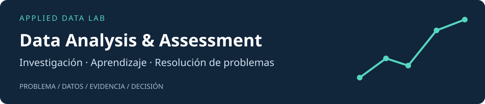
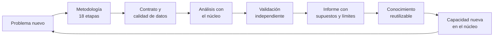
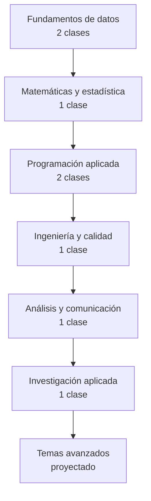

# Applied Data Analysis and Assessment Lab



[](https://github.com/vladimiracunadev-create/applied-data-analysis-and-assessment-lab/actions/workflows/ci.yml)


Laboratorio para **leer datos que uno no generó, resolver un problema con ellos,
documentar qué tecnología se usó y por qué, y dejar el aprendizaje disponible para la
próxima vez.**

Cada aplicación de ese recorrido a un dominio concreto es una **instancia**: transporte
público con datos reales, comercio, educación, y mañana datos bancarios, astronómicos,
de clientes o de una empresa. El recorrido es el mismo; lo que cambia es el negocio.

Su principio rector: **resolver los problemas de hoy y convertir el conocimiento
adquirido en capacidades reutilizables para los problemas de mañana.**

---

## Navegación

| | |
| --- | --- |
| **Empezar** | [Inicio rápido](#inicio-rápido) · [Manual](docs/manual.md) · [Arquitectura](docs/arquitectura.md) |
| **Aprender** | [Programa de aprendizaje](docs/programa.md) · [Perfiles profesionales](docs/perfiles.md) · [Equivalencias SQL/Pandas/Excel/R](docs/equivalencias.md) |
| **Resolver** | [Qué problemas se pueden resolver](docs/problemas-de-la-instancia.md) · [Recorrido e instancias](docs/instancias.md) · [Catálogo de casos](docs/catalogo-casos.md) · [Metodología de 18 etapas](docs/metodologia.md) · [Método de investigación](docs/research-method.md) |
| **Evaluarse** | [Simulaciones de 4 horas](simulations/) · [Preparación DTPM](cases/transport/README.md) · [Antecedentes verificados](docs/dtpm-antecedentes.md) |
| **Consultar** | [Indicadores oficiales](docs/indicadores-oficiales-transporte.md) · [Base de conocimiento](docs/conocimiento.md) · [Diccionario de datos](docs/diccionario.md) · [Contratos de agentes](docs/agentes.md) |
| **Gobernanza** | [Hoja de ruta](docs/roadmap.md) · [Cambios](CHANGELOG.md) · [Contribuir](CONTRIBUTING.md) · [Seguridad](SECURITY.md) · [Estándar visual](docs/visual-standard.md) · [Prompt maestro](PROMPT_MAESTRO.md) |

---

## Qué es esto



El laboratorio tiene tres piezas que no se mezclan:

- **Un núcleo transversal** (`lab/`, 17 módulos) que no sabe nada de ningún dominio:
  contratos de datos, indicadores, fechas, inferencia estadística, puente SQL, libros
  de Excel auditables, informes, metodología, base de conocimiento.
- **Casos de estudio independientes** (`cases/`) que resuelven problemas reales de un
  sector y no se conocen entre sí.
- **Un laboratorio de evaluaciones** (`assessments/`) que genera simulaciones
  reproducibles con rúbrica, para prepararse ante cualquier proceso técnico.

Cada problema resuelto deja registro en la base de conocimiento y, cuando hace falta
algo nuevo, el núcleo crece con su prueba automática.

---

## Inicio rápido

```powershell
uv sync
```

```powershell
uv run python scripts/generate_data.py
```

```powershell
uv run python -m pytest
```

Sin `uv`, el equivalente con pip:

```powershell
python -m venv .venv; .\.venv\Scripts\Activate.ps1; pip install -e .
```

### Qué hacer a continuación

```powershell
uv run python solutions/reference.py 1
```

```powershell
uv run python scripts/build_excel_solutions.py
```

```powershell
uv run python -m lab.knowledge "denominador cero"
```

```powershell
uv run jupyter lab
```

---

## Prioridad inmediata: evaluación técnica de gestor de datos (30 de noviembre de 2026)

El primer caso aplicado del laboratorio es la preparación para una evaluación técnica
de cuatro horas en Excel y Python con Pandas (o RStudio como alternativa), en el
dominio del transporte público.

**Qué hay implementado y verificado para eso:**

| Recurso | Dónde | Cómo se verifica |
| --- | --- | --- |
| 3 simulaciones de 4 horas con rúbrica | [`simulations/`](simulations/) | enunciados versionados |
| 3 datasets sintéticos con defectos controlados | `data/case_1..3` | `scripts/generate_data.py`, semilla fija |
| Solución de referencia en Pandas | `solutions/reference.py` | `tests/test_reference.py` |
| **Segunda implementación en SQL** | `solutions/sql_reference.py` | `tests/test_cross_validation.py` |
| **Libros de Excel resueltos con fórmulas vivas** | `solutions/excel/` | `tests/test_excel_solutions.py` |
| Equivalencias SQL ↔ Pandas ↔ Excel ↔ R | [`docs/equivalencias.md`](docs/equivalencias.md) | — |
| Banco de 15 ítems con criterios y trampas | `assessments/items/` | `tests/test_assessment.py` |
| Ruta de estudio y antecedentes públicos | [`docs/dtpm-antecedentes.md`](docs/dtpm-antecedentes.md) | fuentes abiertas y citadas |

**La validación cruzada es la pieza central.** `solutions/reference.py` (Pandas) y
`solutions/sql_reference.py` (SQL sobre los CSV cargados como texto) resuelven el mismo
problema sin compartir una línea de código, y las pruebas los confrontan indicador por
indicador con tolerancia 10⁻⁹. Esa confrontación **encontró un defecto real**: la
duración calculada con `julianday` difería en el séptimo decimal e invertía la
comparación «duración ≤ meta» justo en los empates, moviendo la puntualidad varios
puntos porcentuales. Con una sola implementación el número habría pasado por correcto.
Está documentado en [`knowledge/julianday-precision.md`](knowledge/julianday-precision.md).

Para generar una simulación nueva y reproducible:

```powershell
uv run python scripts/build_assessment.py --blueprint gestor-datos-transporte --seed 1
```

> Las simulaciones son **material de entrenamiento** propio del laboratorio. No son
> pruebas oficiales de ninguna institución ni reproducen instrumentos reales de
> selección. Cada proceso fija sus propias reglas sobre el uso de asistentes de IA;
> este repositorio no autoriza su uso durante una evaluación.

---

## La instancia con datos reales

El resto del laboratorio usa datos sintéticos, que son reproducibles y sin
restricciones. La instancia [`gtfs_red_movilidad`](cases/gtfs_red_movilidad/README.md)
usa **datos públicos reales**: el GTFS vigente de la Red Metropolitana de Movilidad
publicado por el DTPM —12,8 MB comprimidos, 1 098 717 filas de horarios, 26 137
expediciones— descargado con su procedencia verificada (SHA-256 registrado).

Sirve para ver qué aparece cuando los datos no los generó nadie pensando en enseñar.
La pregunta era simple: **¿cuántas expediciones salen por hora en un día laboral?**

| Lo que se encontró | Magnitud |
| --- | --- |
| Filas de horario que **no son horas de reloj**, sino desplazamientos desde el inicio del viaje | 851 773 — el **77,5 %** de la tabla |
| Relleno de ceros irregular: `'0:00:00' > '00:00:51'` como texto | la parada 1 ordenada **después** de la 2 |
| Error de contar expediciones en lugar de expandir sus frecuencias | **−87,65 %**: 7 905 frente a 64 011 reales |
| Error de tomar el fin de ventana como inclusivo | **+10,37 %**: 6 641 salidas de más |
| «El 32 % de las paradas está huérfano» | **falso**: 5 989 de 5 991 no son paradas. Las reales son **dos** |
| Claves huérfanas en los seis cruces del modelo | **cero**. El feed está bien formado; es *complejo*, no *sucio* |

Las tres primeras trampas, por separado, producen un número plausible y equivocado.
La cuarta es un defecto que no existe y que reportarlo costaría puntos.

```powershell
uv run python scripts/fetch_data.py gtfs-red-movilidad
```

```powershell
uv run python -m cases.gtfs_red_movilidad.solution
```

Los datos **no se versionan**: su licencia no está verificada. Se versiona el código,
el [registro de procedencia](cases/gtfs_red_movilidad/procedencia.json) y los
resultados agregados. Las pruebas no descargan nada: reproducen los formatos
problemáticos con datos de prueba mínimos.

---

## El núcleo

| Módulo | Para qué sirve |
| --- | --- |
`lab.method` | Metodología de 18 etapas como objeto auditable: una etapa no se completa sin evidencia
`lab.contracts` | Contratos de datos: tipos, dominios, claves y severidad de cada hallazgo
`lab.core` | Lectura, perfil de calidad y cruce auditado con control de cardinalidad
`lab.dates` | Fechas, duraciones, bandas horarias y horarios de día de servicio que exceden las 24 h, informando qué no se pudo interpretar
`lab.textual` | Normalización de texto: clave para agrupar y etiqueta para mostrar, parecido y candidatos a duplicado
`lab.calendars` | Calendarios por reglas con su fuente, auditoría de exclusión exclusiva y solapamiento, y cálculo de Pascua para validar feriados
`lab.geo` | Distancias sobre la esfera, conversión de UTM a latitud/longitud y búsqueda del punto más cercano, sin dependencias
`lab.metrics` | Razones seguras, percentiles con método declarado, tasa ponderada frente a promedio simple
`lab.sources` | Adquirir datos públicos con procedencia verificable: URL, fecha, SHA-256, licencia, y el enlace resuelto desde la página índice
`lab.stats` | Intervalos de confianza, Welch, Pearson y chi-cuadrado **sin SciPy**, validados contra tablas publicadas
`lab.sqlbridge` | Ejecutar SQL real sobre DataFrames para validar de forma independiente
`lab.excel` | Escribe libros con fórmulas vivas, y **lee** planillas cuyo encabezado no está en la primera fila
`lab.viz` | Gráficos con título, unidad, período, fuente y escala honesta obligatorios
`lab.report` | Informes que se niegan a exportarse sin sus secciones obligatorias
`lab.catalog` | Estado real de cada caso: 26 campos de metadatos exigidos
`lab.knowledge` | Base de conocimiento con búsqueda TF-IDF, sin modelos ni red
`lab.learning` | Validador del estándar pedagógico: 17 secciones por clase
`lab.assessment` | Motor de evaluaciones: configuración, generación reproducible y rúbricas
`lab.agents` | 20 contratos de capacidades especializadas y un arnés que los verifica
`lab.profiles` | 11 perfiles profesionales con su cobertura real medida
`lab.console` | Salida UTF-8 legible también en consolas de Windows

Ejemplo mínimo de dos cosas que el laboratorio hace cumplir siempre:

```python
from lab.metrics import compare_rates, safe_ratio

safe_ratio(1, 0)                      # nan, no una excepción ni un cero
compare_rates([1, 90], [2, 100])      # ponderada 89.2 %, simple 70.0 %, 19.2 pp de brecha
```

---

## Casos y evaluaciones disponibles

| Instancia | Industria | Datos | Dificultad | Tiempo |
| --- | --- | --- | --- | --- |
| [`bip_lugares_carga`](cases/bip_lugares_carga/README.md) | Transporte | **reales**, licencia verificada | intermedio | 120 min |
| [`calendario_medicion`](cases/calendario_medicion/README.md) | Administración pública | **reales**, metodología oficial | avanzado | 150 min |
| [`gtfs_red_movilidad`](cases/gtfs_red_movilidad/README.md) | Transporte | **reales**, 1,1 M de filas | especializado | 180 min |
| [`transport`](cases/transport/README.md) | Transporte | sintéticos | avanzado | 240 min |
| [`retail`](cases/retail/README.md) | Comercio | sintéticos | intermedio | 90 min |
| [`education`](cases/education/README.md) | Educación | sintéticos | introductorio | 90 min |

El [catálogo completo](docs/catalogo-casos.md) se genera desde los metadatos y marca
los casos incompletos en lugar de ocultarlos. Para crear uno nuevo:

```powershell
uv run python scripts/new_case.py mi-caso
```

---

## Programa de aprendizaje

**8 clases publicadas** en 6 bloques, cada una con las 17 secciones del estándar:
objetivos, prerrequisitos, definiciones simples y formales, fundamentos, fórmulas con
variables y unidades, ejemplos progresivos, aplicaciones profesionales, código
comentado, ejercicios, soluciones explicadas, errores frecuentes, criterios de
validación, preguntas de evaluación, referencias verificables y glosario.



El validador mantiene vivo el estándar: una clase a la que le falte una sección hace
fallar la suite.

```powershell
uv run python -m lab.learning
```

Ver el [programa completo](docs/programa.md) y los
[perfiles profesionales](docs/perfiles.md) con su cobertura medida.

---

## Calidad y validación

```powershell
uv run python -m pytest
```

Lo que la suite protege, además de los cálculos:

- **Validación cruzada entre tecnologías**: Pandas contra SQL, indicador por indicador.
- **Estadística contra valores publicados**: la t de Student, la chi-cuadrado y el
  intervalo de Wilson se comparan con tablas y artículos, no consigo mismos.
- **Mediana y P90 contra una implementación en Python puro**, sin NumPy ni pandas.
- **Estructura de los libros de Excel**: que las fórmulas sean fórmulas y apunten al
  rango correcto.
- **Estándar pedagógico**: 17 secciones por clase.
- **Metadatos de los casos**: 26 campos por caso.
- **Arnés de agentes**: sin responsabilidades duplicadas ni referencias inexistentes.
- **Coherencia del repositorio**: versión única, enlaces relativos vivos, núcleo sin
  dependencias de dominio, documentación derivada al día, ausencia de secretos.

### Lo que la suite **no** cubre

Las pruebas verifican que las fórmulas de Excel existan, sean fórmulas y referencien
los rangos correctos; **no** evalúan su resultado numérico, porque eso exige Excel o
LibreOffice y no están disponibles en integración continua. Esa comprobación la hace la
hoja `30_control` de cada libro al abrirlo, y el acuerdo numérico entre
implementaciones queda cubierto por la validación Pandas ↔ SQL, que sí se ejecuta.
La distinción está declarada en [`docs/roadmap.md`](docs/roadmap.md).

Tras cualquier cambio en el código, regenere la documentación derivada:

```powershell
uv run python scripts/build_docs.py
```

---

## Ecosistema tecnológico

**Entorno mínimo** (siete paquetes): Python, pandas, NumPy, openpyxl, XlsxWriter,
Matplotlib, JupyterLab y pytest. Nada más es obligatorio.

**Integrado sin dependencias nuevas:** SQL mediante `sqlite3` de la biblioteca
estándar, e inferencia estadística implementada en `lab.stats`.

**Opcional y detectado en tiempo de ejecución:** DuckDB
(`lab.sqlbridge.duckdb_available()`).

**Declarado en la hoja de ruta, no implementado:** Polars, R/RStudio, Power BI,
Tableau, Metabase, GeoPandas, QGIS, Arrow/Parquet, SciPy, Statsmodels, scikit-learn,
Docker, n8n, bases vectoriales y búsqueda semántica. La
[hoja de ruta](docs/roadmap.md) distingue de forma estricta lo implementado de lo
proyectado, y declara cada brecha medida.

---

## Datos y privacidad

Los datos de este repositorio son **sintéticos, generados con semilla fija** y no
describen ningún sistema real. Los antecedentes públicos consultados están citados con
su fecha en [`docs/dtpm-antecedentes.md`](docs/dtpm-antecedentes.md), separando lo
verificado de lo pendiente.

No publique datos personales, credenciales ni material de terceros. Lea
[`SECURITY.md`](SECURITY.md) antes de incorporar cualquier dataset.

---

## Licencia

[MIT](LICENSE). El código y la documentación son reutilizables; los datos de terceros
que algún caso futuro incorpore mantendrán su propia licencia, declarada en el
`case.json` correspondiente.
