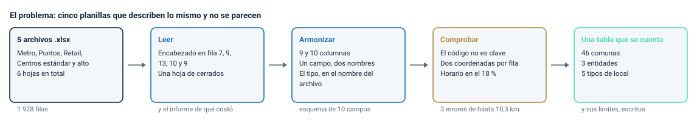
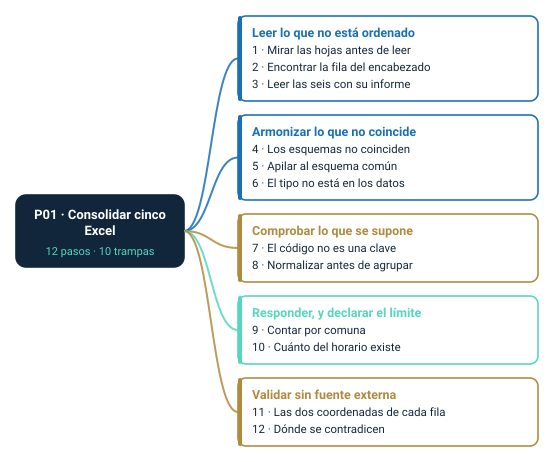
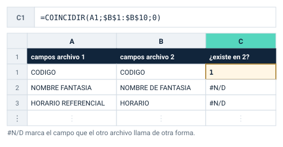
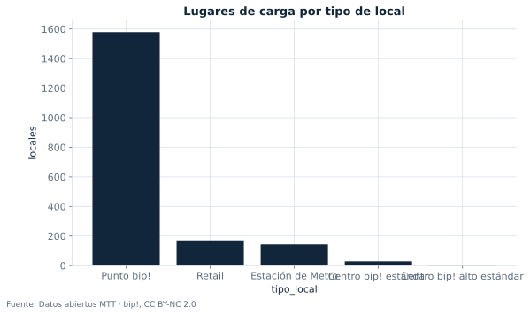
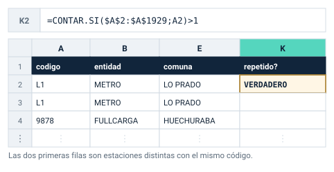
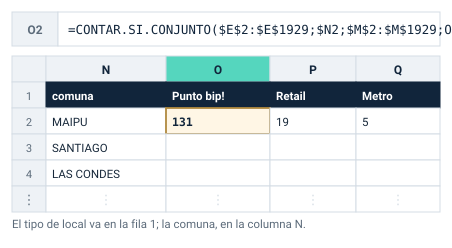
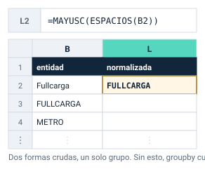
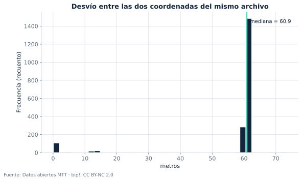
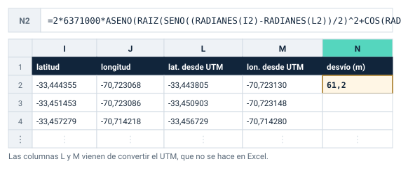
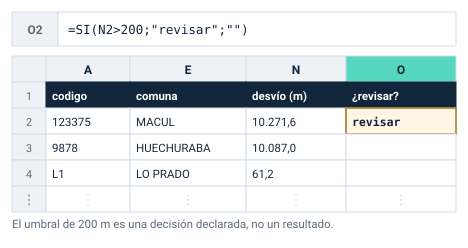

# P01 · Consolidar cinco Excel públicos que describen lo mismo y no se parecen

[Todos los cuadernos](../../docs/cuadernos.md) · [P08 · El cruce que no tiene clave](../cobertura_de_carga/README.md) ▶

[](https://colab.research.google.com/github/vladimiracunadev-create/applied-data-analysis-and-assessment-lab/blob/main/cases/bip_lugares_carga/cuaderno/colab.ipynb) — corre los pasos sin instalar nada: el cuaderno clona el repositorio y descarga los datos del portal.

> **¿Cuántos lugares de carga de la tarjeta bip! hay, dónde están, y qué identifica a cada uno?**

## 1 · El problema

Para pagar un viaje en el transporte público de Santiago hay que llevar saldo en la
tarjeta bip!, y el saldo se carga en locales físicos. El organismo publica dónde están
esos locales, y lo publica como lo publica un organismo: **cinco archivos de Excel
distintos**, uno por tipo de local, hechos en momentos distintos por personas distintas.

La pregunta que llega es simple y legítima: *¿cuántos lugares de carga hay y dónde
están?* Alguien tiene que contestarla para decidir dónde instalar el próximo, o para
responder una consulta ciudadana, o para cruzarla con la red de transporte.

**Lo que la vuelve difícil no es el volumen.** Son 1 928 filas: cabrían en una pantalla
y media. Lo difícil es que los cinco archivos no se parecen entre sí:

- el **encabezado no está en la primera fila** de ninguno, y está en una distinta en
  cada uno, porque arriba hay un título y filas en blanco;
- los **esquemas no coinciden**: unos traen nueve columnas y otros diez, y el mismo
  campo se llama de dos formas;
- el **tipo de local no está en los datos**: está en el nombre del archivo;
- una hoja describe locales **fuera de servicio**, y si se lee todo junto quedan
  contados como abiertos;
- la columna que parece la clave **no identifica una fila**;
- y la misma ubicación viene **dos veces**, en dos sistemas de coordenadas que no
  coinciden.

Ninguno de esos seis problemas produce un error. Cada uno produce una tabla que se puede
sumar, graficar y presentar, con un número equivocado.

Ese es el trabajo real de quien gestiona datos que no generó: no calcular, sino
**descubrir en qué no se puede confiar antes de calcular**. Y es exactamente lo que se
pide en una evaluación técnica de cuatro horas con Excel y Pandas.

**Los datos.** Cinco `.xlsx` del portal de datos abiertos del MTT, licencia CC BY-NC 2.0 verificada. Seis hojas, 1 928 filas, una en la hoja de cerrados.



## 2 · La solución que se va a aplicar

El recorrido va de lo que no se puede suponer a lo que sí se puede afirmar, en cinco
bloques.

**Leer lo que no está ordenado** (pasos 1 a 3). Antes de leer, mirar: cuántas hojas hay
y en qué fila empieza cada tabla. La fila del encabezado se **detecta** en lugar de
fijarse, y de cada lectura queda un informe de qué hubo que hacer. Ese informe es lo que
después permite defender el recuento.

**Armonizar lo que no coincide** (pasos 4 a 6). La correspondencia entre el nombre de
cada archivo y el campo del esquema común se **declara** en una tabla, no se adivina por
parecido: un acierto por casualidad hoy es un error mañana. Y al apilar se agrega el tipo
de local, que vive en el nombre del archivo y se perdería para siempre.

**Comprobar lo que se supone** (pasos 7 y 8). Dos suposiciones que todo el mundo hace y
nadie mide: que la columna llamada «código» es una clave, y que los textos que nombran lo
mismo están escritos igual. Las dos son falsas en este archivo, y medirlo cuesta una
línea cada una.

**Responder, y declarar el límite** (pasos 9 y 10). Recién aquí se cuenta por comuna. Y
se mide cuánto del campo de horario existe de verdad, porque de eso depende qué se puede
concluir después.

**Validar sin fuente externa** (pasos 11 y 12). El archivo trae la ubicación dos veces.
Convertir una y compararla con la otra es una validación que no necesita pedirle nada a
nadie, y es la que encuentra los tres errores de kilómetros que ninguna de las
comprobaciones anteriores podía ver.

Cada paso trae el Pandas, su salida real, y la fórmula de Excel dibujada en su hoja. Diez
de los doce traen además **la trampa**: lo que sale mal si el paso se hace de la forma
obvia, que es la parte que no está en ningún tutorial y la que se pregunta en una prueba.



12 pasos. Cada uno trae el código de **Python**, la salida que devuelve de verdad, y la **fórmula de Excel** equivalente dibujada en su hoja. 10 traen además la trampa de hacerlo de la forma obvia.

| # | Paso | Trampa |
| --- | --- | --- |
| 1 | [Mirar el archivo antes de leerlo](#paso-1) | sí |
| 2 | [Encontrar la fila del encabezado](#paso-2) | sí |
| 3 | [Leer las seis hojas con su encabezado](#paso-3) | — |
| 4 | [Los esquemas no coinciden](#paso-4) | sí |
| 5 | [Apilar los cinco al esquema común](#paso-5) | — |
| 6 | [El tipo de local no está en los datos](#paso-6) | sí |
| 7 | [¿La columna «código» es una clave?](#paso-7) | sí |
| 8 | [Normalizar antes de agrupar](#paso-8) | sí |
| 9 | [Contar por comuna](#paso-9) | sí |
| 10 | [Cuánto del campo «horario» existe](#paso-10) | sí |
| 11 | [Las dos coordenadas de cada fila](#paso-11) | sí |
| 12 | [Las filas donde las dos coordenadas se contradicen](#paso-12) | sí |

### Para trabajar

| Archivo | Qué es |
| --- | --- |
| [`P01-caso-completo.zip`](cuaderno/P01-caso-completo.zip) | **todo el caso en un ZIP**: el cuaderno, el script, el libro de Excel y las figuras |
| [`pasos.py`](cuaderno/pasos.py) | los 12 pasos seguidos. Se corre y muestra cada salida |
| [`practica.xlsx`](cuaderno/practica.xlsx) | las fórmulas y **el resultado que deben dar**, para corregirse solo. Se abre igual en Google Sheets |
| [`colab.ipynb`](cuaderno/colab.ipynb) | el cuaderno **ejecutable en Colab**: clona, descarga los datos del portal y corre los 12 pasos |

---

## 3 · Los pasos

<a id="paso-1"></a>

### Paso 1 · Mirar el archivo antes de leerlo

Cuántas hojas tiene cada archivo y cómo se llaman. Uno tiene dos, y la segunda son locales **fuera de servicio**.

#### Python

```python
{archivo.stem: sheet_names(archivo)
 for archivo in sorted(ORIGINAL.glob('bip-*.xlsx'))}
```

```
{'bip-centros-alto-estandar': ['Abiertos'], 'bip-centros-estandar': ['Abierto'], 'bip-metro': ['Abiertos'], 'bip-puntos': ['PCMA'], 'bip-retail': ['Abiertos', 'Cerrados']}
```

#### Excel

Abrir el archivo y mirar las pestañas. Aquí Excel gana.

> **La trampa.** `pd.read_excel(ruta)` sin `sheet_name` lee **solo la primera hoja** y no avisa. Y las hojas no se llaman igual en los cinco archivos —`Abiertos`, `Abierto`, `PCMA`—, de modo que tampoco sirve pedirla por nombre.

[↑ volver al recorrido](#2--la-solución-que-se-va-a-aplicar)

---

<a id="paso-2"></a>

### Paso 2 · Encontrar la fila del encabezado

No está en la fila 1: está en la 7, 9, 13, 10 y 9, una por archivo. Con `header=0` las columnas salen como `Unnamed: 0`.

#### Python

```python
crudo = pd.read_excel(ruta_metro, sheet_name='Abiertos', header=None)
detect_header_row(crudo)
```

```
7
```

#### Excel

**Datos ▸ Obtener datos ▸ Desde un libro**, y en Power Query **Quitar filas superiores** y **Usar la primera fila como encabezado**.

> **La trampa.** No sirve «la primera fila sin celdas vacías»: una fila de datos también lo cumple. Hay que exigir varias celdas de **texto** seguidas de filas con datos.

[↑ volver al recorrido](#2--la-solución-que-se-va-a-aplicar)

---

<a id="paso-3"></a>

### Paso 3 · Leer las seis hojas con su encabezado

El informe de lectura no es decorativo: es lo que permite afirmar después que el 1 928 no se inventó.

#### Python

```python
hojas = p01.cargar()
p01.informe_de_lectura(hojas)
```

| fuente | hoja | tipo_local | abierto | encabezado_en_fila | filas_de_titulo_descartadas | filas | columnas | filas_vacias_descartadas | columnas_vacias_descartadas |
| --- | --- | --- | --- | --- | --- | --- | --- | --- | --- |
| bip-centros-alto-estandar | Abiertos | Centro bip! alto estándar | sí | 13 | 13 | 7 | 9 | 0 | 0 |
| bip-centros-estandar | Abierto | Centro bip! estándar | sí | 10 | 10 | 29 | 9 | 0 | 0 |
| bip-metro | Abiertos | Estación de Metro | sí | 7 | 7 | 143 | 10 | 0 | 0 |
| bip-puntos | PCMA | Punto bip! | sí | 9 | 9 | 1579 | 9 | 0 | 1 |
| bip-retail | Abiertos | Retail | sí | 9 | 9 | 169 | 10 | 0 | 0 |
| bip-retail | Cerrados | Retail | no | 9 | 9 | 1 | 10 | 0 | 0 |
*6 filas × 10 columnas.*

#### Excel

Repetir el paso anterior cinco veces y **anotar** la fila de cada uno.

[↑ volver al recorrido](#2--la-solución-que-se-va-a-aplicar)

---

<a id="paso-4"></a>

### Paso 4 · Los esquemas no coinciden

Nueve columnas en unos archivos y diez en otros, y el mismo campo con dos nombres: `NOMBRE FANTASIA` y `NOMBRE DE FANTASIA`.

#### Python

```python
p01.informe_de_esquemas(hojas)
```

| fuente | hoja | codigo | entidad | nombre | direccion | comuna | horario | este | norte | latitud | longitud |
| --- | --- | --- | --- | --- | --- | --- | --- | --- | --- | --- | --- |
| bip-centros-alto-estandar | Abiertos | CODIGO | ENTIDAD | — | DIRECCION | COMUNA | HORARIO | ESTE | NORTE | LATITUD | LONGITUD |
| bip-centros-estandar | Abierto | CODIGO | ENTIDAD | — | DIRECCION | COMUNA | HORARIO | ESTE | NORTE | LATITUD | LONGITUD |
| bip-metro | Abiertos | CODIGO | ENTIDAD | NOMBRE FANTASIA | DIRECCION | COMUNA | HORARIO REFERENCIAL | ESTE | NORTE | LATITUD | LONGITUD |
| bip-puntos | PCMA | CODIGO | ENTIDAD | NOMBRE DE FANTASIA | DIRECCION | COMUNA | — | ESTE | NORTE | LATITUD | LONGITUD |
| bip-retail | Abiertos | CODIGO | ENTIDAD | NOMBRE FANTASIA | DIRECCION | COMUNA | HORARIO REFERENCIAL | ESTE | NORTE | LATITUD | LONGITUD |
| bip-retail | Cerrados | CODIGO | ENTIDAD | NOMBRE FANTASIA | DIRECCION | COMUNA | HORARIO REFERENCIAL | ESTE | NORTE | LATITUD | LONGITUD |
*6 filas × 12 columnas.*

#### Excel



`=COINCIDIR(A1;$B$1:$B$10;0)` da `#N/D` donde el campo no existe.

**En Google Sheets:** la misma fórmula, sin cambios.

> **La trampa.** Una columna trae un **espacio al final del nombre**. Es invisible, y un renombrado por igualdad exacta falla sin error: la columna queda fuera del esquema.

[↑ volver al recorrido](#2--la-solución-que-se-va-a-aplicar)

---

<a id="paso-5"></a>

### Paso 5 · Apilar los cinco al esquema común

La correspondencia está **declarada** en el diccionario `ALIAS`, no deducida por parecido.

#### Python

```python
consolidado = p01.consolidar(hojas)
consolidado[ESQUEMA]
```

| codigo | entidad | nombre | direccion | comuna | horario | este | norte | latitud | longitud |
| --- | --- | --- | --- | --- | --- | --- | --- | --- | --- |
| L1 | METRO | SAN PABLO L1 | Av. San Pablo 6190 | LO PRADO | Lunes a Viernes: 6:00 a 23:00 horas, Sábados:… | 339892 | 6298155 | -33.444355 | -70.723068 |
| L1 | METRO | NEPTUNO | Av. Neptuno Oriente frente al 260 | LO PRADO | Lunes a Viernes: 6:00 a 23:00 horas, Sábados:… | 339903 | 6297368 | -33.451453 | -70.723086 |
| L1 | METRO | PAJARITOS | Av. General Bonilla 5900 | LO PRADO | Lunes a Viernes: 6:00 a 23:00 horas, Sábados:… | 340738 | 6296735 | -33.457279 | -70.714218 |
| L1 | METRO | LAS REJAS | Av. Libertador Bernardo O`Higgins 6056 | ESTACION CENTRAL | Lunes a Viernes: 6:00 a 23:00 horas, Sábados:… | 341466 | 6296689 | -33.457802 | -70.706398 |
| L1 | METRO | ECUADOR | Av. Libertador Bernardo O`Higgins Frente al 4… | ESTACION CENTRAL | Lunes a Viernes: 6:00 a 23:00 horas, Sábados:… | 342093 | 6296850 | -33.456448 | -70.699623 |
*1928 filas × 10 columnas, se muestran las primeras 5.*

#### Excel

**Datos ▸ Obtener datos ▸ Combinar consultas ▸ Anexar**. Copiar y pegar funciona una vez y no se repite cuando el portal publique otra versión.

[↑ volver al recorrido](#2--la-solución-que-se-va-a-aplicar)

---

<a id="paso-6"></a>

### Paso 6 · El tipo de local no está en los datos

Está en el **nombre del archivo**. Si no se agrega al apilar, se pierde.

#### Python

```python
consolidado.groupby('tipo_local').size().sort_values(ascending=False)
```

| tipo_local | valor |
| --- | --- |
| Punto bip! | 1579 |
| Retail | 170 |
| Estación de Metro | 143 |
| Centro bip! estándar | 29 |
| Centro bip! alto estándar | 7 |
*5 valores.*



*Los puntos bip! son el 82 % del archivo, y son también los que no declaran horario.*

#### Excel

En Power Query, una **columna personalizada** por consulta antes de anexar: `= "Estación de Metro"`.

> **La trampa.** Es el error más fácil de no notar: la tabla queda completa, sumable y sin huecos, y ya no se puede responder «¿cuántos son de Metro?».

[↑ volver al recorrido](#2--la-solución-que-se-va-a-aplicar)

---

<a id="paso-7"></a>

### Paso 7 · ¿La columna «código» es una clave?

Medirlo cuesta una línea, y hay que hacerlo antes de cruzar.

#### Python

```python
{'filas': len(consolidado),
 'distintos': consolidado['codigo'].nunique(),
 'repetidos': int(consolidado['codigo'].duplicated().sum())}
```

```
{'filas': 1928, 'distintos': 1792, 'repetidos': 136}
```

#### Excel



`=CONTAR.SI($A$2:$A$1929;A2)>1` y arrastrar. Distintos: `=CONTARA(UNICOS(A2:A1929))`.

Debe dar: **136 filas con código repetido, de 1 928**

**En Google Sheets:** la misma fórmula, sin cambios.

> **La trampa.** En el archivo de Metro el código es la **línea** (`L1`, `L5`), no el local: 143 estaciones con 7 códigos. Y tampoco sirve `archivo + código`.

[↑ volver al recorrido](#2--la-solución-que-se-va-a-aplicar)

---

<a id="paso-8"></a>

### Paso 8 · Normalizar antes de agrupar

`FULLCARGA` y `Fullcarga` son dos grupos para `groupby` y uno para una persona.

#### Python

```python
{'crudas': consolidado['entidad'].nunique(),
 'normalizadas': consolidado['entidad'].map(normalize_key).nunique()}
```

```
{'crudas': 4, 'normalizadas': 3}
```

#### Excel


`=MAYUSC(ESPACIOS(B2))` cubre mayúsculas y espacios. Las tildes, con `SUSTITUIR` anidado una por vocal.

Debe dar: **4 valores crudos, 3 normalizados**

**En Google Sheets:** la misma fórmula, sin cambios.

> **La trampa.** Guardar **las dos** formas: la clave para agrupar y la etiqueta para mostrar. Con solo la clave, el informe dice `NUNOA` en vez de `Ñuñoa`.

[↑ volver al recorrido](#2--la-solución-que-se-va-a-aplicar)

---

<a id="paso-9"></a>

### Paso 9 · Contar por comuna

La pregunta que se pedía, con el desglose por tipo de local.

#### Python

```python
p01.por_comuna(consolidado)
```

| comuna_clave | comuna | Centro bip! alto estándar | Centro bip! estándar | Estación de Metro | Punto bip! | Retail | total |
| --- | --- | --- | --- | --- | --- | --- | --- |
| MAIPU | Maipu | 0 | 2 | 5 | 131 | 19 | 157 |
| SANTIAGO | Santiago | 1 | 1 | 25 | 105 | 16 | 148 |
| LAS CONDES | Las Condes | 0 | 0 | 6 | 90 | 8 | 104 |
| PUENTE ALTO | Puente Alto | 0 | 2 | 5 | 84 | 10 | 101 |
| LA FLORIDA | La Florida | 0 | 2 | 11 | 74 | 8 | 95 |
| PUDAHUEL | Pudahuel | 0 | 0 | 3 | 81 | 4 | 88 |
| QUILICURA | Quilicura | 0 | 2 | 4 | 73 | 6 | 85 |
| NUNOA | Ñuñoa | 2 | 0 | 16 | 54 | 12 | 84 |
*46 filas × 8 columnas, se muestran las primeras 8.*

#### Excel



**Insertar ▸ Tabla dinámica**: `comuna` en Filas, `tipo_local` en Columnas, `codigo` en Valores con **Contar**.

Debe dar: **Maipú 157, Santiago 148, Las Condes 104**

**En Google Sheets:** la misma fórmula, sin cambios.

> **La trampa.** `groupby` **descarta los nulos de la clave** sin avisar, y el total deja de sumar las filas. Con `dropna=False` aparecen como grupo propio.

[↑ volver al recorrido](#2--la-solución-que-se-va-a-aplicar)

---

<a id="paso-10"></a>

### Paso 10 · Cuánto del campo «horario» existe

Antes de usar un campo, saber cuánto está lleno. Y declarar **sobre qué**: la cobertura cambia según se cuenten las 1 928 filas o las 1 927 abiertas.

#### Python

```python
def cobertura(tabla):
    lleno = tabla['horario'].notna() & (
        tabla['horario'].astype('string').str.strip() != '')
    return round(float(lleno.mean() * 100), 2)

{'todas las filas': cobertura(consolidado),
 'solo abiertas': cobertura(consolidado[consolidado['abierto']])}
```

```
{'todas las filas': 18.1, 'solo abiertas': 18.06}
```

#### Excel



`=CONTAR.SI(F2:F1929;"?*")/FILAS(F2:F1929)`, en formato porcentaje.

Debe dar: **18,10 % sobre las 1 928 filas · 18,06 % sobre las 1 927 abiertas**

**En Google Sheets:** la misma fórmula, sin cambios.

> **La trampa.** Dos trampas en el mismo paso. Una: `CONTARA` y `CONTAR.SI(...;"<>")` cuentan como no vacía una celda con **fórmula que devuelve cadena vacía**, de modo que una columna traída por una consulta da 100 % estando vacía; `"?*"` exige al menos un carácter. Otra: el **denominador es una decisión**. 18,10 % y 18,06 % son la misma medición sobre dos poblaciones distintas, y hay que decir cuál se publica.

[↑ volver al recorrido](#2--la-solución-que-se-va-a-aplicar)

---

<a id="paso-11"></a>

### Paso 11 · Las dos coordenadas de cada fila

El archivo trae la misma ubicación en UTM y en grados. Convertir una y comparar con la otra es una validación que no necesita fuente externa.

#### Python

```python
lat_utm, lon_utm = utm_to_latlon(
    consolidado['este'], consolidado['norte'], zona=19)
desvio_m = haversine_km(
    lat_utm, lon_utm,
    consolidado['latitud'], consolidado['longitud']) * 1000
pd.cut(desvio_m, [0, 10, 50, 58, 62, 100, 1e9]).value_counts().sort_index()
```

|  | count |
| --- | --- |
| (0.0, 10.0] | 109 |
| (10.0, 50.0] | 37 |
| (50.0, 58.0] | 2 |
| (58.0, 62.0] | 1768 |
| (62.0, 100.0] | 9 |
| (100.0, 1000000000.0] | 3 |
*6 valores.*



*Dos grupos: uno en 0 m y otro en 61 m. Se recortan los mayores de 100 m —tres filas— para que la forma se vea; esos tres son el paso siguiente.*

#### Excel



La conversión de UTM a grados no se hace en Excel: es una serie de ocho términos. La distancia entre dos pares de grados, sí:

```
=2*6371000*ASENO(RAIZ(SENO((RADIANES(I2)-RADIANES(L2))/2)^2
  + COS(RADIANES(L2))*COS(RADIANES(I2))
  * SENO((RADIANES(J2)-RADIANES(M2))/2)^2))
```

Y el histograma: topes en `P1:P6`, y `=FRECUENCIA(N2:N1929;P1:P6)` seleccionando `Q1:Q7`.

Debe dar: **109 filas bajo 10 m y 1 768 entre 58 y 62 m**

**En Google Sheets:** la misma fórmula, sin cambios.

> **La trampa.** La media y los percentiles 50, 90 y 99 **esconden el hallazgo**: los tres caen en 61 m y parece un desvío único con tres atípicos. El histograma muestra **dos grupos**, que es la firma de dos datums distintos y no de un redondeo. Un resumen de cinco números no los distingue.

[↑ volver al recorrido](#2--la-solución-que-se-va-a-aplicar)

---

<a id="paso-12"></a>

### Paso 12 · Las filas donde las dos coordenadas se contradicen

Con el desvío calculado, un umbral declarado separa el desplazamiento sistemático de los errores reales.

#### Python

```python
p01.coordenadas_sospechosas(consolidado)[
    ['fuente', 'codigo', 'comuna', 'desvio_m']]
```

| fuente | codigo | comuna | desvio_m |
| --- | --- | --- | --- |
| bip-puntos | 123375 | MACUL | 10271.629696 |
| bip-puntos | 9878 | HUECHURABA | 10086.992305 |
| bip-puntos | 1224 | ESTACION CENTRAL | 4623.378791 |
*3 filas × 4 columnas.*

#### Excel



Con el desvío en N: `=SI(N2>200;"revisar";"")` y autofiltro.

Debe dar: **3 filas, con desvíos de 893 m a 10,3 km**

**En Google Sheets:** la misma fórmula, sin cambios.

> **La trampa.** El umbral es una **decisión** y se escribe con su motivo. Elegirlo después de ver los datos, para que el número de hallazgos quede cómodo, es el resultado disfrazado de criterio.

[↑ volver al recorrido](#2--la-solución-que-se-va-a-aplicar)

---

## 4 · El resultado

1 928 filas, 1 927 abiertas, 46 comunas, 3 entidades. El `codigo` no identifica una fila, ni junto al archivo de origen. La validación cruzada de las dos coordenadas encontró 3 errores de hasta 10,3 km y un desplazamiento sistemático de 61 m con distribución bimodal.

**No** se puede concluir cuánta gente usa cada local —no hay transacciones— ni si está abierto cuando alguien llega —el horario está en el 18,06 % de las filas—.

## 5 · Qué queda aprendido

1. El encabezado de una planilla real **no está en la primera fila**, y la fila se detecta en lugar de fijarse: así el código sobrevive a la versión siguiente.
2. Una correspondencia de columnas se **declara**. Deducirla por parecido acierta hoy y falla cuando cambie un nombre, sin avisar.
3. Lo que no está en ninguna columna —aquí, el tipo de local— se pierde al apilar si no se agrega a propósito. Y la tabla resultante queda completa y sumable.
4. Una columna llamada «código» **no es una clave hasta que se mide**, y en este archivo no lo es ni junto al nombre del archivo de origen.
5. Normalizar es decidir qué cosas son la misma, y hay que guardar **las dos** formas: la clave para agrupar y la etiqueta para mostrar.
6. El **denominador es una decisión**: la cobertura del horario es 18,10 % o 18,06 % según se cuenten todas las filas o solo las abiertas, y hay que decir cuál se publica.
7. Un campo redundante —la misma ubicación dos veces— es una validación gratuita que no necesita ninguna fuente externa.
8. Un resumen de cinco números **esconde la forma**: la media y los percentiles no distinguen dos sistemas de coordenadas de un error de redondeo. El histograma, sí.
9. Un umbral se escribe con su motivo. Elegirlo después de ver los datos, para que el número de hallazgos quede cómodo, es el resultado disfrazado de criterio.
10. Lo que corresponde con un error de datos ajenos es **reportarlo al publicador**, no corregirlo en silencio: no se sabe cuál de las dos versiones es la buena.

## Reproducir

```powershell
python scripts/fetch_data.py bip-metro bip-puntos bip-centros-alto-estandar bip-centros-estandar bip-retail
python -m cases.bip_lugares_carga.solution
python cases/bip_lugares_carga/cuaderno/pasos.py
```

## Seguir

Lo que este caso toca y se trata a fondo en otro sitio:

- [Qué se encontró, con las cifras y los límites — README del caso](README.md)
- [P08 · El cruce que no tiene clave, que usa esta tabla](../cobertura_de_carga/README.md)
- [P10 · Lo que esta validación de coordenadas no puede ver](../correspondencia_metro/README.md)
- [Equivalencias entre SQL, Pandas, Polars, Excel y R](../../docs/equivalencias.md)
- [Mapa de los 16 problemas de la instancia](../../docs/problemas-de-la-instancia.md)

[Todos los cuadernos](../../docs/cuadernos.md) · [P08 · El cruce que no tiene clave](../cobertura_de_carga/README.md) ▶
