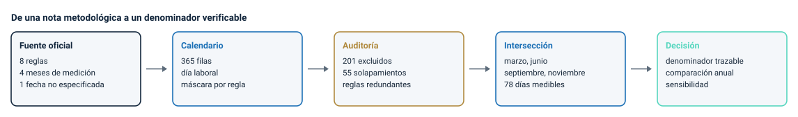
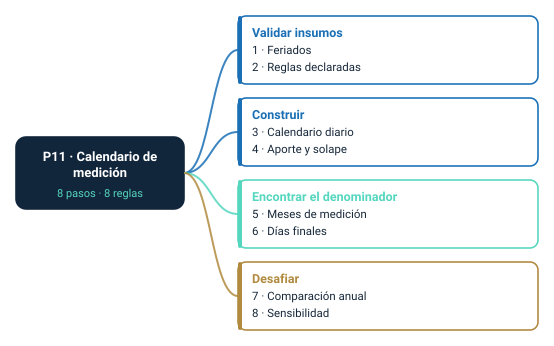
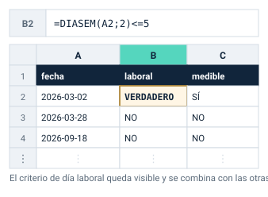
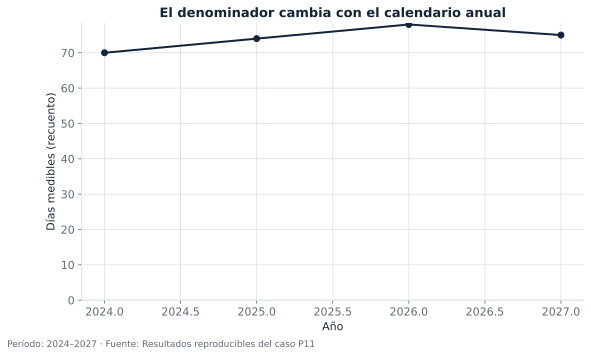

# P11 · Calendario de medición de un indicador oficial

◀ [P08 · Cobertura espacial](../cobertura_de_carga/CUADERNO.md) · [Todos los cuadernos](../../docs/cuadernos.md) · [P12/P13 · Frecuencia programada](../frecuencia_programada/CUADERNO.md) ▶

[](https://colab.research.google.com/github/vladimiracunadev-create/applied-data-analysis-and-assessment-lab/blob/main/cases/calendario_medicion/cuaderno/colab.ipynb) — corre los pasos sin instalar nada: el cuaderno clona el repositorio y descarga los datos del portal.

> **¿Qué días de 2026 entran en la medición según las reglas oficiales?**

## 1 · El problema

El denominador de un indicador oficial no es «los días del año». La metodología
descarta fines de semana, feriados, tres meses completos, vacaciones de invierno, la
semana de fiestas patrias y otras fechas. Además, la medición ocurre solo en cuatro
meses. Una nota al pie decide qué observaciones pueden entrar al indicador.

El riesgo no está en restar días, sino en sumar exclusiones solapadas. En 2026 las ocho
reglas marcan 256 días, pero el calendario contiene 365 y solo 201 quedan excluidos: 55
marcas se superponen. El cuaderno construye cada regla como una máscara auditable y
mide su aporte al denominador final.

**Los datos.** Metodología DIPRES, listado versionado de feriados y calendario gregoriano.



## 2 · La solución que se va a aplicar

Se valida primero el listado de feriados contra Pascua y fechas fijas. Luego se genera
un calendario diario, se aplican las ocho reglas y se auditan sus solapamientos. El
resultado se cruza con los meses efectivos de medición. Por último se compara 2024–2027
para distinguir redundancias estructurales de coincidencias accidentales y se somete a
sensibilidad el único supuesto no fijado por la fuente: las vacaciones de invierno.



### El mismo resultado en Pandas, Polars y R

Los pasos anteriores y siguientes conservan la resolución completa en Pandas. Este laboratorio adicional aísla el indicador central para resolverlo tres veces sobre **la misma tabla, las mismas reglas y la misma escala gráfica**. Así la comparación cambia el motor, no el problema.

#### Contrato común del ejercicio

- **Objetivo.** Comparar el denominador de días medibles entre años bajo las mismas reglas.
- **Fuente que leen las tres implementaciones.**
  [`resultados/comparacion_anios.csv`](resultados/comparacion_anios.csv), CSV UTF-8 versionado y producido
  por la resolución completa del caso. Los datos originales, su publicador, fecha,
  licencia, URL y huella se documentan en [`case.json`](case.json) y, cuando existe,
  `procedencia.json`. Este CSV es un **resultado reproducible**, no se presenta como
  una nueva fuente oficial.
- **Alcance.** días medibles por año. Los tres scripts comparables no sustituyen la adquisición,
  limpieza ni controles completos de los pasos Pandas: aíslan el indicador para que
  una diferencia observada sea atribuible al motor.
- **Fórmula o regla.** días_medibles_a = Σ 1(día laboral y no excluido por ninguna regla) para el año a.
- **Interpretación.** Las diferencias anuales pueden venir del calendario, aunque la metodología no cambie.
- **Error frecuente.** Reutilizar la lista de feriados de un año en otro altera el denominador silenciosamente.

| Campo | Tipo observado | Función en el ejercicio |
| --- | --- | --- |
| `anio` | `int64` | categoría/eje X |
| `dias_medibles` | `int64` | medida/eje Y |
| `fin_de_semana` | `int64` | campo auxiliar del contrato |
| `dias_28_y_29` | `int64` | campo auxiliar del contrato |
| `semana_fiestas_patrias` | `int64` | campo auxiliar del contrato |
| `feriados` | `int64` | campo auxiliar del contrato |
| `once_de_septiembre` | `int64` | campo auxiliar del contrato |
| `meses_completos` | `int64` | campo auxiliar del contrato |
| `vacaciones_invierno` | `int64` | campo auxiliar del contrato |
| `dia_joven_combatiente` | `int64` | campo auxiliar del contrato |

#### Qué cambia entre motores

| Dimensión | Pandas | Polars | R (`dplyr`/`readr`) |
| --- | --- | --- | --- |
| Modelo | DataFrame mutable por operaciones | expresiones columnares y plan optimizable | tubería declarativa sobre `tibble` |
| Nulos | `NaN`/`NA`; `groupby` exige decidir `dropna` | `null` separado de `NaN` | `NA`; muchas funciones exigen `na.rm` explícito |
| Orden | varias operaciones lo conservan, pero se ordena explícitamente | no se presupone tras agrupar | se fija con `arrange` |
| Gráfico | Matplotlib | Matplotlib tras extraer sólo X/Y | ggplot2 y su gramática de capas |
| Ventaja típica | ecosistema amplio y aprendizaje gradual | paralelismo, tipos y consultas grandes | estadística, comunicación y análisis reproducible |
| Límite aquí | el índice puede introducir alineaciones implícitas | añade una dependencia y otra semántica de tipos | requiere runtime y paquetes R independientes |

La equivalencia se valida sobre CSV normalizados con tolerancia numérica `1e-9`; no
se exige que la sintaxis ni los píxeles sean idénticos. Para ejecutar en un entorno
limpio consulte [`docs/ejecucion-portable.md`](../../docs/ejecucion-portable.md).

| Motor | Alcance verificado | Archivo | Ejecutar |
| --- | --- | --- | --- |
| Pandas + Matplotlib | días medibles por año | [`solucion_pandas.py`](cuaderno/solucion_pandas.py) | `python cases/calendario_medicion/cuaderno/solucion_pandas.py` |
| Polars + Matplotlib | días medibles por año | [`solucion_polars.py`](cuaderno/solucion_polars.py) | `uv run --extra polars python cases/calendario_medicion/cuaderno/solucion_polars.py` |
| R + ggplot2 | días medibles por año | [`solucion.R`](cuaderno/solucion.R) | `Rscript cases/calendario_medicion/cuaderno/solucion.R` |

#### Pandas + Matplotlib

```python
"""Laboratorio comparable Pandas + Matplotlib del caso calendario_medicion.

Lee el mismo contrato CSV que las versiones Polars y R. La resolución completa del
caso permanece en ``solution.py`` y en los pasos del cuaderno; este archivo aísla el
indicador central para que la comparación entre motores sea controlada.
"""
from __future__ import annotations

import argparse
import sys
from pathlib import Path

import matplotlib.pyplot as plt
import pandas as pd

if hasattr(sys.stdout, "reconfigure"):
    sys.stdout.reconfigure(encoding="utf-8")

# Buscar la raíz desde el propio archivo evita rutas C:\... específicas del autor y
# funciona igual después de clonar el repositorio en Linux, Windows o Google Colab.
ROOT = Path(__file__).resolve().parents[3] if "__file__" in globals() else Path.cwd()
SOURCE = ROOT / "cases" / "calendario_medicion" / "resultados" / "comparacion_anios.csv"
REQUIRED = {"anio", "dias_medibles"}


def analizar() -> pd.DataFrame:
    """Carga, valida y transforma el indicador; no modifica el archivo de entrada."""
    datos = pd.read_csv(SOURCE)
    faltantes = REQUIRED.difference(datos.columns)
    if faltantes:
        raise ValueError(f"Faltan columnas requeridas en {SOURCE}: {sorted(faltantes)}")
    # La expresión conserva explícitos filtro, agrupación, orden y selección para que
    # el estudiante pueda alinearlos con las expresiones de Polars y dplyr.
    resultado = datos.sort_values("anio")[["anio", "dias_medibles"]]
    return resultado.reset_index(drop=True)


def graficar(resultado: pd.DataFrame, destino: Path) -> Path:
    """Representa exactamente las columnas comparadas y explicita sus unidades."""
    x = resultado["anio"].tolist()
    y = resultado["dias_medibles"].tolist()
    fig, ax = plt.subplots(figsize=(9, 5))
    ax.plot(x, y, marker="o", linewidth=2, color="#11253B")
    ax.set_xlabel("Año")
    ax.set_ylabel("Días medibles (recuento)")
    ax.set_ylim(bottom=0)
    ax.set_title("El denominador cambia con el calendario anual")
    ax.grid(axis="y", alpha=0.25)
    fig.text(0.01, 0.01, "Fuente: Resultados reproducibles del caso P11 · Período: 2024–2027", fontsize=8, color="#58677A")
    fig.tight_layout(rect=(0, 0.05, 1, 1))
    fig.savefig(destino, dpi=150, bbox_inches="tight")
    plt.close(fig)
    return destino


def main() -> None:
    parser = argparse.ArgumentParser(description=__doc__)
    parser.add_argument("--salida", type=Path, help="CSV normalizado para comparar motores")
    parser.add_argument("--grafico", type=Path, help="PNG de la visualización comparable")
    args = parser.parse_args()
    resultado = analizar()
    print(resultado.to_string(index=False))
    if args.salida:
        resultado.to_csv(args.salida, index=False)
    if args.grafico:
        print(graficar(resultado, args.grafico))


if __name__ == "__main__":
    main()
```

#### Polars + Matplotlib

```python
"""Laboratorio comparable Polars + Matplotlib del caso calendario_medicion.

Usa el mismo CSV, columnas, reglas y escala que Pandas y R. Polars expresa las
transformaciones como un plan de expresiones columnares; esa diferencia de método es
el objeto de aprendizaje, no una razón para cambiar la pregunta.
"""
from __future__ import annotations

import argparse
import sys
from pathlib import Path

import matplotlib.pyplot as plt
import polars as pl

if hasattr(sys.stdout, "reconfigure"):
    sys.stdout.reconfigure(encoding="utf-8")

ROOT = Path(__file__).resolve().parents[3] if "__file__" in globals() else Path.cwd()
SOURCE = ROOT / "cases" / "calendario_medicion" / "resultados" / "comparacion_anios.csv"
REQUIRED = {"anio", "dias_medibles"}


def analizar() -> pl.DataFrame:
    """Carga y valida antes de transformar para producir un error explicativo."""
    datos = pl.read_csv(SOURCE)
    faltantes = REQUIRED.difference(datos.columns)
    if faltantes:
        raise ValueError(f"Faltan columnas requeridas en {SOURCE}: {sorted(faltantes)}")
    # select al final fija el contrato de salida y evita comparar columnas auxiliares.
    return datos.sort("anio").select(["anio", "dias_medibles"])


def graficar(resultado: pl.DataFrame, destino: Path) -> Path:
    """Convierte sólo las series del gráfico; el análisis permanece en Polars."""
    x = resultado["anio"].to_list()
    y = resultado["dias_medibles"].to_list()
    fig, ax = plt.subplots(figsize=(9, 5))
    ax.plot(x, y, marker="o", linewidth=2, color="#11253B")
    ax.set_xlabel("Año")
    ax.set_ylabel("Días medibles (recuento)")
    ax.set_ylim(bottom=0)
    ax.set_title("El denominador cambia con el calendario anual")
    ax.grid(axis="y", alpha=0.25)
    fig.text(
        0.01,
        0.01,
        "Fuente: Resultados reproducibles del caso P11 · Período: 2024–2027",
        fontsize=8,
        color="#58677A",
    )
    fig.tight_layout(rect=(0, 0.05, 1, 1))
    fig.savefig(destino, dpi=150, bbox_inches="tight")
    plt.close(fig)
    return destino


def main() -> None:
    parser = argparse.ArgumentParser(description=__doc__)
    parser.add_argument("--salida", type=Path, help="CSV normalizado para comparar motores")
    parser.add_argument("--grafico", type=Path, help="PNG de la visualización comparable")
    args = parser.parse_args()
    resultado = analizar()
    print(resultado)
    if args.salida:
        resultado.write_csv(args.salida)
    if args.grafico:
        print(graficar(resultado, args.grafico))


if __name__ == "__main__":
    main()
```

#### R + ggplot2

```r
#!/usr/bin/env Rscript
# Laboratorio comparable R + dplyr/readr + ggplot2 del caso calendario_medicion.
#
# La resolución completa sigue en solution.py y en los pasos Pandas. Este script
# cambia el motor sobre el mismo contrato CSV para estudiar sintaxis y semántica sin
# cambiar datos, indicador ni escala gráfica.

required <- c("readr", "dplyr")
missing <- required[!vapply(required, requireNamespace, logical(1), quietly = TRUE)]
if (length(missing)) {
  stop(
    "Faltan paquetes: ", paste(missing, collapse = ", "),
    ". Instálelos con install.packages(c('readr', 'dplyr', 'ggplot2'))."
  )
}

# Buscar pyproject.toml hacia arriba hace portable el script entre terminal, RStudio,
# Posit Cloud, IRkernel y un clon en Colab. LAB_ROOT permite una ruta explícita sin
# codificar la unidad o el directorio del desarrollador.
find_root <- function(start = getwd()) {
  current <- normalizePath(start, mustWork = TRUE)
  repeat {
    if (file.exists(file.path(current, "pyproject.toml"))) return(current)
    parent <- dirname(current)
    if (identical(parent, current)) stop("No se encontró la raíz del repositorio.")
    current <- parent
  }
}
root <- Sys.getenv("LAB_ROOT", unset = find_root())
source_csv <- file.path(root, "cases", "calendario_medicion", "resultados", "comparacion_anios.csv")

# readr conserva nombres y tipos previsibles. La validación temprana produce un error
# que explica el contrato roto, en vez de fallar más tarde dentro de una gráfica.
datos <- readr::read_csv(source_csv, show_col_types = FALSE, progress = FALSE)
required_columns <- c("anio", "dias_medibles")
missing_columns <- setdiff(required_columns, names(datos))
if (length(missing_columns)) stop("Faltan columnas: ", paste(missing_columns, collapse = ", "))

# dplyr expresa la misma selección, filtro, agrupación y orden que las otras vías.
resultado <- datos |> dplyr::arrange(.data$anio) |> dplyr::select(.data$anio, .data$dias_medibles)
print(resultado)

args <- commandArgs(trailingOnly = TRUE)
value_after <- function(flag) {
  pos <- match(flag, args)
  if (is.na(pos)) return(NULL)
  if (pos == length(args)) stop(flag, " necesita una ruta de salida")
  args[pos + 1]
}

csv_output <- value_after("--salida")
if (!is.null(csv_output)) readr::write_csv(resultado, csv_output)

plot_output <- value_after("--grafico")
if (!is.null(plot_output)) {
  if (!requireNamespace("ggplot2", quietly = TRUE)) {
    stop("Instale ggplot2 para generar el gráfico: install.packages('ggplot2')")
  }
  grafico <- ggplot2::ggplot(
    resultado,
    ggplot2::aes(x = .data[["anio"]], y = .data[["dias_medibles"]])
  ) +
    ggplot2::geom_line(ggplot2::aes(group = 1), linewidth = 1, colour = "#11253B") +
    ggplot2::geom_point(size = 2.5, colour = "#55D6BE") +
    ggplot2::labs(
      title = "El denominador cambia con el calendario anual",
      x = "Año", y = "Días medibles (recuento)",
      caption = "Fuente: Resultados reproducibles del caso P11 · Período: 2024–2027"
    ) +
    ggplot2::theme_minimal(base_size = 11)
  ggplot2::ggsave(plot_output, grafico, width = 9, height = 5, dpi = 150)
  cat(plot_output, "\n")
}
```

8 pasos. Cada uno trae el código de **Python**, la salida que devuelve de verdad, y la **fórmula de Excel** equivalente dibujada en su hoja. 8 traen además la trampa de hacerlo de la forma obvia.

| # | Paso | Trampa |
| --- | --- | --- |
| 1 | [Validar la fuente de feriados](#paso-1) | sí |
| 2 | [Declarar las ocho reglas antes de calcular](#paso-2) | sí |
| 3 | [Construir el calendario diario](#paso-3) | sí |
| 4 | [Medir solapamientos y redundancias](#paso-4) | sí |
| 5 | [Cruzar con los meses efectivos de medición](#paso-5) | sí |
| 6 | [Cuantificar el aporte al denominador final](#paso-6) | sí |
| 7 | [Distinguir redundancia estructural de accidental](#paso-7) | sí |
| 8 | [Medir el supuesto de vacaciones de invierno](#paso-8) | sí |

### Para trabajar

| Archivo | Qué es |
| --- | --- |
| [`P11-caso-completo.zip`](cuaderno/P11-caso-completo.zip) | **todo el caso en un ZIP**: el cuaderno, el script, el libro de Excel y las figuras |
| [`pasos.py`](cuaderno/pasos.py) | los 8 pasos seguidos. Se corre y muestra cada salida |
| [`practica.xlsx`](cuaderno/practica.xlsx) | las fórmulas y **el resultado que deben dar**, para corregirse solo. Se abre igual en Google Sheets |
| [`colab.ipynb`](cuaderno/colab.ipynb) | el cuaderno **ejecutable en Colab**: clona, descarga los datos del portal y corre los 8 pasos |
| [`solucion_pandas.py`](cuaderno/solucion_pandas.py) | solución ejecutable en Pandas + Matplotlib; incluye el contraste numérico y el gráfico del caso |
| [`solucion_polars.py`](cuaderno/solucion_polars.py) | solución ejecutable en Polars + Matplotlib; incluye el contraste numérico y el gráfico del caso |
| [`solucion.R`](cuaderno/solucion.R) | solución ejecutable en R + ggplot2; incluye el contraste numérico y el gráfico del caso |
| [`solucion.Rmd`](cuaderno/solucion.Rmd) | documento R Markdown para RStudio, Posit Cloud y render reproducible; reutiliza `solucion.R` sin duplicar la lógica |

---

## 3 · Los pasos

<a id="paso-1"></a>

### Paso 1 · Validar la fuente de feriados

El insumo externo se confronta con Pascua calculada y diez fechas fijas.

#### Python

```python
resultados = p11.analizar(2026)
resultados['validacion_feriados']
```

| comprobacion | resultado | veredicto |
| --- | --- | --- |
| cantidad de feriados en el listado | 16 | — |
| Domingo de Pascua calculado (2026-04-05) | no es feriado por sí mismo | — |
| Viernes Santo coincide con el cálculo | 2026-04-03 | sí |
| Sábado Santo coincide con el cálculo | 2026-04-04 | sí |
| feriados de fecha fija presentes (10 esperado… | 10 de 10 | sí |
| feriados movibles por Ley 19.973 | no verificable con los medios de este caso | declarado |
*6 filas × 3 columnas.*

#### Excel

Comparar el listado contra una tabla de fechas esperadas con `BUSCARX` y marcar faltantes.

> **La trampa.** Un CSV descargado no se vuelve verdadero por estar bien formado.

[↑ volver al recorrido](#2--la-solución-que-se-va-a-aplicar)

---

<a id="paso-2"></a>

### Paso 2 · Declarar las ocho reglas antes de calcular

Cada exclusión conserva nombre, descripción y fuente.

#### Python

```python
resultados['exclusion_por_regla'][['regla','excluye','exclusiva','solapada','aporte_pct']]
```

| regla | excluye | exclusiva | solapada | aporte_pct |
| --- | --- | --- | --- | --- |
| fin_de_semana | 104 | 62 | 42 | 16.99 |
| feriados | 16 | 4 | 12 | 1.1 |
| meses_completos | 90 | 58 | 32 | 15.89 |
| vacaciones_invierno | 14 | 9 | 5 | 2.47 |
| semana_fiestas_patrias | 7 | 4 | 3 | 1.1 |
| once_de_septiembre | 1 | 1 | 0 | 0.27 |
| dia_joven_combatiente | 1 | 0 | 1 | 0.0 |
| dias_28_y_29 | 23 | 11 | 12 | 3.01 |
*8 filas × 5 columnas.*

#### Excel

Una columna booleana por regla; nunca una única fórmula opaca con todas mezcladas.

> **La trampa.** Sumar los excluidos por regla cuenta 55 días más de una vez.

[↑ volver al recorrido](#2--la-solución-que-se-va-a-aplicar)

---

<a id="paso-3"></a>

### Paso 3 · Construir el calendario diario

Una fila por fecha permite auditar por qué cada día entra o sale.

#### Python

```python
resultados['resumen_calendario']
```

| indicador | valor | unidad |
| --- | --- | --- |
| dias_del_rango | 365.0 | días |
| dias_laborales | 261.0 | días |
| dias_incluidos | 164.0 | días |
| dias_excluidos | 201.0 | días |
| inclusion_pct | 44.93 | % |
| inclusion_sobre_laborales_pct | 62.84 | % |
| suma_de_exclusiones_por_regla | 256.0 | días |
| solapamiento_total | 55.0 | días |
*8 filas × 3 columnas.*

#### Excel



`=SECUENCIA(FECHA(2027;1;1)-FECHA(2026;1;1);1;FECHA(2026;1;1);1)`.

Debe dar: **365 fechas**

**En Google Sheets:** la misma fórmula, sin cambios.

> **La trampa.** Trabajar solo con totales impide explicar un día particular.

[↑ volver al recorrido](#2--la-solución-que-se-va-a-aplicar)

---

<a id="paso-4"></a>

### Paso 4 · Medir solapamientos y redundancias

Una regla puede excluir días y aun no aportar ninguno dado el resto.

#### Python

```python
resultados['reglas_redundantes']
```

| regla | descripcion | motivo |
| --- | --- | --- |
| dia_joven_combatiente | 29 de marzo, Día del joven combatiente | otra regla ya excluye todos sus días |
*1 filas × 3 columnas.*

#### Excel

Contar `regla=VERDADERO` y `otras_reglas=FALSO` para obtener el aporte exclusivo.

> **La trampa.** Que una regla sea redundante en un año no demuestra que sea innecesaria siempre.

[↑ volver al recorrido](#2--la-solución-que-se-va-a-aplicar)

---

<a id="paso-5"></a>

### Paso 5 · Cruzar con los meses efectivos de medición

El denominador real es la intersección, no todos los días elegibles del año.

#### Python

```python
resultados['resumen_medicion']
```

| indicador | valor | unidad | definicion |
| --- | --- | --- | --- |
| dias_del_anio | 365.0 | días | Días calendario del año |
| dias_laborales | 261.0 | días | De lunes a viernes |
| dias_elegibles | 164.0 | días | Tras aplicar las ocho reglas de exclusión |
| dias_en_meses_de_medicion | 121.0 | días | Marzo, junio, septiembre y noviembre |
| laborales_en_meses_de_medicion | 87.0 | días | Días laborales de esos cuatro meses |
| dias_medibles | 78.0 | días | Elegibles Y en un mes de medición: el denomin… |
| retencion_sobre_laborales_pct | 62.83524904214559 | % | Qué proporción de los días laborales sobreviv… |
| medibles_sobre_laborales_del_trimestre_pct | 89.65517241379311 | % | Proporción de los días laborales de los cuatr… |
*8 filas × 4 columnas.*

#### Excel

`=Y(elegible;ESNUMERO(COINCIDIR(MES(fecha);{3;6;9;11};0)))`.

Debe dar: **78 días medibles**

**En Google Sheets:** la misma fórmula, sin cambios.

> **La trampa.** Publicar 164 días elegibles responde otra pregunta; solo 78 están en meses de medición.

[↑ volver al recorrido](#2--la-solución-que-se-va-a-aplicar)

---

<a id="paso-6"></a>

### Paso 6 · Cuantificar el aporte al denominador final

Se quita una regla a la vez y se recalcula la intersección.

#### Python

```python
resultados['aporte_sobre_medibles']
```

| regla | medibles_con_la_regla | medibles_sin_la_regla | dias_medibles_que_quita | afecta_al_denominador |
| --- | --- | --- | --- | --- |
| fin_de_semana | 78 | 103 | 25 | sí |
| semana_fiestas_patrias | 78 | 82 | 4 | sí |
| dias_28_y_29 | 78 | 80 | 2 | sí |
| once_de_septiembre | 78 | 79 | 1 | sí |
| vacaciones_invierno | 78 | 78 | 0 | NO |
| meses_completos | 78 | 78 | 0 | NO |
| feriados | 78 | 78 | 0 | NO |
| dia_joven_combatiente | 78 | 78 | 0 | NO |
*8 filas × 5 columnas.*

#### Excel

Recalcular el conteo medible desactivando cada columna de regla por turno.

> **La trampa.** Meses completos excluye 90 días del año y cero días del denominador medido.

[↑ volver al recorrido](#2--la-solución-que-se-va-a-aplicar)

---

<a id="paso-7"></a>

### Paso 7 · Distinguir redundancia estructural de accidental

Cuatro años muestran qué reglas jamás afectan y cuáles dependen del calendario.

#### Python

```python
resultados['clasificacion_reglas']
```

| regla | clasificacion | anios_sin_efecto | minimo_que_quita | maximo_que_quita | nota |
| --- | --- | --- | --- | --- | --- |
| fin_de_semana | efectiva | 0 | 25 | 30 | quita días medibles todos los años |
| dias_28_y_29 | efectiva | 0 | 2 | 4 | quita días medibles todos los años |
| semana_fiestas_patrias | efectiva | 0 | 2 | 4 | quita días medibles todos los años |
| feriados | redundante accidental | 1 | 0 | 3 | sin efecto solo en 2026; depende de cómo cae … |
| once_de_septiembre | redundante accidental | 1 | 0 | 1 | sin efecto solo en 2027; depende de cómo cae … |
| meses_completos | redundante estructural | 4 | 0 | 0 | no afecta en ningún año analizado |
| vacaciones_invierno | redundante estructural | 4 | 0 | 0 | no afecta en ningún año analizado |
| dia_joven_combatiente | redundante estructural | 4 | 0 | 0 | no afecta en ningún año analizado |
*8 filas × 6 columnas.*



*El denominador cambia con el calendario anual. Ejes con unidad, período y fuente; el código Polars y R genera la misma vista.*

#### Excel

Tabla por año y regla; `=MAX(rango)=0` identifica redundancia estructural en el período.

> **La trampa.** Feriados no afecta en 2026, pero sí elimina entre uno y tres días en otros años.

[↑ volver al recorrido](#2--la-solución-que-se-va-a-aplicar)

---

<a id="paso-8"></a>

### Paso 8 · Medir el supuesto de vacaciones de invierno

La fecha no publicada se desplaza ±14 días para comprobar si cambia la decisión.

#### Python

```python
resultados['sensibilidad_invierno']
```

| inicio_supuesto | desplazamiento_dias | dias_elegibles | dias_medibles | diferencia_vs_supuesto |
| --- | --- | --- | --- | --- |
| 2026-06-22 | -14 | 164 | 72 | -6 |
| 2026-06-29 | -7 | 164 | 77 | -1 |
| 2026-07-06 | 0 | 164 | 78 | 0 |
| 2026-07-13 | 7 | 164 | 78 | 0 |
| 2026-07-20 | 14 | 165 | 78 | 0 |
*5 filas × 5 columnas.*

#### Excel

Tabla de escenarios con el inicio supuesto y recálculo del conteo medible.

> **La trampa.** Mover el supuesto a junio reduce el denominador hasta seis días; no es un detalle narrativo.

[↑ volver al recorrido](#2--la-solución-que-se-va-a-aplicar)

---

## 4 · El resultado

De 261 días laborales quedan 164 elegibles y 78 medibles. Cuatro reglas no cambian el denominador de 2026, pero solo tres son estructuralmente redundantes en 2024–2027.

## 5 · Qué queda aprendido

1. El denominador es una decisión documentada y debe poder explicarse fecha por fecha.
2. Las exclusiones se combinan como conjuntos; sumar conteos ignora sus intersecciones.
3. Una redundancia de un año puede ser accidental.
4. Todo supuesto de calendario se somete a sensibilidad antes de publicar.

## Reproducir

```powershell
python -m cases.calendario_medicion.solution
```

## Seguir

Lo que este caso toca y se trata a fondo en otro sitio:

- [Hallazgos auditables del caso](README.md)
- [Indicadores oficiales de transporte](../../docs/indicadores-oficiales-transporte.md)

◀ [P08 · Cobertura espacial](../cobertura_de_carga/CUADERNO.md) · [Todos los cuadernos](../../docs/cuadernos.md) · [P12/P13 · Frecuencia programada](../frecuencia_programada/CUADERNO.md) ▶
