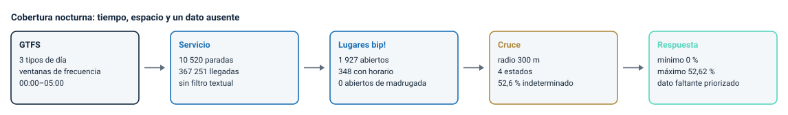
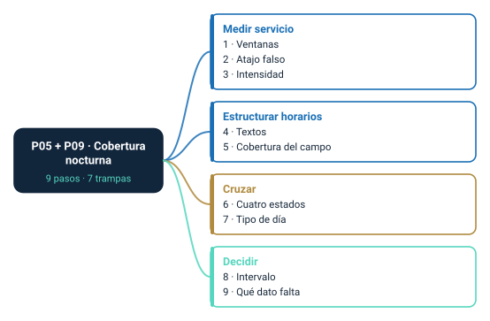
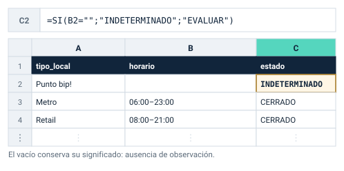

# P05-P09 · Horarios libres y cobertura de carga nocturna

◀ [P08 · Cobertura espacial](../cobertura_de_carga/CUADERNO.md) · [Todos los cuadernos](../../docs/cuadernos.md) · [P10 · Correspondencia buses–Metro](../correspondencia_metro/CUADERNO.md) ▶

[](https://colab.research.google.com/github/vladimiracunadev-create/applied-data-analysis-and-assessment-lab/blob/main/cases/carga_nocturna/cuaderno/colab.ipynb) — corre los pasos sin instalar nada: el cuaderno clona el repositorio y descarga los datos del portal.

> **Donde hay buses entre las 00:00 y las 05:00, ¿hay dónde cargar la tarjeta?**

## 1 · El problema

La cobertura nocturna une tres preguntas: dónde pasa un bus entre las 00:00 y las
05:00, si hay un local de carga a 300 metros y si ese local está abierto. Las dos
primeras se calculan; la tercera tropieza con un dato ausente: 1 579 de los 1 927
locales no publican horario.

El GTFS agrega otra trampa. En expediciones por frecuencia, `arrival_time` es un
desplazamiento desde el inicio y no una hora de reloj. Filtrarlo como texto inventa
1 681 paradas nocturnas. La cifra falsa sobrestima solo 15,98 %, suficiente para parecer
plausible. La respuesta correcta no es un sí/no: tiene una tercera categoría,
indeterminada, y se expresa como intervalo.

**Los datos.** GTFS Red Movilidad y horarios publicados en los cinco Excel de lugares bip!.



## 2 · La solución que se va a aplicar

Se auditan las ventanas de servicio, se mide el error del filtro ingenuo y se obtiene
la intensidad nocturna sin expandir millones de filas. En paralelo se interpreta cada
texto de horario y se cuantifica la cobertura del campo. El cruce espacial clasifica
cada parada en cuatro estados observables y el informe final transforma la falta de
datos en un intervalo y en una lista concreta de información que falta recopilar.



9 pasos. Cada uno trae el código de **Python**, la salida que devuelve de verdad, y la **fórmula de Excel** equivalente dibujada en su hoja. 9 traen además la trampa de hacerlo de la forma obvia.

| # | Paso | Trampa |
| --- | --- | --- |
| 1 | [Auditar las ventanas de servicio](#paso-1) | sí |
| 2 | [Demostrar por qué el filtro textual falla](#paso-2) | sí |
| 3 | [Describir la intensidad nocturna](#paso-3) | sí |
| 4 | [Convertir horarios libres en datos](#paso-4) | sí |
| 5 | [Medir la cobertura del campo horario](#paso-5) | sí |
| 6 | [Clasificar en cuatro estados observables](#paso-6) | sí |
| 7 | [Comprobar estabilidad por tipo de día](#paso-7) | sí |
| 8 | [Expresar la respuesta como intervalo](#paso-8) | sí |
| 9 | [Convertir la incertidumbre en una tarea](#paso-9) | sí |

### Para trabajar

| Archivo | Qué es |
| --- | --- |
| [`P05-P09-caso-completo.zip`](cuaderno/P05-P09-caso-completo.zip) | **todo el caso en un ZIP**: el cuaderno, el script, el libro de Excel y las figuras |
| [`pasos.py`](cuaderno/pasos.py) | los 9 pasos seguidos. Se corre y muestra cada salida |
| [`practica.xlsx`](cuaderno/practica.xlsx) | las fórmulas y **el resultado que deben dar**, para corregirse solo. Se abre igual en Google Sheets |
| [`colab.ipynb`](cuaderno/colab.ipynb) | el cuaderno **ejecutable en Colab**: clona, descarga los datos del portal y corre los 9 pasos |

---

## 3 · Los pasos

<a id="paso-1"></a>

### Paso 1 · Auditar las ventanas de servicio

Se mide qué servicios y ventanas aportan llegadas a la madrugada.

#### Python

```python
resultados = p09.analizar()
resultados['ventanas_por_servicio']
```

| service_id | dias_de_la_semana | ventanas | salidas | ventanas_que_empiezan_antes_de_las_5 | ventanas_que_terminan_a_las_24 | intervalo_mediano_nocturno_min |
| --- | --- | --- | --- | --- | --- | --- |
| D | 1 | 3643 | 36875 | 309 | 554 | 30.0 |
| L | 5 | 6641 | 62747 | 392 | 575 | 30.0 |
| S | 1 | 4236 | 42744 | 333 | 555 | 30.0 |
*3 filas × 7 columnas.*

#### Excel

Filtrar ventanas que intersectan [00:00;05:00), no solo las que empiezan dentro.

> **La trampa.** Una ventana que empieza antes de medianoche puede aportar servicio después de las 00:00.

[↑ volver al recorrido](#2--la-solución-que-se-va-a-aplicar)

---

<a id="paso-2"></a>

### Paso 2 · Demostrar por qué el filtro textual falla

El atajo se calcula al lado del método correcto y se mide su error.

#### Python

```python
resultados['atajo_comparado']
```

| indicador | valor | unidad | definicion |
| --- | --- | --- | --- |
| filas_que_el_atajo_toma | 851773.0 | filas | Filas cuyo arrival_time cae entre 00:00:00 y … |
| de_ellas_con_horario_relativo | 851773.0 | filas | Filas de expediciones de frecuencia, cuyo arr… |
| proporcion_relativas | 100.0 | % | Si es 100, el atajo no está midiendo horas en… |
| paradas_segun_el_atajo | 12201.0 | paradas | Paradas que el atajo reporta como nocturnas |
| paradas_correctas | 10520.0 | paradas | Paradas con al menos una llegada real en la v… |
| sobreestimacion | 15.98 | % | Lo bastante pequeña para que el resultado par… |
| paradas_que_el_atajo_inventa | 1681.0 | paradas | Reportadas como nocturnas sin tener ninguna l… |
| paradas_que_el_atajo_pierde | 0.0 | paradas | Nocturnas que el atajo no reporta |
*8 filas × 4 columnas.*

#### Excel

Separar expediciones con frecuencia antes de interpretar `arrival_time` como reloj.

> **La trampa.** El 100 % de las filas que toma el atajo son desplazamientos relativos, no horas.

[↑ volver al recorrido](#2--la-solución-que-se-va-a-aplicar)

---

<a id="paso-3"></a>

### Paso 3 · Describir la intensidad nocturna

No basta con saber que una parada aparece: se cuentan llegadas y se muestran percentiles.

#### Python

```python
resultados['intensidad']
```

| estadistico | llegadas |
| --- | --- |
| paradas con servicio nocturno | 10520.0 |
| P10 | 3.0 |
| P25 | 7.0 |
| P50 | 23.0 |
| P75 | 48.0 |
| P90 | 80.0 |
| P99 | 186.8 |
| máximo | 459.0 |
| una sola llegada en 5 h | 242.0 |
| 5 o menos (testimonial) | 1867.0 |
| solo por llegadas tras las 24:00 | 1490.0 |
*11 filas × 2 columnas.*

#### Excel

Tabla dinámica por parada y percentiles sobre el conteo de llegadas.

Debe dar: **23 llegadas medianas en cinco horas**

**En Google Sheets:** la misma fórmula, sin cambios.

> **La trampa.** Una sola llegada y 459 llegadas no representan la misma disponibilidad.

[↑ volver al recorrido](#2--la-solución-que-se-va-a-aplicar)

---

<a id="paso-4"></a>

### Paso 4 · Convertir horarios libres en datos

Cada texto se interpreta en días y tramos, y los no interpretables permanecen visibles.

#### Python

```python
resultados['horarios_interpretados']
```

| texto | registros | interpretado | dias_declarados | declara_festivos | motivo |
| --- | --- | --- | --- | --- | --- |
|  | 1579 | no | 0 | no | sin dato |
| Lun-Dom 08:00-21:00 | 168 | sí | 7 | no |  |
| Lunes a Viernes: 6:00 a 23:00 horas, Sábados:… | 143 | sí | 7 | sí |  |
| Lun a Sab 08:00 a 21:00 Dom y Festivos 09:00 … | 15 | sí | 7 | sí |  |
| Lun a Vie 06:00 a 23:00 Sab 07:00 a 23:00 Dom… | 9 | sí | 7 | sí |  |
| Lun a Vie 07:00 a 22:00 Sab 08:00 a 22:00 Dom… | 7 | sí | 7 | sí |  |
| Lun a Vie 05:30 a 23:00 Sab 06:30 a 23:00 Dom… | 2 | sí | 7 | sí |  |
| Lun a Sab 08:30 a 21:00 Dom y Festivos 09:00 … | 1 | sí | 7 | sí |  |
| Lun a Dom 09:00 a 22:00 Festivos 09:00 a 22:00 | 1 | sí | 7 | sí |  |
| Lun a Sab 08:00 a 21:00 Dom y Festivos 09:00 … | 1 | sí | 7 | sí |  |
| Lun-Sáb 08:00-22:00 ⏎ Dom 09:00-22:00  ⏎ Fest… | 1 | sí | 7 | sí |  |
*11 filas × 6 columnas.*

#### Excel

Power Query: normalizar saltos y abreviaturas; separar por día; convertir cada tramo a inicio y fin.

> **La trampa.** Vacío no significa cerrado: significa que el publicador no entregó el campo.

[↑ volver al recorrido](#2--la-solución-que-se-va-a-aplicar)

---

<a id="paso-5"></a>

### Paso 5 · Medir la cobertura del campo horario

La ausencia se reporta por tipo de local, no como una nota al pie.

#### Python

```python
resultados['cobertura_del_campo']
```

| tipo_local | locales | con_horario | abren_de_noche | cobertura_pct |
| --- | --- | --- | --- | --- |
| Centro bip! alto estándar | 7 | 7 | 0 | 100.0 |
| Centro bip! estándar | 29 | 29 | 0 | 100.0 |
| Estación de Metro | 143 | 143 | 0 | 100.0 |
| Punto bip! | 1579 | 0 | 0 | 0.0 |
| Retail | 169 | 169 | 0 | 100.0 |
| TOTAL | 1927 | 348 | 0 | 18.1 |
*6 filas × 5 columnas.*

#### Excel



`=CONTAR.SI.CONJUNTO(tipo;A2;horario;"<>")/CONTAR.SI(tipo;A2)`.

Debe dar: **18,1 % del total con horario**

**En Google Sheets:** la misma fórmula, sin cambios.

> **La trampa.** Promediar por archivo daría 80 %: cuatro fuentes completas y una vacía, sin ponderar sus tamaños.

[↑ volver al recorrido](#2--la-solución-que-se-va-a-aplicar)

---

<a id="paso-6"></a>

### Paso 6 · Clasificar en cuatro estados observables

La respuesta conserva cubierta, sin local, cerrado verificado e indeterminado.

#### Python

```python
resultados['respuesta']
```

| situacion | paradas | porcentaje | permite_afirmar |
| --- | --- | --- | --- |
| con carga abierta verificada | 0 | 0.0 | sí |
| sin local a 300 m | 4225 | 40.2 | sí |
| sin carga abierta (verificado) | 759 | 7.2 | sí |
| indeterminado: local cercano sin horario | 5536 | 52.6 | no |
| TOTAL con servicio nocturno | 10520 | 100.0 | — |
*5 filas × 4 columnas.*

#### Excel

`SI.CONJUNTO` con distancia, horario conocido y apertura; nunca rellenar el vacío con FALSO.

> **La trampa.** Reducir a cubierto/no cubierto mezcla 5 536 incógnitas con evidencia negativa.

[↑ volver al recorrido](#2--la-solución-que-se-va-a-aplicar)

---

<a id="paso-7"></a>

### Paso 7 · Comprobar estabilidad por tipo de día

Laboral, sábado y domingo se publican separados para no ocultar variación.

#### Python

```python
resultados['por_servicio']
```

| service_id | dias_de_la_semana | paradas_nocturnas | llegadas | con_carga_abierta | sin_local_cerca | cerrado_verificado | indeterminado | indeterminado_pct |
| --- | --- | --- | --- | --- | --- | --- | --- | --- |
| D | 1 | 9681 | 108291 | 0 | 3803 | 709 | 5169 | 53.4 |
| L | 5 | 10465 | 140424 | 0 | 4185 | 759 | 5521 | 52.8 |
| S | 1 | 9960 | 118536 | 0 | 3922 | 730 | 5308 | 53.3 |
*3 filas × 9 columnas.*

#### Excel

Tabla dinámica: tipo de día en filas, estado en columnas y paradas en valores.

> **La trampa.** Sumar los servicios repite una parada hasta tres veces; cada denominador se interpreta por separado.

[↑ volver al recorrido](#2--la-solución-que-se-va-a-aplicar)

---

<a id="paso-8"></a>

### Paso 8 · Expresar la respuesta como intervalo

El mínimo usa solo evidencia; el máximo muestra el caso favorable de todos los desconocidos.

#### Python

```python
resultados['intervalo']
```

| indicador | valor | unidad | definicion |
| --- | --- | --- | --- |
| paradas_con_servicio_nocturno | 10520.0 | paradas | El denominador de este indicador |
| cobertura_verificada | 0.0 | paradas | Paradas con un local que declara abrir de mad… |
| cobertura_minima_pct | 0.0 | % | El piso: lo que el dato permite afirmar |
| cobertura_maxima_pct | 52.62 | % | El techo: suponiendo que todos los locales si… |
| ancho_del_intervalo_pp | 52.62 | puntos | Cuánto de la pregunta sigue abierto. No lo pr… |
*5 filas × 4 columnas.*

#### Excel

Mínimo = abiertos verificados / total; máximo = (abiertos + indeterminados) / total.

Debe dar: **0,00 % a 52,62 %**

**En Google Sheets:** la misma fórmula, sin cambios.

> **La trampa.** Elegir el punto medio no agrega información: inventa una probabilidad que los datos no contienen.

[↑ volver al recorrido](#2--la-solución-que-se-va-a-aplicar)

---

<a id="paso-9"></a>

### Paso 9 · Convertir la incertidumbre en una tarea

Se identifica qué fuente completar y cuántas paradas desbloquea.

#### Python

```python
resultados['lo_que_falta']
```

| tipo_local | locales_por_completar | del_total_sin_horario_pct | paradas_que_desbloquean |
| --- | --- | --- | --- |
| Punto bip! | 1546 | 97.9 | 5536 |
*1 filas × 4 columnas.*

#### Excel

Agrupar los indeterminados por tipo de local y contar paradas asociadas.

> **La trampa.** Pedir 'mejorar los datos' sin señalar el campo y el impacto no es una recomendación ejecutable.

[↑ volver al recorrido](#2--la-solución-que-se-va-a-aplicar)

---

## 4 · El resultado

Hay 10 520 paradas con servicio nocturno. La cobertura abierta verificable es 0 %, pero 52,62 % permanece indeterminado: el dato correcto es un intervalo, no un cero definitivo.

## 5 · Qué queda aprendido

1. Horario relativo y hora absoluta son magnitudes distintas aunque compartan formato.
2. Vacío, cero y falso no son intercambiables.
3. Una clasificación honesta necesita una tercera respuesta cuando falta observación.
4. El ancho del intervalo mide el valor potencial de completar el dato.

## Reproducir

```powershell
python -m cases.carga_nocturna.solution
```

## Seguir

Lo que este caso toca y se trata a fondo en otro sitio:

- [Hallazgos auditables del caso](README.md)
- [P06 · Expansión de frecuencias](../gtfs_red_movilidad/CUADERNO.md)
- [P08 · Cobertura espacial](../cobertura_de_carga/CUADERNO.md)

◀ [P08 · Cobertura espacial](../cobertura_de_carga/CUADERNO.md) · [Todos los cuadernos](../../docs/cuadernos.md) · [P10 · Correspondencia buses–Metro](../correspondencia_metro/CUADERNO.md) ▶
