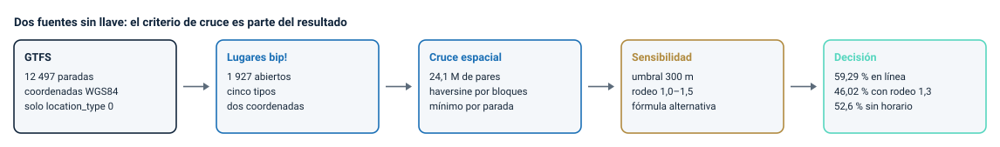
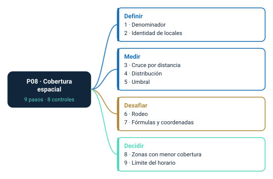
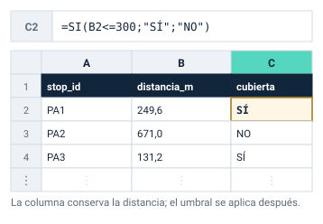
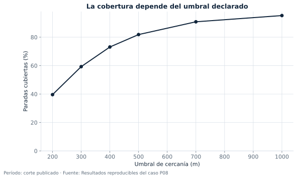

# P08 · Distancia al lugar de carga más cercano

◀ [P07 · Rendimiento GTFS](../rendimiento_gtfs/CUADERNO.md) · [Todos los cuadernos](../../docs/cuadernos.md) · [P11 · Calendario de medición](../calendario_medicion/CUADERNO.md) ▶

[](https://colab.research.google.com/github/vladimiracunadev-create/applied-data-analysis-and-assessment-lab/blob/main/cases/cobertura_de_carga/cuaderno/colab.ipynb) — corre los pasos sin instalar nada: el cuaderno clona el repositorio y descarga los datos del portal.

> **¿Qué proporción de las paradas tiene un lugar de carga bip! a 300 metros o menos?**

## 1 · El problema

Las paradas y los lugares de carga describen la misma ciudad, pero no comparten una
clave. La pregunta —qué proporción de las paradas tiene un lugar de carga a 300 metros—
obliga a declarar qué es una parada, cómo se mide una distancia sobre la Tierra y qué
significa «cerca».

El cruce comprende 12 497 paradas de embarque y 1 927 locales abiertos: más de 24
millones de pares. Una fórmula equivocada sigue produciendo un número razonable. Medir
grados como si fueran metros reduce la cobertura del 59,29 % al 54,69 % y asigna otro
local a 814 paradas. Además, la distancia en línea recta no es la distancia caminada;
por eso el cuaderno separa el dato calculado del supuesto de rodeo.

**Los datos.** GTFS Red Movilidad y los cinco Excel públicos de lugares de carga bip!.



## 2 · La solución que se va a aplicar

Primero se fija el denominador y se audita la supuesta llave de los locales. Después se
calcula la distancia mínima con haversine por bloques, se describe su distribución y se
mide la sensibilidad al umbral y al factor de rodeo. Finalmente se confrontan dos
fórmulas y dos representaciones de coordenadas, se localizan zonas rezagadas y se
declara el límite que impide afirmar si el lugar cercano está abierto.



### El mismo resultado en Pandas, Polars y R

Los pasos anteriores y siguientes conservan la resolución completa en Pandas. Este laboratorio adicional aísla el indicador central para resolverlo tres veces sobre **la misma tabla, las mismas reglas y la misma escala gráfica**. Así la comparación cambia el motor, no el problema.

#### Contrato común del ejercicio

- **Objetivo.** Medir cómo cambia la cobertura al variar el umbral de cercanía.
- **Fuente que leen las tres implementaciones.**
  [`resultados/cobertura_por_umbral.csv`](resultados/cobertura_por_umbral.csv), CSV UTF-8 versionado y producido
  por la resolución completa del caso. Los datos originales, su publicador, fecha,
  licencia, URL y huella se documentan en [`case.json`](case.json) y, cuando existe,
  `procedencia.json`. Este CSV es un **resultado reproducible**, no se presenta como
  una nueva fuente oficial.
- **Alcance.** curva de sensibilidad al umbral. Los tres scripts comparables no sustituyen la adquisición,
  limpieza ni controles completos de los pasos Pandas: aíslan el indicador para que
  una diferencia observada sea atribuible al motor.
- **Fórmula o regla.** cobertura(u) = 100 × #{paradas con distancia ≤ u} / #{paradas evaluables}. El denominador se mantiene fijo entre umbrales.
- **Interpretación.** La pendiente revela sensibilidad a una decisión metodológica; no demuestra demanda de nuevos puntos.
- **Error frecuente.** Cambiar simultáneamente umbral y denominador hace incomparables los puntos de la curva.

| Campo | Tipo observado | Función en el ejercicio |
| --- | --- | --- |
| `umbral_m` | `float64` | categoría/eje X |
| `paradas_cubiertas` | `int64` | campo auxiliar del contrato |
| `paradas_medidas` | `int64` | campo auxiliar del contrato |
| `cobertura_pct` | `float64` | medida/eje Y |
| `es_referencia` | `str` | campo auxiliar del contrato |

#### Qué cambia entre motores

| Dimensión | Pandas | Polars | R (`dplyr`/`readr`) |
| --- | --- | --- | --- |
| Modelo | DataFrame mutable por operaciones | expresiones columnares y plan optimizable | tubería declarativa sobre `tibble` |
| Nulos | `NaN`/`NA`; `groupby` exige decidir `dropna` | `null` separado de `NaN` | `NA`; muchas funciones exigen `na.rm` explícito |
| Orden | varias operaciones lo conservan, pero se ordena explícitamente | no se presupone tras agrupar | se fija con `arrange` |
| Gráfico | Matplotlib | Matplotlib tras extraer sólo X/Y | ggplot2 y su gramática de capas |
| Ventaja típica | ecosistema amplio y aprendizaje gradual | paralelismo, tipos y consultas grandes | estadística, comunicación y análisis reproducible |
| Límite aquí | el índice puede introducir alineaciones implícitas | añade una dependencia y otra semántica de tipos | requiere runtime y paquetes R independientes |

La equivalencia se valida sobre CSV normalizados con tolerancia numérica `1e-9`; no
se exige que la sintaxis ni los píxeles sean idénticos. Para ejecutar en un entorno
limpio consulte [`docs/ejecucion-portable.md`](../../docs/ejecucion-portable.md).

| Motor | Alcance verificado | Archivo | Ejecutar |
| --- | --- | --- | --- |
| Pandas + Matplotlib | curva de sensibilidad al umbral | [`solucion_pandas.py`](cuaderno/solucion_pandas.py) | `python cases/cobertura_de_carga/cuaderno/solucion_pandas.py` |
| Polars + Matplotlib | curva de sensibilidad al umbral | [`solucion_polars.py`](cuaderno/solucion_polars.py) | `uv run --extra polars python cases/cobertura_de_carga/cuaderno/solucion_polars.py` |
| R + ggplot2 | curva de sensibilidad al umbral | [`solucion.R`](cuaderno/solucion.R) | `Rscript cases/cobertura_de_carga/cuaderno/solucion.R` |

#### Pandas + Matplotlib

```python
"""Laboratorio comparable Pandas + Matplotlib del caso cobertura_de_carga.

Lee el mismo contrato CSV que las versiones Polars y R. La resolución completa del
caso permanece en ``solution.py`` y en los pasos del cuaderno; este archivo aísla el
indicador central para que la comparación entre motores sea controlada.
"""
from __future__ import annotations

import argparse
import sys
from pathlib import Path

import matplotlib.pyplot as plt
import pandas as pd

if hasattr(sys.stdout, "reconfigure"):
    sys.stdout.reconfigure(encoding="utf-8")

# Buscar la raíz desde el propio archivo evita rutas C:\... específicas del autor y
# funciona igual después de clonar el repositorio en Linux, Windows o Google Colab.
ROOT = Path(__file__).resolve().parents[3] if "__file__" in globals() else Path.cwd()
SOURCE = ROOT / "cases" / "cobertura_de_carga" / "resultados" / "cobertura_por_umbral.csv"
REQUIRED = {"umbral_m", "cobertura_pct"}


def analizar() -> pd.DataFrame:
    """Carga, valida y transforma el indicador; no modifica el archivo de entrada."""
    datos = pd.read_csv(SOURCE)
    faltantes = REQUIRED.difference(datos.columns)
    if faltantes:
        raise ValueError(f"Faltan columnas requeridas en {SOURCE}: {sorted(faltantes)}")
    # La expresión conserva explícitos filtro, agrupación, orden y selección para que
    # el estudiante pueda alinearlos con las expresiones de Polars y dplyr.
    resultado = datos.sort_values("umbral_m")[["umbral_m", "cobertura_pct"]]
    return resultado.reset_index(drop=True)


def graficar(resultado: pd.DataFrame, destino: Path) -> Path:
    """Representa exactamente las columnas comparadas y explicita sus unidades."""
    x = resultado["umbral_m"].tolist()
    y = resultado["cobertura_pct"].tolist()
    fig, ax = plt.subplots(figsize=(9, 5))
    ax.plot(x, y, marker="o", linewidth=2, color="#11253B")
    ax.set_xlabel("Umbral de cercanía (m)")
    ax.set_ylabel("Paradas cubiertas (%)")
    ax.set_ylim(bottom=0)
    ax.set_title("La cobertura depende del umbral declarado")
    ax.grid(axis="y", alpha=0.25)
    fig.text(0.01, 0.01, "Fuente: Resultados reproducibles del caso P08 · Período: corte publicado", fontsize=8, color="#58677A")
    fig.tight_layout(rect=(0, 0.05, 1, 1))
    fig.savefig(destino, dpi=150, bbox_inches="tight")
    plt.close(fig)
    return destino


def main() -> None:
    parser = argparse.ArgumentParser(description=__doc__)
    parser.add_argument("--salida", type=Path, help="CSV normalizado para comparar motores")
    parser.add_argument("--grafico", type=Path, help="PNG de la visualización comparable")
    args = parser.parse_args()
    resultado = analizar()
    print(resultado.to_string(index=False))
    if args.salida:
        resultado.to_csv(args.salida, index=False)
    if args.grafico:
        print(graficar(resultado, args.grafico))


if __name__ == "__main__":
    main()
```

#### Polars + Matplotlib

```python
"""Laboratorio comparable Polars + Matplotlib del caso cobertura_de_carga.

Usa el mismo CSV, columnas, reglas y escala que Pandas y R. Polars expresa las
transformaciones como un plan de expresiones columnares; esa diferencia de método es
el objeto de aprendizaje, no una razón para cambiar la pregunta.
"""
from __future__ import annotations

import argparse
import sys
from pathlib import Path

import matplotlib.pyplot as plt
import polars as pl

if hasattr(sys.stdout, "reconfigure"):
    sys.stdout.reconfigure(encoding="utf-8")

ROOT = Path(__file__).resolve().parents[3] if "__file__" in globals() else Path.cwd()
SOURCE = ROOT / "cases" / "cobertura_de_carga" / "resultados" / "cobertura_por_umbral.csv"
REQUIRED = {"umbral_m", "cobertura_pct"}


def analizar() -> pl.DataFrame:
    """Carga y valida antes de transformar para producir un error explicativo."""
    datos = pl.read_csv(SOURCE)
    faltantes = REQUIRED.difference(datos.columns)
    if faltantes:
        raise ValueError(f"Faltan columnas requeridas en {SOURCE}: {sorted(faltantes)}")
    # select al final fija el contrato de salida y evita comparar columnas auxiliares.
    return datos.sort("umbral_m").select(["umbral_m", "cobertura_pct"])


def graficar(resultado: pl.DataFrame, destino: Path) -> Path:
    """Convierte sólo las series del gráfico; el análisis permanece en Polars."""
    x = resultado["umbral_m"].to_list()
    y = resultado["cobertura_pct"].to_list()
    fig, ax = plt.subplots(figsize=(9, 5))
    ax.plot(x, y, marker="o", linewidth=2, color="#11253B")
    ax.set_xlabel("Umbral de cercanía (m)")
    ax.set_ylabel("Paradas cubiertas (%)")
    ax.set_ylim(bottom=0)
    ax.set_title("La cobertura depende del umbral declarado")
    ax.grid(axis="y", alpha=0.25)
    fig.text(
        0.01,
        0.01,
        "Fuente: Resultados reproducibles del caso P08 · Período: corte publicado",
        fontsize=8,
        color="#58677A",
    )
    fig.tight_layout(rect=(0, 0.05, 1, 1))
    fig.savefig(destino, dpi=150, bbox_inches="tight")
    plt.close(fig)
    return destino


def main() -> None:
    parser = argparse.ArgumentParser(description=__doc__)
    parser.add_argument("--salida", type=Path, help="CSV normalizado para comparar motores")
    parser.add_argument("--grafico", type=Path, help="PNG de la visualización comparable")
    args = parser.parse_args()
    resultado = analizar()
    print(resultado)
    if args.salida:
        resultado.write_csv(args.salida)
    if args.grafico:
        print(graficar(resultado, args.grafico))


if __name__ == "__main__":
    main()
```

#### R + ggplot2

```r
#!/usr/bin/env Rscript
# Laboratorio comparable R + dplyr/readr + ggplot2 del caso cobertura_de_carga.
#
# La resolución completa sigue en solution.py y en los pasos Pandas. Este script
# cambia el motor sobre el mismo contrato CSV para estudiar sintaxis y semántica sin
# cambiar datos, indicador ni escala gráfica.

required <- c("readr", "dplyr")
missing <- required[!vapply(required, requireNamespace, logical(1), quietly = TRUE)]
if (length(missing)) {
  stop(
    "Faltan paquetes: ", paste(missing, collapse = ", "),
    ". Instálelos con install.packages(c('readr', 'dplyr', 'ggplot2'))."
  )
}

# Buscar pyproject.toml hacia arriba hace portable el script entre terminal, RStudio,
# Posit Cloud, IRkernel y un clon en Colab. LAB_ROOT permite una ruta explícita sin
# codificar la unidad o el directorio del desarrollador.
find_root <- function(start = getwd()) {
  current <- normalizePath(start, mustWork = TRUE)
  repeat {
    if (file.exists(file.path(current, "pyproject.toml"))) return(current)
    parent <- dirname(current)
    if (identical(parent, current)) stop("No se encontró la raíz del repositorio.")
    current <- parent
  }
}
root <- Sys.getenv("LAB_ROOT", unset = find_root())
source_csv <- file.path(root, "cases", "cobertura_de_carga", "resultados", "cobertura_por_umbral.csv")

# readr conserva nombres y tipos previsibles. La validación temprana produce un error
# que explica el contrato roto, en vez de fallar más tarde dentro de una gráfica.
datos <- readr::read_csv(source_csv, show_col_types = FALSE, progress = FALSE)
required_columns <- c("umbral_m", "cobertura_pct")
missing_columns <- setdiff(required_columns, names(datos))
if (length(missing_columns)) stop("Faltan columnas: ", paste(missing_columns, collapse = ", "))

# dplyr expresa la misma selección, filtro, agrupación y orden que las otras vías.
resultado <- datos |> dplyr::arrange(.data$umbral_m) |> dplyr::select(.data$umbral_m, .data$cobertura_pct)
print(resultado)

args <- commandArgs(trailingOnly = TRUE)
value_after <- function(flag) {
  pos <- match(flag, args)
  if (is.na(pos)) return(NULL)
  if (pos == length(args)) stop(flag, " necesita una ruta de salida")
  args[pos + 1]
}

csv_output <- value_after("--salida")
if (!is.null(csv_output)) readr::write_csv(resultado, csv_output)

plot_output <- value_after("--grafico")
if (!is.null(plot_output)) {
  if (!requireNamespace("ggplot2", quietly = TRUE)) {
    stop("Instale ggplot2 para generar el gráfico: install.packages('ggplot2')")
  }
  grafico <- ggplot2::ggplot(
    resultado,
    ggplot2::aes(x = .data[["umbral_m"]], y = .data[["cobertura_pct"]])
  ) +
    ggplot2::geom_line(ggplot2::aes(group = 1), linewidth = 1, colour = "#11253B") +
    ggplot2::geom_point(size = 2.5, colour = "#55D6BE") +
    ggplot2::labs(
      title = "La cobertura depende del umbral declarado",
      x = "Umbral de cercanía (m)", y = "Paradas cubiertas (%)",
      caption = "Fuente: Resultados reproducibles del caso P08 · Período: corte publicado"
    ) +
    ggplot2::theme_minimal(base_size = 11)
  ggplot2::ggsave(plot_output, grafico, width = 9, height = 5, dpi = 150)
  cat(plot_output, "\n")
}
```

9 pasos. Cada uno trae el código de **Python**, la salida que devuelve de verdad, y la **fórmula de Excel** equivalente dibujada en su hoja. 9 traen además la trampa de hacerlo de la forma obvia.

| # | Paso | Trampa |
| --- | --- | --- |
| 1 | [Fijar qué filas son paradas](#paso-1) | sí |
| 2 | [Comprobar la llave de los locales](#paso-2) | sí |
| 3 | [Medir el vecino más cercano](#paso-3) | sí |
| 4 | [Describir la distribución, no solo la media](#paso-4) | sí |
| 5 | [Mostrar cuánto depende del umbral](#paso-5) | sí |
| 6 | [Separar línea recta de distancia caminada](#paso-6) | sí |
| 7 | [Validar fórmula y representación](#paso-7) | sí |
| 8 | [Localizar zonas con menor cobertura](#paso-8) | sí |
| 9 | [Declarar lo que el dato no permite afirmar](#paso-9) | sí |

### Para trabajar

| Archivo | Qué es |
| --- | --- |
| [`P08-caso-completo.zip`](cuaderno/P08-caso-completo.zip) | **todo el caso en un ZIP**: el cuaderno, el script, el libro de Excel y las figuras |
| [`pasos.py`](cuaderno/pasos.py) | los 9 pasos seguidos. Se corre y muestra cada salida |
| [`practica.xlsx`](cuaderno/practica.xlsx) | las fórmulas y **el resultado que deben dar**, para corregirse solo. Se abre igual en Google Sheets |
| [`colab.ipynb`](cuaderno/colab.ipynb) | el cuaderno **ejecutable en Colab**: clona, descarga los datos del portal y corre los 9 pasos |
| [`solucion_pandas.py`](cuaderno/solucion_pandas.py) | solución ejecutable en Pandas + Matplotlib; incluye el contraste numérico y el gráfico del caso |
| [`solucion_polars.py`](cuaderno/solucion_polars.py) | solución ejecutable en Polars + Matplotlib; incluye el contraste numérico y el gráfico del caso |
| [`solucion.R`](cuaderno/solucion.R) | solución ejecutable en R + ggplot2; incluye el contraste numérico y el gráfico del caso |
| [`solucion.Rmd`](cuaderno/solucion.Rmd) | documento R Markdown para RStudio, Posit Cloud y render reproducible; reutiliza `solucion.R` sin duplicar la lógica |

---

## 3 · Los pasos

<a id="paso-1"></a>

### Paso 1 · Fijar qué filas son paradas

El denominador contiene lugares donde sube gente, no estaciones, accesos ni nodos.

#### Python

```python
resultados = p08.analizar()
resultados['paradas_por_tipo']
```

| location_type | significado | filas | con_coordenada | entra_al_denominador |
| --- | --- | --- | --- | --- |
| 0 | parada o andén | 12497 | 12497 | sí |
| 1 | estación | 126 | 126 | no |
| 2 | acceso o salida | 298 | 298 | no |
| 3 | nodo generico de pasillo | 5031 | 0 | no |
| 4 | área de abordaje | 534 | 0 | no |
*5 filas × 5 columnas.*

#### Excel

Filtrar `location_type = 0` y contar solo filas con latitud y longitud válidas.

> **La trampa.** Contar todo `stops.txt` agrega 5 989 elementos que no son paradas de embarque.

[↑ volver al recorrido](#2--la-solución-que-se-va-a-aplicar)

---

<a id="paso-2"></a>

### Paso 2 · Comprobar la llave de los locales

Antes del cruce, se mide si `codigo` identifica un lugar de carga.

#### Python

```python
resultados['identificador']
```

| tipo_local | filas | codigos_distintos | codigos_repetidos | sirve_de_llave |
| --- | --- | --- | --- | --- |
| Centro bip! alto estándar | 7 | 7 | 0 | sí |
| Centro bip! estándar | 29 | 29 | 0 | sí |
| Estación de Metro | 143 | 7 | 136 | no |
| Punto bip! | 1579 | 1579 | 0 | sí |
| Retail | 169 | 169 | 0 | sí |
| TOTAL | 1927 | 1791 | 136 | no |
*6 filas × 5 columnas.*

#### Excel

Tabla dinámica: tipo en filas, recuento de código y recuento distinto de código en valores.

> **La trampa.** En Metro el código es la línea: 143 filas comparten solo siete códigos.

[↑ volver al recorrido](#2--la-solución-que-se-va-a-aplicar)

---

<a id="paso-3"></a>

### Paso 3 · Medir el vecino más cercano

Se evalúan 24 081 719 pares con haversine por bloques y se conserva el mínimo por parada.

#### Python

```python
resultados['resumen']
```

| indicador | valor | unidad | definicion |
| --- | --- | --- | --- |
| paradas_de_embarque | 12497.0 | paradas | Filas de stops.txt con location_type 0: donde… |
| lugares_abiertos | 1927.0 | locales | Lugares de carga bip! en servicio, consolidad… |
| pares_calculados | 24081719.0 | pares | Distancias evaluadas por la búsqueda por fuer… |
| mediana_m | 249.6 | m | Distancia en línea recta al local más cercano… |
| p90_m | 671.0 | m | Nueve de cada diez paradas están a esta dista… |
| cobertura_linea_recta_pct | 59.29 | % | Paradas a 300 m o menos en línea recta. Es un… |
| cobertura_rodeo_13_pct | 46.02 | % | La misma cifra suponiendo que caminar cuesta … |
| paradas_fuera_de_alcance | 61.0 | paradas | Paradas a más de 3 km, que están fuera del ár… |
*8 filas × 4 columnas.*

#### Excel

Para pocos registros: `=MIN(DISTANCIA.HAVERSINE(parada;locales))`; a esta escala, Power Query o Python.

> **La trampa.** Crear la matriz completa consume memoria innecesaria; por bloques conserva el mismo mínimo.

[↑ volver al recorrido](#2--la-solución-que-se-va-a-aplicar)

---

<a id="paso-4"></a>

### Paso 4 · Describir la distribución, no solo la media

Percentiles, mediana y máximo muestran una cola que la media oculta.

#### Python

```python
resultados['distribucion']
```

| estadistico | metros |
| --- | --- |
| paradas medidas | 12497.0 |
| P10 | 62.2 |
| P25 | 131.2 |
| P50 | 249.6 |
| P75 | 416.8 |
| P90 | 671.0 |
| P95 | 975.7 |
| P99 | 2529.3 |
| media | 363.5 |
| máximo | 40305.3 |
*10 filas × 2 columnas.*

#### Excel



`=PERCENTIL.INC(rango;0,5)` para la mediana y percentiles 0,9; 0,95 y 0,99.

Debe dar: **249,6 m de mediana**

**En Google Sheets:** la misma fórmula, sin cambios.

> **La trampa.** El máximo de 40 km pertenece al borde de cobertura de los archivos, no a una caminata plausible.

[↑ volver al recorrido](#2--la-solución-que-se-va-a-aplicar)

---

<a id="paso-5"></a>

### Paso 5 · Mostrar cuánto depende del umbral

La cobertura se publica junto a la curva de 200 a 1 000 metros.

#### Python

```python
resultados['cobertura_por_umbral']
```

| umbral_m | paradas_cubiertas | paradas_medidas | cobertura_pct | es_referencia |
| --- | --- | --- | --- | --- |
| 200.0 | 4949 | 12497 | 39.6 | no |
| 300.0 | 7409 | 12497 | 59.29 | sí |
| 400.0 | 9137 | 12497 | 73.11 | no |
| 500.0 | 10227 | 12497 | 81.84 | no |
| 700.0 | 11351 | 12497 | 90.83 | no |
| 1000.0 | 11900 | 12497 | 95.22 | no |
*6 filas × 5 columnas.*



*La cobertura depende del umbral declarado. Ejes con unidad, período y fuente; el código Polars y R genera la misma vista.*

#### Excel

`=CONTAR.SI(rango_distancia;"<="&E2)/CONTAR(rango_distancia)` para cada umbral.

Debe dar: **59,29 % a 300 m**

**En Google Sheets:** la misma fórmula, sin cambios.

> **La trampa.** Elegir el umbral después de ver el resultado convierte el criterio en una meta móvil.

[↑ volver al recorrido](#2--la-solución-que-se-va-a-aplicar)

---

<a id="paso-6"></a>

### Paso 6 · Separar línea recta de distancia caminada

El factor de rodeo es un supuesto explícito y su efecto se expresa en puntos porcentuales.

#### Python

```python
resultados['sensibilidad_rodeo']
```

| factor_rodeo | umbral_m | paradas_cubiertas | cobertura_pct | puntos_vs_linea_recta |
| --- | --- | --- | --- | --- |
| 1.0 | 300.0 | 7409.0 | 59.29 | 0.0 |
| 1.2 | 300.0 | 6256.0 | 50.06 | -9.23 |
| 1.3 | 300.0 | 5751.0 | 46.02 | -13.27 |
| 1.4 | 300.0 | 5290.0 | 42.33 | -16.96 |
| 1.5 | 300.0 | 4949.0 | 39.6 | -19.68 |
*5 filas × 5 columnas.*

#### Excel

`=CONTAR.SI(rango_distancia*factor;"<=300")/CONTAR(rango_distancia)`.

Debe dar: **46,02 % con factor 1,3**

**En Google Sheets:** la misma fórmula, sin cambios.

> **La trampa.** Decir 300 m caminando a partir de una línea geodésica sobrestima la cobertura.

[↑ volver al recorrido](#2--la-solución-que-se-va-a-aplicar)

---

<a id="paso-7"></a>

### Paso 7 · Validar fórmula y representación

Dos controles independientes cuantifican cuánto cambia la clasificación de cada parada.

#### Python

```python
pd.concat([resultados['formulas_comparadas'], resultados['representaciones_comparadas']], ignore_index=True)
```

| indicador | valor | unidad | definicion |
| --- | --- | --- | --- |
| paradas_medidas | 12497.0 | paradas | Paradas de embarque con coordenada |
| error_mediano_m | 17.2 | m | Distancia euclídea menos haversine, mediana s… |
| error_mediano_pct | 9.41 | % | El mismo error, relativo a la distancia corre… |
| errores_negativos | 0.0 | paradas | Paradas donde la euclídea subestima. Cero con… |
| cobertura_haversine_pct | 59.29 | % | Paradas a 300 m o menos, con la fórmula corre… |
| cobertura_euclidea_pct | 54.69 | % | Paradas a 300 m o menos, con el atajo |
| cambian_de_clase | 574.0 | paradas | Paradas que pasan de cubiertas a no cubiertas… |
| cambian_de_lugar | 814.0 | paradas | Paradas a las que el atajo asigna otro local … |
| cobertura_publicada_pct | 59.29 | % | Paradas a 300 m usando la latitud y longitud … |
| cobertura_desde_utm_pct | 59.17 | % | La misma cifra usando la coordenada derivada … |
| cambian_de_clase | 707.0 | paradas | Paradas que cambian de cubiertas a no cubiert… |
| cambian_de_lugar | 1673.0 | paradas | Paradas a las que la otra representación asig… |
| diferencia_mediana_m | 35.7 | m | Diferencia absoluta entre las dos distancias,… |
| diferencia_maxima_m | 825.9 | m | El peor caso, que son los locales de coordena… |
| locales_sospechosos | 3.0 | locales | Locales cuyas dos coordenadas difieren más de… |
*15 filas × 4 columnas.*

#### Excel

Comparar una columna haversine con el atajo euclídeo y marcar `=ABS(correcta-atajo)>tolerancia`.

> **La trampa.** Que el agregado cambie poco no significa que las mismas paradas queden cubiertas.

[↑ volver al recorrido](#2--la-solución-que-se-va-a-aplicar)

---

<a id="paso-8"></a>

### Paso 8 · Localizar zonas con menor cobertura

Una rejilla publicable sustituye la comuna que no existe en el GTFS.

#### Python

```python
resultados['por_rejilla'].head(10)
```

| celda_lat | celda_lon | paradas | cubiertas | mediana_m | parada_mas_lejana | cobertura_pct |
| --- | --- | --- | --- | --- | --- | --- |
| -33.62 | -70.57 | 20 | 0 | 745.6 | PF978-Av. Circunvalación / esq. Nonato Coo | 0.0 |
| -33.62 | -70.7 | 29 | 0 | 663.8 | PG987-Los Suspiros / esq. Avenida Central | 0.0 |
| -33.51 | -70.67 | 24 | 0 | 643.8 | PH269-Av. J. J. Prieto Vial / esq. Vecinal | 0.0 |
| -33.59 | -70.62 | 21 | 0 | 413.5 | PG858-Avenida Juanita / esq. Miguel Angel | 0.0 |
| -33.4 | -70.66 | 41 | 1 | 582.4 | PB1400-Emiliano Zapata / esq. Bernardo O'Higg… | 2.4 |
| -33.38 | -70.66 | 20 | 1 | 492.1 | PB736-Avenida Las Torres / esq. Cam. Punta Mo… | 5.0 |
| -33.62 | -70.59 | 26 | 2 | 721.7 | PF720-Sargento Menadier / esq. Uruguay | 7.7 |
| -33.5 | -70.71 | 23 | 2 | 741.1 | PI1967-Av. Los Cerrillos / esq. C. Teresa Her… | 8.7 |
| -33.59 | -70.71 | 22 | 2 | 540.0 | PG1202-Avenida Central / esq. Cancha Rayada | 9.1 |
| -33.45 | -70.78 | 21 | 3 | 542.5 | PJ1560-Puerto Vespucio / esq. Puerto Santiago | 14.3 |
*10 filas × 7 columnas.*

#### Excel

Crear latitud y longitud redondeadas, agrupar ambas en una tabla dinámica y ordenar por cobertura.

> **La trampa.** Asignar la comuna del local más cercano a la parada crea comunas falsas en los bordes.

[↑ volver al recorrido](#2--la-solución-que-se-va-a-aplicar)

---

<a id="paso-9"></a>

### Paso 9 · Declarar lo que el dato no permite afirmar

Se distingue cercanía física de disponibilidad efectiva del punto de carga.

#### Python

```python
resultados['limite_por_horario']
```

| indicador | valor | unidad | definicion |
| --- | --- | --- | --- |
| paradas_medidas | 12497.0 | paradas | Paradas de embarque |
| con_horario_conocido | 2787.0 | paradas | Paradas cuyo local más cercano declara horari… |
| con_horario_conocido_pct | 22.3 | % | La misma cifra como proporción del total |
| cubiertas_con_horario | 1708.0 | paradas | Cubiertas a 300 m y se sabe cuándo abre el lo… |
| cubiertas_sin_horario | 5701.0 | paradas | Cubiertas a 300 m pero no se sabe si está abi… |
*5 filas × 4 columnas.*

#### Excel

Contar por separado local cercano, horario conocido y local cercano con horario conocido.

> **La trampa.** Una parada cubierta espacialmente puede apuntar a un local cuyo horario no fue publicado.

[↑ volver al recorrido](#2--la-solución-que-se-va-a-aplicar)

---

## 4 · El resultado

La cobertura es 59,29 % en línea recta y 46,02 % con un rodeo supuesto de 1,3. Son dos respuestas a dos preguntas distintas; ninguna autoriza a afirmar que el local esté abierto.

## 5 · Qué queda aprendido

1. Un cruce espacial también tiene una llave: el criterio, el umbral y la fórmula declarados.
2. La sensibilidad debe acompañar al resultado cuando una decisión metodológica cambia más de diez puntos.
3. Un agregado estable puede esconder centenares de filas que cambian de clasificación.
4. La ausencia de comuna y horario limita qué recomendación es defendible.

## Reproducir

```powershell
python -m cases.cobertura_de_carga.solution
```

## Seguir

Lo que este caso toca y se trata a fondo en otro sitio:

- [Hallazgos auditables del caso](README.md)
- [P01 · Consolidación de locales](../bip_lugares_carga/CUADERNO.md)
- [P09 · Cobertura nocturna](../carga_nocturna/README.md)

◀ [P07 · Rendimiento GTFS](../rendimiento_gtfs/CUADERNO.md) · [Todos los cuadernos](../../docs/cuadernos.md) · [P11 · Calendario de medición](../calendario_medicion/CUADERNO.md) ▶
