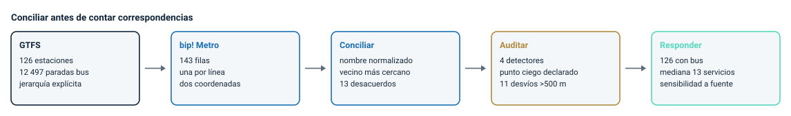
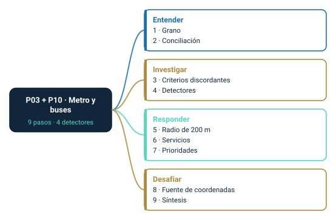
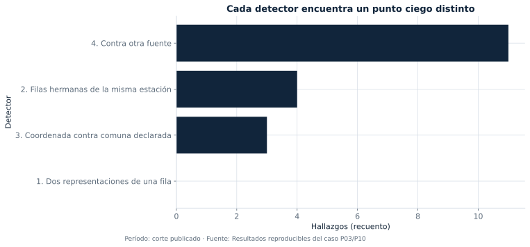
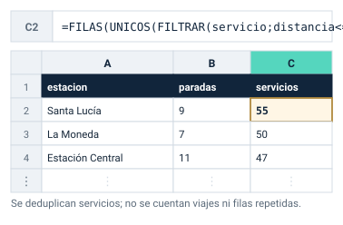

# P03-P10 · Conciliar Metro y medir correspondencias con buses

◀ [P01/P02/P04 · Consolidación y calidad](../bip_lugares_carga/CUADERNO.md) · [Todos los cuadernos](../../docs/cuadernos.md) · [P05/P09 · Horarios y cobertura nocturna](../carga_nocturna/CUADERNO.md) ▶

[](https://colab.research.google.com/github/vladimiracunadev-create/applied-data-analysis-and-assessment-lab/blob/main/cases/correspondencia_metro/cuaderno/colab.ipynb) — corre los pasos sin instalar nada: el cuaderno clona el repositorio y descarga los datos del portal.

> **¿Qué estaciones de Metro tienen buses a 200 m y cuánto depende la respuesta de la fuente?**

## 1 · El problema

Dos fuentes públicas describen las estaciones de Metro con granos diferentes: el GTFS
tiene 126 estaciones y el archivo bip! tiene 143 filas, una por estación y línea. La
diferencia no es un error. El problema empieza cuando se cruzan como si cada fila
representara lo mismo.

La conciliación usa dos criterios independientes —nombre normalizado y proximidad— y
convierte sus desacuerdos en casos para revisar. Esto descubre once estaciones del
archivo bip! a más de 500 metros de la ubicación GTFS y una separación de 26,2 km entre
dos filas que dicen «Plaza de Armas». Luego se responde la pregunta operativa: qué
estaciones tienen buses a 200 metros y cuántos servicios distintos las atienden.

**Los datos.** GTFS Red Movilidad y el archivo público de estaciones de Metro para carga bip!.



## 2 · La solución que se va a aplicar

Se diagnostica el grano antes del cruce, se reducen las filas bip! a estaciones sin
ocultar su dispersión y se confronta nombre con distancia. Cuatro detectores de calidad
declaran qué comparan y cuál es su punto ciego. Solo después se calculan las paradas y
servicios de bus cercanos. La respuesta se repite con la otra fuente de coordenadas
para medir cuánto depende del proveedor elegido.



### El mismo resultado en Pandas, Polars y R

Los pasos anteriores y siguientes conservan la resolución completa en Pandas. Este laboratorio adicional aísla el indicador central para resolverlo tres veces sobre **la misma tabla, las mismas reglas y la misma escala gráfica**. Así la comparación cambia el motor, no el problema.

#### Contrato común del ejercicio

- **Objetivo.** Comparar cuántos hallazgos aporta cada detector independiente de coordenadas.
- **Fuente que leen las tres implementaciones.**
  [`resultados/detectores.csv`](resultados/detectores.csv), CSV UTF-8 versionado y producido
  por la resolución completa del caso. Los datos originales, su publicador, fecha,
  licencia, URL y huella se documentan en [`case.json`](case.json) y, cuando existe,
  `procedencia.json`. Este CSV es un **resultado reproducible**, no se presenta como
  una nueva fuente oficial.
- **Alcance.** hallazgos por detector independiente. Los tres scripts comparables no sustituyen la adquisición,
  limpieza ni controles completos de los pasos Pandas: aíslan el indicador para que
  una diferencia observada sea atribuible al motor.
- **Fórmula o regla.** hallazgos_d = Σ 1(detector d marca la fila). Los detectores no son mutuamente excluyentes, por lo que sus barras no deben sumarse como un total.
- **Interpretación.** La diferencia entre barras muestra puntos ciegos del control, no una competencia entre algoritmos.
- **Error frecuente.** Sumar detectores duplica estaciones marcadas por más de una regla; use el identificador de estación para una unión.

| Campo | Tipo observado | Función en el ejercicio |
| --- | --- | --- |
| `detector` | `str` | categoría/eje X |
| `compara` | `str` | campo auxiliar del contrato |
| `fuente_externa` | `str` | campo auxiliar del contrato |
| `hallazgos` | `int64` | medida/eje Y |
| `unidad` | `str` | campo auxiliar del contrato |
| `ciego_a` | `str` | campo auxiliar del contrato |

#### Qué cambia entre motores

| Dimensión | Pandas | Polars | R (`dplyr`/`readr`) |
| --- | --- | --- | --- |
| Modelo | DataFrame mutable por operaciones | expresiones columnares y plan optimizable | tubería declarativa sobre `tibble` |
| Nulos | `NaN`/`NA`; `groupby` exige decidir `dropna` | `null` separado de `NaN` | `NA`; muchas funciones exigen `na.rm` explícito |
| Orden | varias operaciones lo conservan, pero se ordena explícitamente | no se presupone tras agrupar | se fija con `arrange` |
| Gráfico | Matplotlib | Matplotlib tras extraer sólo X/Y | ggplot2 y su gramática de capas |
| Ventaja típica | ecosistema amplio y aprendizaje gradual | paralelismo, tipos y consultas grandes | estadística, comunicación y análisis reproducible |
| Límite aquí | el índice puede introducir alineaciones implícitas | añade una dependencia y otra semántica de tipos | requiere runtime y paquetes R independientes |

La equivalencia se valida sobre CSV normalizados con tolerancia numérica `1e-9`; no
se exige que la sintaxis ni los píxeles sean idénticos. Para ejecutar en un entorno
limpio consulte [`docs/ejecucion-portable.md`](../../docs/ejecucion-portable.md).

| Motor | Alcance verificado | Archivo | Ejecutar |
| --- | --- | --- | --- |
| Pandas + Matplotlib | hallazgos por detector independiente | [`solucion_pandas.py`](cuaderno/solucion_pandas.py) | `python cases/correspondencia_metro/cuaderno/solucion_pandas.py` |
| Polars + Matplotlib | hallazgos por detector independiente | [`solucion_polars.py`](cuaderno/solucion_polars.py) | `uv run --extra polars python cases/correspondencia_metro/cuaderno/solucion_polars.py` |
| R + ggplot2 | hallazgos por detector independiente | [`solucion.R`](cuaderno/solucion.R) | `Rscript cases/correspondencia_metro/cuaderno/solucion.R` |

#### Pandas + Matplotlib

```python
"""Laboratorio comparable Pandas + Matplotlib del caso correspondencia_metro.

Lee el mismo contrato CSV que las versiones Polars y R. La resolución completa del
caso permanece en ``solution.py`` y en los pasos del cuaderno; este archivo aísla el
indicador central para que la comparación entre motores sea controlada.
"""
from __future__ import annotations

import argparse
import sys
from pathlib import Path

import matplotlib.pyplot as plt
import pandas as pd

if hasattr(sys.stdout, "reconfigure"):
    sys.stdout.reconfigure(encoding="utf-8")

# Buscar la raíz desde el propio archivo evita rutas C:\... específicas del autor y
# funciona igual después de clonar el repositorio en Linux, Windows o Google Colab.
ROOT = Path(__file__).resolve().parents[3] if "__file__" in globals() else Path.cwd()
SOURCE = ROOT / "cases" / "correspondencia_metro" / "resultados" / "detectores.csv"
REQUIRED = {"detector", "hallazgos"}


def analizar() -> pd.DataFrame:
    """Carga, valida y transforma el indicador; no modifica el archivo de entrada."""
    datos = pd.read_csv(SOURCE)
    faltantes = REQUIRED.difference(datos.columns)
    if faltantes:
        raise ValueError(f"Faltan columnas requeridas en {SOURCE}: {sorted(faltantes)}")
    # La expresión conserva explícitos filtro, agrupación, orden y selección para que
    # el estudiante pueda alinearlos con las expresiones de Polars y dplyr.
    resultado = datos.sort_values("hallazgos", ascending=False)[["detector", "hallazgos"]]
    return resultado.reset_index(drop=True)


def graficar(resultado: pd.DataFrame, destino: Path) -> Path:
    """Representa exactamente las columnas comparadas y explicita sus unidades."""
    x = resultado["detector"].tolist()
    y = resultado["hallazgos"].tolist()
    fig, ax = plt.subplots(figsize=(9, 5))
    ax.barh([str(value) for value in x], y, color="#11253B")
    ax.invert_yaxis()  # el primer puesto del ranking queda arriba, como se lee una tabla
    ax.set_xlabel("Hallazgos (recuento)")
    ax.set_ylabel("Detector")
    ax.set_xlim(left=0)
    ax.set_title("Cada detector encuentra un punto ciego distinto")
    ax.grid(axis="y", alpha=0.25)
    fig.text(0.01, 0.01, "Fuente: Resultados reproducibles del caso P03/P10 · Período: corte publicado", fontsize=8, color="#58677A")
    fig.tight_layout(rect=(0, 0.05, 1, 1))
    fig.savefig(destino, dpi=150, bbox_inches="tight")
    plt.close(fig)
    return destino


def main() -> None:
    parser = argparse.ArgumentParser(description=__doc__)
    parser.add_argument("--salida", type=Path, help="CSV normalizado para comparar motores")
    parser.add_argument("--grafico", type=Path, help="PNG de la visualización comparable")
    args = parser.parse_args()
    resultado = analizar()
    print(resultado.to_string(index=False))
    if args.salida:
        resultado.to_csv(args.salida, index=False)
    if args.grafico:
        print(graficar(resultado, args.grafico))


if __name__ == "__main__":
    main()
```

#### Polars + Matplotlib

```python
"""Laboratorio comparable Polars + Matplotlib del caso correspondencia_metro.

Usa el mismo CSV, columnas, reglas y escala que Pandas y R. Polars expresa las
transformaciones como un plan de expresiones columnares; esa diferencia de método es
el objeto de aprendizaje, no una razón para cambiar la pregunta.
"""
from __future__ import annotations

import argparse
import sys
from pathlib import Path

import matplotlib.pyplot as plt
import polars as pl

if hasattr(sys.stdout, "reconfigure"):
    sys.stdout.reconfigure(encoding="utf-8")

ROOT = Path(__file__).resolve().parents[3] if "__file__" in globals() else Path.cwd()
SOURCE = ROOT / "cases" / "correspondencia_metro" / "resultados" / "detectores.csv"
REQUIRED = {"detector", "hallazgos"}


def analizar() -> pl.DataFrame:
    """Carga y valida antes de transformar para producir un error explicativo."""
    datos = pl.read_csv(SOURCE)
    faltantes = REQUIRED.difference(datos.columns)
    if faltantes:
        raise ValueError(f"Faltan columnas requeridas en {SOURCE}: {sorted(faltantes)}")
    # select al final fija el contrato de salida y evita comparar columnas auxiliares.
    return datos.sort("hallazgos", descending=True).select(["detector", "hallazgos"])


def graficar(resultado: pl.DataFrame, destino: Path) -> Path:
    """Convierte sólo las series del gráfico; el análisis permanece en Polars."""
    x = resultado["detector"].to_list()
    y = resultado["hallazgos"].to_list()
    fig, ax = plt.subplots(figsize=(9, 5))
    ax.barh([str(value) for value in x], y, color="#11253B")
    ax.invert_yaxis()  # el primer puesto del ranking queda arriba, como se lee una tabla
    ax.set_xlabel("Hallazgos (recuento)")
    ax.set_ylabel("Detector")
    ax.set_xlim(left=0)
    ax.set_title("Cada detector encuentra un punto ciego distinto")
    ax.grid(axis="y", alpha=0.25)
    fig.text(
        0.01,
        0.01,
        "Fuente: Resultados reproducibles del caso P03/P10 · Período: corte publicado",
        fontsize=8,
        color="#58677A",
    )
    fig.tight_layout(rect=(0, 0.05, 1, 1))
    fig.savefig(destino, dpi=150, bbox_inches="tight")
    plt.close(fig)
    return destino


def main() -> None:
    parser = argparse.ArgumentParser(description=__doc__)
    parser.add_argument("--salida", type=Path, help="CSV normalizado para comparar motores")
    parser.add_argument("--grafico", type=Path, help="PNG de la visualización comparable")
    args = parser.parse_args()
    resultado = analizar()
    print(resultado)
    if args.salida:
        resultado.write_csv(args.salida)
    if args.grafico:
        print(graficar(resultado, args.grafico))


if __name__ == "__main__":
    main()
```

#### R + ggplot2

```r
#!/usr/bin/env Rscript
# Laboratorio comparable R + dplyr/readr + ggplot2 del caso correspondencia_metro.
#
# La resolución completa sigue en solution.py y en los pasos Pandas. Este script
# cambia el motor sobre el mismo contrato CSV para estudiar sintaxis y semántica sin
# cambiar datos, indicador ni escala gráfica.

required <- c("readr", "dplyr")
missing <- required[!vapply(required, requireNamespace, logical(1), quietly = TRUE)]
if (length(missing)) {
  stop(
    "Faltan paquetes: ", paste(missing, collapse = ", "),
    ". Instálelos con install.packages(c('readr', 'dplyr', 'ggplot2'))."
  )
}

# Buscar pyproject.toml hacia arriba hace portable el script entre terminal, RStudio,
# Posit Cloud, IRkernel y un clon en Colab. LAB_ROOT permite una ruta explícita sin
# codificar la unidad o el directorio del desarrollador.
find_root <- function(start = getwd()) {
  current <- normalizePath(start, mustWork = TRUE)
  repeat {
    if (file.exists(file.path(current, "pyproject.toml"))) return(current)
    parent <- dirname(current)
    if (identical(parent, current)) stop("No se encontró la raíz del repositorio.")
    current <- parent
  }
}
root <- Sys.getenv("LAB_ROOT", unset = find_root())
source_csv <- file.path(root, "cases", "correspondencia_metro", "resultados", "detectores.csv")

# readr conserva nombres y tipos previsibles. La validación temprana produce un error
# que explica el contrato roto, en vez de fallar más tarde dentro de una gráfica.
datos <- readr::read_csv(source_csv, show_col_types = FALSE, progress = FALSE)
required_columns <- c("detector", "hallazgos")
missing_columns <- setdiff(required_columns, names(datos))
if (length(missing_columns)) stop("Faltan columnas: ", paste(missing_columns, collapse = ", "))

# dplyr expresa la misma selección, filtro, agrupación y orden que las otras vías.
resultado <- datos |> dplyr::arrange(dplyr::desc(.data$hallazgos)) |> dplyr::select(.data$detector, .data$hallazgos)
print(resultado)

args <- commandArgs(trailingOnly = TRUE)
value_after <- function(flag) {
  pos <- match(flag, args)
  if (is.na(pos)) return(NULL)
  if (pos == length(args)) stop(flag, " necesita una ruta de salida")
  args[pos + 1]
}

csv_output <- value_after("--salida")
if (!is.null(csv_output)) readr::write_csv(resultado, csv_output)

plot_output <- value_after("--grafico")
if (!is.null(plot_output)) {
  if (!requireNamespace("ggplot2", quietly = TRUE)) {
    stop("Instale ggplot2 para generar el gráfico: install.packages('ggplot2')")
  }
  grafico <- ggplot2::ggplot(
    resultado,
    ggplot2::aes(x = .data[["detector"]], y = .data[["hallazgos"]])
  ) +
    ggplot2::geom_col(fill = "#11253B") +
    ggplot2::scale_x_discrete(limits = rev) +
    ggplot2::coord_flip() +
    ggplot2::labs(
      title = "Cada detector encuentra un punto ciego distinto",
      x = "Hallazgos (recuento)", y = "Detector",
      caption = "Fuente: Resultados reproducibles del caso P03/P10 · Período: corte publicado"
    ) +
    ggplot2::theme_minimal(base_size = 11)
  ggplot2::ggsave(plot_output, grafico, width = 9, height = 5, dpi = 150)
  cat(plot_output, "\n")
}
```

9 pasos. Cada uno trae el código de **Python**, la salida que devuelve de verdad, y la **fórmula de Excel** equivalente dibujada en su hoja. 9 traen además la trampa de hacerlo de la forma obvia.

| # | Paso | Trampa |
| --- | --- | --- |
| 1 | [Diagnosticar el grano de las dos fuentes](#paso-1) | sí |
| 2 | [Conciliar por nombre y por distancia](#paso-2) | sí |
| 3 | [Revisar donde los criterios discrepan](#paso-3) | sí |
| 4 | [Declarar el punto ciego de cada detector](#paso-4) | sí |
| 5 | [Medir la correspondencia a 200 metros](#paso-5) | sí |
| 6 | [Mostrar la distribución de servicios](#paso-6) | sí |
| 7 | [Identificar las estaciones con más alternativas](#paso-7) | sí |
| 8 | [Medir la sensibilidad a la fuente de coordenadas](#paso-8) | sí |
| 9 | [Separar hallazgo de explicación](#paso-9) | sí |

### Para trabajar

| Archivo | Qué es |
| --- | --- |
| [`P03-P10-caso-completo.zip`](cuaderno/P03-P10-caso-completo.zip) | **todo el caso en un ZIP**: el cuaderno, el script, el libro de Excel y las figuras |
| [`pasos.py`](cuaderno/pasos.py) | los 9 pasos seguidos. Se corre y muestra cada salida |
| [`practica.xlsx`](cuaderno/practica.xlsx) | las fórmulas y **el resultado que deben dar**, para corregirse solo. Se abre igual en Google Sheets |
| [`colab.ipynb`](cuaderno/colab.ipynb) | el cuaderno **ejecutable en Colab**: clona, descarga los datos del portal y corre los 9 pasos |
| [`solucion_pandas.py`](cuaderno/solucion_pandas.py) | solución ejecutable en Pandas + Matplotlib; incluye el contraste numérico y el gráfico del caso |
| [`solucion_polars.py`](cuaderno/solucion_polars.py) | solución ejecutable en Polars + Matplotlib; incluye el contraste numérico y el gráfico del caso |
| [`solucion.R`](cuaderno/solucion.R) | solución ejecutable en R + ggplot2; incluye el contraste numérico y el gráfico del caso |
| [`solucion.Rmd`](cuaderno/solucion.Rmd) | documento R Markdown para RStudio, Posit Cloud y render reproducible; reutiliza `solucion.R` sin duplicar la lógica |

---

## 3 · Los pasos

<a id="paso-1"></a>

### Paso 1 · Diagnosticar el grano de las dos fuentes

126 y 143 se reconcilian explicando qué representa cada fila.

#### Python

```python
resultados = p10.analizar()
resultados['grano']
```

| indicador | valor | unidad | definicion |
| --- | --- | --- | --- |
| estaciones_gtfs | 126 | filas | Filas con location_type 1: una por estación |
| filas_bip | 143 | filas | Una por estación y línea: es otro grano, no u… |
| estaciones_de_combinacion_gtfs | 17 | estaciones | Identificador compuesto con guion (AN-NA, BA-… |
| filas_con_sufijo_de_linea_bip | 34 | filas | Nombres como «SAN PABLO L1»: la línea va pega… |
| relacion_entre_los_dos_granos | 143 | filas | estaciones − combinaciones + filas con sufijo… |
| estaciones_bip_tras_quitar_el_sufijo | 126 | estaciones | Si coincide con las del GTFS, el grano quedó … |
*6 filas × 4 columnas.*

#### Excel

Quitar el sufijo de línea al nombre bip! y contar valores distintos antes de cruzar.

> **La trampa.** Forzar una unión uno a uno elimina 17 filas legítimas de estaciones de combinación.

[↑ volver al recorrido](#2--la-solución-que-se-va-a-aplicar)

---

<a id="paso-2"></a>

### Paso 2 · Conciliar por nombre y por distancia

Dos criterios independientes permiten medir cobertura y desacuerdo.

#### Python

```python
resultados['conciliacion']
```

| indicador | valor | unidad | definicion |
| --- | --- | --- | --- |
| estaciones_a_conciliar | 126.0 | estaciones | Las del GTFS |
| cruzan_por_nombre | 125.0 | estaciones | Con el sufijo de línea quitado y el nombre no… |
| cruzan_por_nombre_pct | 99.21 | % |  |
| sin_par_por_nombre | 1.0 | estaciones | Un cruce solo por nombre las perdería en sile… |
| los_dos_criterios_coinciden | 113.0 | estaciones | El par por nombre es además el más cercano ge… |
| los_criterios_discrepan | 13.0 | estaciones | Donde hay que mirar: o el nombre o la coorden… |
| desvio_mediano_m | 67.4 | m | Entre las dos fuentes, donde cruzan por nombre |
| desvio_maximo_m | 13147.7 | m | El peor caso usando la MEDIANA de las filas d… |
| desvio_maximo_peor_fila_m | 26243.3 | m | El mismo caso usando la peor de sus filas. La… |
| estaciones_con_filas_discrepantes | 4.0 | estaciones | Sus filas de bip! no coinciden entre sí, de m… |
*10 filas × 4 columnas.*

#### Excel

Una columna con nombre normalizado y otra con la distancia mínima; comparar ambos pares.

> **La trampa.** El nombre encuentra 125 de 126; la fila restante no debe desaparecer en silencio.

[↑ volver al recorrido](#2--la-solución-que-se-va-a-aplicar)

---

<a id="paso-3"></a>

### Paso 3 · Revisar donde los criterios discrepan

Los trece desacuerdos son el conjunto pequeño que requiere inspección.

#### Python

```python
resultados['criterios_discrepantes']
```

| stop_id | stop_name | nombre_bip | clave_mas_cercana | distancia_al_mas_cercano_m | desvio_m | dispersion_interna_m |
| --- | --- | --- | --- | --- | --- | --- |
| PZ-PZA | Plaza de Armas | PLAZA DE ARMAS | PUENTE CAL Y CANTO | 489.1 | 13147.7 | 13095.6 |
| SL | Santa Lucía | SANTA LUCIA | UNIVERSIDAD DE CHILE | 519.8 | 12736.4 | 0.0 |
| PQ | Parque O'Higgins | PARQUE O'HIGGINS | RONDIZZONI | 1076.7 | 11630.1 | 0.0 |
| LIB | Los Libertadores | LOS LIBERTADORES | CARDENAL CARO | 959.1 | 6597.5 | 0.0 |
| PDG | Príncipe de Gales | PRINCIPE DE GALES | FRANCISCO BILBAO | 1330.6 | 3530.4 | 0.0 |
| DS | Del Sol | DEL SOL | SANTIAGO BUERAS | 876.1 | 2583.9 | 0.0 |
| SBO | Simón Bolívar | SIMON BOLIVAR | PLAZA EGANA | 772.6 | 1668.3 | 0.0 |
| QN | Quinta Normal | QUINTA NORMAL | GRUTA DE LOURDES | 1039.8 | 1114.0 | 0.0 |
| RC | Cumming | CUMMING | QUINTA NORMAL | 19.7 | 893.9 | 0.0 |
| TO | Toesca | TOESCA | PARQUE ALMAGRO | 725.7 | 804.0 | 0.0 |
| LF | Bellavista de La Florida | BELLAVISTA DE LA FLORIDA | VICUNA MACKENNA | 261.8 | 553.4 | 0.0 |
| RGR | Grecia | GRECIA | PRINCIPE DE GALES | 108.2 | 222.6 | 0.0 |
| PAC | Presidente Pedro Aguirre Cerda | <NA> | PEDRO AGUIRRE CERDA | 1.4 |  |  |
*13 filas × 7 columnas.*

#### Excel

Filtrar `par_por_nombre <> par_mas_cercano` y ordenar por desvío descendente.

> **La trampa.** Elegir automáticamente el criterio con más coincidencias puede confirmar una coordenada corrupta.

[↑ volver al recorrido](#2--la-solución-que-se-va-a-aplicar)

---

<a id="paso-4"></a>

### Paso 4 · Declarar el punto ciego de cada detector

Calidad significa saber qué error puede y qué error no puede observar cada control.

#### Python

```python
resultados['detectores']
```

| detector | compara | fuente_externa | hallazgos | unidad | ciego_a |
| --- | --- | --- | --- | --- | --- |
| 1. Dos representaciones de una fila | UTM contra latitud/longitud, dentro de la fila | no | 0 | filas de Metro | un error que afecte a las dos representacione… |
| 2. Filas hermanas de la misma estación | fila contra fila que nombra lo mismo | no | 4 | estaciones | la estación que tiene una sola fila |
| 3. Coordenada contra comuna declarada | fila contra la mediana de sus pares de comuna | no | 3 | estaciones | un error dentro de la propia comuna |
| 4. Contra otra fuente | bip! contra el feed GTFS | sí | 11 | estaciones | un error que las dos fuentes compartan |
*4 filas × 6 columnas.*



*Cada detector encuentra un punto ciego distinto. Ejes con unidad, período y fuente; el código Polars y R genera la misma vista.*

#### Excel

Matriz de control: detector, comparación, fuente externa, hallazgos y punto ciego.

> **La trampa.** UTM y lat/lon pueden estar ambas equivocadas de la misma forma: el detector interno no lo ve.

[↑ volver al recorrido](#2--la-solución-que-se-va-a-aplicar)

---

<a id="paso-5"></a>

### Paso 5 · Medir la correspondencia a 200 metros

Cada estación se cruza con paradas de bus por distancia haversine.

#### Python

```python
resultados['correspondencia']
```

| indicador | valor | unidad | definicion |
| --- | --- | --- | --- |
| estaciones_evaluadas | 126.0 | estaciones | Las 126 del feed |
| con_parada_de_bus_cerca | 126.0 | estaciones | Con al menos una parada a 200 m |
| con_parada_de_bus_pct | 100.0 | % |  |
| sin_ninguna | 0.0 | estaciones | Estaciones sin correspondencia de bus |
| servicios_mediana | 13.0 | servicios | Servicios de bus distintos por estación |
| servicios_p90 | 33.5 | servicios |  |
| servicios_maximo | 55.0 | servicios | El máximo de la red |
| paradas_mediana | 5.0 | paradas | Paradas de bus a 200 m de la estación |
*8 filas × 4 columnas.*

#### Excel



Para cada estación, contar paradas cuya distancia sea `<=200` y servicios distintos asociados.

Debe dar: **126 de 126 estaciones con al menos una parada**

**En Google Sheets:** la misma fórmula, sin cambios.

> **La trampa.** Contar filas de horarios multiplica un mismo servicio; la unidad es servicio distinto.

[↑ volver al recorrido](#2--la-solución-que-se-va-a-aplicar)

---

<a id="paso-6"></a>

### Paso 6 · Mostrar la distribución de servicios

La mediana, el p90 y el máximo evitan resumir toda la red con un único extremo.

#### Python

```python
resultados['resumen']
```

| indicador | valor | unidad | definicion |
| --- | --- | --- | --- |
| estaciones_gtfs | 126.0 | estaciones | location_type 1 |
| filas_bip | 143.0 | filas | Una por estación y línea: otro grano |
| concilian_por_nombre | 125.0 | estaciones | Tras quitar el sufijo de línea y normalizar |
| correspondencia_de_bus_pct | 100.0 | % | Estaciones con al menos una parada de bus a 2… |
| servicios_mediana | 13.0 | servicios | Servicios de bus distintos por estación |
| estaciones_mal_ubicadas_en_bip | 11.0 | estaciones | A más de 500 m de donde el GTFS las pone, nin… |
| peor_desvio_m | 26243.3 | m | Plaza de Armas, tomando la peor de sus dos fi… |
*7 filas × 4 columnas.*

#### Excel

`MEDIANA`, `PERCENTIL.INC(...;0,9)` y `MAX` sobre servicios distintos por estación.

> **La trampa.** El máximo de 55 describe Santa Lucía, no la estación típica; la mediana es 13.

[↑ volver al recorrido](#2--la-solución-que-se-va-a-aplicar)

---

<a id="paso-7"></a>

### Paso 7 · Identificar las estaciones con más alternativas

La tabla prioriza estaciones por servicios distintos y conserva el número de paradas.

#### Python

```python
resultados['mejores_correspondencias']
```

| stop_id | stop_name | paradas_de_bus | servicios_distintos |
| --- | --- | --- | --- |
| SL | Santa Lucía | 9 | 55 |
| LM | La Moneda | 7 | 50 |
| EL | Estación Central | 11 | 47 |
| LH-HE | Los Héroes | 13 | 44 |
| CH-UCH | Universidad de Chile | 7 | 43 |
| PM | Plaza de Maipú | 10 | 38 |
| BA-BQ | Baquedano | 6 | 37 |
| RP | República | 6 | 37 |
| AH | San Alberto Hurtado | 7 | 36 |
| LA | Unión Latinoamericana | 5 | 35 |
| LC-LCI | La Cisterna | 11 | 35 |
| UC | Universidad Católica | 6 | 35 |
*12 filas × 4 columnas.*

#### Excel

Ordenar por servicios distintos descendente y mostrar los primeros doce.

> **La trampa.** Más paradas físicas no implica necesariamente más servicios diferentes.

[↑ volver al recorrido](#2--la-solución-que-se-va-a-aplicar)

---

<a id="paso-8"></a>

### Paso 8 · Medir la sensibilidad a la fuente de coordenadas

La misma pregunta se recalcula con GTFS y bip! para cuantificar dependencia.

#### Python

```python
resultados['sensibilidad_a_la_fuente']
```

| indicador | valor | unidad | definicion |
| --- | --- | --- | --- |
| estaciones_comparables | 125.0 | estaciones | Las que cruzan por nombre |
| cambia_el_conteo_de_servicios | 48.0 | estaciones | Solo por elegir la otra coordenada de la mism… |
| cambia_pct | 38.4 | % |  |
| aparecerian_sin_bus | 3.0 | estaciones | Con la coordenada de bip! parecerían no tener… |
| aparecerian_con_bus | 0.0 | estaciones | El caso contrario |
| servicios_totales_con_gtfs | 2014.0 | servicios | Suma sobre las estaciones, con repetición ent… |
| servicios_totales_con_bip | 1834.0 | servicios |  |
*7 filas × 4 columnas.*

#### Excel

Dos columnas de conteo, una por fuente, y `=B2<>C2` para marcar cambios.

> **La trampa.** Con bip!, tres estaciones parecerían no tener bus y 48 cambian su conteo de servicios.

[↑ volver al recorrido](#2--la-solución-que-se-va-a-aplicar)

---

<a id="paso-9"></a>

### Paso 9 · Separar hallazgo de explicación

El cierre publica evidencia y límites sin atribuir causas no observadas.

#### Python

```python
resultados['detector_4_contra_gtfs']
```

| stop_id | stop_name | nombre_bip | lineas | desvio_m |
| --- | --- | --- | --- | --- |
| PZ-PZA | Plaza de Armas | PLAZA DE ARMAS | L3,L5 | 13147.7 |
| SL | Santa Lucía | SANTA LUCIA | L1 | 12736.4 |
| PQ | Parque O'Higgins | PARQUE O'HIGGINS | L2 | 11630.1 |
| LIB | Los Libertadores | LOS LIBERTADORES | L3 | 6597.5 |
| PDG | Príncipe de Gales | PRINCIPE DE GALES | L4 | 3530.4 |
| DS | Del Sol | DEL SOL | L5 | 2583.9 |
| SBO | Simón Bolívar | SIMON BOLIVAR | L4 | 1668.3 |
| QN | Quinta Normal | QUINTA NORMAL | L5 | 1114.0 |
| RC | Cumming | CUMMING | L5 | 893.9 |
| TO | Toesca | TOESCA | L2 | 804.0 |
| LF | Bellavista de La Florida | BELLAVISTA DE LA FLORIDA | L5 | 553.4 |
*11 filas × 5 columnas.*

#### Excel

Lista de revisión con estación, desvío y fuente; no corregir coordenadas en silencio.

> **La trampa.** Un desvío demuestra inconsistencia entre fuentes, no cuál de las dos es correcta ni por qué.

[↑ volver al recorrido](#2--la-solución-que-se-va-a-aplicar)

---

## 4 · El resultado

Las 126 estaciones GTFS tienen al menos una parada de bus a 200 m y la mediana es 13 servicios. Pero 48 estaciones cambian su conteo al usar la coordenada bip!: la fuente es parte del método.

## 5 · Qué queda aprendido

1. Dos conteos distintos pueden ser correctos si sus filas tienen granos diferentes.
2. El desacuerdo entre criterios es información para revisar, no ruido que deba borrarse.
3. Toda prueba de calidad tiene un punto ciego medible.
4. Una inconsistencia entre fuentes no autoriza a declarar cuál es la verdadera.

## Reproducir

```powershell
python -m cases.correspondencia_metro.solution
```

## Seguir

Lo que este caso toca y se trata a fondo en otro sitio:

- [Hallazgos auditables del caso](README.md)
- [P01 · Validación interna de coordenadas](../bip_lugares_carga/CUADERNO.md)

◀ [P01/P02/P04 · Consolidación y calidad](../bip_lugares_carga/CUADERNO.md) · [Todos los cuadernos](../../docs/cuadernos.md) · [P05/P09 · Horarios y cobertura nocturna](../carga_nocturna/CUADERNO.md) ▶
