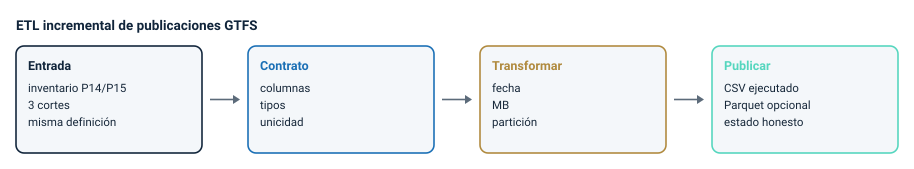
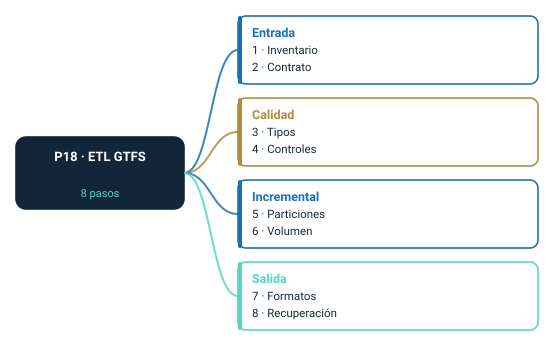
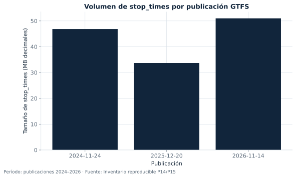

# P18 · ETL histórico y control automatizado de publicaciones GTFS

◀ [P17 · Gobernanza de datos DTPM](../gobernanza_datos_dtpm/CUADERNO.md) · [Todos los cuadernos](../../docs/cuadernos.md) · [P19 · Red de correspondencias](../red_correspondencias_dtpm/CUADERNO.md) ▶

[](https://colab.research.google.com/github/vladimiracunadev-create/applied-data-analysis-and-assessment-lab/blob/main/cases/etl_gtfs_automatizado/cuaderno/colab.ipynb) — corre los pasos sin instalar nada: el cuaderno clona el repositorio y descarga los datos del portal.

> **¿Cómo incorporar un nuevo corte GTFS sin romper la serie ni fingir formatos no ejecutados?**

## 1 · El problema

Una carpeta con publicaciones históricas no es todavía un pipeline incremental. Un
corte duplicado, una fecha ilegible o un volumen vacío debe detener el proceso antes de
mezclarse con la historia. P18 enseña ese contrato sin prometer un formato o un motor
que no se ejecutó.

**Los datos.** Inventario reproducible de P14/P15 para publicaciones DTPM 2024–2026.



## 2 · La solución que se va a aplicar

Se valida el inventario producido por P14/P15, se tipan fechas y magnitudes, se publican
cinco controles independientes y se calcula una partición determinista. La ruta Parquet
es opcional y falla con una instrucción concreta cuando falta su motor.



### El mismo resultado en Pandas, Polars y R

Los pasos anteriores y siguientes conservan la resolución completa en Pandas. Este laboratorio adicional aísla el indicador central para resolverlo tres veces sobre **la misma tabla, las mismas reglas y la misma escala gráfica**. Así la comparación cambia el motor, no el problema.

#### Contrato común del ejercicio

- **Objetivo.** Comparar el volumen de stop_times entre cortes procesados con el mismo contrato.
- **Fuente que leen las tres implementaciones.**
  [`resultados/volumen_por_publicacion.csv`](resultados/volumen_por_publicacion.csv), CSV UTF-8 versionado y producido
  por la resolución completa del caso. Los datos originales, su publicador, fecha,
  licencia, URL y huella se documentan en [`case.json`](case.json) y, cuando existe,
  `procedencia.json`. Este CSV es un **resultado reproducible**, no se presenta como
  una nueva fuente oficial.
- **Alcance.** volumen por corte bajo el mismo contrato. Los tres scripts comparables no sustituyen la adquisición,
  limpieza ni controles completos de los pasos Pandas: aíslan el indicador para que
  una diferencia observada sea atribuible al motor.
- **Fórmula o regla.** MB = bytes_stop_times / 1.000.000; se conserva una fila por publicación y se ordena por fecha.
- **Interpretación.** El cambio de volumen sirve como señal para inspección, pero no demuestra un cambio de servicio ni su causa.
- **Error frecuente.** Comparar el ZIP completo de un corte con stop_times de otro mezcla unidades y vuelve engañosa la gráfica.

| Campo | Tipo observado | Función en el ejercicio |
| --- | --- | --- |
| `publicacion` | `str` | categoría/eje X |
| `filas_stop_times` | `int64` | campo auxiliar del contrato |
| `mb_stop_times` | `float64` | medida/eje Y |
| `filas_por_mb` | `float64` | campo auxiliar del contrato |

#### Qué cambia entre motores

| Dimensión | Pandas | Polars | R (`dplyr`/`readr`) |
| --- | --- | --- | --- |
| Modelo | DataFrame mutable por operaciones | expresiones columnares y plan optimizable | tubería declarativa sobre `tibble` |
| Nulos | `NaN`/`NA`; `groupby` exige decidir `dropna` | `null` separado de `NaN` | `NA`; muchas funciones exigen `na.rm` explícito |
| Orden | varias operaciones lo conservan, pero se ordena explícitamente | no se presupone tras agrupar | se fija con `arrange` |
| Gráfico | Matplotlib | Matplotlib tras extraer sólo X/Y | ggplot2 y su gramática de capas |
| Ventaja típica | ecosistema amplio y aprendizaje gradual | paralelismo, tipos y consultas grandes | estadística, comunicación y análisis reproducible |
| Límite aquí | el índice puede introducir alineaciones implícitas | añade una dependencia y otra semántica de tipos | requiere runtime y paquetes R independientes |

La equivalencia se valida sobre CSV normalizados con tolerancia numérica `1e-9`; no
se exige que la sintaxis ni los píxeles sean idénticos. Para ejecutar en un entorno
limpio consulte [`docs/ejecucion-portable.md`](../../docs/ejecucion-portable.md).

| Motor | Alcance verificado | Archivo | Ejecutar |
| --- | --- | --- | --- |
| Pandas + Matplotlib | volumen por corte bajo el mismo contrato | [`solucion_pandas.py`](cuaderno/solucion_pandas.py) | `python cases/etl_gtfs_automatizado/cuaderno/solucion_pandas.py` |
| Polars + Matplotlib | volumen por corte bajo el mismo contrato | [`solucion_polars.py`](cuaderno/solucion_polars.py) | `uv run --extra polars python cases/etl_gtfs_automatizado/cuaderno/solucion_polars.py` |
| R + ggplot2 | volumen por corte bajo el mismo contrato | [`solucion.R`](cuaderno/solucion.R) | `Rscript cases/etl_gtfs_automatizado/cuaderno/solucion.R` |

#### Pandas + Matplotlib

```python
"""Laboratorio comparable Pandas + Matplotlib del caso etl_gtfs_automatizado.

Lee el mismo contrato CSV que las versiones Polars y R. La resolución completa del
caso permanece en ``solution.py`` y en los pasos del cuaderno; este archivo aísla el
indicador central para que la comparación entre motores sea controlada.
"""
from __future__ import annotations

import argparse
import sys
from pathlib import Path

import matplotlib.pyplot as plt
import pandas as pd

if hasattr(sys.stdout, "reconfigure"):
    sys.stdout.reconfigure(encoding="utf-8")

# Buscar la raíz desde el propio archivo evita rutas C:\... específicas del autor y
# funciona igual después de clonar el repositorio en Linux, Windows o Google Colab.
ROOT = Path(__file__).resolve().parents[3] if "__file__" in globals() else Path.cwd()
SOURCE = ROOT / "cases" / "etl_gtfs_automatizado" / "resultados" / "volumen_por_publicacion.csv"
REQUIRED = {"publicacion", "mb_stop_times"}


def analizar() -> pd.DataFrame:
    """Carga, valida y transforma el indicador; no modifica el archivo de entrada."""
    datos = pd.read_csv(SOURCE)
    faltantes = REQUIRED.difference(datos.columns)
    if faltantes:
        raise ValueError(f"Faltan columnas requeridas en {SOURCE}: {sorted(faltantes)}")
    # La expresión conserva explícitos filtro, agrupación, orden y selección para que
    # el estudiante pueda alinearlos con las expresiones de Polars y dplyr.
    resultado = datos.sort_values("publicacion")[["publicacion", "mb_stop_times"]]
    return resultado.reset_index(drop=True)


def graficar(resultado: pd.DataFrame, destino: Path) -> Path:
    """Representa exactamente las columnas comparadas y explicita sus unidades."""
    x = resultado["publicacion"].tolist()
    y = resultado["mb_stop_times"].tolist()
    fig, ax = plt.subplots(figsize=(9, 5))
    ax.bar([str(value) for value in x], y, color="#11253B")
    ax.set_xlabel("Publicación")
    ax.set_ylabel("Tamaño de stop_times (MB decimales)")
    ax.set_ylim(bottom=0)
    ax.set_title("Volumen de stop_times por publicación GTFS")
    ax.grid(axis="y", alpha=0.25)
    fig.text(0.01, 0.01, "Fuente: Inventario reproducible P14/P15 · Período: publicaciones 2024–2026", fontsize=8, color="#58677A")
    fig.tight_layout(rect=(0, 0.05, 1, 1))
    fig.savefig(destino, dpi=150, bbox_inches="tight")
    plt.close(fig)
    return destino


def main() -> None:
    parser = argparse.ArgumentParser(description=__doc__)
    parser.add_argument("--salida", type=Path, help="CSV normalizado para comparar motores")
    parser.add_argument("--grafico", type=Path, help="PNG de la visualización comparable")
    args = parser.parse_args()
    resultado = analizar()
    print(resultado.to_string(index=False))
    if args.salida:
        resultado.to_csv(args.salida, index=False)
    if args.grafico:
        print(graficar(resultado, args.grafico))


if __name__ == "__main__":
    main()
```

#### Polars + Matplotlib

```python
"""Laboratorio comparable Polars + Matplotlib del caso etl_gtfs_automatizado.

Usa el mismo CSV, columnas, reglas y escala que Pandas y R. Polars expresa las
transformaciones como un plan de expresiones columnares; esa diferencia de método es
el objeto de aprendizaje, no una razón para cambiar la pregunta.
"""
from __future__ import annotations

import argparse
import sys
from pathlib import Path

import matplotlib.pyplot as plt
import polars as pl

if hasattr(sys.stdout, "reconfigure"):
    sys.stdout.reconfigure(encoding="utf-8")

ROOT = Path(__file__).resolve().parents[3] if "__file__" in globals() else Path.cwd()
SOURCE = ROOT / "cases" / "etl_gtfs_automatizado" / "resultados" / "volumen_por_publicacion.csv"
REQUIRED = {"publicacion", "mb_stop_times"}


def analizar() -> pl.DataFrame:
    """Carga y valida antes de transformar para producir un error explicativo."""
    datos = pl.read_csv(SOURCE)
    faltantes = REQUIRED.difference(datos.columns)
    if faltantes:
        raise ValueError(f"Faltan columnas requeridas en {SOURCE}: {sorted(faltantes)}")
    # select al final fija el contrato de salida y evita comparar columnas auxiliares.
    return datos.sort("publicacion").select(["publicacion", "mb_stop_times"])


def graficar(resultado: pl.DataFrame, destino: Path) -> Path:
    """Convierte sólo las series del gráfico; el análisis permanece en Polars."""
    x = resultado["publicacion"].to_list()
    y = resultado["mb_stop_times"].to_list()
    fig, ax = plt.subplots(figsize=(9, 5))
    ax.bar([str(value) for value in x], y, color="#11253B")
    ax.set_xlabel("Publicación")
    ax.set_ylabel("Tamaño de stop_times (MB decimales)")
    ax.set_ylim(bottom=0)
    ax.set_title("Volumen de stop_times por publicación GTFS")
    ax.grid(axis="y", alpha=0.25)
    fig.text(
        0.01,
        0.01,
        "Fuente: Inventario reproducible P14/P15 · Período: publicaciones 2024–2026",
        fontsize=8,
        color="#58677A",
    )
    fig.tight_layout(rect=(0, 0.05, 1, 1))
    fig.savefig(destino, dpi=150, bbox_inches="tight")
    plt.close(fig)
    return destino


def main() -> None:
    parser = argparse.ArgumentParser(description=__doc__)
    parser.add_argument("--salida", type=Path, help="CSV normalizado para comparar motores")
    parser.add_argument("--grafico", type=Path, help="PNG de la visualización comparable")
    args = parser.parse_args()
    resultado = analizar()
    print(resultado)
    if args.salida:
        resultado.write_csv(args.salida)
    if args.grafico:
        print(graficar(resultado, args.grafico))


if __name__ == "__main__":
    main()
```

#### R + ggplot2

```r
#!/usr/bin/env Rscript
# Laboratorio comparable R + dplyr/readr + ggplot2 del caso etl_gtfs_automatizado.
#
# La resolución completa sigue en solution.py y en los pasos Pandas. Este script
# cambia el motor sobre el mismo contrato CSV para estudiar sintaxis y semántica sin
# cambiar datos, indicador ni escala gráfica.

required <- c("readr", "dplyr")
missing <- required[!vapply(required, requireNamespace, logical(1), quietly = TRUE)]
if (length(missing)) {
  stop(
    "Faltan paquetes: ", paste(missing, collapse = ", "),
    ". Instálelos con install.packages(c('readr', 'dplyr', 'ggplot2'))."
  )
}

# Buscar pyproject.toml hacia arriba hace portable el script entre terminal, RStudio,
# Posit Cloud, IRkernel y un clon en Colab. LAB_ROOT permite una ruta explícita sin
# codificar la unidad o el directorio del desarrollador.
find_root <- function(start = getwd()) {
  current <- normalizePath(start, mustWork = TRUE)
  repeat {
    if (file.exists(file.path(current, "pyproject.toml"))) return(current)
    parent <- dirname(current)
    if (identical(parent, current)) stop("No se encontró la raíz del repositorio.")
    current <- parent
  }
}
root <- Sys.getenv("LAB_ROOT", unset = find_root())
source_csv <- file.path(root, "cases", "etl_gtfs_automatizado", "resultados", "volumen_por_publicacion.csv")

# readr conserva nombres y tipos previsibles. La validación temprana produce un error
# que explica el contrato roto, en vez de fallar más tarde dentro de una gráfica.
datos <- readr::read_csv(source_csv, show_col_types = FALSE, progress = FALSE)
required_columns <- c("publicacion", "mb_stop_times")
missing_columns <- setdiff(required_columns, names(datos))
if (length(missing_columns)) stop("Faltan columnas: ", paste(missing_columns, collapse = ", "))

# dplyr expresa la misma selección, filtro, agrupación y orden que las otras vías.
resultado <- datos |> dplyr::arrange(.data$publicacion) |> dplyr::select(.data$publicacion, .data$mb_stop_times)
print(resultado)

args <- commandArgs(trailingOnly = TRUE)
value_after <- function(flag) {
  pos <- match(flag, args)
  if (is.na(pos)) return(NULL)
  if (pos == length(args)) stop(flag, " necesita una ruta de salida")
  args[pos + 1]
}

csv_output <- value_after("--salida")
if (!is.null(csv_output)) readr::write_csv(resultado, csv_output)

plot_output <- value_after("--grafico")
if (!is.null(plot_output)) {
  if (!requireNamespace("ggplot2", quietly = TRUE)) {
    stop("Instale ggplot2 para generar el gráfico: install.packages('ggplot2')")
  }
  grafico <- ggplot2::ggplot(
    resultado,
    ggplot2::aes(x = .data[["publicacion"]], y = .data[["mb_stop_times"]])
  ) +
    ggplot2::geom_col(fill = "#11253B") +
    ggplot2::labs(
      title = "Volumen de stop_times por publicación GTFS",
      x = "Publicación", y = "Tamaño de stop_times (MB decimales)",
      caption = "Fuente: Inventario reproducible P14/P15 · Período: publicaciones 2024–2026"
    ) +
    ggplot2::theme_minimal(base_size = 11)
  ggplot2::ggsave(plot_output, grafico, width = 9, height = 5, dpi = 150)
  cat(plot_output, "\n")
}
```

8 pasos. Cada uno trae el código de **Python**, la salida que devuelve de verdad, y la **fórmula de Excel** equivalente dibujada en su hoja. 8 traen además la trampa de hacerlo de la forma obvia.

| # | Paso | Trampa |
| --- | --- | --- |
| 1 | [Leer el inventario reproducible](#paso-1) | sí |
| 2 | [Comprobar el esquema](#paso-2) | sí |
| 3 | [Tipar y validar magnitudes](#paso-3) | sí |
| 4 | [Publicar cada control](#paso-4) | sí |
| 5 | [Construir particiones deterministas](#paso-5) | sí |
| 6 | [Medir el volumen por publicación](#paso-6) | sí |
| 7 | [Distinguir formatos ejecutados](#paso-7) | sí |
| 8 | [Definir recuperación y reintento](#paso-8) | sí |

### Para trabajar

| Archivo | Qué es |
| --- | --- |
| [`P18-caso-completo.zip`](cuaderno/P18-caso-completo.zip) | **todo el caso en un ZIP**: el cuaderno, el script, el libro de Excel y las figuras |
| [`pasos.py`](cuaderno/pasos.py) | los 8 pasos seguidos. Se corre y muestra cada salida |
| [`practica.xlsx`](cuaderno/practica.xlsx) | las fórmulas y **el resultado que deben dar**, para corregirse solo. Se abre igual en Google Sheets |
| [`colab.ipynb`](cuaderno/colab.ipynb) | el cuaderno **ejecutable en Colab**: clona, descarga los datos del portal y corre los 8 pasos |
| [`solucion_pandas.py`](cuaderno/solucion_pandas.py) | solución ejecutable en Pandas + Matplotlib; incluye el contraste numérico y el gráfico del caso |
| [`solucion_polars.py`](cuaderno/solucion_polars.py) | solución ejecutable en Polars + Matplotlib; incluye el contraste numérico y el gráfico del caso |
| [`solucion.R`](cuaderno/solucion.R) | solución ejecutable en R + ggplot2; incluye el contraste numérico y el gráfico del caso |
| [`solucion.Rmd`](cuaderno/solucion.Rmd) | documento R Markdown para RStudio, Posit Cloud y render reproducible; reutiliza `solucion.R` sin duplicar la lógica |

---

## 3 · Los pasos

<a id="paso-1"></a>

### Paso 1 · Leer el inventario reproducible

La entrada es el resultado versionado de P14/P15, no una cifra copiada.

#### Python

```python
inventario = etl.cargar()
inventario
```

| publicacion | rutas | paradas_embarque | viajes_declarados | ventanas_frecuencia | filas_stop_times | bytes_stop_times |
| --- | --- | --- | --- | --- | --- | --- |
| 2024-11-24 | 419 | 12201 | 19983 | 19863 | 1134450 | 46853843 |
| 2025-12-20 | 428 | 12336 | 14149 | 14060 | 821585 | 33696141 |
| 2026-11-14 | 425 | 12497 | 26137 | 14520 | 1098717 | 50986910 |
*3 filas × 7 columnas.*

#### Excel

Importar la tabla y conservar la fecha como texto hasta validarla.

> **La trampa.** Concatenar publicaciones sin guardar el corte impide reconstruir la historia.

[↑ volver al recorrido](#2--la-solución-que-se-va-a-aplicar)

---

<a id="paso-2"></a>

### Paso 2 · Comprobar el esquema

El pipeline falla antes de calcular cuando falta una columna contractual.

#### Python

```python
{'requeridas': len(etl.REQUIRED), 'presentes': len(set(inventario.columns) & etl.REQUIRED), 'filas': len(inventario)}
```

```
{'requeridas': 7, 'presentes': 7, 'filas': 3}
```

#### Excel

Comparar encabezados con una lista de campos requeridos.

> **La trampa.** Aceptar columnas por posición desplaza silenciosamente las medidas.

[↑ volver al recorrido](#2--la-solución-que-se-va-a-aplicar)

---

<a id="paso-3"></a>

### Paso 3 · Tipar y validar magnitudes

Fechas y conteos se interpretan explícitamente antes de derivar métricas.

#### Python

```python
transformado = etl.transformar(inventario)
transformado[['publicacion', 'anio', 'filas_stop_times', 'mb_stop_times']]
```

| publicacion | anio | filas_stop_times | mb_stop_times |
| --- | --- | --- | --- |
| 2024-11-24 00:00:00 | 2024 | 1134450 | 46.853843 |
| 2025-12-20 00:00:00 | 2025 | 821585 | 33.696141 |
| 2026-11-14 00:00:00 | 2026 | 1098717 | 50.98691 |
*3 filas × 4 columnas.*

#### Excel

`=ESNUMERO(fecha)` y reglas `>=0` para cada medida.

> **La trampa.** Convertir errores a nulos permite que un corte roto continúe.

[↑ volver al recorrido](#2--la-solución-que-se-va-a-aplicar)

---

<a id="paso-4"></a>

### Paso 4 · Publicar cada control

Cinco resultados separados permiten saber qué regla falló.

#### Python

```python
controles = etl.controles(transformado)
controles
```

| control | cumple | regla |
| --- | --- | --- |
| publicacion_unica | True | una fila por corte |
| fechas_validas | True | fecha ISO interpretable |
| volumen_positivo | True | stop_times no vacío |
| paradas_positivas | True | paradas de embarque presentes |
| particion_unica | True | partición determinista por corte |
*5 filas × 3 columnas.*

#### Excel

Una fila por regla con nombre, resultado y explicación.

> **La trampa.** Un único estado global borra la causa del fallo.

[↑ volver al recorrido](#2--la-solución-que-se-va-a-aplicar)

---

<a id="paso-5"></a>

### Paso 5 · Construir particiones deterministas

La fecha del corte es la identidad incremental y evita reescribir toda la historia.

#### Python

```python
transformado[['publicacion', 'particion']]
```

| publicacion | particion |
| --- | --- |
| 2024-11-24 00:00:00 | anio=2024/publicacion=2024-11-24 |
| 2025-12-20 00:00:00 | anio=2025/publicacion=2025-12-20 |
| 2026-11-14 00:00:00 | anio=2026/publicacion=2026-11-14 |
*3 filas × 2 columnas.*

#### Excel

`=AÑO(fecha)` y texto ISO para la carpeta.

> **La trampa.** Particionar sólo por año produce colisiones si hay dos cortes anuales.

[↑ volver al recorrido](#2--la-solución-que-se-va-a-aplicar)

---

<a id="paso-6"></a>

### Paso 6 · Medir el volumen por publicación

El volumen permite detectar cambios que requieren inspección sin atribuirles una causa.

#### Python

```python
resultados = etl.analizar()
resultados['volumen_por_publicacion']
```

| publicacion | filas_stop_times | mb_stop_times | filas_por_mb |
| --- | --- | --- | --- |
| 2024-11-24 | 1134450 | 46.853843 | 24212.528308510362 |
| 2025-12-20 | 821585 | 33.696141 | 24382.168866161857 |
| 2026-11-14 | 1098717 | 50.98691 | 21549.00149861994 |
*3 filas × 4 columnas.*



*Volumen de stop_times por publicación GTFS. Ejes con unidad, período y fuente; el código Polars y R genera la misma vista.*

#### Excel

Convertir bytes a MB con divisor declarado de 1.000.000.

> **La trampa.** Un cambio de tamaño no demuestra por sí mismo un cambio de servicio.

[↑ volver al recorrido](#2--la-solución-que-se-va-a-aplicar)

---

<a id="paso-7"></a>

### Paso 7 · Distinguir formatos ejecutados

La salida informa la disponibilidad real de Parquet.

#### Python

```python
resultados['formatos']
```

| formato | estado | portabilidad |
| --- | --- | --- |
| CSV dentro de ZIP | ejecutado | entorno mínimo |
| Parquet | no ejecutado | requiere extra columnar |
*2 filas × 3 columnas.*

#### Excel

Registrar formato, estado y requisito en tres columnas.

> **La trampa.** Renombrar un CSV como `.parquet` no crea un archivo columnar.

[↑ volver al recorrido](#2--la-solución-que-se-va-a-aplicar)

---

<a id="paso-8"></a>

### Paso 8 · Definir recuperación y reintento

Un nuevo corte se incorpora sólo después de validar; un fallo conserva el último resultado válido.

#### Python

```python
{'orden': ['descargar', 'registrar huella', 'validar', 'transformar', 'publicar'], 'ante_fallo': 'no reemplazar salida válida'}
```

```
{'orden': ['descargar', 'registrar huella', 'validar', 'transformar', 'publicar'], 'ante_fallo': 'no reemplazar salida válida'}
```

#### Excel

Hoja de control con fecha, huella, estado y mensaje de error.

> **La trampa.** Reintentar sin registrar el error oculta una fuente inestable.

[↑ volver al recorrido](#2--la-solución-que-se-va-a-aplicar)

---

## 4 · El resultado

El corte sólo se publica si sus controles pasan; Parquet permanece opcional y verificable.

## 5 · Qué queda aprendido

1. Validar antes de transformar.
2. Incremental necesita identidad.
3. Cada control conserva evidencia.
4. No ejecutado debe declararse.

## Reproducir

```powershell
python -m cases.etl_gtfs_automatizado.solution
```

## Seguir

Lo que este caso toca y se trata a fondo en otro sitio:

- [P14/P15 · Origen del inventario](../evolucion_gtfs/CUADERNO.md)
- [P17 · Gobernanza](../gobernanza_datos_dtpm/CUADERNO.md)

◀ [P17 · Gobernanza de datos DTPM](../gobernanza_datos_dtpm/CUADERNO.md) · [Todos los cuadernos](../../docs/cuadernos.md) · [P19 · Red de correspondencias](../red_correspondencias_dtpm/CUADERNO.md) ▶
