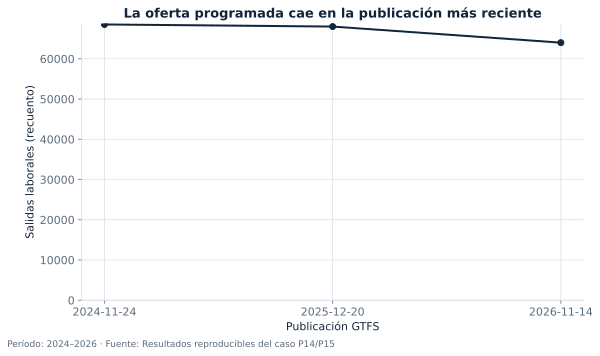
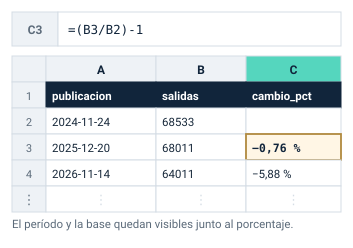

# P14-P15 · Cambios de red y oferta entre publicaciones GTFS

◀ [P12/P13 · Frecuencia programada](../frecuencia_programada/CUADERNO.md) · [Todos los cuadernos](../../docs/cuadernos.md) · [P16 · Informe de decisión](../informe_decision_carga/CUADERNO.md) ▶

[](https://colab.research.google.com/github/vladimiracunadev-create/applied-data-analysis-and-assessment-lab/blob/main/cases/evolucion_gtfs/cuaderno/colab.ipynb) — corre los pasos sin instalar nada: el cuaderno clona el repositorio y descarga los datos del portal.

> **¿Qué cambió entre 2024 y 2026 y cómo varió la oferta programada por hora?**

## 1 · El problema

Comparar publicaciones no es restar sus conteos. Una ruta puede conservar el nombre y
cambiar de trazado; un identificador puede cambiar sin que la realidad cambie; una
versión puede modelar horarios absolutos donde otra usa frecuencias. P14 pregunta qué
cambió y P15 cuánto cambió la oferta: ambas requieren fijar identidad, grano y método.

La ejecución usa tres publicaciones oficiales reales y conserva sus fechas. Es una
trayectoria reciente 2024–2026, no una supuesta serie completa de trece años.

**Los datos.** Últimas publicaciones GTFS de 2024 y 2025, más el feed vigente del 14 de noviembre de 2026.


## 2 · La solución que se va a aplicar

Se leen las últimas publicaciones de 2024 y 2025 desde ZIP anuales y la vigente de 2026.
Se inventaría cada tabla, se comparan conjuntos de rutas y paradas de embarque, y se
firman las secuencias de coordenadas para detectar cambios geométricos. La oferta se
recalcula en las tres versiones con la misma expansión y el mismo `service_id` laboral.


### El mismo resultado en Pandas, Polars y R

Los pasos anteriores y siguientes conservan la resolución completa en Pandas. Este laboratorio adicional aísla el indicador central para resolverlo tres veces sobre **la misma tabla, las mismas reglas y la misma escala gráfica**. Así la comparación cambia el motor, no el problema.

#### Contrato común del ejercicio

- **Objetivo.** Comparar salidas laborales entre publicaciones GTFS equivalentes.
- **Fuente que leen las tres implementaciones.**
  [`resultados/oferta_total.csv`](resultados/oferta_total.csv), CSV UTF-8 versionado y producido
  por la resolución completa del caso. Los datos originales, su publicador, fecha,
  licencia, URL y huella se documentan en [`case.json`](case.json) y, cuando existe,
  `procedencia.json`. Este CSV es un **resultado reproducible**, no se presenta como
  una nueva fuente oficial.
- **Alcance.** evolución de salidas comparables. Los tres scripts comparables no sustituyen la adquisición,
  limpieza ni controles completos de los pasos Pandas: aíslan el indicador para que
  una diferencia observada sea atribuible al motor.
- **Fórmula o regla.** oferta_p = Σ salidas_i de la publicación p después de aplicar el mismo filtro de día comparable.
- **Interpretación.** Una caída en oferta programada es una diferencia de programación, no evidencia directa de ejecución o demanda.
- **Error frecuente.** Comparar archivos con ventanas temporales o reglas de servicio distintas confunde versión con estacionalidad.

| Campo | Tipo observado | Función en el ejercicio |
| --- | --- | --- |
| `publicacion` | `str` | categoría/eje X |
| `salidas` | `int64` | medida/eje Y |
| `cambio_abs` | `float64` | campo auxiliar del contrato |
| `cambio_pct` | `float64` | campo auxiliar del contrato |

#### Qué cambia entre motores

| Dimensión | Pandas | Polars | R (`dplyr`/`readr`) |
| --- | --- | --- | --- |
| Modelo | DataFrame mutable por operaciones | expresiones columnares y plan optimizable | tubería declarativa sobre `tibble` |
| Nulos | `NaN`/`NA`; `groupby` exige decidir `dropna` | `null` separado de `NaN` | `NA`; muchas funciones exigen `na.rm` explícito |
| Orden | varias operaciones lo conservan, pero se ordena explícitamente | no se presupone tras agrupar | se fija con `arrange` |
| Gráfico | Matplotlib | Matplotlib tras extraer sólo X/Y | ggplot2 y su gramática de capas |
| Ventaja típica | ecosistema amplio y aprendizaje gradual | paralelismo, tipos y consultas grandes | estadística, comunicación y análisis reproducible |
| Límite aquí | el índice puede introducir alineaciones implícitas | añade una dependencia y otra semántica de tipos | requiere runtime y paquetes R independientes |

La equivalencia se valida sobre CSV normalizados con tolerancia numérica `1e-9`; no
se exige que la sintaxis ni los píxeles sean idénticos. Para ejecutar en un entorno
limpio consulte [`docs/ejecucion-portable.md`](../../docs/ejecucion-portable.md).

| Motor | Alcance verificado | Archivo | Ejecutar |
| --- | --- | --- | --- |
| Pandas + Matplotlib | evolución de salidas comparables | [`solucion_pandas.py`](cuaderno/solucion_pandas.py) | `python cases/evolucion_gtfs/cuaderno/solucion_pandas.py` |
| Polars + Matplotlib | evolución de salidas comparables | [`solucion_polars.py`](cuaderno/solucion_polars.py) | `uv run --extra polars python cases/evolucion_gtfs/cuaderno/solucion_polars.py` |
| R + ggplot2 | evolución de salidas comparables | [`solucion.R`](cuaderno/solucion.R) | `Rscript cases/evolucion_gtfs/cuaderno/solucion.R` |

#### Pandas + Matplotlib

```python
"""Laboratorio comparable Pandas + Matplotlib del caso evolucion_gtfs.

Lee el mismo contrato CSV que las versiones Polars y R. La resolución completa del
caso permanece en ``solution.py`` y en los pasos del cuaderno; este archivo aísla el
indicador central para que la comparación entre motores sea controlada.
"""
from __future__ import annotations

import argparse
import sys
from pathlib import Path

import matplotlib.pyplot as plt
import pandas as pd

if hasattr(sys.stdout, "reconfigure"):
    sys.stdout.reconfigure(encoding="utf-8")

# Buscar la raíz desde el propio archivo evita rutas C:\... específicas del autor y
# funciona igual después de clonar el repositorio en Linux, Windows o Google Colab.
ROOT = Path(__file__).resolve().parents[3] if "__file__" in globals() else Path.cwd()
SOURCE = ROOT / "cases" / "evolucion_gtfs" / "resultados" / "oferta_total.csv"
REQUIRED = {"publicacion", "salidas"}


def analizar() -> pd.DataFrame:
    """Carga, valida y transforma el indicador; no modifica el archivo de entrada."""
    datos = pd.read_csv(SOURCE)
    faltantes = REQUIRED.difference(datos.columns)
    if faltantes:
        raise ValueError(f"Faltan columnas requeridas en {SOURCE}: {sorted(faltantes)}")
    # La expresión conserva explícitos filtro, agrupación, orden y selección para que
    # el estudiante pueda alinearlos con las expresiones de Polars y dplyr.
    resultado = datos.sort_values("publicacion")[["publicacion", "salidas"]]
    return resultado.reset_index(drop=True)


def graficar(resultado: pd.DataFrame, destino: Path) -> Path:
    """Representa exactamente las columnas comparadas y explicita sus unidades."""
    x = resultado["publicacion"].tolist()
    y = resultado["salidas"].tolist()
    fig, ax = plt.subplots(figsize=(9, 5))
    ax.plot(x, y, marker="o", linewidth=2, color="#11253B")
    ax.set_xlabel("Publicación GTFS")
    ax.set_ylabel("Salidas laborales (recuento)")
    ax.set_ylim(bottom=0)
    ax.set_title("La oferta programada cae en la publicación más reciente")
    ax.grid(axis="y", alpha=0.25)
    fig.text(0.01, 0.01, "Fuente: Resultados reproducibles del caso P14/P15 · Período: 2024–2026", fontsize=8, color="#58677A")
    fig.tight_layout(rect=(0, 0.05, 1, 1))
    fig.savefig(destino, dpi=150, bbox_inches="tight")
    plt.close(fig)
    return destino


def main() -> None:
    parser = argparse.ArgumentParser(description=__doc__)
    parser.add_argument("--salida", type=Path, help="CSV normalizado para comparar motores")
    parser.add_argument("--grafico", type=Path, help="PNG de la visualización comparable")
    args = parser.parse_args()
    resultado = analizar()
    print(resultado.to_string(index=False))
    if args.salida:
        resultado.to_csv(args.salida, index=False)
    if args.grafico:
        print(graficar(resultado, args.grafico))


if __name__ == "__main__":
    main()
```

#### Polars + Matplotlib

```python
"""Laboratorio comparable Polars + Matplotlib del caso evolucion_gtfs.

Usa el mismo CSV, columnas, reglas y escala que Pandas y R. Polars expresa las
transformaciones como un plan de expresiones columnares; esa diferencia de método es
el objeto de aprendizaje, no una razón para cambiar la pregunta.
"""
from __future__ import annotations

import argparse
import sys
from pathlib import Path

import matplotlib.pyplot as plt
import polars as pl

if hasattr(sys.stdout, "reconfigure"):
    sys.stdout.reconfigure(encoding="utf-8")

ROOT = Path(__file__).resolve().parents[3] if "__file__" in globals() else Path.cwd()
SOURCE = ROOT / "cases" / "evolucion_gtfs" / "resultados" / "oferta_total.csv"
REQUIRED = {"publicacion", "salidas"}


def analizar() -> pl.DataFrame:
    """Carga y valida antes de transformar para producir un error explicativo."""
    datos = pl.read_csv(SOURCE)
    faltantes = REQUIRED.difference(datos.columns)
    if faltantes:
        raise ValueError(f"Faltan columnas requeridas en {SOURCE}: {sorted(faltantes)}")
    # select al final fija el contrato de salida y evita comparar columnas auxiliares.
    return datos.sort("publicacion").select(["publicacion", "salidas"])


def graficar(resultado: pl.DataFrame, destino: Path) -> Path:
    """Convierte sólo las series del gráfico; el análisis permanece en Polars."""
    x = resultado["publicacion"].to_list()
    y = resultado["salidas"].to_list()
    fig, ax = plt.subplots(figsize=(9, 5))
    ax.plot(x, y, marker="o", linewidth=2, color="#11253B")
    ax.set_xlabel("Publicación GTFS")
    ax.set_ylabel("Salidas laborales (recuento)")
    ax.set_ylim(bottom=0)
    ax.set_title("La oferta programada cae en la publicación más reciente")
    ax.grid(axis="y", alpha=0.25)
    fig.text(
        0.01,
        0.01,
        "Fuente: Resultados reproducibles del caso P14/P15 · Período: 2024–2026",
        fontsize=8,
        color="#58677A",
    )
    fig.tight_layout(rect=(0, 0.05, 1, 1))
    fig.savefig(destino, dpi=150, bbox_inches="tight")
    plt.close(fig)
    return destino


def main() -> None:
    parser = argparse.ArgumentParser(description=__doc__)
    parser.add_argument("--salida", type=Path, help="CSV normalizado para comparar motores")
    parser.add_argument("--grafico", type=Path, help="PNG de la visualización comparable")
    args = parser.parse_args()
    resultado = analizar()
    print(resultado)
    if args.salida:
        resultado.write_csv(args.salida)
    if args.grafico:
        print(graficar(resultado, args.grafico))


if __name__ == "__main__":
    main()
```

#### R + ggplot2

```r
#!/usr/bin/env Rscript
# Laboratorio comparable R + dplyr/readr + ggplot2 del caso evolucion_gtfs.
#
# La resolución completa sigue en solution.py y en los pasos Pandas. Este script
# cambia el motor sobre el mismo contrato CSV para estudiar sintaxis y semántica sin
# cambiar datos, indicador ni escala gráfica.

required <- c("readr", "dplyr")
missing <- required[!vapply(required, requireNamespace, logical(1), quietly = TRUE)]
if (length(missing)) {
  stop(
    "Faltan paquetes: ", paste(missing, collapse = ", "),
    ". Instálelos con install.packages(c('readr', 'dplyr', 'ggplot2'))."
  )
}

# Buscar pyproject.toml hacia arriba hace portable el script entre terminal, RStudio,
# Posit Cloud, IRkernel y un clon en Colab. LAB_ROOT permite una ruta explícita sin
# codificar la unidad o el directorio del desarrollador.
find_root <- function(start = getwd()) {
  current <- normalizePath(start, mustWork = TRUE)
  repeat {
    if (file.exists(file.path(current, "pyproject.toml"))) return(current)
    parent <- dirname(current)
    if (identical(parent, current)) stop("No se encontró la raíz del repositorio.")
    current <- parent
  }
}
root <- Sys.getenv("LAB_ROOT", unset = find_root())
source_csv <- file.path(root, "cases", "evolucion_gtfs", "resultados", "oferta_total.csv")

# readr conserva nombres y tipos previsibles. La validación temprana produce un error
# que explica el contrato roto, en vez de fallar más tarde dentro de una gráfica.
datos <- readr::read_csv(source_csv, show_col_types = FALSE, progress = FALSE)
required_columns <- c("publicacion", "salidas")
missing_columns <- setdiff(required_columns, names(datos))
if (length(missing_columns)) stop("Faltan columnas: ", paste(missing_columns, collapse = ", "))

# dplyr expresa la misma selección, filtro, agrupación y orden que las otras vías.
resultado <- datos |> dplyr::arrange(.data$publicacion) |> dplyr::select(.data$publicacion, .data$salidas)
print(resultado)

args <- commandArgs(trailingOnly = TRUE)
value_after <- function(flag) {
  pos <- match(flag, args)
  if (is.na(pos)) return(NULL)
  if (pos == length(args)) stop(flag, " necesita una ruta de salida")
  args[pos + 1]
}

csv_output <- value_after("--salida")
if (!is.null(csv_output)) readr::write_csv(resultado, csv_output)

plot_output <- value_after("--grafico")
if (!is.null(plot_output)) {
  if (!requireNamespace("ggplot2", quietly = TRUE)) {
    stop("Instale ggplot2 para generar el gráfico: install.packages('ggplot2')")
  }
  grafico <- ggplot2::ggplot(
    resultado,
    ggplot2::aes(x = .data[["publicacion"]], y = .data[["salidas"]])
  ) +
    ggplot2::geom_line(ggplot2::aes(group = 1), linewidth = 1, colour = "#11253B") +
    ggplot2::geom_point(size = 2.5, colour = "#55D6BE") +
    ggplot2::labs(
      title = "La oferta programada cae en la publicación más reciente",
      x = "Publicación GTFS", y = "Salidas laborales (recuento)",
      caption = "Fuente: Resultados reproducibles del caso P14/P15 · Período: 2024–2026"
    ) +
    ggplot2::theme_minimal(base_size = 11)
  ggplot2::ggsave(plot_output, grafico, width = 9, height = 5, dpi = 150)
  cat(plot_output, "\n")
}
```

8 pasos. Cada uno trae el código de **Python**, la salida que devuelve de verdad, y la **fórmula de Excel** equivalente dibujada en su hoja. 8 traen además la trampa de hacerlo de la forma obvia.

| # | Paso | Trampa |
| --- | --- | --- |
| 1 | [Nombrar las publicaciones por fecha](#paso-1) | sí |
| 2 | [Inventariar antes de comparar](#paso-2) | sí |
| 3 | [Comparar rutas como conjuntos](#paso-3) | sí |
| 4 | [Comparar solo paradas de embarque](#paso-4) | sí |
| 5 | [Firmar el trazado, no solo el ID](#paso-5) | sí |
| 6 | [Recalcular la oferta por hora](#paso-6) | sí |
| 7 | [Medir el cambio total](#paso-7) | sí |
| 8 | [Dejar preparada la ampliación](#paso-8) | sí |

### Para trabajar

| Archivo | Qué es |
| --- | --- |
| [`P14-P15-caso-completo.zip`](cuaderno/P14-P15-caso-completo.zip) | **todo el caso en un ZIP**: el cuaderno, el script, el libro de Excel y las figuras |
| [`pasos.py`](cuaderno/pasos.py) | los 8 pasos seguidos. Se corre y muestra cada salida |
| [`practica.xlsx`](cuaderno/practica.xlsx) | las fórmulas y **el resultado que deben dar**, para corregirse solo. Se abre igual en Google Sheets |
| [`colab.ipynb`](cuaderno/colab.ipynb) | el cuaderno **ejecutable en Colab**: clona, descarga los datos del portal y corre los 8 pasos |
| [`solucion_pandas.py`](cuaderno/solucion_pandas.py) | solución ejecutable en Pandas + Matplotlib; incluye el contraste numérico y el gráfico del caso |
| [`solucion_polars.py`](cuaderno/solucion_polars.py) | solución ejecutable en Polars + Matplotlib; incluye el contraste numérico y el gráfico del caso |
| [`solucion.R`](cuaderno/solucion.R) | solución ejecutable en R + ggplot2; incluye el contraste numérico y el gráfico del caso |
| [`solucion.Rmd`](cuaderno/solucion.Rmd) | documento R Markdown para RStudio, Posit Cloud y render reproducible; reutiliza `solucion.R` sin duplicar la lógica |

---

## 3 · Los pasos

<a id="paso-1"></a>

### Paso 1 · Nombrar las publicaciones por fecha

La etiqueta temporal pertenece al dato, no al momento de análisis.

#### Python

```python
[(r.etiqueta, r.ruta.name, r.miembro or 'ZIP directo') for r in evolucion.REFERENCIAS]
```

```
[('2024-11-24', 'gtfs-historicos-2024.zip', '2024/GTFS_20241124.zip'), ('2025-12-20', 'gtfs-historicos-2025.zip', '2025/GTFS_20251220.zip'), ('2026-11-14', 'gtfs-red-movilidad.zip', 'ZIP directo')]
```

#### Excel

Hoja Fuentes: fecha, URL, archivo, miembro interno y huella.

> **La trampa.** Llamar a ambos archivos 'GTFS' borra qué estado de la red representa cada uno.

[↑ volver al recorrido](#2--la-solución-que-se-va-a-aplicar)

---

<a id="paso-2"></a>

### Paso 2 · Inventariar antes de comparar

Volúmenes y esquemas muestran si las cargas son comparables.

#### Python

```python
resultados = evolucion.analizar()
resultados['inventario']
```

| publicacion | rutas | paradas_embarque | viajes_declarados | ventanas_frecuencia | filas_stop_times | bytes_stop_times |
| --- | --- | --- | --- | --- | --- | --- |
| 2024-11-24 | 419 | 12201 | 19983 | 19863 | 1134450 | 46853843 |
| 2025-12-20 | 428 | 12336 | 14149 | 14060 | 821585 | 33696141 |
| 2026-11-14 | 425 | 12497 | 26137 | 14520 | 1098717 | 50986910 |
*3 filas × 7 columnas.*

#### Excel

Una fila por publicación y una columna por tabla/unidad.

> **La trampa.** El salto de viajes declarados no se interpreta antes de revisar la mecánica de frecuencias.

[↑ volver al recorrido](#2--la-solución-que-se-va-a-aplicar)

---

<a id="paso-3"></a>

### Paso 3 · Comparar rutas como conjuntos

Se separan permanencias, altas y bajas.

#### Python

```python
resultados['identidades'].query("entidad == 'rutas'")
```

| entidad | cambio | cantidad |
| --- | --- | --- |
| rutas | permanece | 400 |
| rutas | aparece | 25 |
| rutas | desaparece | 19 |
*3 filas × 3 columnas.*

#### Excel

`CONTAR.SI` contra la otra versión: presente, aparece o desaparece.

> **La trampa.** Una baja de `route_id` no prueba que el recorrido físico dejó de existir.

[↑ volver al recorrido](#2--la-solución-que-se-va-a-aplicar)

---

<a id="paso-4"></a>

### Paso 4 · Comparar solo paradas de embarque

El denominador excluye estaciones, accesos y nodos de pasillo.

#### Python

```python
resultados['identidades'].query("entidad == 'paradas de embarque'")
```

| entidad | cambio | cantidad |
| --- | --- | --- |
| paradas de embarque | permanece | 11846 |
| paradas de embarque | aparece | 651 |
| paradas de embarque | desaparece | 355 |
*3 filas × 3 columnas.*

#### Excel

Filtrar `location_type=0` en ambas versiones antes del cruce externo.

> **La trampa.** Comparar todo `stops.txt` confunde cambios de jerarquía con paradas nuevas.

[↑ volver al recorrido](#2--la-solución-que-se-va-a-aplicar)

---

<a id="paso-5"></a>

### Paso 5 · Firmar el trazado, no solo el ID

Cada geometría se resume desde su secuencia completa de puntos.

#### Python

```python
resultados['trazados'].query('cambio_de_conjunto').head(15)
```

| route_id | formas_inicial | formas_final | cambio_de_conjunto |
| --- | --- | --- | --- |
| 101 | 4 | 2 | True |
| 102 | 2 | 2 | True |
| 103 | 5 | 3 | True |
| 104 | 3 | 3 | True |
| 105 | 4 | 2 | True |
| 105c | 1 | 1 | True |
| 106 | 4 | 3 | True |
| 107 | 4 | 2 | True |
| 107c | 2 | 2 | True |
| 108 | 2 | 2 | True |
| 109 | 2 | 2 | True |
| 109N | 2 | 2 | True |
| 110 | 2 | 2 | True |
| 110c | 2 | 2 | True |
| 111 | 2 | 2 | True |
*15 filas × 4 columnas.*

#### Excel

Power Query: ordenar puntos por secuencia, concatenarlos por shape y comparar la firma.

> **La trampa.** Un `shape_id` estable puede ocultar coordenadas nuevas; uno nuevo puede dibujar lo mismo.

[↑ volver al recorrido](#2--la-solución-que-se-va-a-aplicar)

---

<a id="paso-6"></a>

### Paso 6 · Recalcular la oferta por hora

La misma función combina frecuencias y horarios absolutos en ambas versiones.

#### Python

```python
resultados['oferta_por_hora'].head(30)
```

| publicacion | hora | salidas |
| --- | --- | --- |
| 2024-11-24 | 0 | 344 |
| 2024-11-24 | 1 | 361 |
| 2024-11-24 | 2 | 249 |
| 2024-11-24 | 3 | 263 |
| 2024-11-24 | 4 | 254 |
| 2024-11-24 | 5 | 1896 |
| 2024-11-24 | 6 | 4332 |
| 2024-11-24 | 7 | 4897 |
| 2024-11-24 | 8 | 4394 |
| 2024-11-24 | 9 | 3680 |
| 2024-11-24 | 10 | 3369 |
| 2024-11-24 | 11 | 3384 |
| 2024-11-24 | 12 | 3340 |
| 2024-11-24 | 13 | 3268 |
| 2024-11-24 | 14 | 3779 |
| 2024-11-24 | 15 | 3548 |
| 2024-11-24 | 16 | 3918 |
| 2024-11-24 | 17 | 4239 |
| 2024-11-24 | 18 | 4405 |
| 2024-11-24 | 19 | 4319 |
| 2024-11-24 | 20 | 3636 |
| 2024-11-24 | 21 | 2876 |
| 2024-11-24 | 22 | 2641 |
| 2024-11-24 | 23 | 1141 |
| 2025-12-20 | 0 | 325 |
| 2025-12-20 | 1 | 371 |
| 2025-12-20 | 2 | 251 |
| 2025-12-20 | 3 | 271 |
| 2025-12-20 | 4 | 251 |
| 2025-12-20 | 5 | 1908 |
*30 filas × 3 columnas.*



*La oferta programada cae en la publicación más reciente. Ejes con unidad, período y fuente; el código Polars y R genera la misma vista.*

#### Excel

Tabla dinámica: publicación en columnas, hora en filas, salidas en valores.

> **La trampa.** Comparar filas de `trips.txt` daría una serie rota: una ventana representa muchas salidas.

[↑ volver al recorrido](#2--la-solución-que-se-va-a-aplicar)

---

<a id="paso-7"></a>

### Paso 7 · Medir el cambio total

Se publica diferencia absoluta y porcentual con su período.

#### Python

```python
resultados['oferta_total']
```

| publicacion | salidas | cambio_abs | cambio_pct |
| --- | --- | --- | --- |
| 2024-11-24 | 68533 |  |  |
| 2025-12-20 | 68011 | -522.0 | -0.76 |
| 2026-11-14 | 64011 | -4000.0 | -5.88 |
*3 filas × 4 columnas.*

#### Excel



`=(salidas_2026/salidas_2025)-1` con formato porcentual.

Debe dar: **−0,76 % y −5,88 %**

**En Google Sheets:** la misma fórmula, sin cambios.

> **La trampa.** Tres puntos describen una trayectoria reciente, no toda la serie 2014–2026.

[↑ volver al recorrido](#2--la-solución-que-se-va-a-aplicar)

---

<a id="paso-8"></a>

### Paso 8 · Dejar preparada la ampliación

Agregar un año es agregar una FeedRef; la definición no cambia.

#### Python

```python
{'publicaciones_ejecutadas': len(evolucion.REFERENCIAS), 'primera': evolucion.REFERENCIAS[0].etiqueta, 'ultima': evolucion.REFERENCIAS[-1].etiqueta}
```

```
{'publicaciones_ejecutadas': 3, 'primera': '2024-11-24', 'ultima': '2026-11-14'}
```

#### Excel

Agregar una fila por publicación manteniendo idénticas fórmulas y filtros.

> **La trampa.** Completar años con cifras copiadas de informes rompería la comparabilidad del método.

[↑ volver al recorrido](#2--la-solución-que-se-va-a-aplicar)

---

## 4 · El resultado

La oferta laboral calculada con idéntica definición pasa de 68 533 salidas en 2024 a 68 011 en 2025 y 64 011 en 2026; el último cambio es −5,88 %.

## 5 · Qué queda aprendido

1. La identidad en el tiempo no se supone.
2. El trazado se compara por geometría.
3. La serie debe recalcular cada versión con la misma definición.
4. Tres puntos describen una trayectoria reciente, no una historia completa.

## Reproducir

```powershell
python -m cases.evolucion_gtfs.solution
```

## Seguir

Lo que este caso toca y se trata a fondo en otro sitio:

- [Resultados auditables](README.md)
- [P06 · Definición de salidas](../gtfs_red_movilidad/CUADERNO.md)

◀ [P12/P13 · Frecuencia programada](../frecuencia_programada/CUADERNO.md) · [Todos los cuadernos](../../docs/cuadernos.md) · [P16 · Informe de decisión](../informe_decision_carga/CUADERNO.md) ▶
