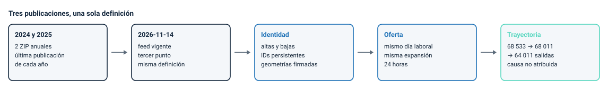
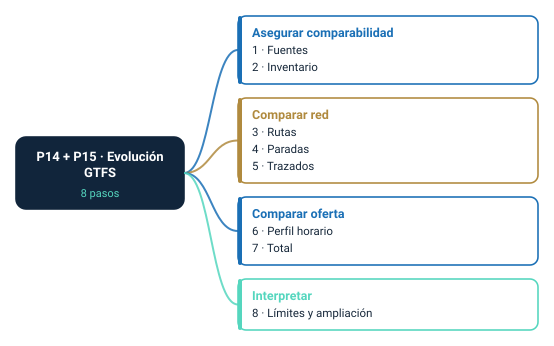

# P14-P15 · Cambios de red y oferta entre publicaciones GTFS

◀ [P12-P13 · Frecuencia](../frecuencia_programada/CUADERNO.md) · [Todos los cuadernos](../../docs/cuadernos.md) · [P16 · Informe de decisión](../informe_decision_carga/CUADERNO.md) ▶

[](https://colab.research.google.com/github/vladimiracunadev-create/applied-data-analysis-and-assessment-lab/blob/main/cases/evolucion_gtfs/cuaderno/colab.ipynb) — corre los pasos sin instalar nada: el cuaderno clona el repositorio y descarga los datos del portal.

> **¿Qué cambió entre 2024 y 2026 y cómo varió la oferta programada por hora?**

## 1 · El problema

Comparar publicaciones no es restar sus conteos. Una ruta puede conservar el nombre y
cambiar de trazado; un identificador puede cambiar sin que la realidad cambie; una
versión puede modelar horarios absolutos donde otra usa frecuencias. P14 pregunta qué
cambió y P15 cuánto cambió la oferta: ambas requieren fijar identidad, grano y método.

La ejecución usa tres publicaciones oficiales reales y conserva sus fechas. Es una
trayectoria reciente 2024–2026, no una supuesta serie completa de trece años.

**Los datos.** Últimas publicaciones GTFS de 2024 y 2025, más el feed vigente del 14 de noviembre de 2026.



## 2 · La solución que se va a aplicar

Se leen las últimas publicaciones de 2024 y 2025 desde ZIP anuales y la vigente de 2026.
Se inventaría cada tabla, se comparan conjuntos de rutas y paradas de embarque, y se
firman las secuencias de coordenadas para detectar cambios geométricos. La oferta se
recalcula en las tres versiones con la misma expansión y el mismo `service_id` laboral.



8 pasos. Cada uno trae el código de **Python**, la salida que devuelve de verdad, y la **fórmula de Excel** equivalente dibujada en su hoja. 8 traen además la trampa de hacerlo de la forma obvia.

| # | Paso | Trampa |
| --- | --- | --- |
| 1 | [Nombrar las publicaciones por fecha](#paso-1) | sí |
| 2 | [Inventariar antes de comparar](#paso-2) | sí |
| 3 | [Comparar rutas como conjuntos](#paso-3) | sí |
| 4 | [Comparar solo paradas de embarque](#paso-4) | sí |
| 5 | [Firmar el trazado, no solo el ID](#paso-5) | sí |
| 6 | [Recalcular la oferta por hora](#paso-6) | sí |
| 7 | [Medir el cambio total](#paso-7) | sí |
| 8 | [Dejar preparada la ampliación](#paso-8) | sí |

### Para trabajar

| Archivo | Qué es |
| --- | --- |
| [`P14-P15-caso-completo.zip`](cuaderno/P14-P15-caso-completo.zip) | **todo el caso en un ZIP**: el cuaderno, el script, el libro de Excel y las figuras |
| [`pasos.py`](cuaderno/pasos.py) | los 8 pasos seguidos. Se corre y muestra cada salida |
| [`practica.xlsx`](cuaderno/practica.xlsx) | las fórmulas y **el resultado que deben dar**, para corregirse solo. Se abre igual en Google Sheets |
| [`colab.ipynb`](cuaderno/colab.ipynb) | el cuaderno **ejecutable en Colab**: clona, descarga los datos del portal y corre los 8 pasos |

---

## 3 · Los pasos

<a id="paso-1"></a>

### Paso 1 · Nombrar las publicaciones por fecha

La etiqueta temporal pertenece al dato, no al momento de análisis.

#### Python

```python
[(r.etiqueta, r.ruta.name, r.miembro or 'ZIP directo') for r in evolucion.REFERENCIAS]
```

```
[('2024-11-24', 'gtfs-historicos-2024.zip', '2024/GTFS_20241124.zip'), ('2025-12-20', 'gtfs-historicos-2025.zip', '2025/GTFS_20251220.zip'), ('2026-11-14', 'gtfs-red-movilidad.zip', 'ZIP directo')]
```

#### Excel

Hoja Fuentes: fecha, URL, archivo, miembro interno y huella.

> **La trampa.** Llamar a ambos archivos 'GTFS' borra qué estado de la red representa cada uno.

[↑ volver al recorrido](#2--la-solución-que-se-va-a-aplicar)

---

<a id="paso-2"></a>

### Paso 2 · Inventariar antes de comparar

Volúmenes y esquemas muestran si las cargas son comparables.

#### Python

```python
resultados = evolucion.analizar()
resultados['inventario']
```

| publicacion | rutas | paradas_embarque | viajes_declarados | ventanas_frecuencia | filas_stop_times | bytes_stop_times |
| --- | --- | --- | --- | --- | --- | --- |
| 2024-11-24 | 419 | 12201 | 19983 | 19863 | 1134450 | 46853843 |
| 2025-12-20 | 428 | 12336 | 14149 | 14060 | 821585 | 33696141 |
| 2026-11-14 | 425 | 12497 | 26137 | 14520 | 1098717 | 50986910 |
*3 filas × 7 columnas.*

#### Excel

Una fila por publicación y una columna por tabla/unidad.

> **La trampa.** El salto de viajes declarados no se interpreta antes de revisar la mecánica de frecuencias.

[↑ volver al recorrido](#2--la-solución-que-se-va-a-aplicar)

---

<a id="paso-3"></a>

### Paso 3 · Comparar rutas como conjuntos

Se separan permanencias, altas y bajas.

#### Python

```python
resultados['identidades'].query("entidad == 'rutas'")
```

| entidad | cambio | cantidad |
| --- | --- | --- |
| rutas | permanece | 400 |
| rutas | aparece | 25 |
| rutas | desaparece | 19 |
*3 filas × 3 columnas.*

#### Excel

`CONTAR.SI` contra la otra versión: presente, aparece o desaparece.

> **La trampa.** Una baja de `route_id` no prueba que el recorrido físico dejó de existir.

[↑ volver al recorrido](#2--la-solución-que-se-va-a-aplicar)

---

<a id="paso-4"></a>

### Paso 4 · Comparar solo paradas de embarque

El denominador excluye estaciones, accesos y nodos de pasillo.

#### Python

```python
resultados['identidades'].query("entidad == 'paradas de embarque'")
```

| entidad | cambio | cantidad |
| --- | --- | --- |
| paradas de embarque | permanece | 11846 |
| paradas de embarque | aparece | 651 |
| paradas de embarque | desaparece | 355 |
*3 filas × 3 columnas.*

#### Excel

Filtrar `location_type=0` en ambas versiones antes del cruce externo.

> **La trampa.** Comparar todo `stops.txt` confunde cambios de jerarquía con paradas nuevas.

[↑ volver al recorrido](#2--la-solución-que-se-va-a-aplicar)

---

<a id="paso-5"></a>

### Paso 5 · Firmar el trazado, no solo el ID

Cada geometría se resume desde su secuencia completa de puntos.

#### Python

```python
resultados['trazados'].query('cambio_de_conjunto').head(15)
```

| route_id | formas_inicial | formas_final | cambio_de_conjunto |
| --- | --- | --- | --- |
| 101 | 4 | 2 | True |
| 102 | 2 | 2 | True |
| 103 | 5 | 3 | True |
| 104 | 3 | 3 | True |
| 105 | 4 | 2 | True |
| 105c | 1 | 1 | True |
| 106 | 4 | 3 | True |
| 107 | 4 | 2 | True |
| 107c | 2 | 2 | True |
| 108 | 2 | 2 | True |
| 109 | 2 | 2 | True |
| 109N | 2 | 2 | True |
| 110 | 2 | 2 | True |
| 110c | 2 | 2 | True |
| 111 | 2 | 2 | True |
*15 filas × 4 columnas.*

#### Excel

Power Query: ordenar puntos por secuencia, concatenarlos por shape y comparar la firma.

> **La trampa.** Un `shape_id` estable puede ocultar coordenadas nuevas; uno nuevo puede dibujar lo mismo.

[↑ volver al recorrido](#2--la-solución-que-se-va-a-aplicar)

---

<a id="paso-6"></a>

### Paso 6 · Recalcular la oferta por hora

La misma función combina frecuencias y horarios absolutos en ambas versiones.

#### Python

```python
resultados['oferta_por_hora'].head(30)
```

| publicacion | hora | salidas |
| --- | --- | --- |
| 2024-11-24 | 0 | 344 |
| 2024-11-24 | 1 | 361 |
| 2024-11-24 | 2 | 249 |
| 2024-11-24 | 3 | 263 |
| 2024-11-24 | 4 | 254 |
| 2024-11-24 | 5 | 1896 |
| 2024-11-24 | 6 | 4332 |
| 2024-11-24 | 7 | 4897 |
| 2024-11-24 | 8 | 4394 |
| 2024-11-24 | 9 | 3680 |
| 2024-11-24 | 10 | 3369 |
| 2024-11-24 | 11 | 3384 |
| 2024-11-24 | 12 | 3340 |
| 2024-11-24 | 13 | 3268 |
| 2024-11-24 | 14 | 3779 |
| 2024-11-24 | 15 | 3548 |
| 2024-11-24 | 16 | 3918 |
| 2024-11-24 | 17 | 4239 |
| 2024-11-24 | 18 | 4405 |
| 2024-11-24 | 19 | 4319 |
| 2024-11-24 | 20 | 3636 |
| 2024-11-24 | 21 | 2876 |
| 2024-11-24 | 22 | 2641 |
| 2024-11-24 | 23 | 1141 |
| 2025-12-20 | 0 | 325 |
| 2025-12-20 | 1 | 371 |
| 2025-12-20 | 2 | 251 |
| 2025-12-20 | 3 | 271 |
| 2025-12-20 | 4 | 251 |
| 2025-12-20 | 5 | 1908 |
*30 filas × 3 columnas.*

#### Excel

Tabla dinámica: publicación en columnas, hora en filas, salidas en valores.

> **La trampa.** Comparar filas de `trips.txt` daría una serie rota: una ventana representa muchas salidas.

[↑ volver al recorrido](#2--la-solución-que-se-va-a-aplicar)

---

<a id="paso-7"></a>

### Paso 7 · Medir el cambio total

Se publica diferencia absoluta y porcentual con su período.

#### Python

```python
resultados['oferta_total']
```

| publicacion | salidas | cambio_abs | cambio_pct |
| --- | --- | --- | --- |
| 2024-11-24 | 68533 |  |  |
| 2025-12-20 | 68011 | -522.0 | -0.76 |
| 2026-11-14 | 64011 | -4000.0 | -5.88 |
*3 filas × 4 columnas.*

#### Excel


`=(salidas_2026/salidas_2025)-1` con formato porcentual.

Debe dar: **−0,76 % y −5,88 %**

**En Google Sheets:** la misma fórmula, sin cambios.

> **La trampa.** Tres puntos describen una trayectoria reciente, no toda la serie 2014–2026.

[↑ volver al recorrido](#2--la-solución-que-se-va-a-aplicar)

---

<a id="paso-8"></a>

### Paso 8 · Dejar preparada la ampliación

Agregar un año es agregar una FeedRef; la definición no cambia.

#### Python

```python
{'publicaciones_ejecutadas': len(evolucion.REFERENCIAS), 'primera': evolucion.REFERENCIAS[0].etiqueta, 'ultima': evolucion.REFERENCIAS[-1].etiqueta}
```

```
{'publicaciones_ejecutadas': 3, 'primera': '2024-11-24', 'ultima': '2026-11-14'}
```

#### Excel

Agregar una fila por publicación manteniendo idénticas fórmulas y filtros.

> **La trampa.** Completar años con cifras copiadas de informes rompería la comparabilidad del método.

[↑ volver al recorrido](#2--la-solución-que-se-va-a-aplicar)

---

## 4 · El resultado

La oferta laboral calculada con idéntica definición pasa de 68 533 salidas en 2024 a 68 011 en 2025 y 64 011 en 2026; el último cambio es −5,88 %.

## 5 · Qué queda aprendido

1. La identidad en el tiempo no se supone.
2. El trazado se compara por geometría.
3. La serie debe recalcular cada versión con la misma definición.
4. Tres puntos describen una trayectoria reciente, no una historia completa.

## Reproducir

```powershell
python -m cases.evolucion_gtfs.solution
```

## Seguir

Lo que este caso toca y se trata a fondo en otro sitio:

- [Resultados auditables](README.md)
- [P06 · Definición de salidas](../gtfs_red_movilidad/CUADERNO.md)

◀ [P12-P13 · Frecuencia](../frecuencia_programada/CUADERNO.md) · [Todos los cuadernos](../../docs/cuadernos.md) · [P16 · Informe de decisión](../informe_decision_carga/CUADERNO.md) ▶
