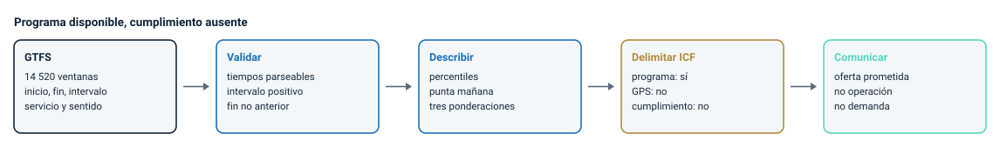

# P12-P13 · ICF y distribución de la frecuencia programada

◀ [P11 · Calendario de medición](../calendario_medicion/CUADERNO.md) · [Todos los cuadernos](../../docs/cuadernos.md) · [P14/P15 · Evolución GTFS](../evolucion_gtfs/CUADERNO.md) ▶

[](https://colab.research.google.com/github/vladimiracunadev-create/applied-data-analysis-and-assessment-lab/blob/main/cases/frecuencia_programada/cuaderno/colab.ipynb) — corre los pasos sin instalar nada: el cuaderno clona el repositorio y descarga los datos del portal.

> **¿Qué parte del ICF se puede calcular con GTFS y cómo se distribuye la frecuencia programada?**

## 1 · El problema

El ICF oficial parece una razón simple, pero su numerador y denominador son mediciones
GPS. El GTFS solo contiene el programa. Confundir ambos convierte una promesa de oferta
en una medición de cumplimiento inexistente. El mismo archivo sí permite contestar P13:
cómo se distribuyen los intervalos programados y qué servicios tienen mayor espera.

**Los datos.** frequencies.txt, trips.txt y routes.txt del GTFS vigente, más la definición oficial del ICF.



## 2 · La solución que se va a aplicar

Se validan las ventanas, se calculan sus salidas con fin exclusivo y se construye una
matriz de alcance del ICF. La distribución se resume con percentiles y tres unidades de
análisis. La punta mañana se filtra por intersección temporal, no por hora de inicio.


### El mismo resultado en Pandas, Polars y R

La ruta principal de los pasos usa Pandas y Excel. Las implementaciones siguientes recalculan el indicador que sostiene la conclusión con otro motor y producen el mismo gráfico estadístico. El alcance queda declarado para no confundir validación independiente con una traducción cosmética.

| Motor | Alcance verificado | Archivo | Ejecutar |
| --- | --- | --- | --- |
| Polars + Matplotlib | percentiles del intervalo programado | [`solucion_polars.py`](cuaderno/solucion_polars.py) | `uv run --extra polars python cases/frecuencia_programada/cuaderno/solucion_polars.py` |
| R + ggplot2 | percentiles del intervalo programado | [`solucion.R`](cuaderno/solucion.R) | `Rscript cases/frecuencia_programada/cuaderno/solucion.R` |

#### Polars + Matplotlib

```python
"""Contraste Polars y visualización Matplotlib del caso frecuencia_programada."""
from __future__ import annotations

import argparse
import sys
from pathlib import Path

import matplotlib.pyplot as plt
import polars as pl

if hasattr(sys.stdout, "reconfigure"):
    sys.stdout.reconfigure(encoding="utf-8")

ROOT = Path(__file__).resolve().parents[3] if "__file__" in globals() else Path.cwd()
SOURCE = ROOT / "cases" / "frecuencia_programada" / "resultados" / "distribucion.csv"


def analizar() -> pl.DataFrame:
    datos = pl.read_csv(SOURCE)
    return datos.select(["estadistico", "intervalo_min"])


def graficar(resultado: pl.DataFrame, destino: Path) -> Path:
    x = resultado["estadistico"].to_list()
    y = resultado["intervalo_min"].to_list()
    fig, ax = plt.subplots(figsize=(9, 5))
    ax.bar([str(value) for value in x], y, color="#11253B")
    ax.set_xlabel("Estadístico")
    ax.set_ylabel("Intervalo entre salidas (minutos)")
    ax.set_ylim(bottom=0)
    ax.set_title("La distribución revela más que un promedio")
    ax.grid(axis="y", alpha=0.25)
    fig.text(
        0.01,
        0.01,
        "Fuente: Resultados reproducibles del caso P12/P13 · Período: publicación GTFS analizada",
        fontsize=8,
        color="#58677A",
    )
    fig.tight_layout(rect=(0, 0.05, 1, 1))
    fig.savefig(destino, dpi=150, bbox_inches="tight")
    plt.close(fig)
    return destino


def main() -> None:
    parser = argparse.ArgumentParser()
    parser.add_argument("--grafico", type=Path)
    args = parser.parse_args()
    resultado = analizar()
    print(resultado)
    if args.grafico:
        print(graficar(resultado, args.grafico))


if __name__ == "__main__":
    main()
```

#### R + ggplot2

```r
#!/usr/bin/env Rscript
# Contraste R + ggplot2 del caso frecuencia_programada.
script_arg <- grep("^--file=", commandArgs(trailingOnly = FALSE), value = TRUE)
script_path <- if (length(script_arg)) sub("^--file=", "", script_arg[1]) else "cuaderno/solucion.R"
root <- normalizePath(file.path(dirname(script_path), "../../.."), mustWork = TRUE)
source_csv <- file.path(root, "cases", "frecuencia_programada", "resultados", "distribucion.csv")

datos <- read.csv(source_csv, check.names = FALSE, fileEncoding = "UTF-8")
resultado <- datos[, c("estadistico", "intervalo_min")]
print(resultado, row.names = FALSE)

args <- commandArgs(trailingOnly = TRUE)
plot_pos <- match("--grafico", args)
if (!is.na(plot_pos)) {
  if (plot_pos == length(args)) stop("--grafico necesita una ruta de salida")
  if (!requireNamespace("ggplot2", quietly = TRUE)) {
    stop("Instale ggplot2 para generar el gráfico: install.packages('ggplot2')")
  }
  destino <- args[plot_pos + 1]
  grafico <- ggplot2::ggplot(
    resultado,
    ggplot2::aes(x = .data[["estadistico"]], y = .data[["intervalo_min"]])
  ) +
    ggplot2::geom_col(fill = "#11253B") +
    ggplot2::labs(
      title = "La distribución revela más que un promedio",
      x = "Estadístico", y = "Intervalo entre salidas (minutos)",
      caption = "Fuente: Resultados reproducibles del caso P12/P13 · Período: publicación GTFS analizada"
    ) +
    ggplot2::theme_minimal(base_size = 11)
  ggplot2::ggsave(destino, grafico, width = 9, height = 5, dpi = 150)
  cat(destino, "\n")
}
```

8 pasos. Cada uno trae el código de **Python**, la salida que devuelve de verdad, y la **fórmula de Excel** equivalente dibujada en su hoja. 8 traen además la trampa de hacerlo de la forma obvia.

| # | Paso | Trampa |
| --- | --- | --- |
| 1 | [Leer solo tres tablas](#paso-1) | sí |
| 2 | [Validar las ventanas](#paso-2) | sí |
| 3 | [Separar programa de observación](#paso-3) | sí |
| 4 | [Conservar el ICF como no calculable](#paso-4) | sí |
| 5 | [Describir la distribución](#paso-5) | sí |
| 6 | [Cambiar la unidad de análisis](#paso-6) | sí |
| 7 | [Filtrar la punta por intersección](#paso-7) | sí |
| 8 | [Publicar una conclusión proporcional](#paso-8) | sí |

### Para trabajar

| Archivo | Qué es |
| --- | --- |
| [`P12-P13-caso-completo.zip`](cuaderno/P12-P13-caso-completo.zip) | **todo el caso en un ZIP**: el cuaderno, el script, el libro de Excel y las figuras |
| [`pasos.py`](cuaderno/pasos.py) | los 8 pasos seguidos. Se corre y muestra cada salida |
| [`practica.xlsx`](cuaderno/practica.xlsx) | las fórmulas y **el resultado que deben dar**, para corregirse solo. Se abre igual en Google Sheets |
| [`colab.ipynb`](cuaderno/colab.ipynb) | el cuaderno **ejecutable en Colab**: clona, descarga los datos del portal y corre los 8 pasos |
| [`solucion_polars.py`](cuaderno/solucion_polars.py) | solución ejecutable en Polars + Matplotlib; incluye el contraste numérico y el gráfico del caso |
| [`solucion.R`](cuaderno/solucion.R) | solución ejecutable en R + ggplot2; incluye el contraste numérico y el gráfico del caso |

---

## 3 · Los pasos

<a id="paso-1"></a>

### Paso 1 · Leer solo tres tablas

El ICF programado no necesita el archivo de 1,1 millones de horarios.

#### Python

```python
tablas = frecuencia.cargar()
{k: v.shape for k, v in tablas.items()}
```

```
{'frequencies': (14520, 5), 'trips': (26137, 4), 'routes': (425, 3)}
```

#### Excel

Power Query: cargar `frequencies`, `trips` y `routes`; no importar `stop_times`.

> **La trampa.** Cargar por costumbre la tabla grande duplica memoria sin aportar una columna al cálculo.

[↑ volver al recorrido](#2--la-solución-que-se-va-a-aplicar)

---

<a id="paso-2"></a>

### Paso 2 · Validar las ventanas

Inicio, fin e intervalo se tipan antes de resumir.

#### Python

```python
ventanas = frecuencia.ventanas_programadas(tablas)
ventanas[['valida','salidas_programadas']].agg(['count','sum'])
```

| valida | salidas_programadas |
| --- | --- |
| 14520 | 14520 |
| 14520 | 142366 |
*2 filas × 2 columnas.*

#### Excel

Columnas auxiliares para segundos, duración, intervalo positivo y fin posterior al inicio.

> **La trampa.** Una ventana inválida no se descarta sin contarla.

[↑ volver al recorrido](#2--la-solución-que-se-va-a-aplicar)

---

<a id="paso-3"></a>

### Paso 3 · Separar programa de observación

La matriz impide presentar el programa como ICF.

#### Python

```python
resultados = frecuencia.analizar()
resultados['alcance_icf']
```

| componente | calculable_con_gtfs | valor | unidad |
| --- | --- | --- | --- |
| programa de frecuencia | sí | 14520 | ventanas GTFS |
| intervalo objetivo | sí | 14520 | ventanas |
| salidas programadas | sí | 142366 | salidas |
| mediciones GPS realizadas | NO |  | mediciones |
| mediciones que cumplen | NO |  | mediciones |
| ICF oficial | NO |  | % |
*6 filas × 4 columnas.*


*La distribución revela más que un promedio. Ejes con unidad, período y fuente; el código Polars y R genera la misma vista.*

#### Excel

Tabla de control con componente, disponibilidad, valor y unidad.

> **La trampa.** 142 366 salidas programadas no son 142 366 mediciones GPS.

[↑ volver al recorrido](#2--la-solución-que-se-va-a-aplicar)

---

<a id="paso-4"></a>

### Paso 4 · Conservar el ICF como no calculable

La ausencia de GPS es un resultado de alcance, no un error de ejecución.

#### Python

```python
resultados['alcance_icf'].query("calculable_con_gtfs == 'NO'")
```

| componente | calculable_con_gtfs | valor | unidad |
| --- | --- | --- | --- |
| mediciones GPS realizadas | NO |  | mediciones |
| mediciones que cumplen | NO |  | mediciones |
| ICF oficial | NO |  | % |
*3 filas × 4 columnas.*

#### Excel

Dejar numerador, denominador e ICF en blanco y acompañarlos con la causa.

> **La trampa.** Rellenar con cero produciría un ICF de 0 % que los datos jamás observaron.

[↑ volver al recorrido](#2--la-solución-que-se-va-a-aplicar)

---

<a id="paso-5"></a>

### Paso 5 · Describir la distribución

Percentiles muestran la asimetría entre 3,10 y 330 minutos.

#### Python

```python
resultados['distribucion']
```

| estadistico | intervalo_min | unidad |
| --- | --- | --- |
| mínimo | 3.1 | minutos entre salidas |
| P10 | 9.0 | minutos entre salidas |
| P25 | 12.0 | minutos entre salidas |
| P50 | 15.0 | minutos entre salidas |
| P75 | 20.0 | minutos entre salidas |
| P90 | 30.0 | minutos entre salidas |
| P95 | 42.85 | minutos entre salidas |
| máximo | 330.0 | minutos entre salidas |
| media | 21.17 | minutos entre salidas |
*9 filas × 3 columnas.*

#### Excel


`PERCENTIL.INC` sobre `headway_secs/60`.

Debe dar: **15 minutos**

**En Google Sheets:** la misma fórmula, sin cambios.

> **La trampa.** La media de 21,17 minutos no representa la ventana típica de 15.

[↑ volver al recorrido](#2--la-solución-que-se-va-a-aplicar)

---

<a id="paso-6"></a>

### Paso 6 · Cambiar la unidad de análisis

Ventana, servicio y salida responden preguntas distintas.

#### Python

```python
resultados['ponderaciones']
```

| unidad_de_analisis | intervalo_tipico_min | observaciones |
| --- | --- | --- |
| ventana publicada | 15.0 | 14520 |
| servicio (mediana de sus ventanas) | 15.0 | 417 |
| salida programada | 13.03 | 142366 |
*3 filas × 3 columnas.*

#### Excel

Tres tablas dinámicas o tres ponderaciones explícitas.

> **La trampa.** Promediar servicios sin declarar peso da el mismo voto a uno diario y a uno intensivo.

[↑ volver al recorrido](#2--la-solución-que-se-va-a-aplicar)

---

<a id="paso-7"></a>

### Paso 7 · Filtrar la punta por intersección

Entra toda ventana que toca 08:00–09:00.

#### Python

```python
resultados['punta_manana'].head(15)
```

| route_short_name | direction_id | ventanas | intervalo_mediano_min | intervalo_maximo_min | salidas_programadas |
| --- | --- | --- | --- | --- | --- |
| B30n | 0 | 2 | 240.0 | 330.0 | 2 |
| B31n | 1 | 2 | 240.0 | 330.0 | 2 |
| F30n | 0 | 2 | 240.0 | 330.0 | 2 |
| G37 | 0 | 3 | 150.0 | 165.0 | 4 |
| F30n | 1 | 2 | 120.0 | 165.0 | 4 |
| G37 | 1 | 3 | 110.0 | 150.0 | 5 |
| J22 | 1 | 3 | 110.0 | 150.0 | 5 |
| 282 | 0 | 2 | 92.5 | 110.0 | 5 |
| 206c | 0 | 1 | 90.0 | 90.0 | 1 |
| 210e | 0 | 1 | 90.0 | 90.0 | 1 |
| 320c | 0 | 1 | 90.0 | 90.0 | 1 |
| 320c | 1 | 1 | 90.0 | 90.0 | 1 |
| J22 | 0 | 3 | 90.0 | 110.0 | 6 |
| 282 | 1 | 3 | 50.0 | 110.0 | 8 |
| G46 | 0 | 3 | 50.0 | 55.0 | 11 |
*15 filas × 6 columnas.*

#### Excel

Condición: inicio < 09:00 Y fin > 08:00; agrupar por servicio y sentido.

> **La trampa.** Filtrar solo `start_time` pierde ventanas que comenzaron antes de las 08:00.

[↑ volver al recorrido](#2--la-solución-que-se-va-a-aplicar)

---

<a id="paso-8"></a>

### Paso 8 · Publicar una conclusión proporcional

Se distingue frecuencia larga de incumplimiento.

#### Python

```python
resultados['ventanas_invalidas']
```

| trip_id | start_time | end_time | headway_secs |
| --- | --- | --- | --- |
*0 filas × 4 columnas.*

#### Excel

Mostrar el recuento de inválidas junto a la tabla final.

> **La trampa.** Un intervalo programado largo puede ser diseño de servicio; no demuestra falla operacional.

[↑ volver al recorrido](#2--la-solución-que-se-va-a-aplicar)

---

## 4 · El resultado

El GTFS permite construir 142 366 salidas programadas y describir sus intervalos. No contiene mediciones GPS: el ICF oficial permanece no calculable.

## 5 · Qué queda aprendido

1. Programa no es operación observada.
2. La unidad de análisis cambia el intervalo típico.
3. Las ventanas se filtran por intersección temporal.
4. Un vacío metodológico no se rellena con cero.

## Reproducir

```powershell
python -m cases.frecuencia_programada.solution
```

## Seguir

Lo que este caso toca y se trata a fondo en otro sitio:

- [Resultados auditables](README.md)
- [Definición oficial del ICF](../../docs/indicadores-oficiales-transporte.md)

◀ [P11 · Calendario de medición](../calendario_medicion/CUADERNO.md) · [Todos los cuadernos](../../docs/cuadernos.md) · [P14/P15 · Evolución GTFS](../evolucion_gtfs/CUADERNO.md) ▶
