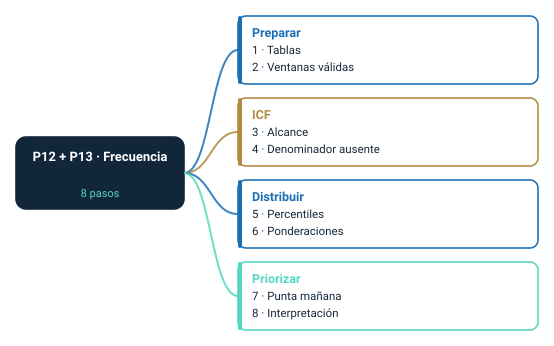
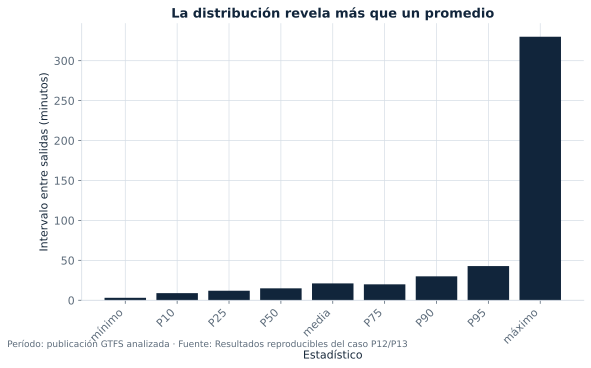

# P12-P13 · ICF y distribución de la frecuencia programada

◀ [P11 · Calendario de medición](../calendario_medicion/CUADERNO.md) · [Todos los cuadernos](../../docs/cuadernos.md) · [P14/P15 · Evolución GTFS](../evolucion_gtfs/CUADERNO.md) ▶

[](https://colab.research.google.com/github/vladimiracunadev-create/applied-data-analysis-and-assessment-lab/blob/main/cases/frecuencia_programada/cuaderno/colab.ipynb) — corre los pasos sin instalar nada: el cuaderno clona el repositorio y descarga los datos del portal.

> **¿Qué parte del ICF se puede calcular con GTFS y cómo se distribuye la frecuencia programada?**

## 1 · El problema

El ICF oficial parece una razón simple, pero su numerador y denominador son mediciones
GPS. El GTFS solo contiene el programa. Confundir ambos convierte una promesa de oferta
en una medición de cumplimiento inexistente. El mismo archivo sí permite contestar P13:
cómo se distribuyen los intervalos programados y qué servicios tienen mayor espera.

**Los datos.** frequencies.txt, trips.txt y routes.txt del GTFS vigente, más la definición oficial del ICF.


## 2 · La solución que se va a aplicar

Se validan las ventanas, se calculan sus salidas con fin exclusivo y se construye una
matriz de alcance del ICF. La distribución se resume con percentiles y tres unidades de
análisis. La punta mañana se filtra por intersección temporal, no por hora de inicio.



### El mismo resultado en Pandas, Polars y R

Los pasos anteriores y siguientes conservan la resolución completa en Pandas. Este laboratorio adicional aísla el indicador central para resolverlo tres veces sobre **la misma tabla, las mismas reglas y la misma escala gráfica**. Así la comparación cambia el motor, no el problema.

#### Contrato común del ejercicio

- **Objetivo.** Contrastar estadísticos de la distribución de intervalos programados.
- **Fuente que leen las tres implementaciones.**
  [`resultados/distribucion.csv`](resultados/distribucion.csv), CSV UTF-8 versionado y producido
  por la resolución completa del caso. Los datos originales, su publicador, fecha,
  licencia, URL y huella se documentan en [`case.json`](case.json) y, cuando existe,
  `procedencia.json`. Este CSV es un **resultado reproducible**, no se presenta como
  una nueva fuente oficial.
- **Alcance.** percentiles del intervalo programado. Los tres scripts comparables no sustituyen la adquisición,
  limpieza ni controles completos de los pasos Pandas: aíslan el indicador para que
  una diferencia observada sea atribuible al motor.
- **Fórmula o regla.** El percentil p con interpolación lineal se ubica en h=(n−1)p; se interpola entre floor(h) y ceil(h). La convención debe declararse.
- **Interpretación.** La mediana y el P90 muestran asimetría que el promedio puede ocultar.
- **Error frecuente.** Comparar percentiles calculados con métodos de interpolación distintos puede producir discrepancias legítimas.

| Campo | Tipo observado | Función en el ejercicio |
| --- | --- | --- |
| `estadistico` | `str` | categoría/eje X |
| `intervalo_min` | `float64` | medida/eje Y |
| `unidad` | `str` | campo auxiliar del contrato |

#### Qué cambia entre motores

| Dimensión | Pandas | Polars | R (`dplyr`/`readr`) |
| --- | --- | --- | --- |
| Modelo | DataFrame mutable por operaciones | expresiones columnares y plan optimizable | tubería declarativa sobre `tibble` |
| Nulos | `NaN`/`NA`; `groupby` exige decidir `dropna` | `null` separado de `NaN` | `NA`; muchas funciones exigen `na.rm` explícito |
| Orden | varias operaciones lo conservan, pero se ordena explícitamente | no se presupone tras agrupar | se fija con `arrange` |
| Gráfico | Matplotlib | Matplotlib tras extraer sólo X/Y | ggplot2 y su gramática de capas |
| Ventaja típica | ecosistema amplio y aprendizaje gradual | paralelismo, tipos y consultas grandes | estadística, comunicación y análisis reproducible |
| Límite aquí | el índice puede introducir alineaciones implícitas | añade una dependencia y otra semántica de tipos | requiere runtime y paquetes R independientes |

La equivalencia se valida sobre CSV normalizados con tolerancia numérica `1e-9`; no
se exige que la sintaxis ni los píxeles sean idénticos. Para ejecutar en un entorno
limpio consulte [`docs/ejecucion-portable.md`](../../docs/ejecucion-portable.md).

| Motor | Alcance verificado | Archivo | Ejecutar |
| --- | --- | --- | --- |
| Pandas + Matplotlib | percentiles del intervalo programado | [`solucion_pandas.py`](cuaderno/solucion_pandas.py) | `python cases/frecuencia_programada/cuaderno/solucion_pandas.py` |
| Polars + Matplotlib | percentiles del intervalo programado | [`solucion_polars.py`](cuaderno/solucion_polars.py) | `uv run --extra polars python cases/frecuencia_programada/cuaderno/solucion_polars.py` |
| R + ggplot2 | percentiles del intervalo programado | [`solucion.R`](cuaderno/solucion.R) | `Rscript cases/frecuencia_programada/cuaderno/solucion.R` |

#### Pandas + Matplotlib

```python
"""Laboratorio comparable Pandas + Matplotlib del caso frecuencia_programada.

Lee el mismo contrato CSV que las versiones Polars y R. La resolución completa del
caso permanece en ``solution.py`` y en los pasos del cuaderno; este archivo aísla el
indicador central para que la comparación entre motores sea controlada.
"""
from __future__ import annotations

import argparse
import sys
from pathlib import Path

import matplotlib.pyplot as plt
import pandas as pd

if hasattr(sys.stdout, "reconfigure"):
    sys.stdout.reconfigure(encoding="utf-8")

# Buscar la raíz desde el propio archivo evita rutas C:\... específicas del autor y
# funciona igual después de clonar el repositorio en Linux, Windows o Google Colab.
ROOT = Path(__file__).resolve().parents[3] if "__file__" in globals() else Path.cwd()
SOURCE = ROOT / "cases" / "frecuencia_programada" / "resultados" / "distribucion.csv"
REQUIRED = {"estadistico", "intervalo_min"}


def analizar() -> pd.DataFrame:
    """Carga, valida y transforma el indicador; no modifica el archivo de entrada."""
    datos = pd.read_csv(SOURCE)
    faltantes = REQUIRED.difference(datos.columns)
    if faltantes:
        raise ValueError(f"Faltan columnas requeridas en {SOURCE}: {sorted(faltantes)}")
    # La expresión conserva explícitos filtro, agrupación, orden y selección para que
    # el estudiante pueda alinearlos con las expresiones de Polars y dplyr.
    resultado = datos.assign(_orden=datos["estadistico"].map({"mínimo": 0, "P10": 1, "P25": 2, "P50": 3, "media": 4, "P75": 5, "P90": 6, "P95": 7, "máximo": 8})).sort_values("_orden")[["estadistico", "intervalo_min"]]
    return resultado.reset_index(drop=True)


def graficar(resultado: pd.DataFrame, destino: Path) -> Path:
    """Representa exactamente las columnas comparadas y explicita sus unidades."""
    x = resultado["estadistico"].tolist()
    y = resultado["intervalo_min"].tolist()
    fig, ax = plt.subplots(figsize=(9, 5))
    ax.bar([str(value) for value in x], y, color="#11253B")
    ax.set_xlabel("Estadístico")
    ax.set_ylabel("Intervalo entre salidas (minutos)")
    ax.set_ylim(bottom=0)
    ax.set_title("La distribución revela más que un promedio")
    ax.grid(axis="y", alpha=0.25)
    fig.text(0.01, 0.01, "Fuente: Resultados reproducibles del caso P12/P13 · Período: publicación GTFS analizada", fontsize=8, color="#58677A")
    fig.tight_layout(rect=(0, 0.05, 1, 1))
    fig.savefig(destino, dpi=150, bbox_inches="tight")
    plt.close(fig)
    return destino


def main() -> None:
    parser = argparse.ArgumentParser(description=__doc__)
    parser.add_argument("--salida", type=Path, help="CSV normalizado para comparar motores")
    parser.add_argument("--grafico", type=Path, help="PNG de la visualización comparable")
    args = parser.parse_args()
    resultado = analizar()
    print(resultado.to_string(index=False))
    if args.salida:
        resultado.to_csv(args.salida, index=False)
    if args.grafico:
        print(graficar(resultado, args.grafico))


if __name__ == "__main__":
    main()
```

#### Polars + Matplotlib

```python
"""Laboratorio comparable Polars + Matplotlib del caso frecuencia_programada.

Usa el mismo CSV, columnas, reglas y escala que Pandas y R. Polars expresa las
transformaciones como un plan de expresiones columnares; esa diferencia de método es
el objeto de aprendizaje, no una razón para cambiar la pregunta.
"""
from __future__ import annotations

import argparse
import sys
from pathlib import Path

import matplotlib.pyplot as plt
import polars as pl

if hasattr(sys.stdout, "reconfigure"):
    sys.stdout.reconfigure(encoding="utf-8")

ROOT = Path(__file__).resolve().parents[3] if "__file__" in globals() else Path.cwd()
SOURCE = ROOT / "cases" / "frecuencia_programada" / "resultados" / "distribucion.csv"
REQUIRED = {"estadistico", "intervalo_min"}


def analizar() -> pl.DataFrame:
    """Carga y valida antes de transformar para producir un error explicativo."""
    datos = pl.read_csv(SOURCE)
    faltantes = REQUIRED.difference(datos.columns)
    if faltantes:
        raise ValueError(f"Faltan columnas requeridas en {SOURCE}: {sorted(faltantes)}")
    # select al final fija el contrato de salida y evita comparar columnas auxiliares.
    return datos.with_columns(pl.col("estadistico").replace_strict({"mínimo": 0, "P10": 1, "P25": 2, "P50": 3, "media": 4, "P75": 5, "P90": 6, "P95": 7, "máximo": 8}).alias("_orden")).sort("_orden").select(["estadistico", "intervalo_min"])


def graficar(resultado: pl.DataFrame, destino: Path) -> Path:
    """Convierte sólo las series del gráfico; el análisis permanece en Polars."""
    x = resultado["estadistico"].to_list()
    y = resultado["intervalo_min"].to_list()
    fig, ax = plt.subplots(figsize=(9, 5))
    ax.bar([str(value) for value in x], y, color="#11253B")
    ax.set_xlabel("Estadístico")
    ax.set_ylabel("Intervalo entre salidas (minutos)")
    ax.set_ylim(bottom=0)
    ax.set_title("La distribución revela más que un promedio")
    ax.grid(axis="y", alpha=0.25)
    fig.text(
        0.01,
        0.01,
        "Fuente: Resultados reproducibles del caso P12/P13 · Período: publicación GTFS analizada",
        fontsize=8,
        color="#58677A",
    )
    fig.tight_layout(rect=(0, 0.05, 1, 1))
    fig.savefig(destino, dpi=150, bbox_inches="tight")
    plt.close(fig)
    return destino


def main() -> None:
    parser = argparse.ArgumentParser(description=__doc__)
    parser.add_argument("--salida", type=Path, help="CSV normalizado para comparar motores")
    parser.add_argument("--grafico", type=Path, help="PNG de la visualización comparable")
    args = parser.parse_args()
    resultado = analizar()
    print(resultado)
    if args.salida:
        resultado.write_csv(args.salida)
    if args.grafico:
        print(graficar(resultado, args.grafico))


if __name__ == "__main__":
    main()
```

#### R + ggplot2

```r
#!/usr/bin/env Rscript
# Laboratorio comparable R + dplyr/readr + ggplot2 del caso frecuencia_programada.
#
# La resolución completa sigue en solution.py y en los pasos Pandas. Este script
# cambia el motor sobre el mismo contrato CSV para estudiar sintaxis y semántica sin
# cambiar datos, indicador ni escala gráfica.

required <- c("readr", "dplyr")
missing <- required[!vapply(required, requireNamespace, logical(1), quietly = TRUE)]
if (length(missing)) {
  stop(
    "Faltan paquetes: ", paste(missing, collapse = ", "),
    ". Instálelos con install.packages(c('readr', 'dplyr', 'ggplot2'))."
  )
}

# Buscar pyproject.toml hacia arriba hace portable el script entre terminal, RStudio,
# Posit Cloud, IRkernel y un clon en Colab. LAB_ROOT permite una ruta explícita sin
# codificar la unidad o el directorio del desarrollador.
find_root <- function(start = getwd()) {
  current <- normalizePath(start, mustWork = TRUE)
  repeat {
    if (file.exists(file.path(current, "pyproject.toml"))) return(current)
    parent <- dirname(current)
    if (identical(parent, current)) stop("No se encontró la raíz del repositorio.")
    current <- parent
  }
}
root <- Sys.getenv("LAB_ROOT", unset = find_root())
source_csv <- file.path(root, "cases", "frecuencia_programada", "resultados", "distribucion.csv")

# readr conserva nombres y tipos previsibles. La validación temprana produce un error
# que explica el contrato roto, en vez de fallar más tarde dentro de una gráfica.
datos <- readr::read_csv(source_csv, show_col_types = FALSE, progress = FALSE)
required_columns <- c("estadistico", "intervalo_min")
missing_columns <- setdiff(required_columns, names(datos))
if (length(missing_columns)) stop("Faltan columnas: ", paste(missing_columns, collapse = ", "))

# dplyr expresa la misma selección, filtro, agrupación y orden que las otras vías.
resultado <- datos |> dplyr::mutate(.orden = match(.data$estadistico, c("mínimo", "P10", "P25", "P50", "media", "P75", "P90", "P95", "máximo"))) |> dplyr::arrange(.data$.orden) |> dplyr::select(.data$estadistico, .data$intervalo_min)
print(resultado)

args <- commandArgs(trailingOnly = TRUE)
value_after <- function(flag) {
  pos <- match(flag, args)
  if (is.na(pos)) return(NULL)
  if (pos == length(args)) stop(flag, " necesita una ruta de salida")
  args[pos + 1]
}

csv_output <- value_after("--salida")
if (!is.null(csv_output)) readr::write_csv(resultado, csv_output)

plot_output <- value_after("--grafico")
if (!is.null(plot_output)) {
  if (!requireNamespace("ggplot2", quietly = TRUE)) {
    stop("Instale ggplot2 para generar el gráfico: install.packages('ggplot2')")
  }
  grafico <- ggplot2::ggplot(
    resultado,
    ggplot2::aes(x = .data[["estadistico"]], y = .data[["intervalo_min"]])
  ) +
    ggplot2::geom_col(fill = "#11253B") +
    ggplot2::labs(
      title = "La distribución revela más que un promedio",
      x = "Estadístico", y = "Intervalo entre salidas (minutos)",
      caption = "Fuente: Resultados reproducibles del caso P12/P13 · Período: publicación GTFS analizada"
    ) +
    ggplot2::theme_minimal(base_size = 11)
  ggplot2::ggsave(plot_output, grafico, width = 9, height = 5, dpi = 150)
  cat(plot_output, "\n")
}
```

8 pasos. Cada uno trae el código de **Python**, la salida que devuelve de verdad, y la **fórmula de Excel** equivalente dibujada en su hoja. 8 traen además la trampa de hacerlo de la forma obvia.

| # | Paso | Trampa |
| --- | --- | --- |
| 1 | [Leer solo tres tablas](#paso-1) | sí |
| 2 | [Validar las ventanas](#paso-2) | sí |
| 3 | [Separar programa de observación](#paso-3) | sí |
| 4 | [Conservar el ICF como no calculable](#paso-4) | sí |
| 5 | [Describir la distribución](#paso-5) | sí |
| 6 | [Cambiar la unidad de análisis](#paso-6) | sí |
| 7 | [Filtrar la punta por intersección](#paso-7) | sí |
| 8 | [Publicar una conclusión proporcional](#paso-8) | sí |

### Para trabajar

| Archivo | Qué es |
| --- | --- |
| [`P12-P13-caso-completo.zip`](cuaderno/P12-P13-caso-completo.zip) | **todo el caso en un ZIP**: el cuaderno, el script, el libro de Excel y las figuras |
| [`pasos.py`](cuaderno/pasos.py) | los 8 pasos seguidos. Se corre y muestra cada salida |
| [`practica.xlsx`](cuaderno/practica.xlsx) | las fórmulas y **el resultado que deben dar**, para corregirse solo. Se abre igual en Google Sheets |
| [`colab.ipynb`](cuaderno/colab.ipynb) | el cuaderno **ejecutable en Colab**: clona, descarga los datos del portal y corre los 8 pasos |
| [`solucion_pandas.py`](cuaderno/solucion_pandas.py) | solución ejecutable en Pandas + Matplotlib; incluye el contraste numérico y el gráfico del caso |
| [`solucion_polars.py`](cuaderno/solucion_polars.py) | solución ejecutable en Polars + Matplotlib; incluye el contraste numérico y el gráfico del caso |
| [`solucion.R`](cuaderno/solucion.R) | solución ejecutable en R + ggplot2; incluye el contraste numérico y el gráfico del caso |
| [`solucion.Rmd`](cuaderno/solucion.Rmd) | documento R Markdown para RStudio, Posit Cloud y render reproducible; reutiliza `solucion.R` sin duplicar la lógica |

---

## 3 · Los pasos

<a id="paso-1"></a>

### Paso 1 · Leer solo tres tablas

El ICF programado no necesita el archivo de 1,1 millones de horarios.

#### Python

```python
tablas = frecuencia.cargar()
{k: v.shape for k, v in tablas.items()}
```

```
{'frequencies': (14520, 5), 'trips': (26137, 4), 'routes': (425, 3)}
```

#### Excel

Power Query: cargar `frequencies`, `trips` y `routes`; no importar `stop_times`.

> **La trampa.** Cargar por costumbre la tabla grande duplica memoria sin aportar una columna al cálculo.

[↑ volver al recorrido](#2--la-solución-que-se-va-a-aplicar)

---

<a id="paso-2"></a>

### Paso 2 · Validar las ventanas

Inicio, fin e intervalo se tipan antes de resumir.

#### Python

```python
ventanas = frecuencia.ventanas_programadas(tablas)
ventanas[['valida','salidas_programadas']].agg(['count','sum'])
```

| valida | salidas_programadas |
| --- | --- |
| 14520 | 14520 |
| 14520 | 142366 |
*2 filas × 2 columnas.*

#### Excel

Columnas auxiliares para segundos, duración, intervalo positivo y fin posterior al inicio.

> **La trampa.** Una ventana inválida no se descarta sin contarla.

[↑ volver al recorrido](#2--la-solución-que-se-va-a-aplicar)

---

<a id="paso-3"></a>

### Paso 3 · Separar programa de observación

La matriz impide presentar el programa como ICF.

#### Python

```python
resultados = frecuencia.analizar()
resultados['alcance_icf']
```

| componente | calculable_con_gtfs | valor | unidad |
| --- | --- | --- | --- |
| programa de frecuencia | sí | 14520 | ventanas GTFS |
| intervalo objetivo | sí | 14520 | ventanas |
| salidas programadas | sí | 142366 | salidas |
| mediciones GPS realizadas | NO |  | mediciones |
| mediciones que cumplen | NO |  | mediciones |
| ICF oficial | NO |  | % |
*6 filas × 4 columnas.*



*La distribución revela más que un promedio. Ejes con unidad, período y fuente; el código Polars y R genera la misma vista.*

#### Excel

Tabla de control con componente, disponibilidad, valor y unidad.

> **La trampa.** 142 366 salidas programadas no son 142 366 mediciones GPS.

[↑ volver al recorrido](#2--la-solución-que-se-va-a-aplicar)

---

<a id="paso-4"></a>

### Paso 4 · Conservar el ICF como no calculable

La ausencia de GPS es un resultado de alcance, no un error de ejecución.

#### Python

```python
resultados['alcance_icf'].query("calculable_con_gtfs == 'NO'")
```

| componente | calculable_con_gtfs | valor | unidad |
| --- | --- | --- | --- |
| mediciones GPS realizadas | NO |  | mediciones |
| mediciones que cumplen | NO |  | mediciones |
| ICF oficial | NO |  | % |
*3 filas × 4 columnas.*

#### Excel

Dejar numerador, denominador e ICF en blanco y acompañarlos con la causa.

> **La trampa.** Rellenar con cero produciría un ICF de 0 % que los datos jamás observaron.

[↑ volver al recorrido](#2--la-solución-que-se-va-a-aplicar)

---

<a id="paso-5"></a>

### Paso 5 · Describir la distribución

Percentiles muestran la asimetría entre 3,10 y 330 minutos.

#### Python

```python
resultados['distribucion']
```

| estadistico | intervalo_min | unidad |
| --- | --- | --- |
| mínimo | 3.1 | minutos entre salidas |
| P10 | 9.0 | minutos entre salidas |
| P25 | 12.0 | minutos entre salidas |
| P50 | 15.0 | minutos entre salidas |
| P75 | 20.0 | minutos entre salidas |
| P90 | 30.0 | minutos entre salidas |
| P95 | 42.85 | minutos entre salidas |
| máximo | 330.0 | minutos entre salidas |
| media | 21.17 | minutos entre salidas |
*9 filas × 3 columnas.*

#### Excel


`PERCENTIL.INC` sobre `headway_secs/60`.

Debe dar: **15 minutos**

**En Google Sheets:** la misma fórmula, sin cambios.

> **La trampa.** La media de 21,17 minutos no representa la ventana típica de 15.

[↑ volver al recorrido](#2--la-solución-que-se-va-a-aplicar)

---

<a id="paso-6"></a>

### Paso 6 · Cambiar la unidad de análisis

Ventana, servicio y salida responden preguntas distintas.

#### Python

```python
resultados['ponderaciones']
```

| unidad_de_analisis | intervalo_tipico_min | observaciones |
| --- | --- | --- |
| ventana publicada | 15.0 | 14520 |
| servicio (mediana de sus ventanas) | 15.0 | 417 |
| salida programada | 13.03 | 142366 |
*3 filas × 3 columnas.*

#### Excel

Tres tablas dinámicas o tres ponderaciones explícitas.

> **La trampa.** Promediar servicios sin declarar peso da el mismo voto a uno diario y a uno intensivo.

[↑ volver al recorrido](#2--la-solución-que-se-va-a-aplicar)

---

<a id="paso-7"></a>

### Paso 7 · Filtrar la punta por intersección

Entra toda ventana que toca 08:00–09:00.

#### Python

```python
resultados['punta_manana'].head(15)
```

| route_short_name | direction_id | ventanas | intervalo_mediano_min | intervalo_maximo_min | salidas_programadas |
| --- | --- | --- | --- | --- | --- |
| B30n | 0 | 2 | 240.0 | 330.0 | 2 |
| B31n | 1 | 2 | 240.0 | 330.0 | 2 |
| F30n | 0 | 2 | 240.0 | 330.0 | 2 |
| G37 | 0 | 3 | 150.0 | 165.0 | 4 |
| F30n | 1 | 2 | 120.0 | 165.0 | 4 |
| G37 | 1 | 3 | 110.0 | 150.0 | 5 |
| J22 | 1 | 3 | 110.0 | 150.0 | 5 |
| 282 | 0 | 2 | 92.5 | 110.0 | 5 |
| 206c | 0 | 1 | 90.0 | 90.0 | 1 |
| 210e | 0 | 1 | 90.0 | 90.0 | 1 |
| 320c | 0 | 1 | 90.0 | 90.0 | 1 |
| 320c | 1 | 1 | 90.0 | 90.0 | 1 |
| J22 | 0 | 3 | 90.0 | 110.0 | 6 |
| 282 | 1 | 3 | 50.0 | 110.0 | 8 |
| G46 | 0 | 3 | 50.0 | 55.0 | 11 |
*15 filas × 6 columnas.*

#### Excel

Condición: inicio < 09:00 Y fin > 08:00; agrupar por servicio y sentido.

> **La trampa.** Filtrar solo `start_time` pierde ventanas que comenzaron antes de las 08:00.

[↑ volver al recorrido](#2--la-solución-que-se-va-a-aplicar)

---

<a id="paso-8"></a>

### Paso 8 · Publicar una conclusión proporcional

Se distingue frecuencia larga de incumplimiento.

#### Python

```python
resultados['ventanas_invalidas']
```

| trip_id | start_time | end_time | headway_secs |
| --- | --- | --- | --- |
*0 filas × 4 columnas.*

#### Excel

Mostrar el recuento de inválidas junto a la tabla final.

> **La trampa.** Un intervalo programado largo puede ser diseño de servicio; no demuestra falla operacional.

[↑ volver al recorrido](#2--la-solución-que-se-va-a-aplicar)

---

## 4 · El resultado

El GTFS permite construir 142 366 salidas programadas y describir sus intervalos. No contiene mediciones GPS: el ICF oficial permanece no calculable.

## 5 · Qué queda aprendido

1. Programa no es operación observada.
2. La unidad de análisis cambia el intervalo típico.
3. Las ventanas se filtran por intersección temporal.
4. Un vacío metodológico no se rellena con cero.

## Reproducir

```powershell
python -m cases.frecuencia_programada.solution
```

## Seguir

Lo que este caso toca y se trata a fondo en otro sitio:

- [Resultados auditables](README.md)
- [Definición oficial del ICF](../../docs/indicadores-oficiales-transporte.md)

◀ [P11 · Calendario de medición](../calendario_medicion/CUADERNO.md) · [Todos los cuadernos](../../docs/cuadernos.md) · [P14/P15 · Evolución GTFS](../evolucion_gtfs/CUADERNO.md) ▶
