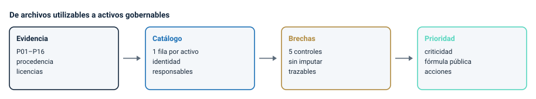
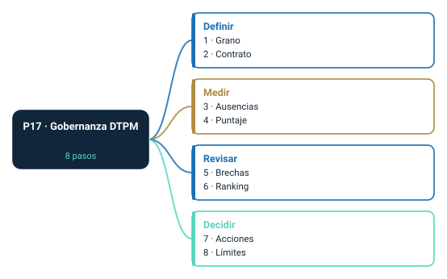
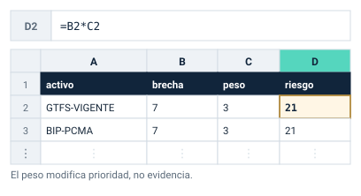
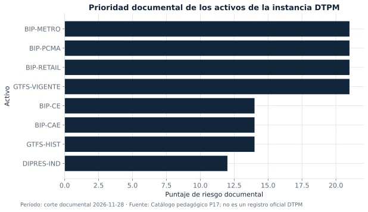

# P17 · Gobernanza y catálogo de activos de datos DTPM

◀ [P16 · Informe de decisión](../informe_decision_carga/CUADERNO.md) · [Todos los cuadernos](../../docs/cuadernos.md) · [P18 · ETL histórico GTFS](../etl_gtfs_automatizado/CUADERNO.md) ▶

[](https://colab.research.google.com/github/vladimiracunadev-create/applied-data-analysis-and-assessment-lab/blob/main/cases/gobernanza_datos_dtpm/cuaderno/colab.ipynb) — corre los pasos sin instalar nada: el cuaderno clona el repositorio y descarga los datos del portal.

> **¿Qué información de gobernanza falta aclarar para los activos usados por P01–P16?**

## 1 · El problema

Los casos anteriores prueban que los archivos se pueden usar, pero no que tengan
responsables, periodicidad, licencia, esquema y retención explícitos. P17 separa una
ausencia documental de un defecto de datos: escribe «no declarado» cuando no hay
evidencia, en vez de completar el catálogo con una suposición cómoda.

**Los datos.** Catálogo pedagógico versionado de ocho activos, derivado de la procedencia documentada; no es un catálogo oficial DTPM.



## 2 · La solución que se va a aplicar

Se define una fila por activo, se valida su identificador, se convierten cinco ausencias
en banderas auditables y se publica una fórmula de prioridad. La criticidad modifica el
orden de atención, pero no cambia la evidencia observada ni convierte el puntaje en una
probabilidad de incidente.



### El mismo resultado en Pandas, Polars y R

Los pasos anteriores y siguientes conservan la resolución completa en Pandas. Este laboratorio adicional aísla el indicador central para resolverlo tres veces sobre **la misma tabla, las mismas reglas y la misma escala gráfica**. Así la comparación cambia el motor, no el problema.

#### Contrato común del ejercicio

- **Objetivo.** Ordenar los activos según brechas documentales ponderadas por criticidad.
- **Fuente que leen las tres implementaciones.**
  [`resultados/riesgo_por_activo.csv`](resultados/riesgo_por_activo.csv), CSV UTF-8 versionado y producido
  por la resolución completa del caso. Los datos originales, su publicador, fecha,
  licencia, URL y huella se documentan en [`case.json`](case.json) y, cuando existe,
  `procedencia.json`. Este CSV es un **resultado reproducible**, no se presenta como
  una nueva fuente oficial.
- **Alcance.** ranking de brechas ponderadas por criticidad. Los tres scripts comparables no sustituyen la adquisición,
  limpieza ni controles completos de los pasos Pandas: aíslan el indicador para que
  una diferencia observada sea atribuible al motor.
- **Fórmula o regla.** riesgo = (3·licencia + 2·esquema + 2·actualización + 2·responsable + retención) × peso_criticidad; cada brecha vale 0 o 1.
- **Interpretación.** Una barra alta prioriza una aclaración; no demuestra mala calidad del dato ni estima la probabilidad de un incidente.
- **Error frecuente.** Imputar un campo no declarado como conforme reduce artificialmente el puntaje y fabrica evidencia.

| Campo | Tipo observado | Función en el ejercicio |
| --- | --- | --- |
| `activo_id` | `str` | categoría/eje X |
| `nombre` | `str` | campo auxiliar del contrato |
| `criticidad` | `str` | campo auxiliar del contrato |
| `puntaje_brecha` | `int64` | campo auxiliar del contrato |
| `puntaje_riesgo` | `int64` | medida/eje Y |

#### Qué cambia entre motores

| Dimensión | Pandas | Polars | R (`dplyr`/`readr`) |
| --- | --- | --- | --- |
| Modelo | DataFrame mutable por operaciones | expresiones columnares y plan optimizable | tubería declarativa sobre `tibble` |
| Nulos | `NaN`/`NA`; `groupby` exige decidir `dropna` | `null` separado de `NaN` | `NA`; muchas funciones exigen `na.rm` explícito |
| Orden | varias operaciones lo conservan, pero se ordena explícitamente | no se presupone tras agrupar | se fija con `arrange` |
| Gráfico | Matplotlib | Matplotlib tras extraer sólo X/Y | ggplot2 y su gramática de capas |
| Ventaja típica | ecosistema amplio y aprendizaje gradual | paralelismo, tipos y consultas grandes | estadística, comunicación y análisis reproducible |
| Límite aquí | el índice puede introducir alineaciones implícitas | añade una dependencia y otra semántica de tipos | requiere runtime y paquetes R independientes |

La equivalencia se valida sobre CSV normalizados con tolerancia numérica `1e-9`; no
se exige que la sintaxis ni los píxeles sean idénticos. Para ejecutar en un entorno
limpio consulte [`docs/ejecucion-portable.md`](../../docs/ejecucion-portable.md).

| Motor | Alcance verificado | Archivo | Ejecutar |
| --- | --- | --- | --- |
| Pandas + Matplotlib | ranking de brechas ponderadas por criticidad | [`solucion_pandas.py`](cuaderno/solucion_pandas.py) | `python cases/gobernanza_datos_dtpm/cuaderno/solucion_pandas.py` |
| Polars + Matplotlib | ranking de brechas ponderadas por criticidad | [`solucion_polars.py`](cuaderno/solucion_polars.py) | `uv run --extra polars python cases/gobernanza_datos_dtpm/cuaderno/solucion_polars.py` |
| R + ggplot2 | ranking de brechas ponderadas por criticidad | [`solucion.R`](cuaderno/solucion.R) | `Rscript cases/gobernanza_datos_dtpm/cuaderno/solucion.R` |

#### Pandas + Matplotlib

```python
"""Laboratorio comparable Pandas + Matplotlib del caso gobernanza_datos_dtpm.

Lee el mismo contrato CSV que las versiones Polars y R. La resolución completa del
caso permanece en ``solution.py`` y en los pasos del cuaderno; este archivo aísla el
indicador central para que la comparación entre motores sea controlada.
"""
from __future__ import annotations

import argparse
import sys
from pathlib import Path

import matplotlib.pyplot as plt
import pandas as pd

if hasattr(sys.stdout, "reconfigure"):
    sys.stdout.reconfigure(encoding="utf-8")

# Buscar la raíz desde el propio archivo evita rutas C:\... específicas del autor y
# funciona igual después de clonar el repositorio en Linux, Windows o Google Colab.
ROOT = Path(__file__).resolve().parents[3] if "__file__" in globals() else Path.cwd()
SOURCE = ROOT / "cases" / "gobernanza_datos_dtpm" / "resultados" / "riesgo_por_activo.csv"
REQUIRED = {"activo_id", "puntaje_riesgo"}


def analizar() -> pd.DataFrame:
    """Carga, valida y transforma el indicador; no modifica el archivo de entrada."""
    datos = pd.read_csv(SOURCE)
    faltantes = REQUIRED.difference(datos.columns)
    if faltantes:
        raise ValueError(f"Faltan columnas requeridas en {SOURCE}: {sorted(faltantes)}")
    # La expresión conserva explícitos filtro, agrupación, orden y selección para que
    # el estudiante pueda alinearlos con las expresiones de Polars y dplyr.
    resultado = datos.sort_values(["puntaje_riesgo", "activo_id"], ascending=[False, True])[["activo_id", "puntaje_riesgo"]]
    return resultado.reset_index(drop=True)


def graficar(resultado: pd.DataFrame, destino: Path) -> Path:
    """Representa exactamente las columnas comparadas y explicita sus unidades."""
    x = resultado["activo_id"].tolist()
    y = resultado["puntaje_riesgo"].tolist()
    fig, ax = plt.subplots(figsize=(9, 5))
    ax.barh([str(value) for value in x], y, color="#11253B")
    ax.invert_yaxis()  # el primer puesto del ranking queda arriba, como se lee una tabla
    ax.set_xlabel("Puntaje de riesgo documental")
    ax.set_ylabel("Activo")
    ax.set_xlim(left=0)
    ax.set_title("Prioridad documental de los activos de la instancia DTPM")
    ax.grid(axis="y", alpha=0.25)
    fig.text(0.01, 0.01, "Fuente: Catálogo pedagógico P17; no es un registro oficial DTPM · Período: corte documental 2026-11-28", fontsize=8, color="#58677A")
    fig.tight_layout(rect=(0, 0.05, 1, 1))
    fig.savefig(destino, dpi=150, bbox_inches="tight")
    plt.close(fig)
    return destino


def main() -> None:
    parser = argparse.ArgumentParser(description=__doc__)
    parser.add_argument("--salida", type=Path, help="CSV normalizado para comparar motores")
    parser.add_argument("--grafico", type=Path, help="PNG de la visualización comparable")
    args = parser.parse_args()
    resultado = analizar()
    print(resultado.to_string(index=False))
    if args.salida:
        resultado.to_csv(args.salida, index=False)
    if args.grafico:
        print(graficar(resultado, args.grafico))


if __name__ == "__main__":
    main()
```

#### Polars + Matplotlib

```python
"""Laboratorio comparable Polars + Matplotlib del caso gobernanza_datos_dtpm.

Usa el mismo CSV, columnas, reglas y escala que Pandas y R. Polars expresa las
transformaciones como un plan de expresiones columnares; esa diferencia de método es
el objeto de aprendizaje, no una razón para cambiar la pregunta.
"""
from __future__ import annotations

import argparse
import sys
from pathlib import Path

import matplotlib.pyplot as plt
import polars as pl

if hasattr(sys.stdout, "reconfigure"):
    sys.stdout.reconfigure(encoding="utf-8")

ROOT = Path(__file__).resolve().parents[3] if "__file__" in globals() else Path.cwd()
SOURCE = ROOT / "cases" / "gobernanza_datos_dtpm" / "resultados" / "riesgo_por_activo.csv"
REQUIRED = {"activo_id", "puntaje_riesgo"}


def analizar() -> pl.DataFrame:
    """Carga y valida antes de transformar para producir un error explicativo."""
    datos = pl.read_csv(SOURCE)
    faltantes = REQUIRED.difference(datos.columns)
    if faltantes:
        raise ValueError(f"Faltan columnas requeridas en {SOURCE}: {sorted(faltantes)}")
    # select al final fija el contrato de salida y evita comparar columnas auxiliares.
    return datos.sort(["puntaje_riesgo", "activo_id"], descending=[True, False]).select(["activo_id", "puntaje_riesgo"])


def graficar(resultado: pl.DataFrame, destino: Path) -> Path:
    """Convierte sólo las series del gráfico; el análisis permanece en Polars."""
    x = resultado["activo_id"].to_list()
    y = resultado["puntaje_riesgo"].to_list()
    fig, ax = plt.subplots(figsize=(9, 5))
    ax.barh([str(value) for value in x], y, color="#11253B")
    ax.invert_yaxis()  # el primer puesto del ranking queda arriba, como se lee una tabla
    ax.set_xlabel("Puntaje de riesgo documental")
    ax.set_ylabel("Activo")
    ax.set_xlim(left=0)
    ax.set_title("Prioridad documental de los activos de la instancia DTPM")
    ax.grid(axis="y", alpha=0.25)
    fig.text(
        0.01,
        0.01,
        "Fuente: Catálogo pedagógico P17; no es un registro oficial DTPM · Período: corte documental 2026-11-28",
        fontsize=8,
        color="#58677A",
    )
    fig.tight_layout(rect=(0, 0.05, 1, 1))
    fig.savefig(destino, dpi=150, bbox_inches="tight")
    plt.close(fig)
    return destino


def main() -> None:
    parser = argparse.ArgumentParser(description=__doc__)
    parser.add_argument("--salida", type=Path, help="CSV normalizado para comparar motores")
    parser.add_argument("--grafico", type=Path, help="PNG de la visualización comparable")
    args = parser.parse_args()
    resultado = analizar()
    print(resultado)
    if args.salida:
        resultado.write_csv(args.salida)
    if args.grafico:
        print(graficar(resultado, args.grafico))


if __name__ == "__main__":
    main()
```

#### R + ggplot2

```r
#!/usr/bin/env Rscript
# Laboratorio comparable R + dplyr/readr + ggplot2 del caso gobernanza_datos_dtpm.
#
# La resolución completa sigue en solution.py y en los pasos Pandas. Este script
# cambia el motor sobre el mismo contrato CSV para estudiar sintaxis y semántica sin
# cambiar datos, indicador ni escala gráfica.

required <- c("readr", "dplyr")
missing <- required[!vapply(required, requireNamespace, logical(1), quietly = TRUE)]
if (length(missing)) {
  stop(
    "Faltan paquetes: ", paste(missing, collapse = ", "),
    ". Instálelos con install.packages(c('readr', 'dplyr', 'ggplot2'))."
  )
}

# Buscar pyproject.toml hacia arriba hace portable el script entre terminal, RStudio,
# Posit Cloud, IRkernel y un clon en Colab. LAB_ROOT permite una ruta explícita sin
# codificar la unidad o el directorio del desarrollador.
find_root <- function(start = getwd()) {
  current <- normalizePath(start, mustWork = TRUE)
  repeat {
    if (file.exists(file.path(current, "pyproject.toml"))) return(current)
    parent <- dirname(current)
    if (identical(parent, current)) stop("No se encontró la raíz del repositorio.")
    current <- parent
  }
}
root <- Sys.getenv("LAB_ROOT", unset = find_root())
source_csv <- file.path(root, "cases", "gobernanza_datos_dtpm", "resultados", "riesgo_por_activo.csv")

# readr conserva nombres y tipos previsibles. La validación temprana produce un error
# que explica el contrato roto, en vez de fallar más tarde dentro de una gráfica.
datos <- readr::read_csv(source_csv, show_col_types = FALSE, progress = FALSE)
required_columns <- c("activo_id", "puntaje_riesgo")
missing_columns <- setdiff(required_columns, names(datos))
if (length(missing_columns)) stop("Faltan columnas: ", paste(missing_columns, collapse = ", "))

# dplyr expresa la misma selección, filtro, agrupación y orden que las otras vías.
resultado <- datos |> dplyr::arrange(dplyr::desc(.data$puntaje_riesgo), .data$activo_id) |> dplyr::select(.data$activo_id, .data$puntaje_riesgo)
print(resultado)

args <- commandArgs(trailingOnly = TRUE)
value_after <- function(flag) {
  pos <- match(flag, args)
  if (is.na(pos)) return(NULL)
  if (pos == length(args)) stop(flag, " necesita una ruta de salida")
  args[pos + 1]
}

csv_output <- value_after("--salida")
if (!is.null(csv_output)) readr::write_csv(resultado, csv_output)

plot_output <- value_after("--grafico")
if (!is.null(plot_output)) {
  if (!requireNamespace("ggplot2", quietly = TRUE)) {
    stop("Instale ggplot2 para generar el gráfico: install.packages('ggplot2')")
  }
  grafico <- ggplot2::ggplot(
    resultado,
    ggplot2::aes(x = .data[["activo_id"]], y = .data[["puntaje_riesgo"]])
  ) +
    ggplot2::geom_col(fill = "#11253B") +
    ggplot2::scale_x_discrete(limits = rev) +
    ggplot2::coord_flip() +
    ggplot2::labs(
      title = "Prioridad documental de los activos de la instancia DTPM",
      x = "Puntaje de riesgo documental", y = "Activo",
      caption = "Fuente: Catálogo pedagógico P17; no es un registro oficial DTPM · Período: corte documental 2026-11-28"
    ) +
    ggplot2::theme_minimal(base_size = 11)
  ggplot2::ggsave(plot_output, grafico, width = 9, height = 5, dpi = 150)
  cat(plot_output, "\n")
}
```

8 pasos. Cada uno trae el código de **Python**, la salida que devuelve de verdad, y la **fórmula de Excel** equivalente dibujada en su hoja. 8 traen además la trampa de hacerlo de la forma obvia.

| # | Paso | Trampa |
| --- | --- | --- |
| 1 | [Nombrar el grano del catálogo](#paso-1) | sí |
| 2 | [Validar el contrato mínimo](#paso-2) | sí |
| 3 | [Conservar lo no declarado](#paso-3) | sí |
| 4 | [Calcular las cinco banderas](#paso-4) | sí |
| 5 | [Publicar la fórmula de prioridad](#paso-5) | sí |
| 6 | [Contar activos afectados por brecha](#paso-6) | sí |
| 7 | [Construir el ranking de atención](#paso-7) | sí |
| 8 | [Traducir el resultado en acciones](#paso-8) | sí |

### Para trabajar

| Archivo | Qué es |
| --- | --- |
| [`P17-caso-completo.zip`](cuaderno/P17-caso-completo.zip) | **todo el caso en un ZIP**: el cuaderno, el script, el libro de Excel y las figuras |
| [`pasos.py`](cuaderno/pasos.py) | los 8 pasos seguidos. Se corre y muestra cada salida |
| [`practica.xlsx`](cuaderno/practica.xlsx) | las fórmulas y **el resultado que deben dar**, para corregirse solo. Se abre igual en Google Sheets |
| [`colab.ipynb`](cuaderno/colab.ipynb) | el cuaderno **ejecutable en Colab**: clona, descarga los datos del portal y corre los 8 pasos |
| [`solucion_pandas.py`](cuaderno/solucion_pandas.py) | solución ejecutable en Pandas + Matplotlib; incluye el contraste numérico y el gráfico del caso |
| [`solucion_polars.py`](cuaderno/solucion_polars.py) | solución ejecutable en Polars + Matplotlib; incluye el contraste numérico y el gráfico del caso |
| [`solucion.R`](cuaderno/solucion.R) | solución ejecutable en R + ggplot2; incluye el contraste numérico y el gráfico del caso |
| [`solucion.Rmd`](cuaderno/solucion.Rmd) | documento R Markdown para RStudio, Posit Cloud y render reproducible; reutiliza `solucion.R` sin duplicar la lógica |

---

## 3 · Los pasos

<a id="paso-1"></a>

### Paso 1 · Nombrar el grano del catálogo

Una fila representa un activo, no un archivo descargado ni una columna.

#### Python

```python
catalogo = governance.cargar()
catalogo[['activo_id', 'nombre', 'publicador', 'formato']]
```

| activo_id | nombre | publicador | formato |
| --- | --- | --- | --- |
| GTFS-VIGENTE | GTFS vigente de Red Movilidad | DTPM | ZIP/CSV |
| GTFS-HIST | Archivo histórico GTFS | DTPM | ZIP/CSV |
| BIP-METRO | Lugares de carga bip! en Metro | Subsecretaría de Transportes | XLSX |
| BIP-PCMA | Puntos bip! | Subsecretaría de Transportes | XLSX |
| BIP-CAE | Centros bip! de alto estándar | Subsecretaría de Transportes | XLSX |
| BIP-CE | Centros bip! estándar | Subsecretaría de Transportes | XLSX |
| BIP-RETAIL | Centros bip! en retail | Subsecretaría de Transportes | XLSX |
| DIPRES-IND | Definiciones de indicadores de desempeño | DIPRES | PDF |
*8 filas × 4 columnas.*

#### Excel

Crear una tabla y documentar que `activo_id` identifica un activo lógico.

> **La trampa.** Contar cada publicación mensual como un activo infla el inventario y mezcla versión con identidad.

[↑ volver al recorrido](#2--la-solución-que-se-va-a-aplicar)

---

<a id="paso-2"></a>

### Paso 2 · Validar el contrato mínimo

La gobernanza empieza por comprobar que el propio catálogo tenga identidad y vocabularios válidos.

#### Python

```python
{'filas': len(catalogo), 'ids_unicos': catalogo['activo_id'].nunique(), 'criticidades': sorted(catalogo['criticidad'].unique())}
```

```
{'filas': 8, 'ids_unicos': 8, 'criticidades': ['alta', 'media']}
```

#### Excel

`=CONTARA(A2:A9)=CONTARA(UNICOS(A2:A9))` para comprobar identidad.

> **La trampa.** Una columna llamada ID no garantiza unicidad.

[↑ volver al recorrido](#2--la-solución-que-se-va-a-aplicar)

---

<a id="paso-3"></a>

### Paso 3 · Conservar lo no declarado

Los vacíos documentales son resultados y no deben imputarse como cumplimiento.

#### Python

```python
catalogo[['activo_id', 'responsable_operativo', 'retencion_meses', 'actualizacion_declarada']]
```

| activo_id | responsable_operativo | retencion_meses | actualizacion_declarada |
| --- | --- | --- | --- |
| GTFS-VIGENTE | Equipo de publicación | 36.0 | no |
| GTFS-HIST | Equipo de publicación | 120.0 | no |
| BIP-METRO | no_declarado |  | no |
| BIP-PCMA | no_declarado |  | no |
| BIP-CAE | no_declarado |  | no |
| BIP-CE | no_declarado |  | no |
| BIP-RETAIL | no_declarado |  | no |
| DIPRES-IND | no_declarado | 120.0 | sí |
*8 filas × 4 columnas.*

#### Excel

Usar `NO_DECLARADO` como categoría y no una celda vacía ambigua.

> **La trampa.** Completar responsable o retención por intuición fabrica evidencia.

[↑ volver al recorrido](#2--la-solución-que-se-va-a-aplicar)

---

<a id="paso-4"></a>

### Paso 4 · Calcular las cinco banderas

Cada brecha responde una pregunta verificable y conserva su columna de origen.

#### Python

```python
auditoria = governance.evaluar(catalogo)
auditoria[['activo_id', 'brecha_licencia', 'brecha_esquema', 'brecha_actualizacion', 'brecha_responsable', 'brecha_retencion']]
```

| activo_id | brecha_licencia | brecha_esquema | brecha_actualizacion | brecha_responsable | brecha_retencion |
| --- | --- | --- | --- | --- | --- |
| GTFS-VIGENTE | 1 | 1 | 1 | 0 | 0 |
| GTFS-HIST | 1 | 1 | 1 | 0 | 0 |
| BIP-METRO | 0 | 1 | 1 | 1 | 1 |
| BIP-PCMA | 0 | 1 | 1 | 1 | 1 |
| BIP-CAE | 0 | 1 | 1 | 1 | 1 |
| BIP-CE | 0 | 1 | 1 | 1 | 1 |
| BIP-RETAIL | 0 | 1 | 1 | 1 | 1 |
| DIPRES-IND | 0 | 1 | 0 | 1 | 0 |
*8 filas × 6 columnas.*

#### Excel

Cada control es `SI(condición;1;0)`; no esconderlos dentro del puntaje.

> **La trampa.** Un puntaje sin componentes no se puede auditar.

[↑ volver al recorrido](#2--la-solución-que-se-va-a-aplicar)

---

<a id="paso-5"></a>

### Paso 5 · Publicar la fórmula de prioridad

Los pesos son una decisión pedagógica y deben quedar visibles.

#### Python

```python
auditoria[['activo_id', 'puntaje_brecha', 'peso_criticidad', 'puntaje_riesgo']].sort_values('puntaje_riesgo', ascending=False)
```

| activo_id | puntaje_brecha | peso_criticidad | puntaje_riesgo |
| --- | --- | --- | --- |
| GTFS-VIGENTE | 7 | 3 | 21 |
| BIP-METRO | 7 | 3 | 21 |
| BIP-PCMA | 7 | 3 | 21 |
| BIP-RETAIL | 7 | 3 | 21 |
| GTFS-HIST | 7 | 2 | 14 |
| BIP-CAE | 7 | 2 | 14 |
| BIP-CE | 7 | 2 | 14 |
| DIPRES-IND | 4 | 3 | 12 |
*8 filas × 4 columnas.*

#### Excel



`=(3*licencia+2*esquema+2*actualizacion+2*responsable+retencion)*peso`.

> **La trampa.** El puntaje ordena aclaraciones; no es una probabilidad.

[↑ volver al recorrido](#2--la-solución-que-se-va-a-aplicar)

---

<a id="paso-6"></a>

### Paso 6 · Contar activos afectados por brecha

El resumen revela problemas transversales que conviene resolver una sola vez.

#### Python

```python
resultados = governance.analizar(catalogo)
resultados['brechas']
```

| brecha | activos_afectados |
| --- | --- |
| esquema | 8 |
| actualizacion | 7 |
| responsable | 6 |
| retencion | 5 |
| licencia | 2 |
*5 filas × 2 columnas.*

#### Excel

Sumar cada columna binaria; no sumar el puntaje ponderado como si fueran activos.

> **La trampa.** Cinco brechas de un activo no equivalen a cinco activos.

[↑ volver al recorrido](#2--la-solución-que-se-va-a-aplicar)

---

<a id="paso-7"></a>

### Paso 7 · Construir el ranking de atención

El orden conserva el activo, su criticidad y los dos puntajes para poder explicarlo.

#### Python

```python
resultados['riesgo_por_activo']
```

| activo_id | nombre | criticidad | puntaje_brecha | puntaje_riesgo |
| --- | --- | --- | --- | --- |
| BIP-METRO | Lugares de carga bip! en Metro | alta | 7 | 21 |
| BIP-PCMA | Puntos bip! | alta | 7 | 21 |
| BIP-RETAIL | Centros bip! en retail | alta | 7 | 21 |
| GTFS-VIGENTE | GTFS vigente de Red Movilidad | alta | 7 | 21 |
| BIP-CAE | Centros bip! de alto estándar | media | 7 | 14 |
| BIP-CE | Centros bip! estándar | media | 7 | 14 |
| GTFS-HIST | Archivo histórico GTFS | media | 7 | 14 |
| DIPRES-IND | Definiciones de indicadores de desempeño | alta | 4 | 12 |
*8 filas × 5 columnas.*



*Prioridad documental de los activos de la instancia DTPM. Ejes con unidad, período y fuente; el código Polars y R genera la misma vista.*

#### Excel

Ordenar `puntaje_riesgo` descendente y conservar el desempate por ID.

> **La trampa.** Ocultar empates hace parecer más precisa una prioridad ordinal.

[↑ volver al recorrido](#2--la-solución-que-se-va-a-aplicar)

---

<a id="paso-8"></a>

### Paso 8 · Traducir el resultado en acciones

Cada brecha requiere una acción documental distinta y una validación con el publicador.

#### Python

```python
{'licencia': 'verificar condiciones', 'esquema': 'publicar contrato', 'actualizacion': 'declarar periodicidad', 'responsable': 'validar stewardship', 'retencion': 'definir ciclo de vida'}
```

```
{'licencia': 'verificar condiciones', 'esquema': 'publicar contrato', 'actualizacion': 'declarar periodicidad', 'responsable': 'validar stewardship', 'retencion': 'definir ciclo de vida'}
```

#### Excel

Agregar columnas `acción`, `responsable de validar` y `estado`, sin asignar nombres no confirmados.

> **La trampa.** El laboratorio no puede nombrar responsables institucionales por cuenta propia.

[↑ volver al recorrido](#2--la-solución-que-se-va-a-aplicar)

---

## 4 · El resultado

El ranking prioriza aclaraciones documentales. La acción siguiente es validar el catálogo con los publicadores; hasta entonces, no declarado permanece no declarado.

## 5 · Qué queda aprendido

1. Un catálogo necesita grano e identidad.
2. Ausencia de evidencia no es cumplimiento.
3. Los pesos deben ser públicos.
4. Gobernanza no se reemplaza con limpieza técnica.

## Reproducir

```powershell
python -m cases.gobernanza_datos_dtpm.solution
```

## Seguir

Lo que este caso toca y se trata a fondo en otro sitio:

- [Metadatos completos](case.json)
- [P01 · Procedencia de lugares bip!](../bip_lugares_carga/CUADERNO.md)
- [P14/P15 · Publicaciones GTFS](../evolucion_gtfs/CUADERNO.md)

◀ [P16 · Informe de decisión](../informe_decision_carga/CUADERNO.md) · [Todos los cuadernos](../../docs/cuadernos.md) · [P18 · ETL histórico GTFS](../etl_gtfs_automatizado/CUADERNO.md) ▶
