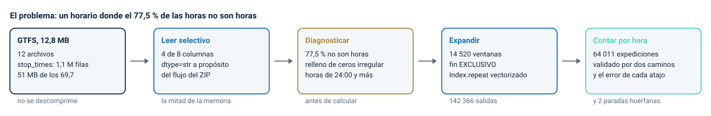
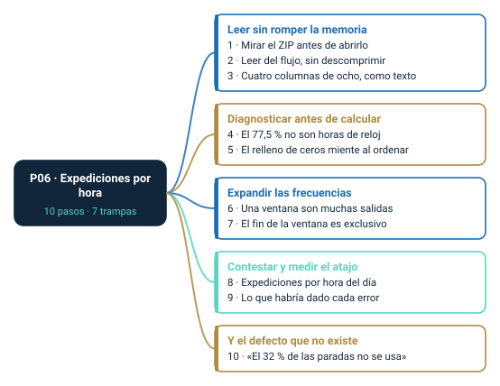
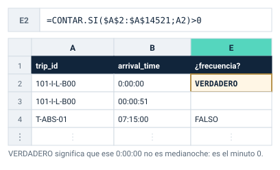
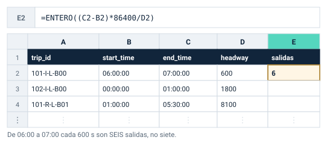
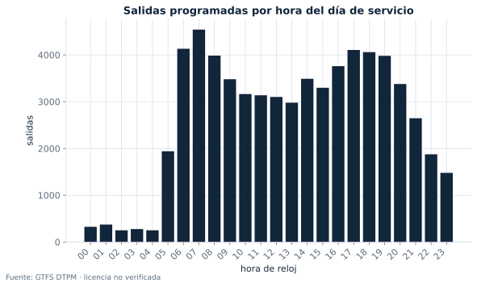

# P06 · Contar expediciones en un horario donde el 77,5 % de las horas no son horas

◀ [P05/P09 · Horarios y cobertura nocturna](../carga_nocturna/CUADERNO.md) · [Todos los cuadernos](../../docs/cuadernos.md) · [P07 · Rendimiento GTFS](../rendimiento_gtfs/CUADERNO.md) ▶

[](https://colab.research.google.com/github/vladimiracunadev-create/applied-data-analysis-and-assessment-lab/blob/main/cases/gtfs_red_movilidad/cuaderno/colab.ipynb) — corre los pasos sin instalar nada: el cuaderno clona el repositorio y descarga los datos del portal.

> **¿Cuántas expediciones de transporte público salen por hora en un día laboral, y cómo se reparten entre buses, Metro y trenes?**

## 1 · El problema

El Ministerio publica el horario completo del transporte público de Santiago en formato
GTFS: un ZIP de 12,8 MB que descomprimido pesa 69,7 MB, de los cuales 51 MB son un solo
archivo de **1 098 717 filas**.

La pregunta que llega es de las más básicas que se le pueden hacer a un horario:
*¿cuántas expediciones de transporte público salen por hora en un día laboral?* Es la
cifra que va en el primer párrafo de cualquier informe de oferta, y la que alguien usa
para decir si el servicio de la mañana es el doble que el de la tarde.

**Y hay cuatro formas de contestarla mal**, todas plausibles.

La tabla de horarios no contiene horas en el 77,5 % de sus filas: contiene
**desplazamientos desde el inicio del viaje**, porque esos recorridos no se publican con
horario fijo sino con frecuencia —«cada diez minutos entre las 6 y las 9»—. Agrupar ese
campo por su hora da 635 574 llegadas «a medianoche».

El relleno de ceros no es consistente: la misma expedición mezcla `0:00:00` y `00:00:51`,
y ordenadas como texto la primera queda **después** de la segunda.

Contar las expediciones declaradas en lugar de expandir las frecuencias subestima el
servicio por un **factor de seis**.

Y hay un cuarto problema que no existe: el 32 % de las paradas «no se usa». No es un
defecto de calidad, y reportarlo costaría más que no reportar nada.

Lo que distingue este caso de los demás es el **volumen**: aquí las decisiones de lectura
—qué columnas, qué tipos, descomprimir o no— dejan de ser estilo y pasan a decidir si el
análisis corre.

**Los datos.** Feed GTFS estático de la Red Metropolitana de Movilidad (DTPM), 12,8 MB comprimidos y 69,7 descomprimidos. 1 098 717 filas de horarios, 26 137 expediciones, 18 486 lugares, 425 recorridos. **Licencia no verificada**: el sitio no publica condiciones de uso.



## 2 · La solución que se va a aplicar

El recorrido va de leer el archivo sin romper la memoria, a un conteo que se valida por
dos caminos independientes.

**Leer solo lo necesario** (pasos 1 a 3). Mirar el inventario del ZIP antes de abrirlo,
leer del flujo comprimido sin descomprimir a disco, y de la tabla grande pedir **cuatro
de sus ocho columnas** como texto. `dtype=str` es deliberado: queremos ver los valores
como los publicó el organismo y decidir nosotros qué es un número y qué es una hora.

**Diagnosticar antes de calcular** (pasos 4 y 5). Medir cuántas filas traen horas de
reloj y cuántas desplazamientos, y comprobar el relleno de ceros. Las dos
comprobaciones cuestan una línea y las dos cambian el resultado.

**Expandir las frecuencias** (pasos 6 y 7). Cada ventana de frecuencia representa muchas
salidas reales. La expansión se hace vectorizada con `Index.repeat`, y el fin de la
ventana es **exclusivo**: la salida de `end_time` pertenece a la ventana siguiente, y
contarla infla el total en una salida por cada una de las 14 520 ventanas.

**Contestar, y medir el error del atajo** (pasos 8 y 9). El conteo correcto por hora, y
al lado lo que habría dado cada forma equivocada, con su magnitud.

**Y el defecto que no existe** (paso 10). 5 991 de las 18 486 filas de `stops.txt` no
aparecen en la tabla de horarios. 5 989 de ellas no son paradas: son estaciones, accesos
y nodos de pasillo, distinguidos por un campo de la especificación. Las paradas
realmente huérfanas son **dos**.



### El mismo resultado en Pandas, Polars y R

Los pasos anteriores y siguientes conservan la resolución completa en Pandas. Este laboratorio adicional aísla el indicador central para resolverlo tres veces sobre **la misma tabla, las mismas reglas y la misma escala gráfica**. Así la comparación cambia el motor, no el problema.

#### Contrato común del ejercicio

- **Objetivo.** Agregar salidas programadas por hora de reloj para observar el perfil diario.
- **Fuente que leen las tres implementaciones.**
  [`resultados/salidas_por_hora.csv`](resultados/salidas_por_hora.csv), CSV UTF-8 versionado y producido
  por la resolución completa del caso. Los datos originales, su publicador, fecha,
  licencia, URL y huella se documentan en [`case.json`](case.json) y, cuando existe,
  `procedencia.json`. Este CSV es un **resultado reproducible**, no se presenta como
  una nueva fuente oficial.
- **Alcance.** perfil horario agregado de salidas. Los tres scripts comparables no sustituyen la adquisición,
  limpieza ni controles completos de los pasos Pandas: aíslan el indicador para que
  una diferencia observada sea atribuible al motor.
- **Fórmula o regla.** salidas_h = Σ salidas_i para toda fila cuya hora_reloj = h. Las horas GTFS mayores que 24 se normalizan según día de servicio antes de este agregado.
- **Interpretación.** La curva representa oferta programada, no viajes efectivamente realizados ni pasajeros.
- **Error frecuente.** Truncar 25:30 como hora inválida elimina servicio posterior a medianoche; GTFS permite horas mayores que 24.

| Campo | Tipo observado | Función en el ejercicio |
| --- | --- | --- |
| `hora_reloj` | `int64` | categoría/eje X |
| `modo` | `str` | campo auxiliar del contrato |
| `fuente` | `str` | campo auxiliar del contrato |
| `salidas` | `int64` | medida/eje Y |

#### Qué cambia entre motores

| Dimensión | Pandas | Polars | R (`dplyr`/`readr`) |
| --- | --- | --- | --- |
| Modelo | DataFrame mutable por operaciones | expresiones columnares y plan optimizable | tubería declarativa sobre `tibble` |
| Nulos | `NaN`/`NA`; `groupby` exige decidir `dropna` | `null` separado de `NaN` | `NA`; muchas funciones exigen `na.rm` explícito |
| Orden | varias operaciones lo conservan, pero se ordena explícitamente | no se presupone tras agrupar | se fija con `arrange` |
| Gráfico | Matplotlib | Matplotlib tras extraer sólo X/Y | ggplot2 y su gramática de capas |
| Ventaja típica | ecosistema amplio y aprendizaje gradual | paralelismo, tipos y consultas grandes | estadística, comunicación y análisis reproducible |
| Límite aquí | el índice puede introducir alineaciones implícitas | añade una dependencia y otra semántica de tipos | requiere runtime y paquetes R independientes |

La equivalencia se valida sobre CSV normalizados con tolerancia numérica `1e-9`; no
se exige que la sintaxis ni los píxeles sean idénticos. Para ejecutar en un entorno
limpio consulte [`docs/ejecucion-portable.md`](../../docs/ejecucion-portable.md).

| Motor | Alcance verificado | Archivo | Ejecutar |
| --- | --- | --- | --- |
| Pandas + Matplotlib | perfil horario agregado de salidas | [`solucion_pandas.py`](cuaderno/solucion_pandas.py) | `python cases/gtfs_red_movilidad/cuaderno/solucion_pandas.py` |
| Polars + Matplotlib | perfil horario agregado de salidas | [`solucion_polars.py`](cuaderno/solucion_polars.py) | `uv run --extra polars python cases/gtfs_red_movilidad/cuaderno/solucion_polars.py` |
| R + ggplot2 | perfil horario agregado de salidas | [`solucion.R`](cuaderno/solucion.R) | `Rscript cases/gtfs_red_movilidad/cuaderno/solucion.R` |

#### Pandas + Matplotlib

```python
"""Laboratorio comparable Pandas + Matplotlib del caso gtfs_red_movilidad.

Lee el mismo contrato CSV que las versiones Polars y R. La resolución completa del
caso permanece en ``solution.py`` y en los pasos del cuaderno; este archivo aísla el
indicador central para que la comparación entre motores sea controlada.
"""
from __future__ import annotations

import argparse
import sys
from pathlib import Path

import matplotlib.pyplot as plt
import pandas as pd

if hasattr(sys.stdout, "reconfigure"):
    sys.stdout.reconfigure(encoding="utf-8")

# Buscar la raíz desde el propio archivo evita rutas C:\... específicas del autor y
# funciona igual después de clonar el repositorio en Linux, Windows o Google Colab.
ROOT = Path(__file__).resolve().parents[3] if "__file__" in globals() else Path.cwd()
SOURCE = ROOT / "cases" / "gtfs_red_movilidad" / "resultados" / "salidas_por_hora.csv"
REQUIRED = {"hora_reloj", "salidas"}


def analizar() -> pd.DataFrame:
    """Carga, valida y transforma el indicador; no modifica el archivo de entrada."""
    datos = pd.read_csv(SOURCE)
    faltantes = REQUIRED.difference(datos.columns)
    if faltantes:
        raise ValueError(f"Faltan columnas requeridas en {SOURCE}: {sorted(faltantes)}")
    # La expresión conserva explícitos filtro, agrupación, orden y selección para que
    # el estudiante pueda alinearlos con las expresiones de Polars y dplyr.
    resultado = datos.groupby("hora_reloj", as_index=False)["salidas"].sum().sort_values("hora_reloj")
    return resultado.reset_index(drop=True)


def graficar(resultado: pd.DataFrame, destino: Path) -> Path:
    """Representa exactamente las columnas comparadas y explicita sus unidades."""
    x = resultado["hora_reloj"].tolist()
    y = resultado["salidas"].tolist()
    fig, ax = plt.subplots(figsize=(9, 5))
    ax.plot(x, y, marker="o", linewidth=2, color="#11253B")
    ax.set_xlabel("Hora del reloj")
    ax.set_ylabel("Salidas programadas (recuento)")
    ax.set_ylim(bottom=0)
    ax.set_title("Oferta programada por hora del día")
    ax.grid(axis="y", alpha=0.25)
    fig.text(0.01, 0.01, "Fuente: Resultados reproducibles del caso P06 · Período: publicación GTFS analizada", fontsize=8, color="#58677A")
    fig.tight_layout(rect=(0, 0.05, 1, 1))
    fig.savefig(destino, dpi=150, bbox_inches="tight")
    plt.close(fig)
    return destino


def main() -> None:
    parser = argparse.ArgumentParser(description=__doc__)
    parser.add_argument("--salida", type=Path, help="CSV normalizado para comparar motores")
    parser.add_argument("--grafico", type=Path, help="PNG de la visualización comparable")
    args = parser.parse_args()
    resultado = analizar()
    print(resultado.to_string(index=False))
    if args.salida:
        resultado.to_csv(args.salida, index=False)
    if args.grafico:
        print(graficar(resultado, args.grafico))


if __name__ == "__main__":
    main()
```

#### Polars + Matplotlib

```python
"""Laboratorio comparable Polars + Matplotlib del caso gtfs_red_movilidad.

Usa el mismo CSV, columnas, reglas y escala que Pandas y R. Polars expresa las
transformaciones como un plan de expresiones columnares; esa diferencia de método es
el objeto de aprendizaje, no una razón para cambiar la pregunta.
"""
from __future__ import annotations

import argparse
import sys
from pathlib import Path

import matplotlib.pyplot as plt
import polars as pl

if hasattr(sys.stdout, "reconfigure"):
    sys.stdout.reconfigure(encoding="utf-8")

ROOT = Path(__file__).resolve().parents[3] if "__file__" in globals() else Path.cwd()
SOURCE = ROOT / "cases" / "gtfs_red_movilidad" / "resultados" / "salidas_por_hora.csv"
REQUIRED = {"hora_reloj", "salidas"}


def analizar() -> pl.DataFrame:
    """Carga y valida antes de transformar para producir un error explicativo."""
    datos = pl.read_csv(SOURCE)
    faltantes = REQUIRED.difference(datos.columns)
    if faltantes:
        raise ValueError(f"Faltan columnas requeridas en {SOURCE}: {sorted(faltantes)}")
    # select al final fija el contrato de salida y evita comparar columnas auxiliares.
    return datos.group_by("hora_reloj").agg(pl.col("salidas").sum()).sort("hora_reloj")


def graficar(resultado: pl.DataFrame, destino: Path) -> Path:
    """Convierte sólo las series del gráfico; el análisis permanece en Polars."""
    x = resultado["hora_reloj"].to_list()
    y = resultado["salidas"].to_list()
    fig, ax = plt.subplots(figsize=(9, 5))
    ax.plot(x, y, marker="o", linewidth=2, color="#11253B")
    ax.set_xlabel("Hora del reloj")
    ax.set_ylabel("Salidas programadas (recuento)")
    ax.set_ylim(bottom=0)
    ax.set_title("Oferta programada por hora del día")
    ax.grid(axis="y", alpha=0.25)
    fig.text(
        0.01,
        0.01,
        "Fuente: Resultados reproducibles del caso P06 · Período: publicación GTFS analizada",
        fontsize=8,
        color="#58677A",
    )
    fig.tight_layout(rect=(0, 0.05, 1, 1))
    fig.savefig(destino, dpi=150, bbox_inches="tight")
    plt.close(fig)
    return destino


def main() -> None:
    parser = argparse.ArgumentParser(description=__doc__)
    parser.add_argument("--salida", type=Path, help="CSV normalizado para comparar motores")
    parser.add_argument("--grafico", type=Path, help="PNG de la visualización comparable")
    args = parser.parse_args()
    resultado = analizar()
    print(resultado)
    if args.salida:
        resultado.write_csv(args.salida)
    if args.grafico:
        print(graficar(resultado, args.grafico))


if __name__ == "__main__":
    main()
```

#### R + ggplot2

```r
#!/usr/bin/env Rscript
# Laboratorio comparable R + dplyr/readr + ggplot2 del caso gtfs_red_movilidad.
#
# La resolución completa sigue en solution.py y en los pasos Pandas. Este script
# cambia el motor sobre el mismo contrato CSV para estudiar sintaxis y semántica sin
# cambiar datos, indicador ni escala gráfica.

required <- c("readr", "dplyr")
missing <- required[!vapply(required, requireNamespace, logical(1), quietly = TRUE)]
if (length(missing)) {
  stop(
    "Faltan paquetes: ", paste(missing, collapse = ", "),
    ". Instálelos con install.packages(c('readr', 'dplyr', 'ggplot2'))."
  )
}

# Buscar pyproject.toml hacia arriba hace portable el script entre terminal, RStudio,
# Posit Cloud, IRkernel y un clon en Colab. LAB_ROOT permite una ruta explícita sin
# codificar la unidad o el directorio del desarrollador.
find_root <- function(start = getwd()) {
  current <- normalizePath(start, mustWork = TRUE)
  repeat {
    if (file.exists(file.path(current, "pyproject.toml"))) return(current)
    parent <- dirname(current)
    if (identical(parent, current)) stop("No se encontró la raíz del repositorio.")
    current <- parent
  }
}
root <- Sys.getenv("LAB_ROOT", unset = find_root())
source_csv <- file.path(root, "cases", "gtfs_red_movilidad", "resultados", "salidas_por_hora.csv")

# readr conserva nombres y tipos previsibles. La validación temprana produce un error
# que explica el contrato roto, en vez de fallar más tarde dentro de una gráfica.
datos <- readr::read_csv(source_csv, show_col_types = FALSE, progress = FALSE)
required_columns <- c("hora_reloj", "salidas")
missing_columns <- setdiff(required_columns, names(datos))
if (length(missing_columns)) stop("Faltan columnas: ", paste(missing_columns, collapse = ", "))

# dplyr expresa la misma selección, filtro, agrupación y orden que las otras vías.
resultado <- datos |> dplyr::group_by(.data$hora_reloj) |> dplyr::summarise(salidas = sum(.data$salidas), .groups = "drop") |> dplyr::arrange(.data$hora_reloj)
print(resultado)

args <- commandArgs(trailingOnly = TRUE)
value_after <- function(flag) {
  pos <- match(flag, args)
  if (is.na(pos)) return(NULL)
  if (pos == length(args)) stop(flag, " necesita una ruta de salida")
  args[pos + 1]
}

csv_output <- value_after("--salida")
if (!is.null(csv_output)) readr::write_csv(resultado, csv_output)

plot_output <- value_after("--grafico")
if (!is.null(plot_output)) {
  if (!requireNamespace("ggplot2", quietly = TRUE)) {
    stop("Instale ggplot2 para generar el gráfico: install.packages('ggplot2')")
  }
  grafico <- ggplot2::ggplot(
    resultado,
    ggplot2::aes(x = .data[["hora_reloj"]], y = .data[["salidas"]])
  ) +
    ggplot2::geom_line(ggplot2::aes(group = 1), linewidth = 1, colour = "#11253B") +
    ggplot2::geom_point(size = 2.5, colour = "#55D6BE") +
    ggplot2::labs(
      title = "Oferta programada por hora del día",
      x = "Hora del reloj", y = "Salidas programadas (recuento)",
      caption = "Fuente: Resultados reproducibles del caso P06 · Período: publicación GTFS analizada"
    ) +
    ggplot2::theme_minimal(base_size = 11)
  ggplot2::ggsave(plot_output, grafico, width = 9, height = 5, dpi = 150)
  cat(plot_output, "\n")
}
```

10 pasos. Cada uno trae el código de **Python**, la salida que devuelve de verdad, y la **fórmula de Excel** equivalente dibujada en su hoja. 7 traen además la trampa de hacerlo de la forma obvia.

| # | Paso | Trampa |
| --- | --- | --- |
| 1 | [Mirar el ZIP antes de abrirlo](#paso-1) | sí |
| 2 | [Leer del flujo comprimido, sin descomprimir](#paso-2) | — |
| 3 | [Cuatro columnas de ocho, y todas como texto](#paso-3) | sí |
| 4 | [El 77,5 % de las «horas» no son horas](#paso-4) | sí |
| 5 | [El relleno de ceros miente al ordenar](#paso-5) | sí |
| 6 | [Convertir a segundos, admitiendo horas de 24:00 y más](#paso-6) | sí |
| 7 | [Una ventana de frecuencia son muchas salidas](#paso-7) | — |
| 8 | [El fin de la ventana es exclusivo](#paso-8) | sí |
| 9 | [Expediciones por hora del día](#paso-9) | — |
| 10 | [«El 32 % de las paradas no se usa»: el defecto que no existe](#paso-10) | sí |

### Para trabajar

| Archivo | Qué es |
| --- | --- |
| [`P06-caso-completo.zip`](cuaderno/P06-caso-completo.zip) | **todo el caso en un ZIP**: el cuaderno, el script, el libro de Excel y las figuras |
| [`pasos.py`](cuaderno/pasos.py) | los 10 pasos seguidos. Se corre y muestra cada salida |
| [`practica.xlsx`](cuaderno/practica.xlsx) | las fórmulas y **el resultado que deben dar**, para corregirse solo. Se abre igual en Google Sheets |
| [`colab.ipynb`](cuaderno/colab.ipynb) | el cuaderno **ejecutable en Colab**: clona, descarga los datos del portal y corre los 10 pasos |
| [`solucion_pandas.py`](cuaderno/solucion_pandas.py) | solución ejecutable en Pandas + Matplotlib; incluye el contraste numérico y el gráfico del caso |
| [`solucion_polars.py`](cuaderno/solucion_polars.py) | solución ejecutable en Polars + Matplotlib; incluye el contraste numérico y el gráfico del caso |
| [`solucion.R`](cuaderno/solucion.R) | solución ejecutable en R + ggplot2; incluye el contraste numérico y el gráfico del caso |
| [`solucion.Rmd`](cuaderno/solucion.Rmd) | documento R Markdown para RStudio, Posit Cloud y render reproducible; reutiliza `solucion.R` sin duplicar la lógica |

---

## 3 · Los pasos

<a id="paso-1"></a>

### Paso 1 · Mirar el ZIP antes de abrirlo

Qué archivos trae, cuánto pesa cada uno descomprimido, y cuál es el grande. Decide si se puede leer todo o hay que elegir.

#### Python

```python
zip_members(FEED)
```

| archivo | bytes_comprimido | bytes | modificado |
| --- | --- | --- | --- |
| stop_times.txt | 8727716 | 50986910 | 2026-11-13T12:40:40 |
| shapes.txt | 3364021 | 14789124 | 2026-11-13T12:36:24 |
| trips.txt | 178330 | 1522530 | 2026-11-13T12:46:46 |
| stops.txt | 422805 | 1438196 | 2026-11-13T12:36:28 |
| frequencies.txt | 57566 | 544507 | 2026-11-13T12:36:22 |
| pathways.txt | 67327 | 404544 | 2026-11-13T12:36:28 |
| routes.txt | 6001 | 26214 | 2026-11-13T13:29:58 |
| levels.txt | 2788 | 15419 | 2026-11-13T12:36:26 |
| agency.txt | 256 | 582 | 2026-11-13T12:36:22 |
| calendar.txt | 121 | 300 | 2026-11-13T12:36:22 |
| feed_info.txt | 118 | 165 | 2026-11-13T12:36:22 |
| calendar_dates.txt | 67 | 116 | 2026-11-13T12:36:22 |
*12 filas × 4 columnas.*

#### Excel

Abrir el ZIP en el explorador y mirar los tamaños. Excel **no puede abrir** el archivo grande: 1 098 717 filas superan el límite de 1 048 576 de una hoja, de modo que este caso no se hace en Excel sin partir el archivo antes.

> **La trampa.** Es el único caso del laboratorio donde Excel no alcanza. Y el límite no avisa bien: al abrir un CSV más largo, Excel carga el millón de filas que caben y **descarta el resto sin error**.

[↑ volver al recorrido](#2--la-solución-que-se-va-a-aplicar)

---

<a id="paso-2"></a>

### Paso 2 · Leer del flujo comprimido, sin descomprimir

El feed pesa 12,8 MB comprimido y 69,7 MB descomprimido. Descomprimir primero duplica el espacio sin aportar nada: `zipfile` da un flujo que `read_csv` lee directamente.

#### Python

```python
tablas = p06.cargar()
{nombre: tabla.shape for nombre, tabla in tablas.items()}
```

```
{'agency': (4, 2), 'feed_info': (1, 6), 'calendar': (6, 10), 'routes': (425, 4), 'trips': (26137, 3), 'stops': (18486, 5), 'frequencies': (14520, 5), 'stop_times': (1098717, 4)}
```

#### Excel

Power Query puede leer de un ZIP, pero traerá el archivo entero a la hoja y choca con el límite de filas. La ruta en Excel es cargar solo `frequencies.txt`, que son 14 520 filas y sí cabe.

[↑ volver al recorrido](#2--la-solución-que-se-va-a-aplicar)

---

<a id="paso-3"></a>

### Paso 3 · Cuatro columnas de ocho, y todas como texto

De `stop_times.txt` se usan cuatro de sus ocho columnas. Y `dtype=str` es deliberado: queremos ver los valores como los publicó el organismo y decidir nosotros qué es un número y qué es una hora.

#### Python

```python
horarios = tablas['stop_times']
{'filas': len(horarios), 'columnas': list(horarios.columns),
 'memoria_MB': round(horarios.memory_usage(deep=True).sum() / 1e6, 1)}
```

```
{'filas': 1098717, 'columnas': ['trip_id', 'arrival_time', 'stop_id', 'stop_sequence'], 'memoria_MB': np.float64(246.9)}
```

#### Excel

En Power Query, **Elegir columnas** antes de cargar, y poner el tipo de las horas en **Texto**. Si se deja en automático, Power Query convierte `0:00:00` a una hora y `25:10:00` a error.

> **La trampa.** Dejar que pandas infiera los tipos convierte las horas a algo **antes** de que las validemos, y las de 24:00 o más se vuelven nulas o texto según la fila. El diagnóstico del paso siguiente ya no se podría hacer.

[↑ volver al recorrido](#2--la-solución-que-se-va-a-aplicar)

---

<a id="paso-4"></a>

### Paso 4 · El 77,5 % de las «horas» no son horas

La comprobación que decide todo el resto. Una expedición con frecuencia declarada publica en `arrival_time` el **desplazamiento desde el inicio del viaje**, no la hora de reloj.

#### Python

```python
p06.diagnosticar_horas(tablas)
```

| indicador | valor | unidad | definicion |
| --- | --- | --- | --- |
| filas_stop_times | 1098717.0 | filas | Tamaño de la tabla de horarios |
| expediciones_declaradas | 26137.0 | expediciones | Filas distintas de trips.txt |
| expediciones_de_frecuencia | 14520.0 | expediciones | Declaradas en frequencies.txt: su horario es … |
| filas_con_horario_relativo | 851773.0 | filas | Filas de stop_times cuyo tiempo NO es hora de… |
| pct_horario_relativo | 77.52433065111398 | % | Proporción de la tabla que no se puede leer c… |
| hora_sin_relleno | 13570.0 | filas | Valores con una sola cifra de hora, como 0:00… |
*10 filas × 4 columnas, se muestran las primeras 6.*

#### Excel



Sobre `frequencies.txt` cargado y la lista de `trip_id` de los horarios: `=CONTAR.SI($A$2:$A$14521;A2)>0` marca las expediciones con frecuencia. La proporción de filas marcadas es la cifra.

Debe dar: **851 773 de 1 098 717 filas: el 77,5 %**

**En Google Sheets:** la misma fórmula, sin cambios.

> **La trampa.** Agrupar `arrival_time` por su hora sin esta comprobación da **635 574 llegadas a medianoche** y un gráfico con un pico absurdo a las 00:00. El pico es el `0:00:00` de cada primera parada de cada expedición de frecuencia.

[↑ volver al recorrido](#2--la-solución-que-se-va-a-aplicar)

---

<a id="paso-5"></a>

### Paso 5 · El relleno de ceros miente al ordenar

La misma expedición mezcla `0:00:00` con una cifra y `00:00:51` con dos. Como texto, la primera es mayor que la segunda.

#### Python

```python
'0:00:00' > '00:00:51'
```

```
True
```

#### Excel

Pasa igual: con las horas en texto, ordenar la columna pone `0:00:00` después de `00:00:51`. Se arregla normalizando con `=TEXTO(VALOR.NUMERO(IZQUIERDA(B2;BUSCAR(":";B2)-1));"00")&EXTRAE(B2;BUSCAR(":";B2);9)`, que es ilegible, o convirtiendo a segundos como hace Pandas.

> **La trampa.** No produce un error: produce la **primera parada de cada expedición ordenada al final**, de modo que el origen y el destino quedan cambiados. Un informe de tiempos de viaje con el signo invertido.

[↑ volver al recorrido](#2--la-solución-que-se-va-a-aplicar)

---

<a id="paso-6"></a>

### Paso 6 · Convertir a segundos, admitiendo horas de 24:00 y más

Un día de servicio puede pasar de la medianoche: `25:10:00` es la 01:10 del día siguiente. Es un valor legítimo de la especificación que `pd.to_datetime` rechaza.

#### Python

```python
ejemplos = pd.Series(['0:00:00', '00:00:51', '25:10:00', '28:00:00'])
pd.DataFrame({'texto': ejemplos,
              'segundos': parse_hms_seconds(ejemplos),
              'hora_de_reloj': service_day_hour(parse_hms_seconds(ejemplos))})
```

| texto | segundos | hora_de_reloj |
| --- | --- | --- |
| 0:00:00 | 0 | 0.0 |
| 00:00:51 | 51 | 0.0 |
| 25:10:00 | 90600 | 1.0 |
| 28:00:00 | 100800 | 4.0 |
*4 filas × 3 columnas.*

#### Excel

`=VALOR.NUMERO(IZQUIERDA(B2;BUSCAR(":";B2)-1))*3600 + ...` suma las tres partes. La hora de reloj es el resto: `=RESIDUO(ENTERO(E2/3600);24)`.

Debe dar: **25:10:00 → 90 600 s → hora de reloj 1**

**En Google Sheets:** la misma fórmula, sin cambios.

> **La trampa.** `pd.to_datetime('25:10:00')` **falla**, y con `errors='coerce'` devuelve nulo en silencio. Las horas del servicio nocturno desaparecerían del conteo sin que nada avise.

[↑ volver al recorrido](#2--la-solución-que-se-va-a-aplicar)

---

<a id="paso-7"></a>

### Paso 7 · Una ventana de frecuencia son muchas salidas

Cada fila de `frequencies.txt` dice «entre A y B sale un vehículo cada N segundos». Son 14 520 filas que representan 142 366 salidas reales.

#### Python

```python
expandido = p06.expandir_frecuencias(tablas)
expandido.head(4)
```

| trip_id | salida_s | salida | hora_reloj | intervalo_s |
| --- | --- | --- | --- | --- |
| 101-I-D-B23 | 19800 | 05:30:00 | 5.0 | 1200 |
| 101-I-D-B23 | 21000 | 05:50:00 | 5.0 | 1200 |
| 101-I-D-B23 | 22200 | 06:10:00 | 6.0 | 1200 |
| 101-I-D-B23 | 23400 | 06:30:00 | 6.0 | 1200 |
*4 filas × 5 columnas.*

#### Excel



El número de salidas de cada ventana es `=ENTERO((C2-B2)*86400/D2)`, con las horas como fracción de día. Expandirlas a una fila cada una exige Power Query: columna con `List.Numbers(0; salidas)` y luego **Expandir a nuevas filas**.

Debe dar: **142 366 salidas en total**

**En Google Sheets:** la misma fórmula, sin cambios.

[↑ volver al recorrido](#2--la-solución-que-se-va-a-aplicar)

---

<a id="paso-8"></a>

### Paso 8 · El fin de la ventana es exclusivo

La salida de `end_time` pertenece a la ventana siguiente. Es lo que fija la especificación, y de ello depende un 10 % del total.

#### Python

```python
comparacion = p06.comparar_ingenuo_vs_correcto(tablas)
comparacion
```

| forma_de_contar | resultado | error_vs_correcto | por_que_esta_mal | error_relativo_pct |
| --- | --- | --- | --- | --- |
| expediciones de trips.txt (atajo) | 7905 | -56106 | Cada fila de frequencies.txt representa mucha… | -87.65 |
| frecuencias con fin inclusivo + horario absol… | 70652 | 6641 | GTFS define end_time exclusivo: suma una sali… | 10.37 |
| frecuencias expandidas + horario absoluto (co… | 64011 | 0 | — | 0.0 |
*3 filas × 5 columnas.*

#### Excel

`=ENTERO((C2-B2)*86400/D2)` ya es exclusivo. La versión inclusiva es `=ENTERO((C2-B2)*86400/D2)+1`, y la diferencia entre las dos sumas es el error: una salida por ventana.

Debe dar: **64 011 correctas · 6 641 salidas de más si se cuenta inclusivo**

**En Google Sheets:** la misma fórmula, sin cambios.

> **La trampa.** Es el error más fácil de defender y el más fácil de cometer: contar «de las 6 a las 7 cada 10 minutos» como siete salidas en lugar de seis. Infla el total un **10,37 %**, que es una magnitud que nadie cuestiona en un informe.

[↑ volver al recorrido](#2--la-solución-que-se-va-a-aplicar)

---

<a id="paso-9"></a>

### Paso 9 · Expediciones por hora del día

La pregunta, contestada. Las salidas expandidas más las de horario absoluto, agrupadas por hora del día de servicio.

#### Python

```python
por_hora = p06.expediciones_por_hora(tablas)
por_hora
```

| hora_reloj | modo | fuente | salidas |
| --- | --- | --- | --- |
| 0 | bus | frequencies | 326 |
| 1 | bus | frequencies | 374 |
| 2 | bus | frequencies | 251 |
| 3 | bus | frequencies | 277 |
| 4 | bus | frequencies | 251 |
| 5 | bus | frequencies | 1913 |
| 5 | metro | stop_times | 27 |
| 5 | tranvía o ligero | stop_times | 1 |
| 6 | bus | frequencies | 4042 |
| 6 | metro | stop_times | 72 |
| 6 | tranvía o ligero | frequencies | 15 |
| 6 | tranvía o ligero | stop_times | 3 |
| 7 | bus | frequencies | 4444 |
| 7 | metro | stop_times | 79 |
| 7 | tranvía o ligero | frequencies | 15 |
| 7 | tranvía o ligero | stop_times | 3 |
| 8 | bus | frequencies | 3888 |
| 8 | metro | stop_times | 81 |
| 8 | tranvía o ligero | frequencies | 15 |
| 8 | tranvía o ligero | stop_times | 1 |
| 9 | bus | frequencies | 3392 |
| 9 | metro | stop_times | 77 |
| 9 | tranvía o ligero | frequencies | 10 |
| 9 | tranvía o ligero | stop_times | 2 |
| 10 | bus | frequencies | 3082 |
| 10 | metro | stop_times | 69 |
*75 filas × 4 columnas, se muestran las primeras 26.*



*Las dos puntas se ven solas. Y las horas 0 a 4 no están vacías: es el servicio nocturno, que es el tema de P09.*

#### Excel

Con las salidas expandidas y su hora en una columna: **tabla dinámica** con la hora en Filas y el conteo en Valores. Sin dinámica, `=CONTAR.SI($F$2:$F$14521;G2)` con las horas 0 a 23 en la columna G.

Debe dar: **64 011 expediciones en el día laboral**

**En Google Sheets:** la misma fórmula, sin cambios.

[↑ volver al recorrido](#2--la-solución-que-se-va-a-aplicar)

---

<a id="paso-10"></a>

### Paso 10 · «El 32 % de las paradas no se usa»: el defecto que no existe

5 991 de las 18 486 filas de `stops.txt` no aparecen en la tabla de horarios. Antes de reportarlo, mirar **qué son** esas filas.

#### Python

```python
p06.paradas_sin_uso(tablas)
```

| location_type | tipo | filas | en_horarios | sin_coordenadas | fuera_de_horarios | es_defecto_real |
| --- | --- | --- | --- | --- | --- | --- |
| 0 | parada o andén | 12497 | 12495 | 0 | 2 | True |
| 3 | nodo generico de pasillo | 5031 | 0 | 5031 | 5031 | False |
| 4 | área de abordaje | 534 | 0 | 534 | 534 | False |
| 2 | acceso o salida | 298 | 0 | 0 | 298 | False |
| 1 | estación | 126 | 0 | 0 | 126 | False |
*5 filas × 7 columnas.*

#### Excel

`=CONTAR.SI(horarios!$D:$D;A2)=0` marca las filas sin uso, y una tabla dinámica por `location_type` muestra qué son. La fila que importa es la del tipo 0.

Debe dar: **5 991 sin uso, de las cuales solo 2 son paradas de embarque**

**En Google Sheets:** la misma fórmula, sin cambios.

> **La trampa.** Reportar «el 32 % de las paradas está huérfano» cuesta credibilidad: 5 989 de esas filas **no son paradas**, son estaciones, accesos y nodos de pasillo, y la especificación las distingue con un campo. El feed es **complejo**, no sucio.
>
> Un informe de calidad que no mira la jerarquía del formato produce hallazgos que el publicador descarta en treinta segundos, y con ellos descarta el resto del informe.

[↑ volver al recorrido](#2--la-solución-que-se-va-a-aplicar)

---

## 4 · El resultado

**64 011 expediciones** en el día laboral, validadas por dos caminos sin código común: expansión vectorizada con agrupación, y suma aritmética por ventana más el horario absoluto. Los dos dan la misma cifra.

Lo que habrían dado los atajos: contar expediciones declaradas, 7 905 —un **−87,65 %**—; tomar el fin de ventana como inclusivo, 70 652 —un **+10,37 %**—; agrupar `arrival_time` como hora, un pico de 635 574 llegadas a medianoche.

Y dos paradas realmente huérfanas, no 5 991.

## 5 · Qué queda aprendido

1. Un campo que se llama `arrival_time` **no siempre es una hora**. En GTFS depende de si la expedición se publica con horario fijo o con frecuencia, y hay que comprobarlo antes de agrupar por él.
2. Las horas de un día de servicio **pasan de 24:00**: `25:10:00` es la 01:10 del día siguiente y es un valor legítimo que `pd.to_datetime` rechaza.
3. Ordenar horas **como texto** pone `0:00:00` después de `00:00:51`. El relleno de ceros irregular es invisible hasta que algo sale en el orden equivocado.
4. Un intervalo publicado como «cada N minutos entre A y B» tiene el **fin exclusivo**. Contarlo inclusivo infla el total en una salida por ventana, y aquí hay 14 520.
5. `usecols` y `dtype=str` no son estilo cuando la tabla tiene 1,1 millones de filas: deciden si el análisis corre en esta máquina.
6. Leer del flujo comprimido evita duplicar 70 MB en disco sin ganar nada a cambio.
7. Un recuento que **no se puede validar por dos caminos independientes** es una afirmación, no una medición. Aquí los dos caminos dan 64 011.
8. «El 32 % de las paradas está huérfano» es un defecto que **no existe**: 5 989 de esas filas no son paradas. Reportarlo costaría más que no reportar nada.

## Reproducir

```powershell
python scripts/fetch_data.py gtfs-red-movilidad
python -m cases.gtfs_red_movilidad.solution
python cases/gtfs_red_movilidad/cuaderno/pasos.py
```

## Seguir

Lo que este caso toca y se trata a fondo en otro sitio:

- [Qué se encontró, con las cuatro trampas medidas — README del caso](README.md)
- [P09 · La cobertura nocturna, que usa esta expansión](../carga_nocturna/README.md)
- [P10 · La jerarquía de paradas del feed, a fondo](../correspondencia_metro/README.md)
- [Equivalencias entre SQL, Pandas, Polars, Excel y R](../../docs/equivalencias.md)

◀ [P05/P09 · Horarios y cobertura nocturna](../carga_nocturna/CUADERNO.md) · [Todos los cuadernos](../../docs/cuadernos.md) · [P07 · Rendimiento GTFS](../rendimiento_gtfs/CUADERNO.md) ▶
