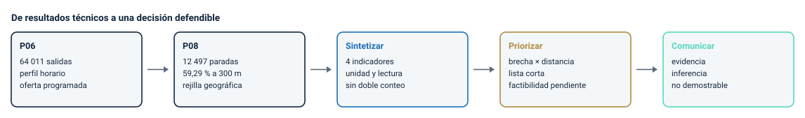
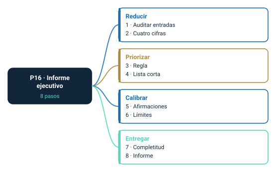
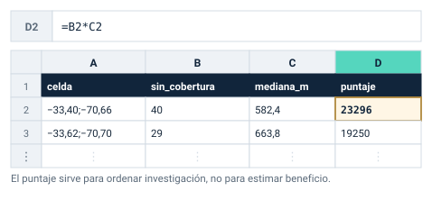

# P16 · Informe de una página para quien decide

◀ [P14/P15 · Evolución GTFS](../evolucion_gtfs/CUADERNO.md) · [Todos los cuadernos](../../docs/cuadernos.md)

[](https://colab.research.google.com/github/vladimiracunadev-create/applied-data-analysis-and-assessment-lab/blob/main/cases/informe_decision_carga/cuaderno/colab.ipynb) — corre los pasos sin instalar nada: el cuaderno clona el repositorio y descarga los datos del portal.

> **¿Qué zonas conviene estudiar para un nuevo centro de carga y qué no se puede afirmar todavía?**

## 1 · El problema

Quien decide no necesita cuarenta tablas, pero reducirlas puede borrar los límites que
hacen honesta la conclusión. P16 debe responder qué estudiar para un nuevo centro de
carga sin afirmar dónde hay más necesidad: los datos describen oferta programada y
proximidad, no transacciones, demanda, seguridad, costos ni predios.

**Los datos.** Resultados reproducibles de P06 y P08; no contiene datos de demanda ni factibilidad de predios.



## 2 · La solución que se va a aplicar

Se seleccionan cuatro indicadores con unidad y lectura, se aplica una regla pública de
cribado a una rejilla geográfica y se separan evidencia, inferencia, hipótesis y lo no
demostrable. `lab.report` exige contexto, método, validación y limitaciones antes de
exportar el informe.



### El mismo resultado en Pandas, Polars y R

La ruta principal de los pasos usa Pandas y Excel. Las implementaciones siguientes recalculan el indicador que sostiene la conclusión con otro motor y producen el mismo gráfico estadístico. El alcance queda declarado para no confundir validación independiente con una traducción cosmética.

| Motor | Alcance verificado | Archivo | Ejecutar |
| --- | --- | --- | --- |
| Polars + Matplotlib | indicadores porcentuales de cobertura | [`solucion_polars.py`](cuaderno/solucion_polars.py) | `uv run --extra polars python cases/informe_decision_carga/cuaderno/solucion_polars.py` |
| R + ggplot2 | indicadores porcentuales de cobertura | [`solucion.R`](cuaderno/solucion.R) | `Rscript cases/informe_decision_carga/cuaderno/solucion.R` |

#### Polars + Matplotlib

```python
"""Contraste Polars y visualización Matplotlib del caso informe_decision_carga."""
from __future__ import annotations

import argparse
import sys
from pathlib import Path

import matplotlib.pyplot as plt
import polars as pl

if hasattr(sys.stdout, "reconfigure"):
    sys.stdout.reconfigure(encoding="utf-8")

ROOT = Path(__file__).resolve().parents[3] if "__file__" in globals() else Path.cwd()
SOURCE = ROOT / "cases" / "informe_decision_carga" / "resultados" / "resumen.csv"


def analizar() -> pl.DataFrame:
    datos = pl.read_csv(SOURCE)
    return datos.filter(pl.col("unidad") == "%").select(["indicador", "valor"])


def graficar(resultado: pl.DataFrame, destino: Path) -> Path:
    x = resultado["indicador"].to_list()
    y = resultado["valor"].to_list()
    fig, ax = plt.subplots(figsize=(9, 5))
    ax.barh([str(value) for value in x], y, color="#11253B")
    ax.set_xlabel("Cobertura de paradas (%)")
    ax.set_ylabel("Indicador")
    ax.set_xlim(left=0)
    ax.set_title("Dos supuestos espaciales producen coberturas distintas")
    ax.grid(axis="y", alpha=0.25)
    fig.text(
        0.01,
        0.01,
        "Fuente: Resultados reproducibles del caso P16 · Período: corte publicado",
        fontsize=8,
        color="#58677A",
    )
    fig.tight_layout(rect=(0, 0.05, 1, 1))
    fig.savefig(destino, dpi=150, bbox_inches="tight")
    plt.close(fig)
    return destino


def main() -> None:
    parser = argparse.ArgumentParser()
    parser.add_argument("--grafico", type=Path)
    args = parser.parse_args()
    resultado = analizar()
    print(resultado)
    if args.grafico:
        print(graficar(resultado, args.grafico))


if __name__ == "__main__":
    main()
```

#### R + ggplot2

```r
#!/usr/bin/env Rscript
# Contraste R + ggplot2 del caso informe_decision_carga.
script_arg <- grep("^--file=", commandArgs(trailingOnly = FALSE), value = TRUE)
script_path <- if (length(script_arg)) sub("^--file=", "", script_arg[1]) else "cuaderno/solucion.R"
root <- normalizePath(file.path(dirname(script_path), "../../.."), mustWork = TRUE)
source_csv <- file.path(root, "cases", "informe_decision_carga", "resultados", "resumen.csv")

datos <- read.csv(source_csv, check.names = FALSE, fileEncoding = "UTF-8")
resultado <- subset(datos, unidad == "%", select = c("indicador", "valor"))
print(resultado, row.names = FALSE)

args <- commandArgs(trailingOnly = TRUE)
plot_pos <- match("--grafico", args)
if (!is.na(plot_pos)) {
  if (plot_pos == length(args)) stop("--grafico necesita una ruta de salida")
  if (!requireNamespace("ggplot2", quietly = TRUE)) {
    stop("Instale ggplot2 para generar el gráfico: install.packages('ggplot2')")
  }
  destino <- args[plot_pos + 1]
  grafico <- ggplot2::ggplot(
    resultado,
    ggplot2::aes(x = .data[["indicador"]], y = .data[["valor"]])
  ) +
    ggplot2::geom_col(fill = "#11253B") +
    ggplot2::coord_flip() +
    ggplot2::labs(
      title = "Dos supuestos espaciales producen coberturas distintas",
      x = "Cobertura de paradas (%)", y = "Indicador",
      caption = "Fuente: Resultados reproducibles del caso P16 · Período: corte publicado"
    ) +
    ggplot2::theme_minimal(base_size = 11)
  ggplot2::ggsave(destino, grafico, width = 9, height = 5, dpi = 150)
  cat(destino, "\n")
}
```

8 pasos. Cada uno trae el código de **Python**, la salida que devuelve de verdad, y la **fórmula de Excel** equivalente dibujada en su hoja. 8 traen además la trampa de hacerlo de la forma obvia.

| # | Paso | Trampa |
| --- | --- | --- |
| 1 | [Auditar las tablas de entrada](#paso-1) | sí |
| 2 | [Reducir a cuatro indicadores](#paso-2) | sí |
| 3 | [Declarar la regla de prioridad](#paso-3) | sí |
| 4 | [Construir una lista corta](#paso-4) | sí |
| 5 | [Clasificar cada afirmación](#paso-5) | sí |
| 6 | [Escribir lo que no se puede concluir](#paso-6) | sí |
| 7 | [Validar la completitud](#paso-7) | sí |
| 8 | [Exportar el entregable reproducible](#paso-8) | sí |

### Para trabajar

| Archivo | Qué es |
| --- | --- |
| [`P16-caso-completo.zip`](cuaderno/P16-caso-completo.zip) | **todo el caso en un ZIP**: el cuaderno, el script, el libro de Excel y las figuras |
| [`pasos.py`](cuaderno/pasos.py) | los 8 pasos seguidos. Se corre y muestra cada salida |
| [`practica.xlsx`](cuaderno/practica.xlsx) | las fórmulas y **el resultado que deben dar**, para corregirse solo. Se abre igual en Google Sheets |
| [`colab.ipynb`](cuaderno/colab.ipynb) | el cuaderno **ejecutable en Colab**: clona, descarga los datos del portal y corre los 8 pasos |
| [`solucion_polars.py`](cuaderno/solucion_polars.py) | solución ejecutable en Polars + Matplotlib; incluye el contraste numérico y el gráfico del caso |
| [`solucion.R`](cuaderno/solucion.R) | solución ejecutable en R + ggplot2; incluye el contraste numérico y el gráfico del caso |

---

## 3 · Los pasos

<a id="paso-1"></a>

### Paso 1 · Auditar las tablas de entrada

El informe consume agregados versionados, no cifras copiadas a mano.

#### Python

```python
tablas = decision.cargar()
{k: v.shape for k, v in tablas.items()}
```

```
{'salidas_por_hora': (75, 4), 'cobertura_por_umbral': (6, 5), 'sensibilidad_rodeo': (5, 5), 'por_rejilla': (296, 7)}
```


*Dos supuestos espaciales producen coberturas distintas. Ejes con unidad, período y fuente; el código Polars y R genera la misma vista.*

#### Excel

Una hoja por resultado de origen, con nombre, fecha y unidad.

> **La trampa.** Copiar cuatro números a una diapositiva rompe la trazabilidad hasta su denominador.

[↑ volver al recorrido](#2--la-solución-que-se-va-a-aplicar)

---

<a id="paso-2"></a>

### Paso 2 · Reducir a cuatro indicadores

Cada cifra incluye unidad y la lectura que sí permite.

#### Python

```python
resultados = decision.analizar()
resultados['resumen']
```

| indicador | valor | unidad | lectura |
| --- | --- | --- | --- |
| salidas programadas en día laboral | 64011.0 | salidas | oferta programada, no demanda |
| hora de mayor oferta | 7.0 | hora | 4541 salidas programadas |
| paradas con carga a 300 m en línea recta | 59.29 | % | referencia espacial |
| paradas con factor de rodeo 1,3 | 46.02 | % | supuesto, no ruta peatonal observada |
*4 filas × 4 columnas.*

#### Excel

Tabla ejecutiva de cuatro filas; no mezclar porcentaje, hora y conteo en un mismo eje.

> **La trampa.** 64 011 salidas son oferta programada, no viajes de personas.

[↑ volver al recorrido](#2--la-solución-que-se-va-a-aplicar)

---

<a id="paso-3"></a>

### Paso 3 · Declarar la regla de prioridad

La regla combina paradas descubiertas y distancia mediana solo como cribado.

#### Python

```python
{'formula': 'paradas_sin_cobertura × mediana_m', 'uso': 'ordenar estudios de factibilidad'}
```

```
{'formula': 'paradas_sin_cobertura × mediana_m', 'uso': 'ordenar estudios de factibilidad'}
```

#### Excel

`=(paradas-cubiertas)*mediana_m` y conservar ambos componentes visibles.

> **La trampa.** Un puntaje sin fórmula publicada convierte criterio en opinión.

[↑ volver al recorrido](#2--la-solución-que-se-va-a-aplicar)

---

<a id="paso-4"></a>

### Paso 4 · Construir una lista corta

Diez celdas reducen el territorio a revisar con datos adicionales.

#### Python

```python
resultados['prioridades']
```

| celda_lat | celda_lon | paradas | cubiertas | paradas_sin_cobertura | mediana_m | cobertura_pct | parada_mas_lejana | prioridad_exploratoria |
| --- | --- | --- | --- | --- | --- | --- | --- | --- |
| -33.4 | -70.66 | 41 | 1 | 40 | 582.4 | 2.4 | PB1400-Emiliano Zapata / esq. Bernardo O'Higg… | 23296.0 |
| -33.62 | -70.7 | 29 | 0 | 29 | 663.8 | 0.0 | PG987-Los Suspiros / esq. Avenida Central | 19250.2 |
| -33.63 | -70.62 | 38 | 9 | 29 | 625.2 | 23.7 | PF673-Belén / esq. Río Maihue | 18130.8 |
| -33.62 | -70.59 | 26 | 2 | 24 | 721.7 | 7.7 | PF720-Sargento Menadier / esq. Uruguay | 17320.8 |
| -33.5 | -70.71 | 23 | 2 | 21 | 741.1 | 8.7 | PI1967-Av. Los Cerrillos / esq. C. Teresa Her… | 15563.1 |
| -33.51 | -70.67 | 24 | 0 | 24 | 643.8 | 0.0 | PH269-Av. J. J. Prieto Vial / esq. Vecinal | 15451.2 |
| -33.62 | -70.57 | 20 | 0 | 20 | 745.6 | 0.0 | PF978-Av. Circunvalación / esq. Nonato Coo | 14912.0 |
| -33.62 | -70.58 | 28 | 5 | 23 | 570.6 | 17.9 | PF791-Av.Pdte. Salvador Allende / esq. Pdte. … | 13123.8 |
| -33.62 | -70.6 | 39 | 9 | 30 | 414.8 | 23.1 | PF882-Rafael Alberti / esq. Ejército Libertad… | 12444.0 |
| -33.54 | -70.68 | 26 | 4 | 22 | 564.3 | 15.4 | PG1149-Avenida Ossa / esq. Alhué | 12414.6 |
*10 filas × 9 columnas.*

#### Excel



Ordenar el puntaje descendente y mostrar los componentes, no solo el ranking.

> **La trampa.** La coordenada de celda no es un predio ni una recomendación de construcción.

[↑ volver al recorrido](#2--la-solución-que-se-va-a-aplicar)

---

<a id="paso-5"></a>

### Paso 5 · Clasificar cada afirmación

Hecho calculado, inferencia e hipótesis se leen de forma distinta.

#### Python

```python
resultados['afirmaciones']
```

| tipo | afirmacion | respaldo |
| --- | --- | --- |
| evidencia | 59,29 % de las paradas está a 300 m en línea … | P08, 7 409 de 12 497 paradas. |
| inferencia | Las celdas con muchas paradas descubiertas am… | Supuesto: cobertura espacial es criterio de c… |
| hipotesis | Un nuevo centro en esas zonas podría reducir … | Requiere demanda, predios, seguridad, costo y… |
| no demostrable | Esas zonas tienen mayor necesidad de carga. | No hay transacciones, saldo, demanda ni orige… |
*4 filas × 3 columnas.*

#### Excel

Columna obligatoria de tipo y otra de respaldo.

> **La trampa.** Presentar una hipótesis como evidencia es más dañino que omitirla.

[↑ volver al recorrido](#2--la-solución-que-se-va-a-aplicar)

---

<a id="paso-6"></a>

### Paso 6 · Escribir lo que no se puede concluir

Los datos faltantes se vinculan a la decisión que bloquean.

#### Python

```python
resultados['afirmaciones'].query("tipo == 'no demostrable'")
```

| tipo | afirmacion | respaldo |
| --- | --- | --- |
| no demostrable | Esas zonas tienen mayor necesidad de carga. | No hay transacciones, saldo, demanda ni orige… |
*1 filas × 3 columnas.*

#### Excel

Sección visible de límites: demanda, red peatonal, predios, costo, seguridad y horario.

> **La trampa.** Baja cobertura no equivale a alta necesidad.

[↑ volver al recorrido](#2--la-solución-que-se-va-a-aplicar)

---

<a id="paso-7"></a>

### Paso 7 · Validar la completitud

El informe no se exporta si falta una sección obligatoria.

#### Python

```python
resultados['completitud']
```

| seccion | clave | presente |
| --- | --- | --- |
| Contexto | contexto | sí |
| Definición del problema | problema | sí |
| Objetivos | objetivos | sí |
| Datos y diccionario | datos | sí |
| Metodología | metodologia | sí |
| Supuestos | supuestos | sí |
| Resultados | resultados | sí |
| Validación independiente | validacion | sí |
| Interpretación | interpretacion | sí |
| Limitaciones | limitaciones | sí |
| Conclusiones | conclusiones | sí |
| Reproducibilidad | reproducibilidad | sí |
*12 filas × 3 columnas.*

#### Excel

Lista de verificación con doce secciones y estado sí/no.

> **La trampa.** Un resumen sin supuestos o limitaciones parece más concluyente de lo que es.

[↑ volver al recorrido](#2--la-solución-que-se-va-a-aplicar)

---

<a id="paso-8"></a>

### Paso 8 · Exportar el entregable reproducible

La misma ejecución escribe tablas y el informe Markdown.

#### Python

```python
ruta = decision.exportar(resultados)
str(ruta / 'informe.md')
```

```
'C:\\dev\\applied-data-analysis-and-assessment-lab\\cases\\informe_decision_carga\\resultados\\informe.md'
```

#### Excel

Guardar fórmulas, fuentes y fecha en el mismo libro que la portada ejecutiva.

> **La trampa.** El formato profesional no sustituye el vínculo al cálculo.

[↑ volver al recorrido](#2--la-solución-que-se-va-a-aplicar)

---

## 4 · El resultado

La entrega produce una lista corta de zonas para factibilidad, no una ubicación aprobada. La recomendación siguiente es recopilar demanda, red peatonal, horarios, predios, costos y seguridad.

## 5 · Qué queda aprendido

1. Reducir no debe borrar denominadores.
2. Un ranking necesita fórmula pública.
3. Baja cobertura no demuestra necesidad.
4. La sección de límites cambia la decisión siguiente.

## Reproducir

```powershell
python -m cases.informe_decision_carga.solution
```

## Seguir

Lo que este caso toca y se trata a fondo en otro sitio:

- [Informe generado](resultados/informe.md)
- [P06 · Oferta programada](../gtfs_red_movilidad/CUADERNO.md)
- [P08 · Cobertura espacial](../cobertura_de_carga/CUADERNO.md)

◀ [P14/P15 · Evolución GTFS](../evolucion_gtfs/CUADERNO.md) · [Todos los cuadernos](../../docs/cuadernos.md)
