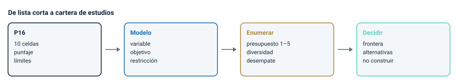
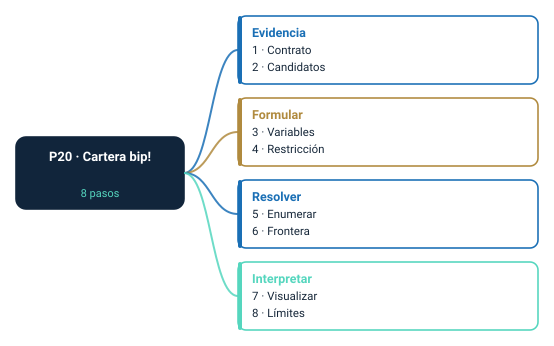
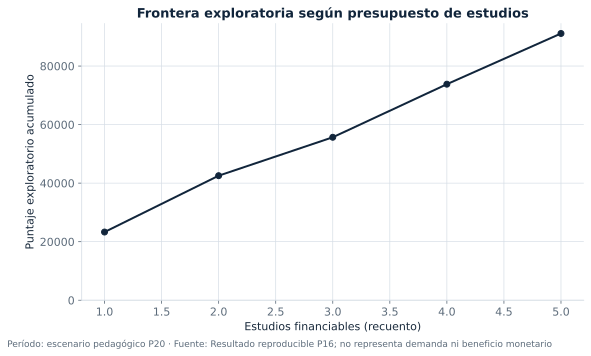

# P20 · Optimización exploratoria de una cartera de estudios para carga bip!

◀ [P19 · Red de correspondencias](../red_correspondencias_dtpm/CUADERNO.md) · [Todos los cuadernos](../../docs/cuadernos.md)

[](https://colab.research.google.com/github/vladimiracunadev-create/applied-data-analysis-and-assessment-lab/blob/main/cases/optimizacion_carga_bip/cuaderno/colab.ipynb) — corre los pasos sin instalar nada: el cuaderno clona el repositorio y descarga los datos del portal.

> **¿Qué combinación de zonas conviene estudiar primero bajo un presupuesto y una regla de diversidad explícitos?**

## 1 · El problema

P16 produce una lista corta, pero una lista no resuelve qué estudiar con un presupuesto
limitado. P20 formula esa elección como una cartera auditable y mantiene separados el
óptimo matemático, la evidencia observada y la decisión pública que todavía falta.

**Los datos.** Diez celdas candidatas de P16, derivadas de GTFS DTPM y lugares bip! públicos.



## 2 · La solución que se va a aplicar

Se identifican candidatos, se asignan tres bandas relativas de latitud, se enumeran
todas las combinaciones de uno a cinco estudios y se maximiza el puntaje P16 sujeto a
diversidad mínima. La frontera y sus tres mejores alternativas se publican completas.



### El mismo resultado en Pandas, Polars y R

Los pasos anteriores y siguientes conservan la resolución completa en Pandas. Este laboratorio adicional aísla el indicador central para resolverlo tres veces sobre **la misma tabla, las mismas reglas y la misma escala gráfica**. Así la comparación cambia el motor, no el problema.

#### Contrato común del ejercicio

- **Objetivo.** Comparar el mejor puntaje acumulado alcanzable para presupuestos de uno a cinco estudios.
- **Fuente que leen las tres implementaciones.**
  [`resultados/frontera_presupuesto.csv`](resultados/frontera_presupuesto.csv), CSV UTF-8 versionado y producido
  por la resolución completa del caso. Los datos originales, su publicador, fecha,
  licencia, URL y huella se documentan en [`case.json`](case.json) y, cuando existe,
  `procedencia.json`. Este CSV es un **resultado reproducible**, no se presenta como
  una nueva fuente oficial.
- **Alcance.** mejor cartera factible para cada presupuesto. Los tres scripts comparables no sustituyen la adquisición,
  limpieza ni controles completos de los pasos Pandas: aíslan el indicador para que
  una diferencia observada sea atribuible al motor.
- **Fórmula o regla.** max Σ prioridad_i·x_i, con Σx_i=k y al menos min(k,3) bandas; x_i∈{0,1}. El desempate usa los ID en orden ascendente.
- **Interpretación.** La curva muestra valor bajo el puntaje de cribado P16; no representa utilidad social, dinero, demanda ni una orden de construcción.
- **Error frecuente.** Sumar prioridades sin declarar diversidad concentra la cartera; llamar beneficio al puntaje inventa una unidad económica.

| Campo | Tipo observado | Función en el ejercicio |
| --- | --- | --- |
| `presupuesto` | `int64` | categoría/eje X |
| `zonas_minimas` | `int64` | campo auxiliar del contrato |
| `candidatos` | `str` | campo auxiliar del contrato |
| `puntaje_total` | `float64` | medida/eje Y |
| `zonas_representadas` | `int64` | campo auxiliar del contrato |
| `paradas_sin_cobertura_referenciales` | `int64` | campo auxiliar del contrato |

#### Qué cambia entre motores

| Dimensión | Pandas | Polars | R (`dplyr`/`readr`) |
| --- | --- | --- | --- |
| Modelo | DataFrame mutable por operaciones | expresiones columnares y plan optimizable | tubería declarativa sobre `tibble` |
| Nulos | `NaN`/`NA`; `groupby` exige decidir `dropna` | `null` separado de `NaN` | `NA`; muchas funciones exigen `na.rm` explícito |
| Orden | varias operaciones lo conservan, pero se ordena explícitamente | no se presupone tras agrupar | se fija con `arrange` |
| Gráfico | Matplotlib | Matplotlib tras extraer sólo X/Y | ggplot2 y su gramática de capas |
| Ventaja típica | ecosistema amplio y aprendizaje gradual | paralelismo, tipos y consultas grandes | estadística, comunicación y análisis reproducible |
| Límite aquí | el índice puede introducir alineaciones implícitas | añade una dependencia y otra semántica de tipos | requiere runtime y paquetes R independientes |

La equivalencia se valida sobre CSV normalizados con tolerancia numérica `1e-9`; no
se exige que la sintaxis ni los píxeles sean idénticos. Para ejecutar en un entorno
limpio consulte [`docs/ejecucion-portable.md`](../../docs/ejecucion-portable.md).

| Motor | Alcance verificado | Archivo | Ejecutar |
| --- | --- | --- | --- |
| Pandas + Matplotlib | mejor cartera factible para cada presupuesto | [`solucion_pandas.py`](cuaderno/solucion_pandas.py) | `python cases/optimizacion_carga_bip/cuaderno/solucion_pandas.py` |
| Polars + Matplotlib | mejor cartera factible para cada presupuesto | [`solucion_polars.py`](cuaderno/solucion_polars.py) | `uv run --extra polars python cases/optimizacion_carga_bip/cuaderno/solucion_polars.py` |
| R + ggplot2 | mejor cartera factible para cada presupuesto | [`solucion.R`](cuaderno/solucion.R) | `Rscript cases/optimizacion_carga_bip/cuaderno/solucion.R` |

#### Pandas + Matplotlib

```python
"""Laboratorio comparable Pandas + Matplotlib del caso optimizacion_carga_bip.

Lee el mismo contrato CSV que las versiones Polars y R. La resolución completa del
caso permanece en ``solution.py`` y en los pasos del cuaderno; este archivo aísla el
indicador central para que la comparación entre motores sea controlada.
"""
from __future__ import annotations

import argparse
import sys
from pathlib import Path

import matplotlib.pyplot as plt
import pandas as pd

if hasattr(sys.stdout, "reconfigure"):
    sys.stdout.reconfigure(encoding="utf-8")

# Buscar la raíz desde el propio archivo evita rutas C:\... específicas del autor y
# funciona igual después de clonar el repositorio en Linux, Windows o Google Colab.
ROOT = Path(__file__).resolve().parents[3] if "__file__" in globals() else Path.cwd()
SOURCE = ROOT / "cases" / "optimizacion_carga_bip" / "resultados" / "frontera_presupuesto.csv"
REQUIRED = {"presupuesto", "puntaje_total"}


def analizar() -> pd.DataFrame:
    """Carga, valida y transforma el indicador; no modifica el archivo de entrada."""
    datos = pd.read_csv(SOURCE)
    faltantes = REQUIRED.difference(datos.columns)
    if faltantes:
        raise ValueError(f"Faltan columnas requeridas en {SOURCE}: {sorted(faltantes)}")
    # La expresión conserva explícitos filtro, agrupación, orden y selección para que
    # el estudiante pueda alinearlos con las expresiones de Polars y dplyr.
    resultado = datos.sort_values("presupuesto")[["presupuesto", "puntaje_total"]]
    return resultado.reset_index(drop=True)


def graficar(resultado: pd.DataFrame, destino: Path) -> Path:
    """Representa exactamente las columnas comparadas y explicita sus unidades."""
    x = resultado["presupuesto"].tolist()
    y = resultado["puntaje_total"].tolist()
    fig, ax = plt.subplots(figsize=(9, 5))
    ax.plot(x, y, marker="o", linewidth=2, color="#11253B")
    ax.set_xlabel("Estudios financiables (recuento)")
    ax.set_ylabel("Puntaje exploratorio acumulado")
    ax.set_ylim(bottom=0)
    ax.set_title("Frontera exploratoria según presupuesto de estudios")
    ax.grid(axis="y", alpha=0.25)
    fig.text(0.01, 0.01, "Fuente: Resultado reproducible P16; no representa demanda ni beneficio monetario · Período: escenario pedagógico P20", fontsize=8, color="#58677A")
    fig.tight_layout(rect=(0, 0.05, 1, 1))
    fig.savefig(destino, dpi=150, bbox_inches="tight")
    plt.close(fig)
    return destino


def main() -> None:
    parser = argparse.ArgumentParser(description=__doc__)
    parser.add_argument("--salida", type=Path, help="CSV normalizado para comparar motores")
    parser.add_argument("--grafico", type=Path, help="PNG de la visualización comparable")
    args = parser.parse_args()
    resultado = analizar()
    print(resultado.to_string(index=False))
    if args.salida:
        resultado.to_csv(args.salida, index=False)
    if args.grafico:
        print(graficar(resultado, args.grafico))


if __name__ == "__main__":
    main()
```

#### Polars + Matplotlib

```python
"""Laboratorio comparable Polars + Matplotlib del caso optimizacion_carga_bip.

Usa el mismo CSV, columnas, reglas y escala que Pandas y R. Polars expresa las
transformaciones como un plan de expresiones columnares; esa diferencia de método es
el objeto de aprendizaje, no una razón para cambiar la pregunta.
"""
from __future__ import annotations

import argparse
import sys
from pathlib import Path

import matplotlib.pyplot as plt
import polars as pl

if hasattr(sys.stdout, "reconfigure"):
    sys.stdout.reconfigure(encoding="utf-8")

ROOT = Path(__file__).resolve().parents[3] if "__file__" in globals() else Path.cwd()
SOURCE = ROOT / "cases" / "optimizacion_carga_bip" / "resultados" / "frontera_presupuesto.csv"
REQUIRED = {"presupuesto", "puntaje_total"}


def analizar() -> pl.DataFrame:
    """Carga y valida antes de transformar para producir un error explicativo."""
    datos = pl.read_csv(SOURCE)
    faltantes = REQUIRED.difference(datos.columns)
    if faltantes:
        raise ValueError(f"Faltan columnas requeridas en {SOURCE}: {sorted(faltantes)}")
    # select al final fija el contrato de salida y evita comparar columnas auxiliares.
    return datos.sort("presupuesto").select(["presupuesto", "puntaje_total"])


def graficar(resultado: pl.DataFrame, destino: Path) -> Path:
    """Convierte sólo las series del gráfico; el análisis permanece en Polars."""
    x = resultado["presupuesto"].to_list()
    y = resultado["puntaje_total"].to_list()
    fig, ax = plt.subplots(figsize=(9, 5))
    ax.plot(x, y, marker="o", linewidth=2, color="#11253B")
    ax.set_xlabel("Estudios financiables (recuento)")
    ax.set_ylabel("Puntaje exploratorio acumulado")
    ax.set_ylim(bottom=0)
    ax.set_title("Frontera exploratoria según presupuesto de estudios")
    ax.grid(axis="y", alpha=0.25)
    fig.text(
        0.01,
        0.01,
        "Fuente: Resultado reproducible P16; no representa demanda ni beneficio monetario · Período: escenario pedagógico P20",
        fontsize=8,
        color="#58677A",
    )
    fig.tight_layout(rect=(0, 0.05, 1, 1))
    fig.savefig(destino, dpi=150, bbox_inches="tight")
    plt.close(fig)
    return destino


def main() -> None:
    parser = argparse.ArgumentParser(description=__doc__)
    parser.add_argument("--salida", type=Path, help="CSV normalizado para comparar motores")
    parser.add_argument("--grafico", type=Path, help="PNG de la visualización comparable")
    args = parser.parse_args()
    resultado = analizar()
    print(resultado)
    if args.salida:
        resultado.write_csv(args.salida)
    if args.grafico:
        print(graficar(resultado, args.grafico))


if __name__ == "__main__":
    main()
```

#### R + ggplot2

```r
#!/usr/bin/env Rscript
# Laboratorio comparable R + dplyr/readr + ggplot2 del caso optimizacion_carga_bip.
#
# La resolución completa sigue en solution.py y en los pasos Pandas. Este script
# cambia el motor sobre el mismo contrato CSV para estudiar sintaxis y semántica sin
# cambiar datos, indicador ni escala gráfica.

required <- c("readr", "dplyr")
missing <- required[!vapply(required, requireNamespace, logical(1), quietly = TRUE)]
if (length(missing)) {
  stop(
    "Faltan paquetes: ", paste(missing, collapse = ", "),
    ". Instálelos con install.packages(c('readr', 'dplyr', 'ggplot2'))."
  )
}

# Buscar pyproject.toml hacia arriba hace portable el script entre terminal, RStudio,
# Posit Cloud, IRkernel y un clon en Colab. LAB_ROOT permite una ruta explícita sin
# codificar la unidad o el directorio del desarrollador.
find_root <- function(start = getwd()) {
  current <- normalizePath(start, mustWork = TRUE)
  repeat {
    if (file.exists(file.path(current, "pyproject.toml"))) return(current)
    parent <- dirname(current)
    if (identical(parent, current)) stop("No se encontró la raíz del repositorio.")
    current <- parent
  }
}
root <- Sys.getenv("LAB_ROOT", unset = find_root())
source_csv <- file.path(root, "cases", "optimizacion_carga_bip", "resultados", "frontera_presupuesto.csv")

# readr conserva nombres y tipos previsibles. La validación temprana produce un error
# que explica el contrato roto, en vez de fallar más tarde dentro de una gráfica.
datos <- readr::read_csv(source_csv, show_col_types = FALSE, progress = FALSE)
required_columns <- c("presupuesto", "puntaje_total")
missing_columns <- setdiff(required_columns, names(datos))
if (length(missing_columns)) stop("Faltan columnas: ", paste(missing_columns, collapse = ", "))

# dplyr expresa la misma selección, filtro, agrupación y orden que las otras vías.
resultado <- datos |> dplyr::arrange(.data$presupuesto) |> dplyr::select(.data$presupuesto, .data$puntaje_total)
print(resultado)

args <- commandArgs(trailingOnly = TRUE)
value_after <- function(flag) {
  pos <- match(flag, args)
  if (is.na(pos)) return(NULL)
  if (pos == length(args)) stop(flag, " necesita una ruta de salida")
  args[pos + 1]
}

csv_output <- value_after("--salida")
if (!is.null(csv_output)) readr::write_csv(resultado, csv_output)

plot_output <- value_after("--grafico")
if (!is.null(plot_output)) {
  if (!requireNamespace("ggplot2", quietly = TRUE)) {
    stop("Instale ggplot2 para generar el gráfico: install.packages('ggplot2')")
  }
  grafico <- ggplot2::ggplot(
    resultado,
    ggplot2::aes(x = .data[["presupuesto"]], y = .data[["puntaje_total"]])
  ) +
    ggplot2::geom_line(ggplot2::aes(group = 1), linewidth = 1, colour = "#11253B") +
    ggplot2::geom_point(size = 2.5, colour = "#55D6BE") +
    ggplot2::labs(
      title = "Frontera exploratoria según presupuesto de estudios",
      x = "Estudios financiables (recuento)", y = "Puntaje exploratorio acumulado",
      caption = "Fuente: Resultado reproducible P16; no representa demanda ni beneficio monetario · Período: escenario pedagógico P20"
    ) +
    ggplot2::theme_minimal(base_size = 11)
  ggplot2::ggsave(plot_output, grafico, width = 9, height = 5, dpi = 150)
  cat(plot_output, "\n")
}
```

8 pasos. Cada uno trae el código de **Python**, la salida que devuelve de verdad, y la **fórmula de Excel** equivalente dibujada en su hoja. 8 traen además la trampa de hacerlo de la forma obvia.

| # | Paso | Trampa |
| --- | --- | --- |
| 1 | [Validar el contrato heredado de P16](#paso-1) | sí |
| 2 | [Crear candidatos y bandas relativas](#paso-2) | sí |
| 3 | [Definir la variable de decisión](#paso-3) | sí |
| 4 | [Hacer visible la diversidad mínima](#paso-4) | sí |
| 5 | [Enumerar las combinaciones factibles](#paso-5) | sí |
| 6 | [Construir la frontera presupuestaria](#paso-6) | sí |
| 7 | [Visualizar valor acumulado por presupuesto](#paso-7) | sí |
| 8 | [Separar estudio, factibilidad e inversión](#paso-8) | sí |

### Para trabajar

| Archivo | Qué es |
| --- | --- |
| [`P20-caso-completo.zip`](cuaderno/P20-caso-completo.zip) | **todo el caso en un ZIP**: el cuaderno, el script, el libro de Excel y las figuras |
| [`pasos.py`](cuaderno/pasos.py) | los 8 pasos seguidos. Se corre y muestra cada salida |
| [`practica.xlsx`](cuaderno/practica.xlsx) | las fórmulas y **el resultado que deben dar**, para corregirse solo. Se abre igual en Google Sheets |
| [`colab.ipynb`](cuaderno/colab.ipynb) | el cuaderno **ejecutable en Colab**: clona, descarga los datos del portal y corre los 8 pasos |
| [`solucion_pandas.py`](cuaderno/solucion_pandas.py) | solución ejecutable en Pandas + Matplotlib; incluye el contraste numérico y el gráfico del caso |
| [`solucion_polars.py`](cuaderno/solucion_polars.py) | solución ejecutable en Polars + Matplotlib; incluye el contraste numérico y el gráfico del caso |
| [`solucion.R`](cuaderno/solucion.R) | solución ejecutable en R + ggplot2; incluye el contraste numérico y el gráfico del caso |
| [`solucion.Rmd`](cuaderno/solucion.Rmd) | documento R Markdown para RStudio, Posit Cloud y render reproducible; reutiliza `solucion.R` sin duplicar la lógica |

---

## 3 · Los pasos

<a id="paso-1"></a>

### Paso 1 · Validar el contrato heredado de P16

La optimización sólo es trazable si conserva la fuente y el significado del puntaje.

#### Python

```python
datos = portfolio.cargar()
datos
```

| celda_lat | celda_lon | paradas | cubiertas | paradas_sin_cobertura | mediana_m | cobertura_pct | parada_mas_lejana | prioridad_exploratoria |
| --- | --- | --- | --- | --- | --- | --- | --- | --- |
| -33.4 | -70.66 | 41 | 1 | 40 | 582.4 | 2.4 | PB1400-Emiliano Zapata / esq. Bernardo O'Higg… | 23296.0 |
| -33.62 | -70.7 | 29 | 0 | 29 | 663.8 | 0.0 | PG987-Los Suspiros / esq. Avenida Central | 19250.2 |
| -33.63 | -70.62 | 38 | 9 | 29 | 625.2 | 23.7 | PF673-Belén / esq. Río Maihue | 18130.8 |
| -33.62 | -70.59 | 26 | 2 | 24 | 721.7 | 7.7 | PF720-Sargento Menadier / esq. Uruguay | 17320.8 |
| -33.5 | -70.71 | 23 | 2 | 21 | 741.1 | 8.7 | PI1967-Av. Los Cerrillos / esq. C. Teresa Her… | 15563.1 |
| -33.51 | -70.67 | 24 | 0 | 24 | 643.8 | 0.0 | PH269-Av. J. J. Prieto Vial / esq. Vecinal | 15451.2 |
| -33.62 | -70.57 | 20 | 0 | 20 | 745.6 | 0.0 | PF978-Av. Circunvalación / esq. Nonato Coo | 14912.0 |
| -33.62 | -70.58 | 28 | 5 | 23 | 570.6 | 17.9 | PF791-Av.Pdte. Salvador Allende / esq. Pdte. … | 13123.8 |
| -33.62 | -70.6 | 39 | 9 | 30 | 414.8 | 23.1 | PF882-Rafael Alberti / esq. Ejército Libertad… | 12444.0 |
| -33.54 | -70.68 | 26 | 4 | 22 | 564.3 | 15.4 | PG1149-Avenida Ossa / esq. Alhué | 12414.6 |
*10 filas × 9 columnas.*

#### Excel

Comprobar columnas, coordenadas únicas y puntajes no negativos.

> **La trampa.** Tratar prioridad como demanda convierte una regla de cribado en una medición inexistente.

[↑ volver al recorrido](#2--la-solución-que-se-va-a-aplicar)

---

<a id="paso-2"></a>

### Paso 2 · Crear candidatos y bandas relativas

Un ID estable permite auditar selecciones; la banda introduce diversidad explícita.

#### Python

```python
candidatos = portfolio.preparar_candidatos(datos)
candidatos[['candidato_id', 'celda_lat', 'celda_lon', 'banda_territorial', 'prioridad_exploratoria']]
```

| candidato_id | celda_lat | celda_lon | banda_territorial | prioridad_exploratoria |
| --- | --- | --- | --- | --- |
| C01 | -33.4 | -70.66 | norte | 23296.0 |
| C02 | -33.62 | -70.7 | sur | 19250.2 |
| C03 | -33.63 | -70.62 | sur | 18130.8 |
| C04 | -33.62 | -70.59 | sur | 17320.8 |
| C05 | -33.5 | -70.71 | norte | 15563.1 |
| C06 | -33.51 | -70.67 | norte | 15451.2 |
| C07 | -33.62 | -70.57 | sur | 14912.0 |
| C08 | -33.62 | -70.58 | centro | 13123.8 |
| C09 | -33.62 | -70.6 | centro | 12444.0 |
| C10 | -33.54 | -70.68 | centro | 12414.6 |
*10 filas × 5 columnas.*

#### Excel

Ordenar por puntaje, numerar y dividir el rango de latitud en terciles relativos.

> **La trampa.** Llamar comuna a la banda inventaría una geografía administrativa.

[↑ volver al recorrido](#2--la-solución-que-se-va-a-aplicar)

---

<a id="paso-3"></a>

### Paso 3 · Definir la variable de decisión

xᵢ vale 1 si la celda i entra en la cartera y 0 en caso contrario.

#### Python

```python
{'variable': 'x_i ∈ {0,1}', 'objetivo': 'max Σ prioridad_i × x_i', 'presupuesto': 'Σ x_i = k'}
```

```
{'variable': 'x_i ∈ {0,1}', 'objetivo': 'max Σ prioridad_i × x_i', 'presupuesto': 'Σ x_i = k'}
```

#### Excel

Una columna binaria por candidato; SUMAPRODUCTO calcula el objetivo.

> **La trampa.** Permitir valores fraccionarios describe medio estudio y cambia el problema.

[↑ volver al recorrido](#2--la-solución-que-se-va-a-aplicar)

---

<a id="paso-4"></a>

### Paso 4 · Hacer visible la diversidad mínima

Para k=1,2,≥3 se exigen una, dos o tres bandas relativas.

#### Python

```python
{k: min(k, 3) for k in range(1, 6)}
```

```
{1: 1, 2: 2, 3: 3, 4: 3, 5: 3}
```

#### Excel

Contar bandas distintas entre filas elegidas.

> **La trampa.** Agregar la restricción después de ver el ganador sería ajustar la regla al resultado.

[↑ volver al recorrido](#2--la-solución-que-se-va-a-aplicar)

---

<a id="paso-5"></a>

### Paso 5 · Enumerar las combinaciones factibles

Con diez candidatos, revisar exhaustivamente es simple y verificable.

#### Python

```python
frontera, alternativas = portfolio.optimizar(candidatos)
alternativas
```

| presupuesto | posicion | candidatos | puntaje_total | zonas_representadas | paradas_sin_cobertura_referenciales |
| --- | --- | --- | --- | --- | --- |
| 1 | 1 | C01 | 23296.0 | 1 | 40 |
| 1 | 2 | C02 | 19250.2 | 1 | 29 |
| 1 | 3 | C03 | 18130.8 | 1 | 29 |
| 2 | 1 | C01;C02 | 42546.2 | 2 | 69 |
| 2 | 2 | C01;C03 | 41426.8 | 2 | 69 |
| 2 | 3 | C01;C04 | 40616.8 | 2 | 64 |
| 3 | 1 | C01;C02;C08 | 55670.0 | 3 | 92 |
| 3 | 2 | C01;C02;C09 | 54990.2 | 3 | 99 |
| 3 | 3 | C01;C02;C10 | 54960.799999999996 | 3 | 91 |
| 4 | 1 | C01;C02;C03;C08 | 73800.8 | 3 | 121 |
| 4 | 2 | C01;C02;C03;C09 | 73121.0 | 3 | 128 |
| 4 | 3 | C01;C02;C03;C10 | 73091.6 | 3 | 120 |
| 5 | 1 | C01;C02;C03;C04;C08 | 91121.6 | 3 | 145 |
| 5 | 2 | C01;C02;C03;C04;C09 | 90441.8 | 3 | 152 |
| 5 | 3 | C01;C02;C03;C04;C10 | 90412.40000000001 | 3 | 144 |
*15 filas × 6 columnas.*

#### Excel

Generar combinaciones de tamaño k, filtrar diversidad y ordenar por objetivo.

> **La trampa.** Usar una heurística sin necesidad puede ocultar una cartera mejor.

[↑ volver al recorrido](#2--la-solución-que-se-va-a-aplicar)

---

<a id="paso-6"></a>

### Paso 6 · Construir la frontera presupuestaria

Cada fila conserva el mejor objetivo bajo exactamente k estudios.

#### Python

```python
frontera
```

| presupuesto | zonas_minimas | candidatos | puntaje_total | zonas_representadas | paradas_sin_cobertura_referenciales |
| --- | --- | --- | --- | --- | --- |
| 1 | 1 | C01 | 23296.0 | 1 | 40 |
| 2 | 2 | C01;C02 | 42546.2 | 2 | 69 |
| 3 | 3 | C01;C02;C08 | 55670.0 | 3 | 92 |
| 4 | 3 | C01;C02;C03;C08 | 73800.8 | 3 | 121 |
| 5 | 3 | C01;C02;C03;C04;C08 | 91121.6 | 3 | 145 |
*5 filas × 6 columnas.*

#### Excel

Seleccionar la primera alternativa de cada presupuesto tras un desempate estable.

> **La trampa.** Comparar carteras de distinto tamaño sin declarar presupuesto favorece siempre la más grande.

[↑ volver al recorrido](#2--la-solución-que-se-va-a-aplicar)

---

<a id="paso-7"></a>

### Paso 7 · Visualizar valor acumulado por presupuesto

La curva hace visible el incremento, no un beneficio monetario.

#### Python

```python
frontera[['presupuesto', 'puntaje_total']]
```

| presupuesto | puntaje_total |
| --- | --- |
| 1.0 | 23296.0 |
| 2.0 | 42546.2 |
| 3.0 | 55670.0 |
| 4.0 | 73800.8 |
| 5.0 | 91121.6 |
*5 filas × 2 columnas.*



*Frontera exploratoria según presupuesto de estudios. Ejes con unidad, período y fuente; el código Polars y R genera la misma vista.*

#### Excel

Línea con presupuesto en X y puntaje exploratorio acumulado en Y.

> **La trampa.** Etiquetar el eje como rentabilidad atribuye dinero que el modelo no contiene.

[↑ volver al recorrido](#2--la-solución-que-se-va-a-aplicar)

---

<a id="paso-8"></a>

### Paso 8 · Separar estudio, factibilidad e inversión

El escenario de cuatro estudios es ilustrativo y requiere validación externa.

#### Python

```python
resultados = portfolio.analizar()
resultados['seleccion_presupuesto_4'][['candidato_id', 'banda_territorial', 'prioridad_exploratoria']]
```

| candidato_id | banda_territorial | prioridad_exploratoria |
| --- | --- | --- |
| C01 | norte | 23296.0 |
| C02 | sur | 19250.2 |
| C03 | sur | 18130.8 |
| C08 | centro | 13123.8 |
*4 filas × 3 columnas.*

#### Excel

Publicar selección, regla, límites y datos faltantes en el mismo entregable.

> **La trampa.** Presentar coordenadas como sitios aprobados excede la evidencia y el alcance de P20.

[↑ volver al recorrido](#2--la-solución-que-se-va-a-aplicar)

---

## 4 · El resultado

El óptimo selecciona estudios bajo reglas declaradas; no selecciona predios ni autoriza inversión.

## 5 · Qué queda aprendido

1. Un modelo hereda los límites de su entrada.
2. Las restricciones expresan criterios.
3. La enumeración es auditable.
4. Óptimo no significa decisión final.

## Reproducir

```powershell
python -m cases.optimizacion_carga_bip.solution
```

## Seguir

Lo que este caso toca y se trata a fondo en otro sitio:

- [P16 · Lista corta de decisión](../informe_decision_carga/CUADERNO.md)
- [P17 · Gobernanza de datos](../gobernanza_datos_dtpm/CUADERNO.md)
- [P18 · Pipeline reproducible](../etl_gtfs_automatizado/CUADERNO.md)

◀ [P19 · Red de correspondencias](../red_correspondencias_dtpm/CUADERNO.md) · [Todos los cuadernos](../../docs/cuadernos.md)
