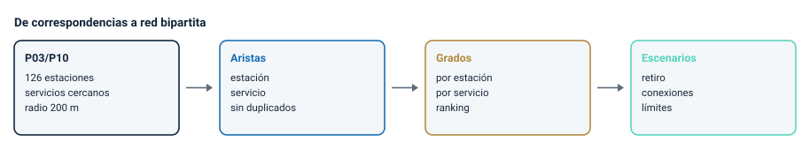
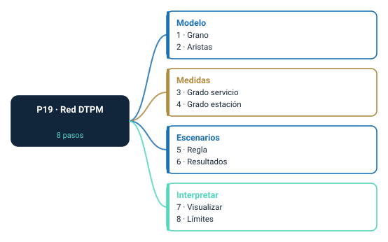
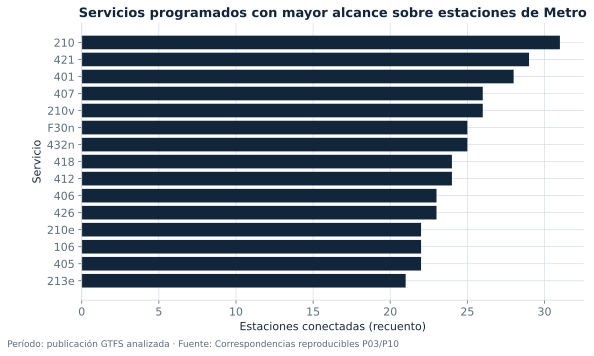

# P19 · Estructura de la red programada de correspondencias Metro–bus

◀ [P18 · ETL histórico GTFS](../etl_gtfs_automatizado/CUADERNO.md) · [Todos los cuadernos](../../docs/cuadernos.md)

[](https://colab.research.google.com/github/vladimiracunadev-create/applied-data-analysis-and-assessment-lab/blob/main/cases/red_correspondencias_dtpm/cuaderno/colab.ipynb) — corre los pasos sin instalar nada: el cuaderno clona el repositorio y descarga los datos del portal.

> **¿Qué servicios conectan más estaciones y cómo cambia la red programada al retirarlos?**

## 1 · El problema

Una estación con muchos servicios cercanos y un servicio que conecta muchas estaciones
son dos grados distintos. P19 modela ambos sin convertir la estructura programada en
una afirmación sobre pasajeros, puntualidad o capacidad.

**Los datos.** Resultado reproducible de P03/P10 basado en GTFS DTPM y lugares bip! públicos.



## 2 · La solución que se va a aplicar

Se transforma cada lista de servicios de P03/P10 en aristas únicas, se calculan grados
en ambos lados y se retiran servicios por grado descendente en cinco escenarios. Cada
resultado puede reconstruirse desde la tabla de aristas.



### El mismo resultado en Pandas, Polars y R

Los pasos anteriores y siguientes conservan la resolución completa en Pandas. Este laboratorio adicional aísla el indicador central para resolverlo tres veces sobre **la misma tabla, las mismas reglas y la misma escala gráfica**. Así la comparación cambia el motor, no el problema.

#### Contrato común del ejercicio

- **Objetivo.** Comparar el grado de los quince servicios programados que conectan más estaciones.
- **Fuente que leen las tres implementaciones.**
  [`resultados/servicios_centrales.csv`](resultados/servicios_centrales.csv), CSV UTF-8 versionado y producido
  por la resolución completa del caso. Los datos originales, su publicador, fecha,
  licencia, URL y huella se documentan en [`case.json`](case.json) y, cuando existe,
  `procedencia.json`. Este CSV es un **resultado reproducible**, no se presenta como
  una nueva fuente oficial.
- **Alcance.** grado de servicio en grafo bipartito. Los tres scripts comparables no sustituyen la adquisición,
  limpieza ni controles completos de los pasos Pandas: aíslan el indicador para que
  una diferencia observada sea atribuible al motor.
- **Fórmula o regla.** grado(s) = #{estaciones distintas e para las que existe la arista (e,s)}; cada par se cuenta una sola vez.
- **Interpretación.** El grado mide alcance estructural bajo el radio de P10; no mide pasajeros, frecuencia, capacidad ni puntualidad.
- **Error frecuente.** Contar filas antes de deduplicar pares estación–servicio puede inflar el grado.

| Campo | Tipo observado | Función en el ejercicio |
| --- | --- | --- |
| `servicio` | `str` | categoría/eje X |
| `estaciones_conectadas` | `int64` | medida/eje Y |
| `participacion_estaciones_pct` | `float64` | campo auxiliar del contrato |

#### Qué cambia entre motores

| Dimensión | Pandas | Polars | R (`dplyr`/`readr`) |
| --- | --- | --- | --- |
| Modelo | DataFrame mutable por operaciones | expresiones columnares y plan optimizable | tubería declarativa sobre `tibble` |
| Nulos | `NaN`/`NA`; `groupby` exige decidir `dropna` | `null` separado de `NaN` | `NA`; muchas funciones exigen `na.rm` explícito |
| Orden | varias operaciones lo conservan, pero se ordena explícitamente | no se presupone tras agrupar | se fija con `arrange` |
| Gráfico | Matplotlib | Matplotlib tras extraer sólo X/Y | ggplot2 y su gramática de capas |
| Ventaja típica | ecosistema amplio y aprendizaje gradual | paralelismo, tipos y consultas grandes | estadística, comunicación y análisis reproducible |
| Límite aquí | el índice puede introducir alineaciones implícitas | añade una dependencia y otra semántica de tipos | requiere runtime y paquetes R independientes |

La equivalencia se valida sobre CSV normalizados con tolerancia numérica `1e-9`; no
se exige que la sintaxis ni los píxeles sean idénticos. Para ejecutar en un entorno
limpio consulte [`docs/ejecucion-portable.md`](../../docs/ejecucion-portable.md).

| Motor | Alcance verificado | Archivo | Ejecutar |
| --- | --- | --- | --- |
| Pandas + Matplotlib | grado de servicio en grafo bipartito | [`solucion_pandas.py`](cuaderno/solucion_pandas.py) | `python cases/red_correspondencias_dtpm/cuaderno/solucion_pandas.py` |
| Polars + Matplotlib | grado de servicio en grafo bipartito | [`solucion_polars.py`](cuaderno/solucion_polars.py) | `uv run --extra polars python cases/red_correspondencias_dtpm/cuaderno/solucion_polars.py` |
| R + ggplot2 | grado de servicio en grafo bipartito | [`solucion.R`](cuaderno/solucion.R) | `Rscript cases/red_correspondencias_dtpm/cuaderno/solucion.R` |

#### Pandas + Matplotlib

```python
"""Laboratorio comparable Pandas + Matplotlib del caso red_correspondencias_dtpm.

Lee el mismo contrato CSV que las versiones Polars y R. La resolución completa del
caso permanece en ``solution.py`` y en los pasos del cuaderno; este archivo aísla el
indicador central para que la comparación entre motores sea controlada.
"""
from __future__ import annotations

import argparse
import sys
from pathlib import Path

import matplotlib.pyplot as plt
import pandas as pd

if hasattr(sys.stdout, "reconfigure"):
    sys.stdout.reconfigure(encoding="utf-8")

# Buscar la raíz desde el propio archivo evita rutas C:\... específicas del autor y
# funciona igual después de clonar el repositorio en Linux, Windows o Google Colab.
ROOT = Path(__file__).resolve().parents[3] if "__file__" in globals() else Path.cwd()
SOURCE = ROOT / "cases" / "red_correspondencias_dtpm" / "resultados" / "servicios_centrales.csv"
REQUIRED = {"servicio", "estaciones_conectadas"}


def analizar() -> pd.DataFrame:
    """Carga, valida y transforma el indicador; no modifica el archivo de entrada."""
    datos = pd.read_csv(SOURCE)
    faltantes = REQUIRED.difference(datos.columns)
    if faltantes:
        raise ValueError(f"Faltan columnas requeridas en {SOURCE}: {sorted(faltantes)}")
    # La expresión conserva explícitos filtro, agrupación, orden y selección para que
    # el estudiante pueda alinearlos con las expresiones de Polars y dplyr.
    resultado = datos.sort_values(["estaciones_conectadas", "servicio"], ascending=[False, True])[["servicio", "estaciones_conectadas"]]
    return resultado.reset_index(drop=True)


def graficar(resultado: pd.DataFrame, destino: Path) -> Path:
    """Representa exactamente las columnas comparadas y explicita sus unidades."""
    x = resultado["servicio"].tolist()
    y = resultado["estaciones_conectadas"].tolist()
    fig, ax = plt.subplots(figsize=(9, 5))
    ax.barh([str(value) for value in x], y, color="#11253B")
    ax.invert_yaxis()  # el primer puesto del ranking queda arriba, como se lee una tabla
    ax.set_xlabel("Estaciones conectadas (recuento)")
    ax.set_ylabel("Servicio")
    ax.set_xlim(left=0)
    ax.set_title("Servicios programados con mayor alcance sobre estaciones de Metro")
    ax.grid(axis="y", alpha=0.25)
    fig.text(0.01, 0.01, "Fuente: Correspondencias reproducibles P03/P10 · Período: publicación GTFS analizada", fontsize=8, color="#58677A")
    fig.tight_layout(rect=(0, 0.05, 1, 1))
    fig.savefig(destino, dpi=150, bbox_inches="tight")
    plt.close(fig)
    return destino


def main() -> None:
    parser = argparse.ArgumentParser(description=__doc__)
    parser.add_argument("--salida", type=Path, help="CSV normalizado para comparar motores")
    parser.add_argument("--grafico", type=Path, help="PNG de la visualización comparable")
    args = parser.parse_args()
    resultado = analizar()
    print(resultado.to_string(index=False))
    if args.salida:
        resultado.to_csv(args.salida, index=False)
    if args.grafico:
        print(graficar(resultado, args.grafico))


if __name__ == "__main__":
    main()
```

#### Polars + Matplotlib

```python
"""Laboratorio comparable Polars + Matplotlib del caso red_correspondencias_dtpm.

Usa el mismo CSV, columnas, reglas y escala que Pandas y R. Polars expresa las
transformaciones como un plan de expresiones columnares; esa diferencia de método es
el objeto de aprendizaje, no una razón para cambiar la pregunta.
"""
from __future__ import annotations

import argparse
import sys
from pathlib import Path

import matplotlib.pyplot as plt
import polars as pl

if hasattr(sys.stdout, "reconfigure"):
    sys.stdout.reconfigure(encoding="utf-8")

ROOT = Path(__file__).resolve().parents[3] if "__file__" in globals() else Path.cwd()
SOURCE = ROOT / "cases" / "red_correspondencias_dtpm" / "resultados" / "servicios_centrales.csv"
REQUIRED = {"servicio", "estaciones_conectadas"}


def analizar() -> pl.DataFrame:
    """Carga y valida antes de transformar para producir un error explicativo."""
    datos = pl.read_csv(SOURCE)
    faltantes = REQUIRED.difference(datos.columns)
    if faltantes:
        raise ValueError(f"Faltan columnas requeridas en {SOURCE}: {sorted(faltantes)}")
    # select al final fija el contrato de salida y evita comparar columnas auxiliares.
    return datos.sort(["estaciones_conectadas", "servicio"], descending=[True, False]).select(["servicio", "estaciones_conectadas"])


def graficar(resultado: pl.DataFrame, destino: Path) -> Path:
    """Convierte sólo las series del gráfico; el análisis permanece en Polars."""
    x = resultado["servicio"].to_list()
    y = resultado["estaciones_conectadas"].to_list()
    fig, ax = plt.subplots(figsize=(9, 5))
    ax.barh([str(value) for value in x], y, color="#11253B")
    ax.invert_yaxis()  # el primer puesto del ranking queda arriba, como se lee una tabla
    ax.set_xlabel("Estaciones conectadas (recuento)")
    ax.set_ylabel("Servicio")
    ax.set_xlim(left=0)
    ax.set_title("Servicios programados con mayor alcance sobre estaciones de Metro")
    ax.grid(axis="y", alpha=0.25)
    fig.text(
        0.01,
        0.01,
        "Fuente: Correspondencias reproducibles P03/P10 · Período: publicación GTFS analizada",
        fontsize=8,
        color="#58677A",
    )
    fig.tight_layout(rect=(0, 0.05, 1, 1))
    fig.savefig(destino, dpi=150, bbox_inches="tight")
    plt.close(fig)
    return destino


def main() -> None:
    parser = argparse.ArgumentParser(description=__doc__)
    parser.add_argument("--salida", type=Path, help="CSV normalizado para comparar motores")
    parser.add_argument("--grafico", type=Path, help="PNG de la visualización comparable")
    args = parser.parse_args()
    resultado = analizar()
    print(resultado)
    if args.salida:
        resultado.write_csv(args.salida)
    if args.grafico:
        print(graficar(resultado, args.grafico))


if __name__ == "__main__":
    main()
```

#### R + ggplot2

```r
#!/usr/bin/env Rscript
# Laboratorio comparable R + dplyr/readr + ggplot2 del caso red_correspondencias_dtpm.
#
# La resolución completa sigue en solution.py y en los pasos Pandas. Este script
# cambia el motor sobre el mismo contrato CSV para estudiar sintaxis y semántica sin
# cambiar datos, indicador ni escala gráfica.

required <- c("readr", "dplyr")
missing <- required[!vapply(required, requireNamespace, logical(1), quietly = TRUE)]
if (length(missing)) {
  stop(
    "Faltan paquetes: ", paste(missing, collapse = ", "),
    ". Instálelos con install.packages(c('readr', 'dplyr', 'ggplot2'))."
  )
}

# Buscar pyproject.toml hacia arriba hace portable el script entre terminal, RStudio,
# Posit Cloud, IRkernel y un clon en Colab. LAB_ROOT permite una ruta explícita sin
# codificar la unidad o el directorio del desarrollador.
find_root <- function(start = getwd()) {
  current <- normalizePath(start, mustWork = TRUE)
  repeat {
    if (file.exists(file.path(current, "pyproject.toml"))) return(current)
    parent <- dirname(current)
    if (identical(parent, current)) stop("No se encontró la raíz del repositorio.")
    current <- parent
  }
}
root <- Sys.getenv("LAB_ROOT", unset = find_root())
source_csv <- file.path(root, "cases", "red_correspondencias_dtpm", "resultados", "servicios_centrales.csv")

# readr conserva nombres y tipos previsibles. La validación temprana produce un error
# que explica el contrato roto, en vez de fallar más tarde dentro de una gráfica.
datos <- readr::read_csv(source_csv, show_col_types = FALSE, progress = FALSE)
required_columns <- c("servicio", "estaciones_conectadas")
missing_columns <- setdiff(required_columns, names(datos))
if (length(missing_columns)) stop("Faltan columnas: ", paste(missing_columns, collapse = ", "))

# dplyr expresa la misma selección, filtro, agrupación y orden que las otras vías.
resultado <- datos |> dplyr::arrange(dplyr::desc(.data$estaciones_conectadas), .data$servicio) |> dplyr::select(.data$servicio, .data$estaciones_conectadas)
print(resultado)

args <- commandArgs(trailingOnly = TRUE)
value_after <- function(flag) {
  pos <- match(flag, args)
  if (is.na(pos)) return(NULL)
  if (pos == length(args)) stop(flag, " necesita una ruta de salida")
  args[pos + 1]
}

csv_output <- value_after("--salida")
if (!is.null(csv_output)) readr::write_csv(resultado, csv_output)

plot_output <- value_after("--grafico")
if (!is.null(plot_output)) {
  if (!requireNamespace("ggplot2", quietly = TRUE)) {
    stop("Instale ggplot2 para generar el gráfico: install.packages('ggplot2')")
  }
  grafico <- ggplot2::ggplot(
    resultado,
    ggplot2::aes(x = .data[["servicio"]], y = .data[["estaciones_conectadas"]])
  ) +
    ggplot2::geom_col(fill = "#11253B") +
    ggplot2::scale_x_discrete(limits = rev) +
    ggplot2::coord_flip() +
    ggplot2::labs(
      title = "Servicios programados con mayor alcance sobre estaciones de Metro",
      x = "Estaciones conectadas (recuento)", y = "Servicio",
      caption = "Fuente: Correspondencias reproducibles P03/P10 · Período: publicación GTFS analizada"
    ) +
    ggplot2::theme_minimal(base_size = 11)
  ggplot2::ggsave(plot_output, grafico, width = 9, height = 5, dpi = 150)
  cat(plot_output, "\n")
}
```

8 pasos. Cada uno trae el código de **Python**, la salida que devuelve de verdad, y la **fórmula de Excel** equivalente dibujada en su hoja. 8 traen además la trampa de hacerlo de la forma obvia.

| # | Paso | Trampa |
| --- | --- | --- |
| 1 | [Declarar los dos tipos de nodo](#paso-1) | sí |
| 2 | [Convertir listas en aristas](#paso-2) | sí |
| 3 | [Calcular el grado de cada servicio](#paso-3) | sí |
| 4 | [Calcular el grado de cada estación](#paso-4) | sí |
| 5 | [Publicar la regla de retiro](#paso-5) | sí |
| 6 | [Recalcular cinco escenarios](#paso-6) | sí |
| 7 | [Visualizar los servicios de mayor alcance](#paso-7) | sí |
| 8 | [Escribir lo que el modelo no observa](#paso-8) | sí |

### Para trabajar

| Archivo | Qué es |
| --- | --- |
| [`P19-caso-completo.zip`](cuaderno/P19-caso-completo.zip) | **todo el caso en un ZIP**: el cuaderno, el script, el libro de Excel y las figuras |
| [`pasos.py`](cuaderno/pasos.py) | los 8 pasos seguidos. Se corre y muestra cada salida |
| [`practica.xlsx`](cuaderno/practica.xlsx) | las fórmulas y **el resultado que deben dar**, para corregirse solo. Se abre igual en Google Sheets |
| [`colab.ipynb`](cuaderno/colab.ipynb) | el cuaderno **ejecutable en Colab**: clona, descarga los datos del portal y corre los 8 pasos |
| [`solucion_pandas.py`](cuaderno/solucion_pandas.py) | solución ejecutable en Pandas + Matplotlib; incluye el contraste numérico y el gráfico del caso |
| [`solucion_polars.py`](cuaderno/solucion_polars.py) | solución ejecutable en Polars + Matplotlib; incluye el contraste numérico y el gráfico del caso |
| [`solucion.R`](cuaderno/solucion.R) | solución ejecutable en R + ggplot2; incluye el contraste numérico y el gráfico del caso |
| [`solucion.Rmd`](cuaderno/solucion.Rmd) | documento R Markdown para RStudio, Posit Cloud y render reproducible; reutiliza `solucion.R` sin duplicar la lógica |

---

## 3 · Los pasos

<a id="paso-1"></a>

### Paso 1 · Declarar los dos tipos de nodo

Estación y servicio no son intercambiables.

#### Python

```python
estaciones = network.cargar()
estaciones[['stop_id', 'stop_name', 'servicios_distintos']]
```

| stop_id | stop_name | servicios_distintos |
| --- | --- | --- |
| AG | Camino Agrícola | 10 |
| AH | San Alberto Hurtado | 36 |
| AL | Alcántara | 6 |
| AN-NA | Santa Ana | 27 |
| AV | Vespucio Norte | 14 |
| BA-BQ | Baquedano | 37 |
| BE | Bellas Artes | 8 |
| BIL | Francisco Bilbao | 12 |
*126 filas × 3 columnas, se muestran las primeras 8.*

#### Excel

Una tabla de estaciones y otra de servicios; declarar el grano.

> **La trampa.** Usar el nombre de estación como ID fusiona homónimos.

[↑ volver al recorrido](#2--la-solución-que-se-va-a-aplicar)

---

<a id="paso-2"></a>

### Paso 2 · Convertir listas en aristas

Una relación por fila hace auditable cualquier medida de red.

#### Python

```python
aristas = network.aristas(estaciones)
aristas
```

| stop_id | stop_name | servicio |
| --- | --- | --- |
| AG | Camino Agrícola | 210 |
| AG | Camino Agrícola | 210e |
| AG | Camino Agrícola | 210v |
| AG | Camino Agrícola | 213e |
| AG | Camino Agrícola | D07 |
| AG | Camino Agrícola | D10 |
| AG | Camino Agrícola | D14 |
| AG | Camino Agrícola | H05 |
| AG | Camino Agrícola | H09 |
| AG | Camino Agrícola | H24 |
*2024 filas × 3 columnas, se muestran las primeras 10.*

#### Excel

Dividir por coma y expandir filas; quitar duplicados por par.

> **La trampa.** Contar el texto separado por comas incluye espacios y duplicados.

[↑ volver al recorrido](#2--la-solución-que-se-va-a-aplicar)

---

<a id="paso-3"></a>

### Paso 3 · Calcular el grado de cada servicio

El grado cuenta estaciones distintas conectadas.

#### Python

```python
resultados = network.analizar()
resultados['servicios_centrales']
```

| servicio | estaciones_conectadas | participacion_estaciones_pct |
| --- | --- | --- |
| 210 | 31 | 24.603174603174605 |
| 421 | 29 | 23.015873015873016 |
| 401 | 28 | 22.22222222222222 |
| 210v | 26 | 20.634920634920636 |
| 407 | 26 | 20.634920634920636 |
| 432n | 25 | 19.841269841269842 |
| F30n | 25 | 19.841269841269842 |
| 412 | 24 | 19.047619047619047 |
| 418 | 24 | 19.047619047619047 |
| 406 | 23 | 18.253968253968253 |
| 426 | 23 | 18.253968253968253 |
| 106 | 22 | 17.46031746031746 |
| 210e | 22 | 17.46031746031746 |
| 405 | 22 | 17.46031746031746 |
| 213e | 21 | 16.666666666666668 |
*15 filas × 3 columnas.*

#### Excel

`CONTARA(UNICOS(FILTRAR(estacion;servicio=actual)))`.

> **La trampa.** Contar aristas sin deduplicar sobrestima servicios repetidos.

[↑ volver al recorrido](#2--la-solución-que-se-va-a-aplicar)

---

<a id="paso-4"></a>

### Paso 4 · Calcular el grado de cada estación

La medida inversa cuenta alternativas programadas cercanas.

#### Python

```python
resultados['grado_por_estacion']
```

| stop_id | stop_name | servicios_conectados |
| --- | --- | --- |
| SL | Santa Lucía | 55 |
| LM | La Moneda | 50 |
| EL | Estación Central | 47 |
| LH-HE | Los Héroes | 44 |
| CH-UCH | Universidad de Chile | 43 |
| PM | Plaza de Maipú | 38 |
| BA-BQ | Baquedano | 37 |
| RP | República | 37 |
| AH | San Alberto Hurtado | 36 |
| LC-LCI | La Cisterna | 35 |
*126 filas × 3 columnas, se muestran las primeras 10.*

#### Excel

Tabla dinámica: estación en filas y servicio como recuento distinto.

> **La trampa.** Más servicios no implica más frecuencia ni capacidad.

[↑ volver al recorrido](#2--la-solución-que-se-va-a-aplicar)

---

<a id="paso-5"></a>

### Paso 5 · Publicar la regla de retiro

Los escenarios retiran primero los servicios de mayor grado, con desempate por ID.

#### Python

```python
{'orden': 'estaciones_conectadas descendente, servicio ascendente', 'escenarios': [0, 1, 3, 5, 10]}
```

```
{'orden': 'estaciones_conectadas descendente, servicio ascendente', 'escenarios': [0, 1, 3, 5, 10]}
```

#### Excel

Ordenar la tabla de grado y marcar los primeros K.

> **La trampa.** Cambiar el criterio entre escenarios invalida la comparación.

[↑ volver al recorrido](#2--la-solución-que-se-va-a-aplicar)

---

<a id="paso-6"></a>

### Paso 6 · Recalcular cinco escenarios

Cada escenario vuelve a contar aristas y estaciones con alternativa.

#### Python

```python
resultados['escenarios']
```

| servicios_retirados | aristas_restantes | aristas_perdidas_pct | estaciones_con_alternativa | estaciones_sin_alternativa |
| --- | --- | --- | --- | --- |
| 0.0 | 2024.0 | 0.0 | 126.0 | 0.0 |
| 1.0 | 1993.0 | 1.5316205533596838 | 126.0 | 0.0 |
| 3.0 | 1936.0 | 4.3478260869565215 | 126.0 | 0.0 |
| 5.0 | 1884.0 | 6.91699604743083 | 126.0 | 0.0 |
| 10.0 | 1763.0 | 12.895256916996047 | 126.0 | 0.0 |
*5 filas × 5 columnas.*

#### Excel

Excluir servicios marcados y recalcular, no restar promedios.

> **La trampa.** Aristas perdidas no son pasajeros afectados.

[↑ volver al recorrido](#2--la-solución-que-se-va-a-aplicar)

---

<a id="paso-7"></a>

### Paso 7 · Visualizar los servicios de mayor alcance

La gráfica muestra grado estructural con fuente y unidad.

#### Python

```python
resultados['servicios_centrales'][['servicio', 'estaciones_conectadas']]
```

| servicio | estaciones_conectadas |
| --- | --- |
| 210 | 31 |
| 421 | 29 |
| 401 | 28 |
| 210v | 26 |
| 407 | 26 |
| 432n | 25 |
| F30n | 25 |
| 412 | 24 |
| 418 | 24 |
| 406 | 23 |
| 426 | 23 |
| 106 | 22 |
| 210e | 22 |
| 405 | 22 |
| 213e | 21 |
*15 filas × 2 columnas.*



*Servicios programados con mayor alcance sobre estaciones de Metro. Ejes con unidad, período y fuente; el código Polars y R genera la misma vista.*

#### Excel

Barras horizontales ordenadas; no usar un eje sin unidad.

> **La trampa.** Una barra alta no demuestra importancia social.

[↑ volver al recorrido](#2--la-solución-que-se-va-a-aplicar)

---

<a id="paso-8"></a>

### Paso 8 · Escribir lo que el modelo no observa

Los límites definen la siguiente fuente necesaria.

#### Python

```python
{'no_observa': ['pasajeros', 'GPS', 'capacidad', 'puntualidad', 'secuencia completa'], 'sí_observa': 'correspondencia programada por proximidad'}
```

```
{'no_observa': ['pasajeros', 'GPS', 'capacidad', 'puntualidad', 'secuencia completa'], 'sí_observa': 'correspondencia programada por proximidad'}
```

#### Excel

Bloque visible de alcance y fuentes faltantes.

> **La trampa.** Llamar resiliencia operacional a este escenario excede la evidencia.

[↑ volver al recorrido](#2--la-solución-que-se-va-a-aplicar)

---

## 4 · El resultado

El modelo mide relaciones programadas; la operación real requiere demanda, GPS y capacidad.

## 5 · Qué queda aprendido

1. El grano define el grafo.
2. Grado no es demanda.
3. Escenarios requieren regla fija.
4. Las aristas preservan trazabilidad.

## Reproducir

```powershell
python -m cases.red_correspondencias_dtpm.solution
```

## Seguir

Lo que este caso toca y se trata a fondo en otro sitio:

- [P03/P10 · Fuente de correspondencias](../correspondencia_metro/CUADERNO.md)
- [P18 · Pipeline de datos](../etl_gtfs_automatizado/CUADERNO.md)

◀ [P18 · ETL histórico GTFS](../etl_gtfs_automatizado/CUADERNO.md) · [Todos los cuadernos](../../docs/cuadernos.md)
