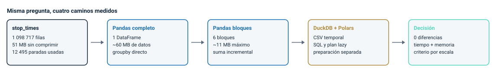
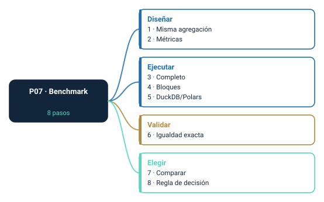
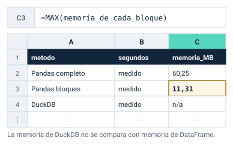

# P07 · Cuándo conviene dejar Pandas

◀ [P06 · Expediciones por hora](../gtfs_red_movilidad/CUADERNO.md) · [Todos los cuadernos](../../docs/cuadernos.md) · [P08 · Cobertura espacial](../cobertura_de_carga/CUADERNO.md) ▶

[](https://colab.research.google.com/github/vladimiracunadev-create/applied-data-analysis-and-assessment-lab/blob/main/cases/rendimiento_gtfs/cuaderno/colab.ipynb) — corre los pasos sin instalar nada: el cuaderno clona el repositorio y descarga los datos del portal.

> **¿Qué se gana y qué se pierde al leer completo, por bloques, con DuckDB o con Polars?**

## 1 · El problema

«Pandas no escala» y «DuckDB es más rápido» son afirmaciones incompletas. La decisión
depende del volumen, la operación, la memoria disponible y el costo de preparar los
datos. P07 fija una sola agregación y exige que todos los motores devuelvan exactamente
lo mismo antes de comparar tiempos.

**Los datos.** stop_times.txt del GTFS vigente: 1 098 717 filas y la misma agregación por parada.



## 2 · La solución que se va a aplicar

Se cuentan filas de horario por parada con lectura completa, seis bloques, una consulta
DuckDB y un plan lazy de Polars. Se separa el tiempo de extracción del ZIP de cada
consulta, se mide la memoria del DataFrame o bloque y se hace una unión por clave para
encontrar cualquier diferencia. La conclusión se expresa como criterio, no como ganador
universal.



8 pasos. Cada uno trae el código de **Python**, la salida que devuelve de verdad, y la **fórmula de Excel** equivalente dibujada en su hoja. 8 traen además la trampa de hacerlo de la forma obvia.

| # | Paso | Trampa |
| --- | --- | --- |
| 1 | [Fijar una agregación idéntica](#paso-1) | sí |
| 2 | [Declarar qué se mide](#paso-2) | sí |
| 3 | [Ejecutar Pandas completo](#paso-3) | sí |
| 4 | [Ejecutar Pandas por bloques](#paso-4) | sí |
| 5 | [Ejecutar DuckDB y Polars](#paso-5) | sí |
| 6 | [Exigir igualdad antes de mirar velocidad](#paso-6) | sí |
| 7 | [Comparar tiempo y memoria](#paso-7) | sí |
| 8 | [Tomar una decisión proporcional](#paso-8) | sí |

### Para trabajar

| Archivo | Qué es |
| --- | --- |
| [`P07-caso-completo.zip`](cuaderno/P07-caso-completo.zip) | **todo el caso en un ZIP**: el cuaderno, el script, el libro de Excel y las figuras |
| [`pasos.py`](cuaderno/pasos.py) | los 8 pasos seguidos. Se corre y muestra cada salida |
| [`practica.xlsx`](cuaderno/practica.xlsx) | las fórmulas y **el resultado que deben dar**, para corregirse solo. Se abre igual en Google Sheets |
| [`colab.ipynb`](cuaderno/colab.ipynb) | el cuaderno **ejecutable en Colab**: clona, descarga los datos del portal y corre los 8 pasos |

---

## 3 · Los pasos

<a id="paso-1"></a>

### Paso 1 · Fijar una agregación idéntica

Todos cuentan filas por `stop_id`; cambiar la pregunta invalidaría el benchmark.

#### Python

```python
{'archivo': 'stop_times.txt', 'operacion': 'COUNT(*) GROUP BY stop_id', 'columnas': ['stop_id']}
```

```
{'archivo': 'stop_times.txt', 'operacion': 'COUNT(*) GROUP BY stop_id', 'columnas': ['stop_id']}
```

#### Excel

Tabla dinámica: `stop_id` en filas y recuento en valores.

> **La trampa.** Comparar una lectura selectiva con otra que carga ocho columnas mide cosas distintas.

[↑ volver al recorrido](#2--la-solución-que-se-va-a-aplicar)

---

<a id="paso-2"></a>

### Paso 2 · Declarar qué se mide

Tiempo, memoria de datos, bloques y filas se guardan en la misma tabla.

#### Python

```python
['segundos','lectura_s','agregacion_s','memoria_datos_mb','bloques','filas_entrada']
```

```
['segundos', 'lectura_s', 'agregacion_s', 'memoria_datos_mb', 'bloques', 'filas_entrada']
```

#### Excel

Hoja Benchmark con método en filas y una columna por métrica.

> **La trampa.** Un único tiempo total oculta que DuckDB necesita preparar un CSV temporal.

[↑ volver al recorrido](#2--la-solución-que-se-va-a-aplicar)

---

<a id="paso-3"></a>

### Paso 3 · Ejecutar Pandas completo

Es la referencia simple mientras el archivo cabe en memoria.

#### Python

```python
referencia = rendimiento.cargar_referencia()
referencia['benchmark'].query("metodo == 'Pandas completo'")
```

```
            metodo  segundos  ...  filas_resultado  filas_entrada
0  Pandas completo  0.960397  ...            12495        1098717

[1 rows x 9 columns]
```

#### Excel

Cargar columna y crear tabla dinámica.

> **La trampa.** El DataFrame usa más memoria que los 51 MB del CSV porque cada texto es un objeto.

[↑ volver al recorrido](#2--la-solución-que-se-va-a-aplicar)

---

<a id="paso-4"></a>

### Paso 4 · Ejecutar Pandas por bloques

Cada bloque se agrega y los parciales se suman por clave.

#### Python

```python
referencia['benchmark'].query("metodo == 'Pandas por bloques'")
```

```
               metodo  segundos  ...  filas_resultado  filas_entrada
1  Pandas por bloques  1.659754  ...            12495        1098717

[1 rows x 9 columns]
```

#### Excel

Power Query puede agrupar antes de cargar, equivalente al patrón incremental.

> **La trampa.** Una mediana exacta no se puede combinar sumando medianas de bloques.

[↑ volver al recorrido](#2--la-solución-que-se-va-a-aplicar)

---

<a id="paso-5"></a>

### Paso 5 · Ejecutar DuckDB y Polars

Ambos consultan el CSV extraído y reportan la extracción aparte.

#### Python

```python
referencia['benchmark'].query("metodo in ['DuckDB sobre CSV', 'Polars lazy sobre CSV']")
```

```
                  metodo  segundos  ...  filas_resultado  filas_entrada
2       DuckDB sobre CSV  1.121300  ...            12495        1098717
3  Polars lazy sobre CSV  0.195069  ...            12495        1098717

[2 rows x 9 columns]
```

#### Excel

En Power Query, agrupar durante la consulta evita cargar el detalle a la hoja.

> **La trampa.** DuckDB y Polars lazy no son equivalentes internamente; solo comparten la pregunta y la salida.

[↑ volver al recorrido](#2--la-solución-que-se-va-a-aplicar)

---

<a id="paso-6"></a>

### Paso 6 · Exigir igualdad antes de mirar velocidad

Una implementación rápida y distinta es incorrecta.

#### Python

```python
referencia['validacion']
```

| comparacion | coinciden | diferencias |
| --- | --- | --- |
| completo vs bloques | True | 0 |
| completo vs DuckDB | True | 0 |
| completo vs Polars | True | 0 |
*3 filas × 3 columnas.*

#### Excel

Cruce por `stop_id` y columna `=conteo_A=conteo_B`; contar falsos.

> **La trampa.** Comparar solo el total puede ocultar errores que se compensan entre paradas.

[↑ volver al recorrido](#2--la-solución-que-se-va-a-aplicar)

---

<a id="paso-7"></a>

### Paso 7 · Comparar tiempo y memoria

Ningún método domina las dos dimensiones en todos los volúmenes.

#### Python

```python
referencia['benchmark']
```

| metodo | segundos | lectura_s | agregacion_s | memoria_datos_mb | bloques | estado | filas_resultado | filas_entrada |
| --- | --- | --- | --- | --- | --- | --- | --- | --- |
| Pandas completo | 0.9603973000193946 | 0.7582218000316061 | 0.2021754999877885 | 60.248285 | 1.0 |  | 12495 | 1098717 |
| Pandas por bloques | 1.6597541999653913 |  |  | 11.310612 | 6.0 |  | 12495 | 1098717 |
| DuckDB sobre CSV | 1.1213004000019282 | 0.4513530000112951 | 1.1213004000019282 |  |  | ejecutado; extracción informada por separado | 12495 | 1098717 |
| Polars lazy sobre CSV | 0.19506870000623167 | 0.41066780005348846 | 0.19506870000623167 |  |  | ejecutado; extracción informada por separado | 12495 | 1098717 |
*4 filas × 9 columnas.*

#### Excel



Tabla con formato condicional por métrica, sin semáforo único.

> **La trampa.** El color de 'ganador' borra que bloques compra memoria a cambio de tiempo.

[↑ volver al recorrido](#2--la-solución-que-se-va-a-aplicar)

---

<a id="paso-8"></a>

### Paso 8 · Tomar una decisión proporcional

Se elige el camino más simple que cumple el límite real de recursos.

#### Python

```python
{'este_feed': 'Pandas completo cabe', 'memoria_restringida': 'bloques', 'muchos_feeds_o_consultas': 'DuckDB/Polars'}
```

```
{'este_feed': 'Pandas completo cabe', 'memoria_restringida': 'bloques', 'muchos_feeds_o_consultas': 'DuckDB/Polars'}
```

#### Excel

Documentar volumen, operación, máquina y fecha junto a la elección.

> **La trampa.** Extrapolar linealmente una sola corrida no sustituye medir el siguiente orden de magnitud.

[↑ volver al recorrido](#2--la-solución-que-se-va-a-aplicar)

---

## 4 · El resultado

En este feed Pandas completo cabe y es simple; bloques reduce cerca de 81 % la memoria de datos. DuckDB y Polars ejecutan planes columnares con la preparación informada aparte.

## 5 · Qué queda aprendido

1. Un benchmark empieza por igualdad de resultado.
2. Tiempo y memoria son objetivos distintos.
3. La agregación por bloques exige una operación combinable.
4. Los tiempos se vuelven a medir por equipo.

## Reproducir

```powershell
python -m cases.rendimiento_gtfs.solution
```

## Seguir

Lo que este caso toca y se trata a fondo en otro sitio:

- [Resultados y límites](README.md)
- [P06 · El mismo archivo en un análisis](../gtfs_red_movilidad/CUADERNO.md)

◀ [P06 · Expediciones por hora](../gtfs_red_movilidad/CUADERNO.md) · [Todos los cuadernos](../../docs/cuadernos.md) · [P08 · Cobertura espacial](../cobertura_de_carga/CUADERNO.md) ▶
