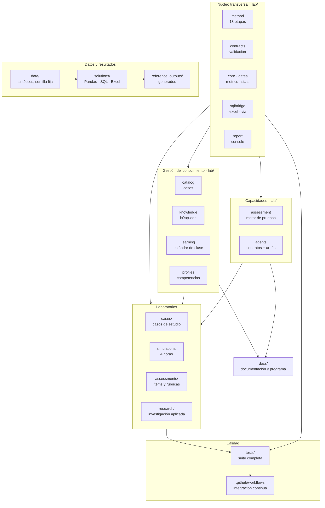
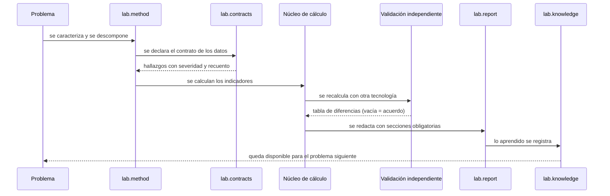

# Arquitectura del laboratorio

## 1. Principio de diseño

El laboratorio separa **lo que se puede reutilizar** de **lo que pertenece a un
problema concreto**. El núcleo no sabe nada de transporte, de comercio ni de
educación; los casos no se conocen entre sí. Esa doble independencia es lo que permite
que un problema nuevo entre sin romper los anteriores, que es el requisito central del
repositorio.

Tres reglas lo sostienen:

1. **El núcleo no contiene reglas de negocio.** `lab.metrics.safe_ratio` sirve para
   cualquier razón; el criterio de qué se excluye del cumplimiento de la programación
   vive en el caso de transporte.
2. **Los casos no se importan entre sí.** Un caso depende del núcleo y de sus propios
   datos. Nada más. `tests/test_repo_coherence.py` lo comprueba.
3. **La documentación derivada se genera desde el código.** Si una tabla puede
   desincronizarse, se genera; si se genera, no puede mentir.

## 2. Vista de componentes



## 3. Contratos entre componentes

Cada módulo del núcleo tiene una responsabilidad única y una interfaz declarada.

| Módulo | Responsabilidad | Entrada | Salida |
| --- | --- | --- | --- |
| `method` | Seguimiento auditable de la metodología | enunciado, evidencias | `MethodRun`, informe, cobertura |
| `contracts` | Validar una tabla contra su contrato | DataFrame + `TableContract` | `ValidationReport` con hallazgos y severidad |
| `core` | Lectura, perfil y cruce auditado | rutas, DataFrames | DataFrames + tabla de auditoría |
| `dates` | Fechas, duraciones y bandas horarias | Series de texto o fecha | Series tipadas + recuento de fallos |
| `metrics` | Indicadores y descriptiva | Series numéricas | tablas con unidad y cobertura |
| `stats` | Inferencia sin dependencias externas | muestras | `Estimate`, `TestResult` |
| `sqlbridge` | Segunda implementación en SQL | DataFrames + consulta | DataFrame, tabla de diferencias |
| `excel` | Libros auditables con fórmulas vivas | `Sheet`s | archivo `.xlsx` |
| `viz` | Gráficos con el estándar visual | DataFrame + rótulos | archivo `.png` |
| `report` | Informes con secciones obligatorias | secciones, afirmaciones | Markdown validado |
| `catalog` | Estado real de los casos | `case.json` | catálogo, matriz de competencias |
| `knowledge` | Recuperar conocimiento | consulta de texto | registros ordenados por relevancia |
| `learning` | Hacer cumplir el estándar pedagógico | archivos de clase | hallazgos por clase, cobertura |
| `assessment` | Generar y corregir evaluaciones | `Blueprint` + banco | instancia reproducible, nota |
| `agents` | Especificar capacidades | — | registro + hallazgos del arnés |
| `profiles` | Rutas profesionales y su cobertura | competencias de los casos | cobertura por perfil |
| `console` | Salida legible en cualquier sistema | — | efecto sobre stdout |

**Invariantes que las pruebas protegen:**

- Ningún módulo del núcleo importa de `cases/`, `solutions/` ni `assessments/`.
- Ningún caso importa de otro caso.
- Toda etapa completada de `MethodRun` tiene evidencia.
- Todo informe exportado tiene sus secciones obligatorias.
- Toda clase publicada cumple las 17 secciones.
- Todo caso declara los 26 campos de metadatos.
- El arnés de agentes no encuentra hallazgos.
- La documentación derivada coincide con el código.

## 4. Flujo de un problema nuevo



El último paso es el que convierte un trabajo en una capacidad: el conocimiento
adquirido se escribe como registro, el caso declara qué capacidades reutilizables deja
y, si hizo falta algo nuevo, el núcleo crece con su prueba.

## 5. Decisiones de arquitectura y sus alternativas

| Decisión | Alternativas consideradas | Por qué esta |
| --- | --- | --- |
| Validación independiente con **SQLite** (`sqlite3`, biblioteca estándar) | DuckDB; una segunda implementación en Pandas | SQLite no agrega dependencias y su semántica difiere realmente de Pandas (`NULL`, `CAST`, afinidad de tipos), de modo que el acuerdo entre ambas es informativo. Una segunda implementación en Pandas compartiría los mismos malentendidos. DuckDB queda como opción detectable |
| Inferencia estadística **propia** en Python puro | SciPy; Statsmodels | Mantiene el entorno mínimo sin dependencias científicas pesadas y permite explicar las fórmulas en el programa de aprendizaje. Se valida contra tablas estadísticas publicadas |
| Búsqueda de conocimiento **léxica** (TF-IDF) | Embeddings con base vectorial | Funciona sin red ni modelos, corre en integración continua y es explicable. La opción semántica está en la hoja de ruta y solo entra si mejora de forma medible |
| Documentación derivada **generada** | Escrita a mano | Una tabla escrita a mano se desincroniza en el primer cambio. Generada, no puede mentir, y `--check` lo verifica en CI |
| Metadatos de caso en **JSON** | YAML; encabezado en el README | JSON se valida sin dependencias y no admite ambigüedad de indentación |
| Excel con **fórmulas vivas** | Valores calculados en Python | Un valor pegado no demuestra el cálculo. Las fórmulas se auditan abriendo la celda, y la hoja de control confronta ambas vías |
| Datos **sintéticos con semilla** | Datos públicos reales | Reproducibles, sin datos personales y sin ataduras de licencia. Los antecedentes públicos verificados quedan documentados aparte |
| `uv` para Python | pip + venv; conda | Resolución rápida, lockfile reproducible y un solo comando para el entorno |

## 6. Estructura de directorios

```
applied-data-analysis-and-assessment-lab/
├── lab/                    núcleo transversal, sin reglas de negocio (17 módulos)
├── cases/                  casos de estudio independientes
│   ├── transport/          caso prioritario, con case.json
│   ├── retail/
│   └── education/
├── simulations/            enunciados de cuatro horas
├── assessments/            motor de evaluaciones: ítems, configuraciones, generadas
│   ├── items/              banco de ejercicios en JSON
│   └── generated/          instancias reproducibles por semilla
├── knowledge/              base de conocimiento: un archivo por registro
├── research/               investigación aplicada y plantillas
├── data/                   datos sintéticos, inmutables, con semilla fija
├── solutions/              referencia en Pandas, en SQL y en Excel
│   └── excel/              libros resueltos con fórmulas vivas
├── reference_outputs/      resultados generados (no versionados)
├── docs/                   documentación, programa de aprendizaje y derivados
│   └── learning/           clases por bloque
├── scripts/                generadores: datos, Excel, evaluaciones, documentación
├── templates/              plantilla de caso nuevo
├── tests/                  suite completa
├── notebooks/              exploración
├── assets/                 identidad visual
└── submissions/            trabajo propio, no versionado
```

## 7. Cómo se extiende

| Qué agregar | Dónde | Qué prueba lo protege |
| --- | --- | --- |
| Un caso de estudio | `cases/<slug>/` con `case.json` | `tests/test_catalog.py` |
| Una capacidad del núcleo | `lab/<modulo>.py` | `tests/test_<modulo>.py` |
| Una clase | `docs/learning/<bloque>/NN-slug.md` | `tests/test_learning.py` |
| Un registro de conocimiento | `knowledge/<id>.md` | `tests/test_knowledge.py` |
| Un ítem de evaluación | `assessments/items/*.json` | `tests/test_assessment.py` |
| Un contrato de agente | `lab/agents.py` → `REGISTRY` | `tests/test_agents.py` |
| Un perfil profesional | `lab/profiles.py` → `PROFILES` | `tests/test_profiles.py` |
| Una tecnología opcional | dependencia opcional en `pyproject.toml` | detección en tiempo de ejecución |

Después de cualquiera de estos cambios:

```powershell
uv run python scripts/build_docs.py
uv run python -m pytest
```
