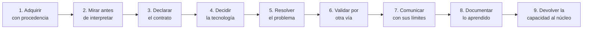

# Instancias: el mismo recorrido para cualquier dominio de datos

Este laboratorio no es un programa sobre transporte. Es un **recorrido reutilizable**
para leer datos que uno no generó, resolver un problema con ellos, documentar qué
tecnología se usó y por qué, y dejar el aprendizaje disponible para la próxima vez.

Cada aplicación de ese recorrido a un dominio concreto es una **instancia**. El
transporte público de Santiago es la primera instancia con datos reales; el mismo
recorrido aplica a datos bancarios, de la NASA, de clientes, de una empresa o de
cualquier otra fuente.

---

## El recorrido



Las nueve etapas no son una formalidad: cada una existe porque su ausencia produce un
error concreto y conocido.

### 1. Adquirir con procedencia

**Qué se hace.** Traer el dato registrando URL, fecha, tamaño, tipo de contenido,
huella SHA-256 y licencia.

**Por qué.** Un análisis sobre un archivo del que no se sabe el origen ni la fecha no
es reproducible. Y si el nombre del archivo publicado cambia —cosa habitual—, un
script que lo construya a mano falla sin aviso.

**Herramienta.** `lab.sources`: `DataSource`, `fetch`, `discover_link`, `manifest`.

**Lo que esto evita.** El informe que nadie puede repetir, y la redistribución de un
dato cuya licencia no se leyó.

### 2. Mirar antes de interpretar

**Qué se hace.** Inventario del archivo, recuento de filas, tipos tal como vienen
(`dtype=str`), perfil de nulos y duplicados, **distribuciones**.

**Por qué.** La señal más valiosa de un dato ajeno es una distribución que no puede
ser cierta. En la instancia del GTFS, el 58 % de los pasos aparecía a medianoche: eso
destapó que la columna no contenía horas de reloj.

**Herramienta.** `lab.core.profile`, `lab.sources.zip_members`,
`lab.metrics.describe_numeric`.

**Lo que esto evita.** Explicar con elegancia un patrón que en realidad es un
malentendido de la columna.

### 3. Declarar el contrato

**Qué se hace.** Escribir en código qué debe cumplir cada tabla: tipos, dominios,
rangos, clave primaria, claves foráneas, y la severidad de cada incumplimiento.

**Por qué.** La validación informa; no borra. La decisión de excluir pertenece al
análisis y hay que declararla, con su recuento.

**Herramienta.** `lab.contracts`.

**Lo que esto evita.** Limpiar antes de medir, y perder así el número que el informe
necesitaba.

### 4. Decidir la tecnología

**Qué se hace.** Elegir, y **escribir la alternativa descartada y el motivo**.

**Por qué.** Una decisión técnica sin alternativa declarada no se puede revisar. Es la
parte que más se omite y la que más vale en una evaluación.

**Criterios que suelen decidir:**

| Situación | Decisión habitual | Por qué |
| --- | --- | --- |
| Cabe en memoria, lógica compleja | Pandas | Expresividad; el cuello no es el volumen |
| Agregación columnar o ejecución lazy | Polars | Paralelismo y plan optimizable con tipos explícitos |
| No cabe, agregaciones por ventana | DuckDB o Parquet | El motor hace lo que la memoria no |
| Hay que demostrar el cálculo a una persona | Excel con fórmulas vivas | Se audita abriendo la celda |
| Se necesita una segunda opinión fuera de Python | R base sobre los mismos archivos | Runtime distinto: el acuerdo es informativo |
| Se necesitan varias opiniones | Pandas + Polars + R + SQL | Cada vía parte del archivo crudo y se confronta |
| Hay coordenadas | GeoPandas | Distancias y pertenencia a polígonos |
| Hay que anticipar | scikit-learn | Con validación fuera de muestra |

### 5. Resolver el problema

**Qué se hace.** Banderas de validez por indicador en lugar de filtros sucesivos;
cada indicador calculado sobre su propio conjunto válido; unidades y denominadores
declarados.

**Herramienta.** `lab.metrics`, `lab.dates`, `lab.stats`.

**Lo que esto evita.** Un `df` reasignado quince veces del que nadie sabe qué filas
quedaron.

### 6. Validar por otra vía

**Qué se hace.** Recalcular el resultado principal con una implementación que **no
comparte código** con la primera, y comparar con una tolerancia declarada.

**Por qué.** Es la forma más económica de descartar una familia entera de errores. En
este repositorio ya encontró dos defectos reales: la pérdida de precisión de
`julianday` en SQLite y el denominador inflado de `CONTAR.SI.CONJUNTO` en Excel.

**Herramienta.** `lab.sqlbridge.query` y `cross_check`, o una comprobación aritmética
independiente como en la instancia del GTFS.

**Lo que esto evita.** Declarar verificado lo que solo está ejecutado.

### 7. Comunicar con sus límites

**Qué se hace.** Informe con secciones obligatorias, afirmaciones clasificadas como
hecho, evidencia, inferencia, interpretación o hipótesis, y limitaciones escritas.

**Herramienta.** `lab.report`, `lab.viz`.

**Lo que esto evita.** Que quien decide dé por hecho lo que era hipótesis.

### 8. Documentar lo aprendido

**Qué se hace.** Un registro por cosa que costó descubrir y volverá a aparecer, con su
fuente dentro del repositorio.

**Herramienta.** `lab.knowledge`.

**Criterio de admisión.** Entra lo que costó descubrir. No entra lo que ya dice la
documentación de una biblioteca.

### 9. Devolver la capacidad al núcleo

**Qué se hace.** Si el problema exigió algo nuevo, ese algo sube a `lab/` con su
prueba, de modo que la próxima instancia lo encuentre hecho.

**Ejemplo real.** La instancia del GTFS exigió horarios que exceden las 24 horas con
relleno irregular. Eso se convirtió en `lab.dates.parse_hms_seconds`, que ahora sirve
para turnos de producción, jornadas de guardia o cualquier horario operacional.

---

## Instancias existentes

| Instancia | Dominio | Datos | Qué capacidad aportó al núcleo |
| --- | --- | --- | --- |
| [`gtfs_red_movilidad`](../cases/gtfs_red_movilidad/README.md) | Transporte, Santiago | **Reales**, 1,1 M de filas | `lab.sources`, horarios de día de servicio |
| [`transport`](../cases/transport/README.md) | Transporte | Sintéticos | Validación cruzada Pandas ↔ Polars ↔ R ↔ SQL ↔ Excel |
| [`retail`](../cases/retail/README.md) | Comercio | Sintéticos | Columna de signo derivada de un estado |
| [`education`](../cases/education/README.md) | Educación | Sintéticos | Tasa ponderada frente a promedio simple |

El catálogo completo, generado desde los metadatos, está en
[`catalogo-casos.md`](catalogo-casos.md).

---

## Instancias que el recorrido admite y aún no existen

Esta tabla es una lista de trabajo, **no** una declaración de capacidades. Nada de
aquí está implementado.

| Dominio | Problema típico | Qué tecnología traería | Qué trampa enseñaría |
| --- | --- | --- | --- |
| **Banca** | Conciliar movimientos contra extracto | Cruce sin clave exacta, por monto y fecha con tolerancia | Partidas que calzan por coincidencia |
| **Astronomía / NASA** | Series de observación de un catálogo público | Lectura por bloques, Parquet, unidades físicas | Valores centinela (`-999`) tratados como dato |
| **Clientes / CRM** | Deduplicar personas sin identificador común | Normalización de texto, distancia entre cadenas | Dos registros distintos de la misma persona |
| **Empresa / finanzas internas** | Margen por línea de negocio con criterios de asignación | Modelo de datos con jerarquías | El resultado depende del criterio de reparto, que es una decisión |
| **Salud** | Tiempos de espera por prestación | Distribuciones asimétricas, mediana y P90 | La media describe a un paciente que no existe |
| **Energía** | Consumo horario | Series temporales, estacionalidad | El día del cambio de hora tiene 23 o 25 horas |
| **Logística** | Tiempos de tránsito entre puntos | GeoPandas, distancias | La distancia en línea recta no es la distancia recorrida |
| **Ciberseguridad** | Agregación de registros de acceso | Parsing de texto, ventanas temporales | Husos horarios mezclados en un mismo archivo |

Para que una de estas entre, tiene que aportar **una capacidad nueva al núcleo**, no
solo un dataset más. Ese es el criterio.

---

## Cómo agregar una instancia

```powershell
uv run python scripts/new_case.py mi-instancia
```

1. **Declare la fuente** en `lab.sources.CATALOG`, con su licencia. Si no la verificó,
   déjela como `NO VERIFICADA`: el laboratorio no redistribuye datos cuya licencia no
   leyó.
2. **Descárguela** con `python scripts/fetch_data.py mi-instancia` y copie el registro
   de procedencia a `cases/mi-instancia/procedencia.json`.
3. **Complete `case.json`** con los 26 campos obligatorios, incluidas las
   metodologías alternativas y las limitaciones.
4. **Escriba el README con las siete partes** de la anatomía de caso: problema,
   descomposición, datos, tecnología elegida con sus alternativas, resolución,
   resultado con su validación, y aprendizaje.
5. **Resuelva en `solution.py`**, con banderas por indicador y unidades declaradas.
6. **Valide por otra vía** y deje la comprobación en una prueba automática.
7. **Registre lo aprendido** en `knowledge/` y suba al núcleo lo que sirva a otras
   instancias.

Y después:

```powershell
uv run python scripts/build_docs.py
uv run python -m pytest
```

Si los datos pesan y su licencia no está verificada, no se versionan: se versiona el
código, la procedencia y los resultados agregados. Así lo hace la instancia del GTFS.
