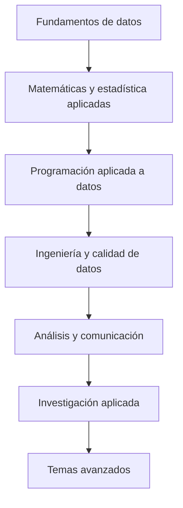

<!-- Archivo generado por scripts/build_docs.py. No lo edite a mano: modifique el código fuente y vuelva a ejecutar el script. -->

# Programa de aprendizaje

**8 clases publicadas** en 7 bloques. Cada clase
debe contener las **17 secciones** del estándar; una clase
incompleta aparece marcada y `tests/test_learning.py` falla.

## Mapa de aprendizaje



## Cobertura por bloque

| bloque | clases | cumplen_estandar | estado |
| --- | --- | --- | --- |
| Fundamentos de datos | 2 | 2 | publicado |
| Matemáticas y estadística aplicadas | 1 | 1 | publicado |
| Programación aplicada a datos | 2 | 2 | publicado |
| Ingeniería y calidad de datos | 1 | 1 | publicado |
| Análisis y comunicación | 1 | 1 | publicado |
| Investigación aplicada | 1 | 1 | publicado |
| Temas avanzados | 0 | 0 | proyectado |

## Clases

### Fundamentos de datos

Qué es un dato, un registro, una tabla, un tipo y una clave; cómo se lee y se escribe.

- [01. Datos, tablas, tipos y claves](learning/00-fundamentos/01-datos-tablas-y-tipos.md)
- [02. Calidad de datos: medir antes de limpiar](learning/00-fundamentos/02-calidad-de-datos.md)

### Matemáticas y estadística aplicadas

Aritmética de indicadores, probabilidad, estadística descriptiva e inferencia básica.

- [01. Estadística descriptiva: resumir sin engañar](learning/10-matematicas/01-estadistica-descriptiva.md)

### Programación aplicada a datos

Pandas, Polars, R y hojas de cálculo como herramientas comparables para el mismo problema.

- [01. Pandas para gestión de datos](learning/20-programacion/01-pandas-para-gestion-de-datos.md)
- [02. Excel: fórmulas verificables y tablas dinámicas](learning/20-programacion/02-excel-formulas-y-tablas-dinamicas.md)

### Ingeniería y calidad de datos

Contratos, validación, cruces, ETL, trazabilidad y gobernanza.

- [01. Cruces, contratos y SQL equivalente](learning/30-ingenieria/01-cruces-contratos-y-sql.md)

### Análisis y comunicación

Indicadores, visualización, informes y apoyo a la decisión.

- [01. Indicadores, visualización y comunicación de resultados](learning/40-analisis/01-indicadores-y-comunicacion.md)

### Investigación aplicada

Preguntas, hipótesis, diseño, sesgos, validez y reproducibilidad.

- [01. Método, preguntas, hipótesis y validez](learning/50-investigacion/01-metodo-preguntas-e-hipotesis.md)

### Temas avanzados

Series temporales, geoespacial, optimización, simulación y aprendizaje automático.

_Bloque declarado en la hoja de ruta; sin clases publicadas todavía._

## Estándar de clase

Toda clase del laboratorio contiene, como encabezados de nivel 2:

1. Objetivos
2. Prerrequisitos
3. Definiciones
4. Explicación
5. Fundamentos
6. Fórmulas
7. Variables
8. Ejemplos
9. Aplicaciones
10. Código
11. Ejercicios
12. Soluciones
13. Errores frecuentes
14. Validación
15. Evaluación
16. Referencias
17. Glosario

El validador compara sin distinguir tildes ni mayúsculas, de modo que
«Fórmulas matemáticas explicadas» y «FORMULAS» cuentan igual.

```powershell
uv run python -m lab.learning
```
